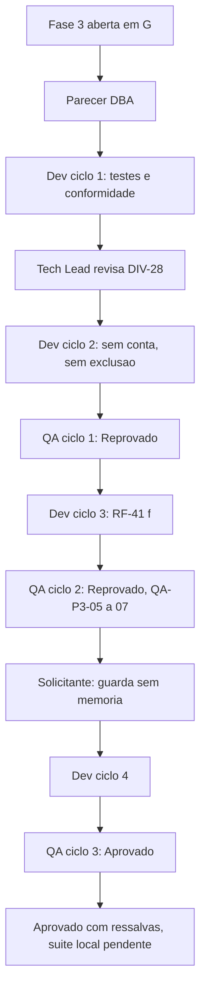

# 2026-10-19 — Fase 3: cache único, skip do upload e segredo obrigatório (porte G)

Registro estrutural. Detalhamento em [registro de entrega](../../../../docs/reviews/2026-10-18-2243-registro-cache-unico-p3.md), [revisão consolidada](../../../../docs/reviews/2026-10-18-2243-revisao-consolidada-cache-unico.md) e [aprovação final](../../../../docs/reviews/2026-10-18-2243-aprovacao-final-cache-unico.md). Instância `myPCWin/Adriano Sales Santos`; branch `feature/cache-unico-p3` sobre `develop` @ `007f3ec`.

## Contexto da mudança

A fase 3 do plano `2026-10-18-1745-melhorias-em-fases` (fonte: `docs/sources/2026-10-18-analise-melhorias.md`, P3 e P4) tratava de cache, SQL, skip do upload e PKCE. Dois caches de hash coexistiam (`lib/db` em SQLite e `lib/state` em arquivo NUL), e o upload dependia de `sqlite3`/`python3`.

## Decisão tomada

- **Cache único em `lib/state`; `lib/db` removido** ([`cache-unico-e-segredo`](../entradas/2026-10-18-2243-cache-unico-e-segredo.md)). `client_secret` obrigatório; PKCE fora (F-35); paralelismo adiado (F-34).
- **Skip do upload só com hash remoto igual** ([`skip-upload-condicionado`](../entradas/2026-10-18-1745-skip-upload-condicionado.md)); o cache só poupa o cálculo local.
- **Cache do upload sem vínculo a conta, com poda** (acima de 10 mil entradas, remover as não usadas há mais de 90 dias); identidade forte do arquivo; DIV-26 a DIV-29 ([`cache-do-upload`](../entradas/2026-10-18-2243-cache-do-upload.md)).
- **Guarda de origem vazia sem memória e `--permitir-origem-vazia`** ([`guarda-origem-vazia`](../entradas/2026-10-18-2243-guarda-origem-vazia.md)).
- **Aceite do solicitante** da suíte do QA (41 casos) e da remoção do `db_test` ([`aceite-testes-qa-p3`](../entradas/2026-10-18-2243-aceite-testes-qa-p3.md)).

## Cronologia das decisões e dos ciclos

| Quando | Evento | Resultado |
|---|---|---|
| 2026-10-18 | PR #36 mesclada (fase 2, `007f3ec`); abertura da fase 3 em G; solicitante decide cache único, segredo obrigatório, paralelismo adiado | `cache-unico-e-segredo` |
| 2026-10-18 | Parecer do DBA (Aprovado com ressalvas); solicitante emenda o RF-52 e define a poda; Tech Lead aceita as demais recomendações | `cache-do-upload` |
| 2026-10-18 | Ciclo 1 do desenvolvimento: gate de testes Aprovado; conformidade com 1 bloqueante (direção de dependência `lib/state` para `lib/walk`) corrigido antes da emissão, resultado Aprovado com ressalvas | Identidade passa a `lib/hash` |
| 2026-10-19 | Tech Lead classifica como bloqueante o risco de RF-41(b) sem conta; **DIV-28 revista**: a primeira decisão abria exclusão em massa sem conta | Ciclo 2 do desenvolvimento: exclusão desabilitada sem conta, `--confirmar` não reabilita (RF-41(e)) |
| 2026-10-19 | QA ciclo 1: **Reprovado**. QA-P3-01 (bloqueante, memória descartada), QA-P3-02 e 03 (maiores), QA-P3-04 (menor) | Ciclo 3 do desenvolvimento: RF-41(f), segredo na classe `configuracao` (3), status capturado antes de `if !`, README |
| 2026-10-19 | QA ciclo 2: **Reprovado**. QA-P3-05 e 06 (bloqueantes: a regravação após descarte e a travessia parcial deixavam base vazia; a segunda execução apagava), QA-P3-07 (maior: memória ilegível contava como ausente) | Escalonamento ao solicitante (decisão de requisito) |
| 2026-10-19 | Solicitante escolhe a **guarda sem memória**; RF-41(b) reescrito | Ciclo 4 do desenvolvimento: guarda por origem vazia, `--permitir-origem-vazia`, gravação só após travessia completa, ilegível conta como descartada |
| 2026-10-19 | QA ciclo 3: **Aprovado**, com O-1, O-6, O-7 (Info); solicitante aprova a suíte do QA (33 + 8 casos) e a remoção de 4 casos do `db_test` | `aceite-testes-qa-p3`; guarda de remoção de 772 para 833 |
| 2026-10-19 | Revisão consolidada e aprovação final do Tech Lead | Aprovado com ressalvas; suíte completa local verde em `9407c9a`: 26 arquivos, 894 aprovados, 0 reprovados, 2 pulados (vetor oficial sem rede), 142 s; `--conferir` com saida 0 |

Resultado de testes do ciclo 3 do QA: 26 arquivos, 894 aprovados, 0 falhas, 2 pulados.

## Impacto técnico e de negócio

- Um único cache sem dependência de `sqlite3`/`python3`; System Design v1.5; requisitos v1.5 (RF-60 a RF-63, RNF-33, RSK-42 a RSK-46, F-34, F-35, DP-34).
- **Nota de versão (RSK-46):** em cada par espelhado, a primeira execução após a atualização não propaga exclusões e sai com código diferente de 0, porque a memória v1 é descartada; rotinas agendadas precisam tolerar isso. Origem vazia com `--espelhar` agora exige `--permitir-origem-vazia`. O `dbx.db` legado fica intacto.

## Lições duráveis

1. **Uma guarda de segurança que depende de estado é frágil a cada falha desse estado.** A DIV-28 foi decidida e depois revista porque a primeira decisão abria a exclusão em massa sem conta; o QA-P3-01, corrigido de início por desabilitação, só adiava a exclusão (QA-P3-05 a 07). A guarda passou a olhar o que seria apagado agora, e não o histórico.
2. Quando um achado bloqueante depende de decisão de requisito, o QA o devolve ao Tech Lead antes da correção; a correção escolhida só no desenvolvimento reabriu o problema duas vezes.
3. Auditorias de composição acusaram uma dependência indevida de canal público (`DBX_AUTH_MOTIVO` lido sem limpeza) e a direção de camadas (`lib/state` para `lib/walk`); ambas foram resolvidas movendo a definição para o domínio ou para o módulo dono.

## Próximos passos (owner e prazo)

| Item | Owner | Prazo |
|---|---|---|
| O-1, O-6, O-7 e O-5 (leitura de JSON em `upload.sh`, candidata a `lib/cmd`) | Senior Developer | Próxima fase |
| RSK-43 (`stat` validado só no uutils) | QA Expert | Próxima fase |
| F-34 (paralelismo, com medição) e F-35 (PKCE) | Backlog | Sem prazo |
| F-32 (caixa fora do ASCII) | Business Analyst | Fase 5 |
| SC2034 pré-existente em `tests/unit/progress_test.sh:219` | Senior Developer | Fase 5 |
| Suíte completa local, commit e PR | Tech Lead | Feito: `9407c9a` (implementacao, com `Remocao-de-casos: tests/unit/db_test.sh 4`, aceita pela guarda) e o commit de documentacao que preenche os registros; PR #37 |

## Diagrama

