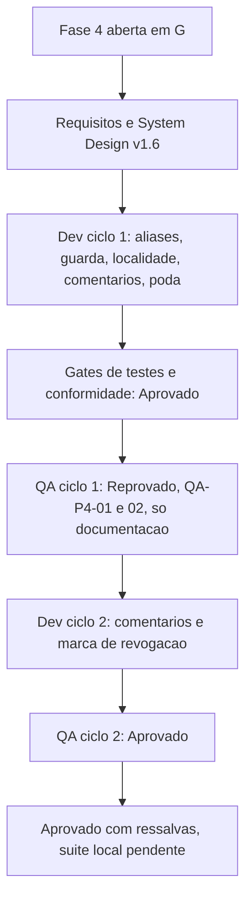

# 2026-10-19 — Fase 4: documentação, manutenção e aliases em inglês (porte G)

Registro estrutural. Detalhamento em [registro de entrega](../../../../docs/reviews/2026-10-19-0829-registro-docs-e-aliases-p4.md), [revisão consolidada](../../../../docs/reviews/2026-10-19-0829-revisao-consolidada-docs-e-aliases.md) e [aprovação final](../../../../docs/reviews/2026-10-19-0829-aprovacao-final-docs-e-aliases.md). Instância `myPCWin/Adriano Sales Santos`; branch `feature/docs-e-aliases-p4` sobre `develop` @ `6b00bcd`.

## Contexto da mudança

A fase 4 do plano `2026-10-18-1745-melhorias-em-fases` (fonte: `docs/sources/2026-10-18-analise-melhorias.md`, P5) tratava de documentação contraditória, comentários narrativos longos, peso do `.github` (9,5 MB) e ausência de aliases em inglês no `sync`. Entraram também as ressalvas das fases anteriores com prazo nesta fase: O-1, O-6, F-32 e SC2034.

## Decisão tomada

- **Aliases em inglês** (os nomes em português continuam valendo): `sync` com `--source`, `--dest`, `--push`, `--pull`, `--mirror`, `--yes`, `--allow-empty-source`; `unlink` com `--yes`, `--keep-app`; `config` com `--replace`, `--root` ([`aliases-poda-e-comentarios`](../entradas/2026-10-19-0829-aliases-poda-e-comentarios.md)).
- **Poda do pacote:** 31 skills de stacks fora do projeto removidas; o `ai_team` segue como fonte e uma sincronização futura repete a poda (regra em `SKILLS_SYNC.md`, seção "Poda deste projeto"). `.github` de 9,5 MB para 1,9 MB.
- **Comentários:** `lib/http.sh` e `lib/transfer.sh` só com o porquê atual; histórico em `docs/registros/2026-10-19-historico-comentarios-http-transfer.md`.
- **Decisões do Tech Lead:** F-32 e DIV-32 (`C.UTF-8` só dentro da comparação sem caixa); DIV-30 (guarda antiga de origem vazia sai); DIV-31 (repetir o sentido continua uso inválido); `DBX_SYNC_LOCALIDADE` como apoio de teste; opcionais do `config --debug` fora do preflight.
- **Aceite do solicitante** da suíte do QA (16 casos) e O-QA-1 aceito como risco documentado ([`aceite-testes-qa-p4`](../entradas/2026-10-19-0829-aceite-testes-qa-p4.md)).

## Cronologia das decisões e dos ciclos

| Quando | Evento | Resultado |
|---|---|---|
| 2026-10-19 | PR #37 mesclada (fase 3, `6b00bcd`); abertura da fase 4 em G; solicitante decide aliases, poda e comentários | `aliases-poda-e-comentarios` |
| 2026-10-19 | Requisitos v1.6 e System Design v1.6 (RF-64, RNF-34, DP-35; DIV-30 a 32 resolvidas) | Base dos gates |
| 2026-10-19 | Ciclo 1 do desenvolvimento: gates de testes e conformidade Aprovados, com 2 achados menores em cada parecer | `DBX_SYNC_LOCALIDADE` e opcionais do `config --debug` decididos pelo Tech Lead |
| 2026-10-19 | QA ciclo 1: **Reprovado**. QA-P4-01 (maior: `lib/config.sh` e `lib/auth.sh` diziam "única escrita persistente"), QA-P4-02 (menor: decisão v0.3 sem marca de revogação) | Funcionalidade aprovada; só RNF-34 reprovou |
| 2026-10-19 | Ciclo 2 do desenvolvimento: comentários reescritos, linha do System Design marcada como revogada | Diff sem comentários dos dois arquivos deu 0 |
| 2026-10-19 | QA ciclo 2: **Aprovado**; solicitante aprova a suíte do QA (16 casos); Tech Lead aceita O-QA-1 | `aceite-testes-qa-p4` |
| 2026-10-19 | Revisão consolidada e aprovação final do Tech Lead | Aprovado com ressalvas; suíte completa local, commit e PR: `PENDENTE` |

Resultado de testes do ciclo 2 do QA: 27 arquivos, 935 aprovados, 0 reprovados, 2 pulados. Suíte do QA: 16 casos, sha256 `adf7f5c2b33b63ce7278e0f44e458dd3fde67c7f7ec7cd67d4ea09042a373fc1`, 7 mutantes mortos.

## Impacto técnico e de negócio

- Os dois nomes de cada opção caem no mesmo ramo do `case`; prefixos, outra caixa e `--opcao=x` são recusados sem rede, como no português.
- Guarda de origem vazia pelo plano nos dois sentidos; sem `--espelhar`, origem vazia sai com 0.
- Documentação coerente com `lib/state`; README com os utilitários do preflight e os opcionais do `config --debug`.
- **Nota de versão:** sem `--espelhar`, origem vazia deixa de ser recusada; sem a localidade `C.UTF-8`, a comparação sem caixa vale no ASCII e o `sync` avisa uma vez.

## Lições duráveis

1. **A poda do pacote precisa de regra de sincronização.** Sem ela, a próxima importação do `ai_team` traria de volta as 31 skills; a regra ficou em `SKILLS_SYNC.md`.
2. **Mutante que sobrevive revela equivalência escondida.** O M5 (recusa condicionada à memória) sobreviveu enquanto o caso só cobria `--pull`, porque lá o destino povoado entra na memória durante o resumo; o QA acrescentou o trecho `--push` sem memória e o mutante morreu.
3. **A lista fechada de buscas de um requisito de documentação não pega tudo.** O QA-P4-01 passou pelas buscas do TC-DOC-01; o caput do RNF-34 (cabeçalho que afirma o contrário do código) é que o pegou. Recomenda-se acrescentar a busca "única escrita persistente".
4. **Fixar localidade só no escopo da comparação**, nunca no processo, para nenhuma contagem em bytes mudar.

## Próximos passos (owner e prazo)

| Item | Owner | Prazo |
|---|---|---|
| O-QA-2 (memória ausente sem `--confirmar` cai em RF-48 antes do plano) e O-QA-3 (`historico/` cita skills removidas) | QA Expert | Backlog |
| O-5 (leitura de JSON em `upload.sh`) e O-7 (travessia parcial) | Senior Developer | Backlog |
| RSK-43 (`stat` validado só no uutils) | QA Expert | Backlog |
| F-34 (paralelismo, com medição) e F-35 (PKCE) | Backlog | Sem prazo |
| Suíte completa local, commit e PR | Tech Lead | `PENDENTE` |

## Balanço do plano em quatro fases

Fecha o plano `2026-10-18-1745-melhorias-em-fases`; só o resultado, os detalhes estão nos registros de cada fase.

| Fase | PR | Pedido da análise externa | Entregue | Backlog |
|---|---|---|---|---|
| 1, integridade (P1) | #35 | Perda ou corrupção de dados: caixa, recebimento atômico, `umask`, `rev` no envio | Correções de integridade (porte M) | Ver o registro da fase |
| 2, rede (P2) | #36 | Timeout, `Retry-After`, tentativas, upload retomável, falhas por arquivo | Limites por ambiente, retomada, saída de falhas (porte M) | Ver o registro da fase |
| 3, cache e correção (P3 e P4) | #37 | Dois caches, SQL por interpolação, skip só local, PKCE | Cache único em `lib/state`, `lib/db` removido, skip pelo hash remoto, segredo obrigatório, guarda de origem vazia (porte G) | F-34, F-35 |
| 4, documentação e aliases (P5) | esta PR (`PENDENTE`) | Documentação contraditória, comentários longos, peso do `.github`, aliases | RNF-34, comentários enxutos, poda de 31 skills, 11 aliases, F-32, O-1, O-6, SC2034 | O-QA-2, O-QA-3, O-5, O-7, RSK-43 |

## Diagrama

