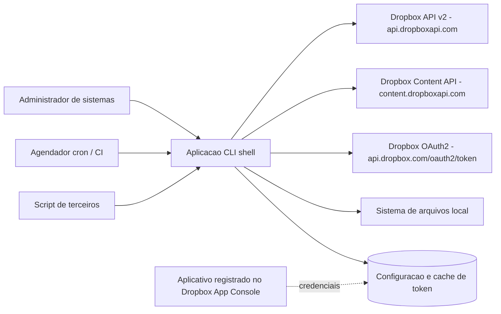

# Escopo, Requisitos e Criterios de Aceite — Aplicacao Shell de Integracao com Dropbox

| Campo | Valor |
|---|---|
| Projeto | `dropbox_api` — aplicacao CLI em shell script para integracao com Dropbox |
| Responsavel Business Analyst | Business Analyst (pacote de agents) |
| Data da versao | 2026-10-19 |
| Versao | **v1.10** |
| Status | ✅ **Escopo aprovado. Nenhuma decisao bloqueante de escopo.** 🔴 **Duas decisoes novas submetidas ao solicitante: `DP-29` (limite de `RF-31`) e `DP-30` (`RF-08`, tamanho de parte configuravel).** `RF-31` **emendado** por `DIV-18`: um de seus criterios de aceite exigia o que a plataforma nao permite cumprir |
| Documentos relacionados | [System Design](../arquitetura/system-design.md) · [Decisoes pendentes](decisoes-pendentes.md) · [Funcionalidades candidatas](funcionalidades-candidatas.md) · [Riscos e licenciamento](riscos-restricoes-e-licenciamento.md) |

> **Aviso de maturidade.** Este documento separa deliberadamente o que e **derivavel com seguranca** a partir da demanda do que **depende de decisao do solicitante**. Requisitos marcados como `Condicional` nao devem entrar em planejamento de implementacao antes da resposta a decisao pendente correspondente. Nenhum requisito foi inventado para preencher lacuna de escopo.

## Registro de versao

| Versao | Mudanca |
|---|---|
| v0.1 | Especificacao inicial |
| **v1.10** | Alinhamento com a entrega da fase 1: `RF-68(a)` (`--raiz` e remota, nao completa), `RF-66` (uma linha `dependencias` por utilitario), `RF-65` (limite aceito de pasta vazia, `TC-VER-10`; guardas do `sync`), `RF-67(i)` (`espaco_necessario`, `espaco_livre`, `espaco_verificado`), `RF-15`/`RF-44` (simulacao proibe escrita; leituras permitidas). |
| **v1.9** | **`DIV-33` a `DIV-37` fechadas (decisao do Tech Lead, 2026-10-19):** `--forcar` pula as checagens previas (`RF-67(e)`), e `RF-64(a)` ganha `--forcar`=`--force` do `sync`; `11` mantido com mensagem propria (`RF-65(e)`); escopos exigidos fixados e `scope` exposto por `lib/auth` (`RF-66(a)`); `DIV-36` encerrada; alias `completion` (`RF-68`). |
| **v1.8** | **Fase 1 do backlog (2026-10-19; memoria `2026-10-19-1050-consulta-e-diagnostico`): consulta e diagnostico.** **Criados** (secao 5.9, status **em andamento, fase 1**): `RF-65` (`dbx verificar`, `F-11`), `RF-66` (`dbx diagnostico`, `F-22`, com o preflight contornado), `RF-67` (checagem previa de espaco no `upload` e no `sync --enviar`, `F-21`) e `RF-68` (autocompletar de `bash`, `F-19`). Sem classe de erro nova (`integridade` `11` e `espaco` `12` ja existiam). Cinco divergencias (`DIV-33` a `DIV-37`) **fechadas pelo Tech Lead no mesmo dia** (v1.9: `RF-64` ganha `--forcar`=`--force` do `sync`; escopos fixados; alias `completion`). Matriz de rastreabilidade com `TC-VER`, `TC-DIA`, `TC-ESP` e `TC-CPL`. Sem mudanca de codigo nesta rodada. |
| **v1.7** | **Pendencias da fase 0 do backlog (2026-10-19).** `RF-38(b)` emendado (O-7: travessia parcial nao grava nada, nem as entradas novas; coerente com `RF-41(f)`; custo so de recalculo); `RF-48` registra a ordem das guardas (O-QA-2: memoria ausente sem `--confirmar` e recusada antes do plano, e a guarda de `RF-41(b)` vem depois). Sem mudanca de codigo. |
| **v1.6** | **Decisoes de 2026-10-19 propagadas (fase 4: aliases em ingles, guarda de origem vazia pelo plano, localidade da comparacao e coerencia da documentacao; memoria `2026-10-19-0829-aliases-poda-e-comentarios`).** **Criados:** `RF-64` (aliases em ingles de `sync`, `unlink` e `config`, 11 pares; a regra de opcao repetida, que so existia no codigo, passa a constar) e `RNF-34` (coerencia entre documentacao e codigo; lista as contradicoes remanescentes do `P5.1`). **Emendados:** `RF-41(b)` (`O-1`: no `--receber`, a recusa por origem vazia sai pelo plano com `recusada=origem vazia`; a guarda anterior, antes do plano e com mensagem de memoria, sai), `RF-54(e)(f)(g)` (`F-32`: `LC_CTYPE=C.UTF-8` fixado quando a localidade existe; sem ela, comparacao so no ASCII e aviso da verificacao previa, sem recusa), `RF-53(f)`, `RF-51(g)` e `RF-01` (remetem a `RF-64`). **Casos de teste:** `TC-ALI-01..03`, `TC-DEL-13`, `TC-CX-04`, `TC-CX-05`, `TC-DOC-01`. `DIV-30` a `DIV-32` registradas e **RESOLVIDAS no mesmo dia por decisao do Tech Lead** (secao 9). A poda das skills fora da stack e o enxugamento de comentarios nao geram requisito funcional |
| **v1.5** | **Decisoes do solicitante de 2026-10-18 propagadas (fase 3: cache unico, skip do upload e segredo; `DP-34`).** Handoff do DBA incorporado ([parecer](../reviews/2026-10-18-2243-parecer-dba-cache-unico.md), regra 26). **Criados:** `RF-60` (omissao do envio no `upload` decidida pelo `content_hash` remoto; detalha `DP-32` e fecha `RSK-37`), `RF-61` (memoria do `upload` em namespace proprio, identidade forte, sem vinculo a conta, poda), `RF-62` (chave canonica pelo caminho fisico, `upload` e raiz local do `sync`), `RF-63` (`client_secret` obrigatorio tambem na biblioteca; PKCE fora) e `RNF-33` (remocao do `lib/db`, legado `dbx.db*` intacto e documentado, `install.sh` sem `sqlite3`). **Emendados:** `RF-33` (remete o `upload` a `RF-60`), `RF-38` (cache unico; `sync` grava so entradas visitadas), `RF-42` (vale para o registro do `upload`), `RF-51` (alinea (f), diretorio de estado inteiro), `RF-52` (sem conta, o `sync` segue sem memoria; o cache do `upload` nao se vincula a conta), `RNF-02` (sem `sqlite3`/`python3`, auditoria com mutacao por `RSK-27`), `RNF-25` (diretorio `0700`, temporarios orfaos), `RNF-26` (estado autorizado: memoria do `sync`, memoria do `upload`, cursor) e `RNF-32` (alinea (d), testes diretos de `lib/state.sh` e `lib/cmd.sh`). **`DIV-25` registrada e resolvida** (o `lib/db` nunca constou do System Design nem do `RNF-26`); ~~**`DIV-26` a `DIV-29` abertas** para o Tech Lead~~ **`DIV-26` a `DIV-29` registradas e RESOLVIDAS no mesmo dia por decisao do Tech Lead** (memoria `2026-10-18-2243-cache-do-upload`): `RF-38(e)` (identidade forte no `sync`), `RF-60(i)` (`--rev` sem skip), `RF-52(a)` (falha segura documentada na ajuda e no `README`), `RNF-25(b1)` (correcao para `0700` ou recusa como `permissao`); `TC-MEM-06`, `TC-SKP-09`, `TC-CONTA-04`, `TC-EST-04`. **Revisao da `DIV-28` (Tech Lead, 2026-10-18, achado de seguranca):** `RF-41(e)` criado — sem identidade de conta a propagacao de exclusao fica desabilitada na execucao (semantica de `RF-41(a)`; `--confirmar` nao reabilita); `RF-52(a)` emendado; `TC-DEL-07` criado e `TC-CONTA-04` reescrito. **Achado bloqueante do QA `QA-P3-01` (decisao do Tech Lead, 2026-10-18):** `RF-41(f)` criado — memoria existente descartada na carga (versao `1`, truncada, corrompida) desabilita a propagacao de exclusao naquela execucao e e regravada em v2 apos travessia completa; `RF-42` emendado; `TC-DEL-08` criado; `RSK-46` (atualizacao de instalacoes v1 para v2). `RF-63(a)` e `RF-03` explicitam a classe `configuracao`, codigo `3`, para credencial sem segredo. **Decisao do solicitante apos `QA-P3-05` a `QA-P3-07` (memoria `2026-10-18-2243-guarda-origem-vazia`):** `RF-41(b)` reescrito — origem vazia com algo a apagar e sempre recusada no `--espelhar` (codigo `14`), independente da memoria, nos dois sentidos; redacao anterior registrada como superada. `RF-53(e)` cria `--permitir-origem-vazia`, unica dispensa (`--confirmar` nao basta). `RF-41(f)` mantido como defesa em profundidade, com memoria ilegivel contando como descartada e regravacao so apos travessia completa. `TC-DEL-09..11` criados; `RSK-46` atualizado. **Decisao do Tech Lead (simulacao):** com `--dry-run` e origem vazia com algo a apagar, o plano anuncia `recusaria=origem vazia`, nao lista exclusao e sai com `0` (`RF-44`); com `--permitir-origem-vazia`, lista as exclusoes → `RF-41(b)`, `TC-DEL-12` |
| **v1.4** | **Decisoes do solicitante de 2026-10-18 propagadas (fase P2, robustez de rede; `DP-33`).** `RNF-30` (timeouts), `RF-58` (retomada do upload por sessao na mesma execucao), `RF-59` (falhas por item no `sync`), `RNF-31` (limpeza da area `dbx-sync.*` em sinais) e `RNF-32` (higiene da suite: parada no primeiro erro, `TMPDIR` privado, mapa de modulos) criados. **Emendados:** `RF-09` (de "ate 3" para 5 tentativas configuraveis), `RNF-07` (recuo com base de 1 s, teto de 60 s, `Retry-After` prevalece com teto de 300 s, exigido nesta fase) e `RF-32` (alinea (b), `F-28`: `download` sem destino escreve no stdout). **`DIV-22` ENCERRADA** (criterio de `RNF-07` exigido na fase). `F-24`, `F-28`, `F-30`, `F-31` e `F-33` marcados "em andamento na fase 2". `F-03` permanece fora de escopo: `RF-58` nao persiste estado |
| **v1.3** | **Decisoes do solicitante de 2026-10-18 propagadas (fase P1 da analise de melhorias, `docs/sources/2026-10-18-analise-melhorias.md`).** `RF-54` a `RF-57` e `RNF-29` criados com criterios de aceite verificaveis (caixa de caminho no `sync`, recebimento atomico com `content_hash`, `download` que nunca apaga arquivo regular, `sync --enviar` por sessao com `client_modified`, `umask` e area temporaria HTTP). `DP-31` e `DP-32` registradas. **Resolvidas em 2026-10-18 por decisao do solicitante:** `DIV-23` (`RF-49` MANTIDO; `RF-57(c)` emendado; `RF-49` reescrito sem "conflito novo"; `TC-REV-01..02` exigidos na P1) e `DIV-24` (`RNF-04` emendado). Permanece aberta `DIV-22` (`RNF-07` x `Retry-After`, fase P2) |
| **v1.2** | **Divergencias devolvidas pela implementacao de `RF-31`/`RF-08`/`RF-09` (2026-08-19).** 🔴 **`RF-31` EMENDADO (`DIV-18`)**: o criterio "dado que a origem do fluxo falhe no meio..." era **impossivel de cumprir** como estava escrito, porque tratava como um caso unico duas situacoes de verificabilidade oposta. Agora separa **(a) falha de leitura** — exigida, verificavel, cumprida — de **(b) produtor de cano anonimo que morre no meio** — **nao exigida, por impossibilidade da plataforma**, com a medicao registrada. Sem afrouxamento silencioso e sem apagar a redacao anterior. **`RF-08`: lacuna declarada (`DIV-19`)** — parte fixa em 4.194.304 bytes, com a razao tecnica (parte de rede e bloco de resumo sao hoje a mesma grandeza) e o trabalho futuro que a fecha. **Matriz corrigida (`DIV-20`)**: `lib/stream` era componente **planejado que nao se materializou**; `RF-31` roda em `lib/transfer` + `lib/hash`. **`RES-05` revalidada e CONFIRMADA** contra `files.stone` do ramo `main`; **`RES-18` criada** (sessao de envio vale 7 dias). **`DIV-21`**: o ramo `master` do repositorio de especificacao esta **desatualizado** — diz 48 horas e nao tem `session_type`. **`RSK-36` criado.** Decisoes submetidas ao solicitante: **`DP-29`** e **`DP-30`**. ⚠️ **Lacuna de registro anotada e NAO reconstruida:** este registro de versao nao recebeu linhas para **v0.8 a v1.1**, embora o conteudo correspondente esteja presente no documento (secao 5.8, `RF-37` a `RF-53`, `DP-27`/`DP-28`, `RNF-25` a `RNF-28`). Reconstrui-las exigiria afirmar o que cada versao mudou **sem evidencia**, o que este projeto nao faz; o salto de v0.7 para v1.2 e deliberado e alinha a numeracao a do System Design |
| v0.2 | DP-01 resolvida (reimplementacao independente); DP-03 resolvida (uso interativo **e** automatizado), promovendo RF-15 e RF-28 a P0 e reforcando RNF-19; DP-04 resolvida (conta pessoal com acesso a Dropbox inteira), movendo RF-06 para fora de escopo e criando RNF-20; contratos da Dropbox API revalidados via Context7, corrigindo unidades, o requisito de multiplo de 4 MiB, a paginacao de busca e as afirmacoes sobre endpoints depreciados; DIV-10 removida por erro factual; DIV-11 a DIV-14 acrescentadas |
| **v0.7** | **`RNF-24` criado (`E3-01`, contexto nomeado)** com a restricao verificavel de nome sempre interno; `RSK-27` (auditoria estatica que so pega a forma obvia) e `RSK-28` (instrumento de observacao interfere na propriedade observada) registrados; secao de vocabulario "separar dado de canal" no System Design. Duas correcoes de registro anterior incorporadas em `DIV-17`. Ciclo 2 de QA aprovado com ressalva |
| **v0.6** | **`DP-05` resolvida** — uma conta so, sem nocao de perfil: `RF-05` e `F-18` saem para o backlog como incremento **aditivo**, e o desenho de `lib/config` fica fechado (um arquivo, um caminho, sem multiplexacao). **`RNF-23` criado** a partir de medicao real: teto de entrada de 256 KiB em `lib/json` torna **obrigatorio o `limit`/`max_results` explicito** em toda chamada de colecao — `RF-16` e `RF-22` emendados. **`RSK-24` encerrado** com aceite reconfirmado, agora fundamentado apenas nos dois argumentos tecnicos validos |
| **v0.5** | **Correcao de registro e tres decisoes novas.** `DP-07` e `DP-08` **ja estavam decididas** pelo solicitante ("so cURL, `bash` 4+, Linux") e nunca haviam sido propagadas: `RNF-01` **descongelado** com piso `bash` **4.4**, `RNF-02` fixado sem `jq`, `RNF-11` elevado a criticidade maxima, `DIV-15` **retirada** e `RSK-25` **encerrado**. `DP-11` resolvida — credencial `0600` sob XDG, sem sobrescrita por ambiente (`RNF-04`). `DIV-16b` resolvida — `--null` com terminador nulo, destravando `lib/output` (`RF-28`, `RNF-22` ampliado aos dois modos). `DP-19` encerrada com desvios consumados registrados. `RES-15` a `RES-17` criadas. Novo risco `RSK-26` (falha de propagacao de decisao) e `RSK-24` reaberto para reavaliacao |
| **v0.4** | **Correcoes devolvidas pelo ciclo de QA da camada de dominio (aprovado com ressalva).** `RNF-20` ampliado para os **dois espacos de nomes**, remoto e local, com resolucao fisica de symlinks, oito vetores de ataque cobertos, raiz `/` sob opt-in e TOCTOU aceito como risco residual (`RSK-24`); `RNF-07` ajustado para a dimensao de idempotencia em `5xx` e `http=0`; `RNF-10` emendado para exigir quebra de linha no conjunto de teste; **`RNF-22` criado** (restricao de entrada de `lib/output` decorrente da redacao de cabecalho sensivel); `RF-31` corrigido quanto ao transito por `$TMPDIR` em blocos; `RF-35` fixa a faixa de codigos de saida em 0..15 e registra a rejeicao do codigo 16; **`RNF-01` congelado** e `DIV-15` aberta por antecipacao de decisao do solicitante; `DIV-16` reclassificada |
| **v0.3** | **DP-02 resolvida — escopo do MVP aprovado.** Secao 5.5 criada com RF-31 a RF-36, formalizando F-01, F-02, F-04 e F-05; secao 5.6 formaliza o Bloco 0 como requisito de base; F-03 e os Blocos 2 e 3 registrados como fora de escopo, o que mantem o MVP **sem estado local persistente** e nao aciona o handoff do DBA; **algoritmo do `content_hash` confirmado**, desbloqueando `lib/hash` e RF-33/RF-34; DIV-14 reduzida a uma pendencia residual; matriz de rastreabilidade estendida |

> ✅ **Escopo do MVP aprovado (`PRJ-DEC-04`).** Bloco 0 integral + F-01 (fluxo `stdin`/`stdout`) + F-02 (incremental por `content_hash`) + F-04 (contrato de automacao) + F-05 (relatorio de execucao). Formalizados nas secoes 5.5 e 5.6. Fundamentacao e backlog em [funcionalidades-candidatas.md](funcionalidades-candidatas.md).
>
> ⚠️ **O MVP nao introduz estado local persistente.** F-03, F-06, F-12 e F-14 — as unicas candidatas que o exigiriam — ficaram fora do escopo. `DP-09` permanece fechada e o handoff do DBA **nao** e acionado nesta versao. Reintroduzir persistencia constitui mudanca de escopo.

---

## 1. Especificacao de caso de uso

### 1.1 Problema de negocio

Operacoes de transferencia e gestao de arquivos no Dropbox precisam ser executadas a partir de ambientes onde **nao ha cliente grafico de sincronizacao nem runtime de aplicacao instalado** — servidores headless, containers, dispositivos embarcados, jobs de backup e pipelines de automacao. Nesses ambientes, o denominador comum disponivel e um shell POSIX e o `cURL`.

A demanda solicita uma aplicacao em shell script que exponha as capacidades da Dropbox API v2 como comandos de linha de comando, tomando como modelo o projeto `Dropbox-Uploader`.

> **Justificativa do investimento (DP-02, parcialmente resolvida).** O solicitante confirmou que a demanda se justifica por **funcionalidades que o `Dropbox-Uploader` nao possui**. O projeto, portanto, **nao** e uma reimplementacao equivalente: e uma ferramenta com escopo funcional maior. O risco de "clone sem valor incremental" esta encerrado.
>
> Permanece em aberto **quais** funcionalidades. A proposta de 22 candidatas, com valor, esforco e dependencias, esta em [funcionalidades-candidatas.md](funcionalidades-candidatas.md), aguardando confirmacao, corte ou acrescimo. Enquanto isso nao for respondido, o MVP nao e definivel.

### 1.2 Usuarios primarios

| Persona | Contexto de uso | Necessidade dominante |
|---|---|---|
| Administrador de sistemas | Servidor Linux headless, sessao SSH | Transferir arquivos sob demanda sem instalar runtime adicional |
| Engenheiro de automacao | `cron`, `systemd timer`, pipeline de CI | Execucao nao assistida, previsivel, com codigo de saida confiavel e sem prompt interativo |
| Operador de rotina de backup | Job agendado noturno | Envio recorrente de artefatos volumosos com retomada e verificacao de integridade |
| Desenvolvedor integrador | Estacao de trabalho | Consultar, publicar e compartilhar arquivos a partir de scripts proprios |

> Personas derivadas do contexto tecnico da demanda e dos ambientes testados declarados pelo projeto de referencia. **Requerem confirmacao do solicitante** (DP-03).

### 1.3 Criterios de sucesso mensuraveis

| ID | Criterio de sucesso | Metrica | Meta proposta |
|---|---|---|---|
| CS-01 | Instalacao e primeiro uso sem dependencia alem de shell e `cURL` | Numero de pacotes adicionais exigidos em instalacao minima de distribuicao suportada | 0 (ou 1, se `jq` for aprovado em DP-08) |
| CS-02 | Execucao nao assistida confiavel | Taxa de sucesso de execucoes agendadas em 30 dias, sem intervencao humana | >= 99% |
| CS-03 | Diagnostico de falha sem inspecao de codigo | Percentual de falhas em que a mensagem de erro identifica causa e acao corretiva | 100% dos codigos de erro mapeados |
| CS-04 | Nao exposicao de segredos | Ocorrencias de credencial em `argv`, log, variavel exportada ou arquivo com permissao ampla | 0 |
| CS-05 | Aderencia a contratos vigentes da Dropbox API v2 | Endpoints depreciados ou retirados em uso | 0 |
| CS-06 | Verificabilidade | Percentual de requisitos com criterio de aceite automatizavel | 100% |

---

## 2. Fronteiras de escopo

### 2.1 Dentro do escopo (derivavel com seguranca)

- Aplicacao de linha de comando escrita em shell script.
- Autenticacao OAuth2 contra a Dropbox API v2 com refresh token e access token de curta duracao.
- Operacoes de arquivos e pastas: envio, recebimento, listagem, metadados, criacao de pasta, mover, copiar, excluir.
- Consulta de informacoes de conta e uso de espaco.
- Tratamento de erro, retentativa e codigos de saida adequados a automacao.
- Documentacao de uso e de implantacao.

### 2.2 Fora do escopo (nesta versao)

- Interface grafica, web ou TUI.
- Sincronizacao **bidirecional** — o `sync` e direcional por `DP-27`, com a origem como autoridade. Sincronizacao continua, tambem fora.
- Daemon residente em memoria.
- Servidor de callback OAuth em `localhost` (o fluxo previsto e por codigo de autorizacao colado manualmente).
- Suporte a provedores de armazenamento alem do Dropbox.
- Criptografia de conteudo do lado do cliente antes do envio. A composicao com ferramentas externas por fluxo continua possivel.
- **Dropbox Business e Team em qualquer forma** — administracao de equipe, impersonacao de membro, espaco de equipe e manipulacao de namespace por `Dropbox-API-Path-Root`. **Definitivo por DP-04**, que fixou conta pessoal.

### 2.3 Escopo condicional

| Capacidade | Depende de |
|---|---|
| Funcionalidades novas propostas (F-01 a F-22) | **DP-02** — bloqueante |
| Perfis e multiplas contas | DP-05 |
| Shell interativo equivalente ao `dropShell.sh` | DP-13 |
| Sincronizacao unidirecional com espelhamento e exclusao remota | DP-09, acoplada a DP-02 |
| Monitoramento de mudancas via longpoll | DP-16 |
| Empacotamento em container e distribuicao | DP-14 |

### 2.3.1 Escopo desbloqueado na v0.2

| Item | Situacao anterior | Situacao atual |
|---|---|---|
| Regime de licenciamento | Bloqueava o inicio do trabalho | **Resolvido.** Reimplementacao independente; sem obrigacao copyleft. Licenca especifica pendente em DP-20 |
| Modo de uso | Indefinido entre interativo e automatizado | **Resolvido.** Ambos. RF-15 e RF-28 promovidos a P0; RNF-19 reforcado |
| Tipo de conta e escopo de acesso | Indefinido | **Resolvido.** Conta pessoal com acesso a Dropbox inteira. RF-06 movido para fora de escopo; RNF-20 criado |

### 2.4 Atores e sistemas externos

---

## 3. Premissas

| ID | Premissa | Consequencia se falsa |
|---|---|---|
| PRE-01 | O solicitante possui ou pode criar um aplicativo no Dropbox App Console com acesso `Scoped Access` | Sem app key/secret nao ha autenticacao possivel; o projeto nao inicia |
| PRE-02 | O ambiente de execucao tem `cURL` com suporte a TLS e cadeia de certificados valida | Toda a integracao falha |
| PRE-03 | O ambiente de execucao dispone de sistema de arquivos gravavel para configuracao e area temporaria | Upload em partes e cache de token ficam inviaveis |
| PRE-04 | A conta Dropbox alvo tem espaco e cota de API compativeis com o volume pretendido | Falhas por `insufficient_space` e HTTP 429 |
| PRE-05 | Nao ha requisito de persistencia em banco de dados | Handoff do DBA passa a ser obrigatorio e o System Design precisa de revisao |
| PRE-06 | Nao ha interface grafica; portanto nao ha Design System aplicavel | A secao obrigatoria de Design System do System Design precisa de handoff do UX Expert |
| PRE-07 | O conteudo transferido nao contem dado pessoal sensivel sujeito a controle regulatorio adicional | Exige requisitos de LGPD, criptografia em repouso e trilha de auditoria (ver DP-10) |

---

## 4. Restricoes

| ID | Restricao | Origem |
|---|---|---|
| RES-01 | A implementacao deve ser em shell script | Imposicao explicita do solicitante |
| RES-02 | **Nao derivar codigo do projeto de referencia.** Por decisao registrada em DP-01, o `Dropbox-Uploader` e referencia conceitual apenas; nenhum trecho de codigo, estrutura interna de funcoes, nome interno de variavel ou texto literal de mensagem pode ser copiado ou adaptado | Decisao do solicitante. Afasta o copyleft GPLv3. Ver [riscos](riscos-restricoes-e-licenciamento.md) |
| RES-03 | O contrato de integracao e definido pela Dropbox e nao e negociavel | Dropbox API v2 |
| RES-04 | Access token de curta duracao; acesso nao assistido exige refresh token obtido com `token_access_type=offline` na URL de autorizacao. A resposta do endpoint de token informa a validade em `expires_in` (exemplo documentado: `14400`, equivalente a 4 horas) | Documentacao Dropbox, revalidada via Context7 |
| RES-05 | `POST /2/files/upload` nao deve ser usado para arquivos maiores que **150 MiB**; acima disso e obrigatorio o fluxo de `upload_session`. Cada requisicao isolada de `append_v2` e de `finish` tambem esta limitada a 150 MiB. O tamanho maximo por sessao e de 2^41 − 2^22 bytes | Documentacao Dropbox, revalidada via Context7. ✅ **REVALIDADA em 2026-08-19 contra fonte primaria distinta e CONFIRMADA nas duas afirmacoes:** `dropbox/dropbox-api-spec`, arquivo `files.stone`, **ramo `main`** — `payload_too_large` documentado como *"The request payload must be at most 150 MiB"*, e o teto por sessao como *"2^41 - 2^22 (2,199,019,061,248) bytes"*. ⚠️ **Qualificacao obrigatoria:** contrato **documentado e lido**, **nao exercitado** contra o servico real. Ver `DIV-21` quanto ao ramo do repositorio de especificacao |
| RES-06 | O endpoint vigente de busca e `/2/files/search_v2`, paginado por `/2/files/search/continue_v2`, com teto de **10.000 correspondencias**. A documentacao atual **nao apresenta mais** o endpoint `/2/files/search` sem sufixo | Documentacao Dropbox, revalidada via Context7. O projeto de referencia ainda aponta para o endpoint sem sufixo |
| RES-07 | As operacoes vigentes sao `copy_v2`, `move_v2`, `delete_v2` e `create_folder_v2`, todas retornando envelope com campo `metadata`. A documentacao atual **nao apresenta mais** as variantes sem sufixo | Documentacao Dropbox, revalidada via Context7 |
| RES-08 | Shell nao oferece parser JSON nativo. **Decidido em DP-08: interpretador proprio em shell, sem `jq`.** A unica dependencia externa e `cURL` | Limitacao da linguagem imposta em RES-01; decisao do solicitante |
| RES-15 | **Plataforma Linux e `bash` 4.4 ou superior.** macOS, *BSD, BusyBox `ash` e `sh` POSIX estao fora de escopo; RHEL 6 (`bash` 4.1) fica fora | Decisao do solicitante em DP-07, com o piso refinado tecnicamente |
| RES-16 | **Credencial exclusivamente em arquivo `0600` sob convencao XDG**, sem sobrescrita por variavel de ambiente | Decisao do solicitante em DP-11 |
| RES-17 | ✅ **Resolvido.** O repositorio esta publicado em `github.com:salesadriano/dropbox_sync` sob **licenca MIT**, titular **`Adriano Sales Santos`**, verificado por leitura direta do `LICENSE`. O placeholder que existiu no historico publico e situacao consumada e **inocua** — o commit de correcao e posterior e o estado corrente esta correto | `DP-20` resolvida; `DIV-E` encerrada |
| RES-09 | O projeto alvo nao e repositorio git e nao possui stack instalada | Estado observado em `/home/sales/dropbox_api` |
| RES-10 | Em sessao de envio do tipo **concorrente**, o deslocamento e o tamanho de cada parte **devem** ser multiplos de 4.194.304 bytes (2^22). Em sessao **sequencial** nao ha essa exigencia | Documentacao Dropbox, revalidada via Context7. **Corrige a v0.1**, que tratava o multiplo de 4 MiB como recomendacao geral |
| **RES-18** | **A sessao de envio (`upload_session`) vale no maximo 7 dias.** Passado esse prazo, o `session_id` deixa de ser aceito e o servico responde `not_found` | **Nova na v1.2.** `dropbox/dropbox-api-spec`, `files.stone`, **ramo `main`** — contrato **documentado e lido, nao exercitado** contra o servico real. **Classificada como restricao, e nao como requisito novo. Criterio adotado:** e enunciado do contrato externo, que a aplicacao nao pode alterar, e que **hoje nao gera nenhum comportamento novo exigivel** — o MVP nao tem retomada de sessao entre execucoes (`F-03` esta fora de escopo), de modo que nenhuma sessao sobrevive ao processo que a criou e o prazo de 7 dias e inalcancavel na pratica. **Torna-se vinculante e exige requisito proprio se `F-03` for promovida**, quando sera preciso decidir o que fazer com sessao expirada (reiniciar do zero, recusar, ou reconciliar). ⚠️ Ver `DIV-21`: o ramo `master` do mesmo repositorio diz **48 horas**, e esta desatualizado |
| RES-11 | Chamadas simultaneas de `list_folder` ou `list_folder/continue` para o mesmo usuario pelo mesmo aplicativo produzem erro de limite de taxa; a orientacao e aguardar as requisicoes pendentes antes de iniciar nova chamada | Documentacao Dropbox, revalidada via Context7. Restringe diretamente qualquer estrategia de paralelismo (F-09) |
| RES-12 | A revogacao de token desabilita tambem o refresh token correspondente e todos os demais access tokens derivados dele | Documentacao Dropbox, revalidada via Context7 |
| RES-13 | O acesso concedido ao aplicativo e amplo (`Full Dropbox`), por decisao registrada em DP-04. A limitacao de alcance passa a depender de escopos OAuth minimos e de controles da propria aplicacao | Decisao do solicitante |
| RES-14 | A busca pode retornar resultados duplicados entre paginas ou omitir resultados, por atraso de indexacao. A deduplicacao e responsabilidade do cliente | Documentacao Dropbox, revalidada via Context7 |

---

## 5. Requisitos funcionais

Legenda de prioridade: **P0** essencial ao MVP · **P1** importante · **P2** desejavel.
Legenda de status: **Derivavel** = seguro a partir da demanda · **Condicional** = depende de decisao pendente.

### 5.1 Autenticacao e configuracao

| ID | Requisito | Prior. | Status | Criterio de aceite |
|---|---|---|---|---|
| RF-01 | Assistente de configuracao inicial que orienta o registro do aplicativo, coleta app key, app secret e codigo de autorizacao, troca o codigo por refresh token e persiste a configuracao | P0 | Derivavel | Dado ambiente sem configuracao previa, quando o comando de configuracao e executado e os dados validos sao informados, entao o arquivo de configuracao e criado com permissao `0600`, contendo refresh token, e um comando subsequente de leitura (`info`) retorna codigo de saida `0`. *(v1.6, `RF-64`)* As opcoes `--substituir` e `--raiz` do `config` tem os aliases `--replace` e `--root`, com o mesmo efeito e as mesmas recusas (`TC-ALI-03`) |
| RF-02 | Obtencao automatica de access token de curta duracao a partir do refresh token, com cache em memoria durante a execucao e renovacao antes da expiracao | P0 | Derivavel | Dado refresh token valido, quando qualquer comando autenticado e executado, entao ocorre no maximo uma chamada a `oauth2/token` por execucao e o comando conclui com sucesso; dado access token expirado durante a execucao, quando a API responde `401`, entao o token e renovado uma vez e a operacao e repetida com sucesso |
| RF-03 | Validacao da configuracao com mensagem acionavel quando ausente, incompleta ou em formato legado | P0 | Derivavel | Dado arquivo de configuracao ausente ou sem refresh token, quando um comando autenticado e executado, entao a saida indica a causa e o comando corretivo, e o codigo de saida e `3` (erro de configuracao). *(v1.5)* Credencial sem app secret conta como incompleta: classe `configuracao`, codigo `3` (`RF-63(a)`) |
| RF-04 | Desvinculo (`unlink`) que revoga o token junto a Dropbox e remove as credenciais locais | P1 | Derivavel | Dado configuracao valida, quando o desvinculo e executado, entao `POST /2/auth/token/revoke` retorna sucesso, o arquivo de configuracao e removido ou invalidado, e um comando autenticado subsequente falha com codigo `3` |
| ~~RF-05~~ | ~~Suporte a multiplos perfis de credencial na mesma instalacao~~ | — | ❌ **Fora de escopo desta versao (DP-05)** | Removido na v0.6. O solicitante fixou **uma conta so, sem nocao de perfil**: um unico arquivo de credencial, sem `--profile`, sem arquivo por perfil, sem selecao por ambiente. **Justificativa:** acrescentar perfis depois e mudanca **aditiva** — um sinalizador e um caminho alternativo — que nao quebra o contrato publico congelado por RF-35. Custo de adiar baixo; custo de antecipar real (multiplexacao em `lib/config`, mais estados, mais superficie de teste). Mantido no backlog junto com F-18 |
| ~~RF-06~~ | ~~Suporte a contas Dropbox Business/Team, com selecao de namespace e execucao em nome de membro~~ | — | ❌ **Fora de escopo (DP-04)** | Removido na v0.2. O solicitante fixou conta pessoal. Nao havera uso de `Dropbox-API-Path-Root`, de selecao de membro nem de endpoints de equipe |
| RF-06a | Revogacao consciente: a operacao de desvinculo deve advertir que a revogacao invalida tambem o refresh token e todos os access tokens derivados | P1 | Derivavel | Dado modo interativo, quando o desvinculo e solicitado, entao a advertencia e exibida e a confirmacao e exigida; dado modo automatizado, entao a operacao so prossegue com sinalizador explicito de confirmacao (RES-12) |
| RF-63 | **`client_secret` obrigatorio tambem na biblioteca; PKCE nao implementado** (`DP-34`; `F-25`; alternativa futura em `F-35`) | P0 | Derivavel | O `config` ja exige o segredo (`RF-01`); a biblioteca passa a exigir tambem. **(a)** **Dada** credencial carregada **sem** app secret, **quando** `lib/auth` renova o access token **ou** troca o codigo de autorizacao, **entao** a operacao e recusada **antes de qualquer chamada de rede**, como credencial incompleta: **classe `configuracao`, codigo de saida `3`** (`RF-03`; *corrigido na v1.5 por decisao do Tech Lead — a redacao anterior, "mesma classe e codigo de saida de `RF-03`", deixava ambiguo o codigo esperado*), com mensagem que nomeia a falta do segredo sem exibir valor algum. **(b)** **Dada** auditoria estatica, **entao** nenhum caminho de codigo monta requisicao a `oauth2/token` sem `client_secret`; por `RSK-27`, a auditoria vem com mutacao que reintroduz o ramo "sem segredo" em forma nao obvia e reprova a suite. **(c)** PKCE (`code_challenge`/`code_verifier`) **nao** e implementado e **nao** consta do System Design como disponivel. **(d)** `RNF-03` mantido: o segredo segue so no corpo, nunca em `argv` nem em log. **Verificacao:** `TC-SCR-01..03` |

### 5.2 Transferencia de arquivos

| ID | Requisito | Prior. | Status | Criterio de aceite |
|---|---|---|---|---|
| RF-07 | Envio de arquivo local para caminho remoto usando requisicao unica quando o arquivo nao ultrapassar 150 MiB | P0 | Derivavel | Dado arquivo local de 1 MiB, quando o envio e executado, entao o arquivo existe no destino remoto com tamanho identico, o `content_hash` retornado corresponde ao calculado localmente e o codigo de saida e `0` |
| RF-08 | Envio em partes (`upload_session/start`, `append_v2`, `finish`) para arquivos acima de 150 MiB, com tamanho de parte configuravel e nunca superior a 150 MiB por requisicao | P0 | Derivavel | Dado arquivo de 200 MiB, quando o envio e executado, entao sao emitidas as chamadas de sessao na ordem correta, nenhuma requisicao isolada excede 150 MiB, o arquivo remoto tem o tamanho original e o `content_hash` confere. Dado que a sessao seja do tipo concorrente, entao o deslocamento e o tamanho de cada parte sao multiplos de 4.194.304 bytes (RES-10). **⚠️ Lacuna declarada na v1.2 (`DIV-19`): a clausula "tamanho de parte configuravel" NAO foi entregue.** A entrega de 2026-08-19 fixou a parte em **4.194.304 bytes** e usa **sessao sequencial**. **Razao tecnica, declarada pela implementacao e nao descoberta depois:** nesta implementacao a **parte de rede** e a **mesma grandeza** que o **bloco do `content_hash`**; uma parte de tamanho diferente do bloco faria a cadeia de resumos ser montada sobre fatias que **nao sao blocos**, produzindo um `content_hash` **bem formado e errado** — divergencia que so apareceria na comparacao com o servico. Enquanto parte e bloco forem a mesma grandeza, o teto de ocupacao de **um bloco** exigido por `RF-31` e **consequencia estrutural**, e nao promessa a vigiar. **Trabalho que fecharia a lacuna:** separar `parte de rede` de `bloco de resumo`, permitindo parte **multipla** do bloco, e so entao expor o valor. **Se "configuravel" continua sendo requisito e decisao do solicitante — `DP-30`, nao decidida aqui.** Os demais criterios desta linha permanecem exigidos e verificados |
| RF-09 | Retentativa por parte em falha transitoria durante o envio em partes, sem reiniciar o arquivo inteiro | P0 | Derivavel | Dada falha transitoria simulada em uma parte, quando o envio prossegue, entao apenas a parte afetada e reenviada e o resultado final e integro. **Emendado na v1.4 (`DP-33`, decisao de 2026-10-18):** o limite e de **5 tentativas por parte** (a primeira inclusa), **configuravel** por `DBX_HTTP_TENTATIVAS_MAXIMAS` conforme `RNF-07`; dado que a parte falhe nas 5 tentativas, entao o envio aborta sem `finish`, sem publicar nada no destino e com codigo de saida de operacao nao concluida. ~~Redacao anterior: "ate 3 tentativas"~~, superada |
| RF-10 | Politica explicita de colisao no destino: sobrescrever, ignorar existente ou renomear automaticamente | P0 | Derivavel | Dado arquivo ja existente no destino, quando o envio e executado com cada politica, entao o resultado corresponde a politica escolhida e e reportado na saida |
| RF-11 | Recebimento de arquivo remoto para caminho local, com verificacao de integridade | P0 | Derivavel | Dado arquivo remoto conhecido, quando o recebimento e executado, entao o arquivo local tem o mesmo tamanho e o `content_hash` calculado localmente corresponde ao valor retornado pela API |
| RF-12 | Envio recursivo de diretorio, preservando a hierarquia, com padroes de exclusao | P1 | Derivavel | Dada arvore local com 3 niveis e um padrao de exclusao, quando o envio recursivo e executado, entao a hierarquia e replicada no destino, os itens excluidos nao sao enviados e a contagem de itens enviados e reportada |
| RF-13 | Recebimento recursivo de pasta remota, preservando a hierarquia | P1 | Derivavel | Dada pasta remota com subpastas, quando o recebimento recursivo e executado, entao a arvore local reproduz a estrutura remota e todos os arquivos passam na verificacao de integridade |
| RF-14 | Envio direto de conteudo a partir de URL (`save_url`), sem transito pelo disco local, com acompanhamento do job assincrono | P2 | **Condicional (DP-06)** | Dada URL publica valida, quando o comando e executado, entao o job e iniciado, o estado e consultado ate a conclusao e o arquivo aparece no destino remoto |
| RF-15 | Modo de simulacao (`dry-run`) que descreve as operacoes sem executar escrita remota ou local | **P0** *(promovido por DP-03)* | Derivavel | Dado qualquer comando de escrita executado em modo de simulacao, quando concluido, entao nenhuma chamada de escrita e emitida a API, o plano de acao e impresso e o codigo de saida e `0`. **A proibicao e de ESCRITA** *(v1.10)*: leituras (renovacao do token, listagem, consulta de espaco de `RF-67(f)`) sao permitidas, e a falha delas apenas avisa |
| RF-54 | **Comparacao de caminhos do `sync` sem diferenciar caixa, e recusa de colisao de caixa local** (`DP-31`, item 1) | **P0** | Derivavel | O Dropbox nao diferencia caixa; o `sync` tambem nao. **(a)** Dados `Docs/Foto.JPG` local e `docs/foto.jpg` remoto, quando o plano e calculado, entao ha **um** caminho (mesmo arquivo): a decisao e por `content_hash` (`RF-39`) e o plano nao contem o par "transferir + apagar" para ele. **(b)** Dado `--enviar --espelhar` com esse par e conteudo diferente, entao o arquivo e enviado e **nenhuma exclusao remota o atinge**. **(c)** Dada arvore local com `a.txt` e `A.txt` na mesma raiz, quando o `sync` e invocado (inclusive em simulacao), entao e **recusado antes de qualquer escrita local ou remota**, com mensagem que nomeia os dois caminhos e codigo de saida diferente de `0`. **(d)** A chave de comparacao e o caminho em minusculas (`path_lower` no remoto); a grafia original e preservada para exibicao e para a escrita. **(e) Localidade da comparacao** *(v1.6, `F-32`; decisao do Tech Lead de 2026-10-19)*: para a comparacao valer **fora do ASCII**, o `dbx` **fixa a classificacao de caracteres em `C.UTF-8`** (`LC_CTYPE=C.UTF-8`) **somente dentro da comparacao sem caixa** (a funcao que produz a chave), **nunca no processo**, **quando essa localidade existe no sistema** (decisao do Tech Lead de 2026-10-19, fecha `DIV-32`). **Dados** `Éa.txt` local e `éa.txt` remoto (ou `É` e `é` em qualquer posicao), **com** a localidade disponivel, **entao** a chave e a mesma, ha **um** caminho, e valem (a) a (c) para eles — inclusive quando o ambiente do operador traz `LC_ALL=C` ou `LANG=C`, que **nao** pode anular a fixacao dentro da comparacao (a fixacao local vale sobre `LC_ALL`). Fora da comparacao o ambiente de localidade do processo fica **intacto**: a fixacao **nao** vaza para o restante da execucao, **nao** altera as demais categorias (`LC_COLLATE`, `LC_MESSAGES`, `LC_NUMERIC`) e **nenhuma contagem em bytes pode mudar** (tamanhos, limites, deslocamentos, `lib/json`, `lib/hash`), o que se demonstra por caso de teste com nomes multibyte, com o processo sob `LC_ALL=C` e sob UTF-8. **(f) Localidade ausente** *(v1.6, `F-32`)*: **dada** localidade `C.UTF-8` inexistente no sistema, **entao** a comparacao sem caixa vale **so no ASCII** (`É` e `é` sao chaves distintas, e `A.txt`/`a.txt` seguem tratados por (a) a (c)), e a **verificacao previa emite um aviso** em stderr, **uma vez por execucao do `sync`**, que nomeia a causa (localidade `C.UTF-8` ausente) e o efeito (comparacao sem caixa so no ASCII). O aviso **nao recusa**: o codigo de saida e o conteudo da saida padrao sao os mesmos de uma execucao sem aviso, e o aviso nao leva segredo (`RNF-03`). **(g) Escopo do aviso** *(decisao do Tech Lead de 2026-10-19)*: o aviso e emitido **so pelo `sync`**, unico comando que compara caminhos sem caixa; os demais comandos nao o emitem, mesmo sem a localidade. **Verificacao:** mutacao que volte a usar `path_display` como chave reprova (a) e (b); `TC-CX-04` (localidade presente, inclusive sob `LC_ALL=C` no ambiente: par `É`/`é` e um caminho, sem transferir+apagar, e `--espelhar` nao apaga o recem-enviado; mutacao que remova a fixacao reprova) e `TC-CX-05` (localidade ausente, simulada **sem depender da maquina do teste**: aviso emitido em stderr, par `É`/`é` tratado como distinto, codigo de saida inalterado) |
| RF-55 | **Recebimento atomico com verificacao previa de `content_hash`** (`download` e `sync --receber`) (`DP-31`, item 3) | **P0** | Derivavel | Estende `RF-11` e `RF-13`. **(a)** O conteudo e gravado em temporario **no mesmo diretorio** do alvo; so apos conferir o `content_hash` com o valor da API o temporario substitui o alvo por renomeacao atomica. **(b)** Dado alvo existente e hash recebido **divergente**, entao o arquivo antigo permanece **byte a byte intacto**, o temporario e **descartado** e o comando falha com codigo diferente de `0`. **(c)** Dada interrupcao de rede no meio do recebimento, entao o alvo anterior permanece intacto e nao resta temporario. **(d)** Dado hash coincidente, entao o alvo tem o conteudo novo e nao resta temporario. **(e)** O `sync --receber` aplica a mesma verificacao (antes nao havia). **(f)** *(decisao do solicitante, 2026-10-18)* Dado alvo existente **sem permissao de escrita para o usuario** (ex.: modo `0444`), quando o recebimento e executado (`download` com destino ou `sync --receber`), entao o alvo **nao e substituido**: o comando falha com diagnostico de **destino somente leitura**, o arquivo permanece intacto (conteudo **e modo**) e nao resta temporario. No `sync --receber` conta como falha do item, os demais prosseguem e o `sync` sai como nao concluido (codigo diferente de `0`). Razao: antes o `curl` falhava nesse caso por acidente; a renomeacao atomica passaria a substitui-lo, e o solicitante preferiu preservar a protecao do usuario. **Verificacao:** mutacao que grave direto no alvo reprova (b) e (c) |
| RF-56 | **`download` de pasta nunca apaga arquivo regular existente no destino** (`DP-31`, item 4) | **P0** | Derivavel | Dado `dbx download /Pasta ./relatorio.txt` com `relatorio.txt` existente como arquivo regular, quando o comando e executado, entao e **recusado**, o arquivo local permanece intacto (conteudo e `mtime`) e o codigo de saida e diferente de `0`; dado destino inexistente ou diretorio, entao o comportamento anterior e mantido. Nenhum ramo de `download` remove arquivo regular do usuario |
| RF-57 | **`sync --enviar` usa o mesmo caminho de envio do `upload`: sessao acima de 150 MiB e `client_modified`; origem vence sem condicionar ao `rev`** (`DP-31`, item 5) | **P0** | Derivavel | Complementa `RF-07`, `RF-08` e `RNF-27`. **(a)** Dado arquivo local de 200 MiB, quando o `sync --enviar` o envia, entao sao emitidas as chamadas de sessao (`RF-08`) e nenhuma requisicao isolada excede 150 MiB; o mesmo vale para `upload <diretorio>`. **(b)** Todo envio do `sync` define `client_modified` a partir do `mtime` local (`RNF-27`). **(c)** *(emendada em 2026-10-18, decisao do solicitante; ~~redacao anterior: o envio nao carrega `rev`~~, superada)* Arquivo ja existente no remoto e sobrescrito em modo `update` com o `rev` obtido na **listagem daquela execucao** (`RF-49`); arquivo novo e enviado em modo `add`. Dado que o remoto tenha mudado entre a listagem e a escrita e a Dropbox recuse, entao o item **falha**, e reportado, **sem sobrescrever**; os demais itens prosseguem e o `sync` sai como nao concluido (codigo diferente de `0`). A origem continua vencendo **entre execucoes** (`DP-27`); o `rev` apenas fecha a janela da corrida dentro de uma execucao **(d)** Roteamento por tamanho e montagem do objeto de publicacao ficam em um unico helper compartilhado com o `upload` (verificavel por auditoria: um so ponto de escolha entre requisicao unica e sessao) |
| RF-58 | **Retomada do envio por sessao diante de `incorrect_offset`, so na mesma execucao e so para arquivo regular** (`DP-33`, item 3; liga `F-03` e emenda o comportamento de `RF-08`/`RF-09`) | P1 | Derivavel | **(a)** Dado envio por sessao de **arquivo regular** e resposta do servico com `incorrect_offset` informando `correct_offset` `N` com `0 <= N <= tamanho do arquivo` **e `N <= bytes ja enviados com sucesso`**, quando o envio prossegue, entao o arquivo e relido **a partir de `N`**, a sessao continua desde `N`, e o envio conclui com tamanho e `content_hash` iguais aos locais; **nenhum byte anterior a `N` e reenviado** e o envio nao recomeca do zero. **(b)** Dado `correct_offset` **ausente, nao inteiro, negativo, maior que o tamanho do arquivo ou maior que o total ja enviado com sucesso** (servidor hostil, `RSK-40`), entao e **recusado**: o envio aborta antes de qualquer `finish`, nada e publicado no destino, nao resta residuo em `$TMPDIR`, o codigo de saida indica operacao nao concluida e a mensagem nomeia o valor recusado. **(c)** O `session_id` e o deslocamento **vivem so no processo**: nenhum arquivo de estado e escrito e uma nova execucao recomeca do zero (`F-03`, retomada entre execucoes, **continua fora de escopo**; `RNF-26` intacto; `RES-18` continua nao vinculante). **(d)** A **entrada padrao (`-`)** e qualquer origem nao posicionavel (cano, FIFO) **seguem sem retomada**: `incorrect_offset` falha como hoje (`RF-31`). **(e)** *Decidido pelo Tech Lead (memoria `2026-10-18-2045-detalhes-tecnicos-rede-p2`):* cada retomada consome uma das tentativas da parte (`RF-09`, `RNF-07`), o que limita o laco, e arquivo cujo tamanho mudou desde o inicio do envio e recusado como em (b). **(f)** Parte e bloco de resumo sao a mesma grandeza (`DIV-19`): `N` nao multiplo do bloco exige recompor o resumo do bloco parcial; o criterio e que o `content_hash` final confira (`RF-34`). Verificacao: `TC-RSM-01..05`; mutacao que reinicie do zero reprova (a) |
| RF-59 | **Falhas por item do `sync` reportadas uma a uma, sem segredo** (`DP-33`, item 4; complementa `RF-36`, `RF-46` e `RF-49`) | P1 | Derivavel | **(a)** Dado item do `sync` (envio, recebimento ou exclusao) que falhe, quando o `sync` conclui, entao a saida de erro tem **uma linha por item** no formato `falha <caminho>: <classe> <resumo>`, em que `<classe>` e a classe de `RF-29`; a **saida padrao nao muda** em relacao a de hoje. **(b)** No modo `--json`, o campo **`falhas`** continua sendo a **contagem** (ja e contrato, `RF-35`; nao muda de tipo) e a saida acrescenta, **por item falho e na ordem dos itens**, o par **`falha_caminho`/`falha_classe`**; sem falha, nenhum par e emitido. E **acrescimo compativel** (`RF-35`), sem mudar campo existente. *(Decisao do Tech Lead, memoria `2026-10-18-2045-detalhes-tecnicos-rede-p2`; supera a redacao "`falhas` como lista de objetos".)* **(c)** Nenhuma linha de `falha`, nem os campos `falha_caminho`/`falha_classe`, contem **token, cabecalho de autorizacao ou corpo bruto de resposta**; o `<resumo>` e texto curto derivado da classe e do prefixo do `error_summary` (`RNF-08`). **(d)** Caminho com caractere de controle ou quebra de linha **segue a regra de saida existente** (`RNF-10`, `RNF-22`, `RF-28`): nunca produz segunda linha nem linha `falha` forjada, e o numero de linhas `falha` e igual ao numero de itens falhos. **(e)** O contador de falhados do relatorio (`RF-36`, `RF-46`) e o campo `falhas` coincidem com o numero de linhas `falha` e de pares `falha_caminho`/`falha_classe`, e o codigo de saida segue diferente de `0` (`RF-36`). **Verificacao:** `TC-FLH-01..04`; teste com token e corpo de erro sentinelas que nao podem aparecer em stdout nem stderr |
| RF-60 | **Omissao do envio no `upload` decidida pelo `content_hash` remoto; o cache local so poupa o calculo do hash local** (`DP-32`, `DP-34`; detalha `RF-33` para o `upload`; `F-26`; fecha `RSK-37`) | **P0** | Derivavel | Vale para `upload` de **arquivo**; o `upload` de diretorio delega ao `sync` e segue `RF-37`. **(a)** **Dado** arquivo regular local e, no mesmo caminho remoto, um **arquivo** cujo `content_hash`, obtido por `get_metadata` **nesta execucao**, e igual ao `content_hash` local, **quando** `upload` e executado sem `--forcar`, **entao** nenhuma chamada de envio (`files/upload`, `upload_session/*`) e emitida, o item sai como dispensado com os campos que a saida ja emite (`status dispensado`, `motivo`; acrescimo compativel por `RF-35`, sem renomear campo) e o codigo de saida e `0`. **(b)** **Dado** remoto arquivo com `content_hash` **diferente** do local, **entao** o envio ocorre conforme o modo pedido; com `--modo add` o resultado e o comportamento atual de colisao (`RF-10`). **(c)** **Dado** `--modo overwrite`, **entao** vale exatamente a regra de (a) e (b): dispensa so com hash remoto igual; remoto diferente e sobrescrito. **(d)** **Dado** remoto inexistente (`path/not_found`), **entao** o envio ocorre, e o hash local **nao** e calculado (nem o cache lido) so para comparar ("sem consulta redundante", `RF-33`). **Dada** falha do `get_metadata` (rede, timeout, `5xx` ou `429` com tentativas esgotadas, resposta sem `content_hash` ou ilegivel), **entao** o envio normal ocorre: a falha da consulta **nunca** dispensa o envio e nao aborta o comando por si so. **(e)** **Dado** remoto que **nao e arquivo** (pasta), **entao** o comportamento e o atual: nao ha dispensa, o envio e tentado e a colisao e reportada como hoje. **(f)** **Nenhuma dispensa e decidida so pelo cache (`RSK-23`):** dado cache local valido para o arquivo e o remoto **apagado** ou **alterado** depois do ultimo envio, **entao** o envio ocorre; dado o mesmo par arquivo/remoto com e sem cache (cache apagado entre duas execucoes), **entao** a decisao enviar/dispensar e identica. **(g)** **Dado** `--forcar`, **entao** nenhum `get_metadata` de comparacao e emitido e o envio ocorre (sinalizador de `RF-33`). **(h)** **Dada** entrada padrao (`-`), **entao** nao ha consulta de comparacao nem dispensa: o fluxo so tem hash depois de consumido (`RF-31`). **(i)** *(decisao do Tech Lead de 2026-10-18, fecha `DIV-27`)* **Dado** `upload --rev <rev>`, **entao** nao ha dispensa nem consulta de comparacao, ainda que o hash remoto seja igual: o envio segue em modo `update` com o `rev` informado e o servidor faz valer a revisao (`rev` divergente falha como hoje). **Verificacao:** `TC-SKP-01..09`; mutacao que dispense pelo cache sem comparar com o remoto reprova (f); mutacao que dispense quando o `get_metadata` falha reprova (d) |

### 5.3 Gestao de conteudo remoto

| ID | Requisito | Prior. | Status | Criterio de aceite |
|---|---|---|---|---|
| RF-16 | Listagem de pasta remota com paginacao completa via cursor **e `limit` explicito** | P0 | Derivavel | Dada pasta com mais itens do que uma pagina retorna, quando a listagem e executada, entao todos os itens sao apresentados por meio de `list_folder` e `list_folder/continue`, sem truncamento silencioso. **Acrescentado na v0.6 (RNF-23):** a chamada envia `limit` explicito, dimensionado para manter cada resposta abaixo do teto de 256 KiB do analisador; dada pasta grande o bastante para ultrapassar esse teto em uma unica resposta, entao a operacao conclui por paginacao, e **nao** falha por recusa de analise |
| RF-17 | Consulta de metadados de arquivo ou pasta (tipo, tamanho, data de modificacao, `content_hash`, `rev`) | P0 | Derivavel | Dado caminho remoto existente, quando os metadados sao consultados, entao os campos previstos sao exibidos; dado caminho inexistente, entao a saida indica `path_not_found` e o codigo de saida e `4` |
| RF-18 | Criacao de pasta remota, incluindo caminhos intermediarios | P0 | Derivavel | Dado caminho remoto de 3 niveis inexistente, quando a criacao e executada, entao a pasta final existe e a operacao e idempotente em nova execucao |
| RF-19 | Mover e renomear item remoto | P0 | Derivavel | Dado item remoto existente, quando movido para novo caminho, entao o item passa a existir no destino, deixa de existir na origem e o retorno confirma o novo caminho |
| RF-20 | Copiar item remoto | P1 | Derivavel | Dado item remoto existente, quando copiado, entao origem e destino existem com o mesmo `content_hash` |
| RF-21 | Excluir item remoto, com confirmacao obrigatoria em modo interativo e supressao explicita em modo automatizado | P0 | Derivavel | Dado item remoto existente, quando a exclusao e executada com confirmacao, entao o item deixa de existir; dado modo automatizado sem sinalizador de confirmacao, entao a operacao e recusada com codigo de saida `2` |
| RF-22 | Busca de itens por termo, com paginacao por cursor, **`max_results` explicito** e deduplicacao de resultados | P1 | Derivavel | Dado termo com correspondencias conhecidas, quando a busca e executada, entao os resultados sao obtidos via `/2/files/search_v2` e paginados por `/2/files/search/continue_v2`, nenhuma chamada e feita ao endpoint sem sufixo, itens repetidos entre paginas sao apresentados uma unica vez (RES-14) e o teto de 10.000 correspondencias e comunicado ao usuario quando atingido. **Acrescentado na v0.6 (RNF-23):** a chamada envia `max_results` explicito, dimensionado para manter cada resposta abaixo do teto de 256 KiB do analisador |
| RF-23 | Criacao e consulta de link compartilhado para arquivo ou pasta | P1 | Derivavel | Dado item remoto existente sem link, quando o compartilhamento e solicitado, entao um link e criado e exibido; dado item que ja possui link, entao o link existente e reaproveitado sem erro |
| RF-24 | Monitoramento de alteracoes em pasta remota com espera longa (`longpoll`) e tempo limite configuravel | P2 | **Condicional (DP-16)** | Dada pasta monitorada, quando ocorre alteracao remota, entao o evento e reportado em ate 30 segundos; dado tempo limite atingido sem alteracao, entao o comando encerra com codigo de saida dedicado |

### 5.4 Conta e diagnostico

| ID | Requisito | Prior. | Status | Criterio de aceite |
|---|---|---|---|---|
| RF-25 | Exibicao de informacoes da conta autenticada | P1 | Derivavel | Dado token valido, quando o comando e executado, entao nome, identificador e tipo de conta sao exibidos e o codigo de saida e `0` |
| RF-26 | Exibicao de uso e cota de espaco, com opcao de formato legivel por humano | P1 | Derivavel | Dado token valido, quando o comando e executado, entao espaco usado e alocado sao exibidos em bytes e, sob sinalizador, em unidades legiveis |
| RF-27 | Ajuda de uso por comando e exibicao de versao da aplicacao | P0 | Derivavel | Quando a ajuda e solicitada sem argumentos ou com argumento invalido, entao a sintaxe e a lista de comandos sao exibidas; quando a versao e solicitada, entao a versao semantica e impressa e o codigo de saida e `0` |
| RF-28 | Saida com duas apresentacoes sobre o mesmo modelo de resultado: legivel por humano quando houver terminal associado, e estruturada legivel por maquina quando nao houver ou quando solicitada por sinalizador explicito. **Dois modos de terminador de registro** (v0.5, DIV-16b) | **P0** *(promovido por DP-03)* | Derivavel | Dado comando de consulta executado com terminal associado, quando concluido, entao a saida e formatada para leitura humana; dado o mesmo comando executado sem terminal associado ou com o sinalizador de saida estruturada, entao a saida padrao contem apenas registros parseaveis por script, sem texto decorativo, e todo diagnostico e escrito na saida de erro. O sinalizador explicito prevalece sobre a deteccao automatica em ambos os sentidos. **Terminador:** por padrao, um registro por linha; **com `--null`, o terminador e o byte nulo (`\0`)**, no padrao de `find -print0` e `xargs -0`. Dado nome de arquivo contendo quebra de linha, quando a saida e emitida em modo `--null`, entao o registro e integro e delimitado sem ambiguidade; quando emitida no modo padrao, entao a ambiguidade e sinalizada em vez de produzir registro corrompido silenciosamente (RNF-10) |
| RF-29 | Codigos de saida deterministicos e documentados, distintos por classe de falha | P0 | Derivavel | Dado cada classe de falha (uso invalido, configuracao, nao encontrado, autenticacao, limite de taxa, rede, erro remoto), quando reproduzida, entao o codigo de saida corresponde ao valor documentado e e estavel entre execucoes |
| RF-30 | Registro de diagnostico com niveis de verbosidade, contendo contexto suficiente para abrir chamado junto ao suporte da Dropbox | P1 | Derivavel | Dado nivel de diagnostico elevado, quando ocorre falha de API, entao o log contem endpoint, codigo HTTP, `error_summary` integral e, **quando presente na resposta**, o cabecalho de identificacao de requisicao retornado pela Dropbox; em nenhuma hipotese o log contem segredo. **Nota v0.2:** a existencia do cabecalho `X-Dropbox-Request-Id` nao foi confirmada na documentacao indexada; o requisito foi reescrito para registrar o cabecalho de correlacao caso ele exista, sem depender do nome exato |

### 5.5 Funcionalidades novas aprovadas no MVP

Formalizacao das candidatas aprovadas em `PRJ-DEC-04`. Todas com status **Aprovado** — nenhuma e condicional.

| ID | Requisito | Prior. | Origem | Criterio de aceite |
|---|---|---|---|---|
| RF-31 | Envio de conteudo recebido pela entrada padrao para um caminho remoto, sem exigir arquivo intermediario **do tamanho do conteudo**. Como o tamanho total e desconhecido no inicio, a operacao usa obrigatoriamente sessao em partes, bufferizando uma parte por vez | P0 | F-01 | Dado `tar czf - /dados \| dbx upload - /destino.tgz`, quando o comando conclui, entao o arquivo remoto existe, seu tamanho corresponde ao total de bytes lidos da entrada padrao e seu `content_hash` corresponde ao calculado sobre o fluxo consumido; **o conteudo transita por `$TMPDIR` em blocos de 4 MiB**, com arquivo de bloco em modo `0600` sob area `0700`, e a ocupacao maxima em disco e a de **um bloco**, nunca a do conteudo integral. **(a) Falha de LEITURA — exigido e verificavel:** dado que a leitura da entrada padrao falhe com status nao zero do leitor (EIO, truncamento sob leitura), entao a operacao aborta **antes de qualquer `finish`**, nenhum arquivo parcial e publicado no destino, nenhum residuo permanece em `$TMPDIR` e o codigo de saida indica operacao nao concluida. **(b) Produtor que encerra mal depois de escrever um prefixo — NAO exigido, por impossibilidade da plataforma:** quando a origem e um **cano anonimo** — que e o caso do exemplo acima —, o fim prematuro do produtor e **indistinguivel** do fim de fluxo legitimo: o cano fecha e o leitor ve EOF nos dois casos, e o status de saida do produtor pertence ao shell do operador e nunca chega a este processo. **Medido em 2026-08-19:** produtor que escreve 5.000.000 bytes e sai com status `3` faz o comando publicar os 5.000.000 bytes e sair com **codigo `0`**; com `set -o pipefail` no shell do operador, o encadeamento devolve `3`. Este criterio **nao** exige a deteccao desse caso e a implementacao **nao** a entrega. Contramedida disponivel, **fora do processo**: `set -o pipefail` no shell de quem encadeia. Ver `DIV-18`, `RSK-36` e `DP-29`. **Ajustado na v0.4:** a redacao da v0.3 dizia "sem materializar em disco", o que era impreciso; o transito por area temporaria em blocos foi aceito sem ressalva pelo solicitante, revertendo a decisao de desenho anterior. O invariante que importa e o **teto de ocupacao**, nao a ausencia de disco. **Emendado na v1.2 (`DIV-18`):** as versoes v0.3 a v1.1 exigiam, sem qualificacao, que *"dado que a origem do fluxo falhe no meio, entao nenhum arquivo parcial e publicado no destino, nenhum residuo permanece em `$TMPDIR` e o codigo de saida indica operacao nao concluida"*. **A redacao anterior nao estava errada — estava incompleta, e a incompletude a tornava impossivel de cumprir.** Ela tratava "a origem falhar" como um caso unico, quando sao **dois**, com verificabilidade oposta: falha de leitura, observavel dentro do processo, e morte do produtor a montante de um cano anonimo, **inobservavel por qualquer meio dentro do processo**. Escrito como estava, o criterio seria dado por cumprido por qualquer teste que exercitasse apenas o primeiro caso. **A emenda nao afrouxa o requisito:** preserva integralmente a parte verificavel, nomeia a parte que nao e, e registra a medicao que sustenta a afirmacao. **Nao ha mitigacao dentro do processo** — ver `DIV-18` |
| RF-32 | Recebimento de conteudo remoto diretamente para a saida padrao, permitindo composicao com outros processos | P0 | F-01 | Dado `dbx download /origem.tgz - \| tar xzf - -C /restauracao`, quando o comando conclui, entao os bytes escritos na saida padrao correspondem integralmente ao conteudo remoto e o `content_hash` calculado sobre o fluxo emitido confere com o dos metadados remotos; nenhum diagnostico, mensagem ou indicacao de progresso e escrito na saida padrao durante a operacao; dado que o processo consumidor encerre antes do fim, entao a aplicacao termina sem erro nao tratado e com codigo de saida especifico. **(b) Destino omitido (`F-28`, fase 2; acrescentado na v1.4):** dado `dbx download /origem.txt` **sem destino**, quando o comando conclui, entao os bytes do conteudo remoto sao escritos na saida padrao, nada alem do conteudo e escrito nela, o diagnostico vai a saida de erro e o codigo de saida e `0`. **Investigacao previa obrigatoria:** o achado `QA-01(a)` (codigo 9 no duplo de teste, antes da P1) nao diz se o defeito e do duplo ou do comando; a conclusao, com a evidencia, consta do registro de entrega antes da correcao, que e feita no lugar certo (duplo ou comando). Verificacao: `TC-DLS-01` |
| RF-33 | Omissao de transferencia quando o conteudo de origem e destino for identico, decidida por comparacao de `content_hash` e nao por nome, data ou existencia | P0 | F-02 | Dado arquivo local cujo `content_hash` e igual ao do arquivo remoto de mesmo caminho, quando o envio e executado, entao nenhuma chamada de escrita e emitida a API, o item e contabilizado como omitido no relatorio e o codigo de saida e `0`; dado arquivo local com mesmo nome, mesmo tamanho e mesma data de modificacao mas conteudo diferente, entao a transferencia **ocorre**; dado que o item nao exista no destino, entao a transferencia ocorre sem consulta redundante. O comportamento e desativavel por sinalizador explicito que forca a transferencia. **Emendado na v1.5 (`DP-32`, `DP-34`):** no `upload` a omissao so ocorre quando o `content_hash` **remoto**, consultado na propria execucao, for igual ao local; o detalhamento e os criterios estao em **`RF-60`**. A redacao acima nao mudou: o codigo anterior e que nao a cumpria, porque dispensava o envio olhando so o lado local (`RSK-37`) |
| RF-34 | Calculo local do `content_hash` conforme o algoritmo publicado pela Dropbox | P0 | F-02 | Dado o arquivo de teste oficial publicado pela Dropbox, quando o resumo e calculado localmente, entao o resultado e exatamente `485291fa0ee50c016982abbfa943957bcd231aae0492ccbaa22c58e3997b35e0`; dado arquivo vazio, arquivo menor que um bloco, arquivo de exatamente um bloco e arquivo com multiplos blocos mais resto, entao o valor calculado coincide com o `content_hash` retornado pela API apos o envio de cada um; o resultado tem 64 caracteres hexadecimais |
| RF-35 | Estabilidade e versionamento do contrato de saida estruturada, para que consumidores automatizados nao quebrem em atualizacoes | P0 | F-04 | A saida estruturada declara a versao do contrato; dentro de uma mesma versao principal, campos existentes nao mudam de nome, tipo ou semantica, e apenas acrescimo de campo e permitido; dado consumidor escrito contra a versao corrente, quando uma atualizacao compativel e aplicada, entao o consumidor continua funcionando sem alteracao. **Contrato de codigos de saida fixado na v0.4:** a faixa e **0..15**, aceita como contrato publico; cada codigo esta publicado na documentacao e coberto por teste que reprova se mudar de significado; a coerencia entre classe de erro e politica de retentativa e verificada. **Proposta de codigo 16 (`dependencia_ausente`) rejeitada pelo solicitante:** o problema diagnosticado era precisao de mensagem, nao escassez de codigo, e foi resolvido reescrevendo a mensagem da classe `configuracao` e mapeando falha de area temporaria para ela. Ampliar a faixa sem necessidade real degradaria o contrato publico |
| RF-36 | Relatorio de execucao ao final de operacoes em lote, disponivel nas duas apresentacoes de saida | P1 | F-05 | Dada operacao sobre multiplos itens, quando ela conclui, entao o relatorio informa quantidade de itens transferidos, omitidos por conteudo identico, falhados, total de bytes transferidos, duracao e numero de chamadas emitidas a API; os mesmos dados estao disponiveis na apresentacao estruturada, permitindo que um orquestrador decida alertar por limiar sem analisar texto livre; dado que ao menos um item falhe, entao o codigo de saida reflete a falha ainda que outros itens tenham sido concluidos |

### 5.8 Comando `sync` — direcional, com a origem como autoridade

> ### ⚠️ `DP-27` — MUDANCA DE ESCOPO DECIDIDA PELO SOLICITANTE (2026-08-19)
>
> **Decisao registrada, na forma em que foi dada:** o `sync` recebe **`--origem` e `--destino` como parametros obrigatorios**, e **o estado dos arquivos na origem e que determina o comportamento**. Um dos dois lados e local e o outro e remoto, **nunca os dois do mesmo tipo**: origem local implica destino remoto e operacao base de **envio**; origem remota implica destino local e operacao base de **recebimento**.
>
> **`DP-27a`** — os papeis vem de **sinalizador explicito** (`--origem`, `--destino`), e nao de posicao na linha de comando. O solicitante reviu a escolha por posicao ao ver que ela decide o *papel* e nao diz de que **lado** cada caminho esta.
>
> **`DP-27b`** — a **linha de base persiste**, por decisao do solicitante, mas **rebaixada a memoria auxiliar de desempenho**: ela **nao arbitra** decisao alguma. A decisao le origem e destino agora.
>
> **O QUE ISTO REVOGA.** O `sync` **deixa de ser bidirecional**. Com isso caem, por perda de premissa e nao por preferencia:
>
> - a **matriz de tres estados** de 5.8.2, com suas treze linhas e quatro classes de conflito — nao ha conflito quando um dos lados manda;
> - `DP-21` (ultimo a escrever vence) e `DP-22` (honrar a exclusao), que eram **politicas de arbitragem de conflito**;
> - `RF-39a` e `RF-40a`, que ordenavam vencedor por carimbo de tempo e por recuperabilidade;
> - o argumento de 5.8.1, que derivava a linha de base **por construcao** da bidirecionalidade.
>
> **O QUE ISTO NAO REVOGA, E FICA MAIS IMPORTANTE.** `RF-40` (exclusao desabilitada por padrao), `RF-41` (salvaguardas contra exclusao em massa), `RF-47` (registro nominal de toda perda) e `RF-48` (reconhecimento na primeira execucao com espelhamento). A razao esta em 5.8.1: a protecao que a linha de base dava contra exclusao indevida **desapareceu junto com o papel dela**, e essas quatro passam a ser a defesa inteira.
>
> **`PRJ-DEC-07` continua revogado** para o escopo do `sync`, e `DP-09` continua reaberta — nao pela correcao, que ja nao exige estado, mas pela escolha de `DP-27b`. O handoff do DBA segue acionado, com escopo reduzido: o artefato passou de **arbitro** a **memoria descartavel**, e o custo de perde-lo caiu de "decisao errada" para "trabalho repetido".

> ### 📜 Registro da decisao anterior — `DP-06`, superada por `DP-27`
>
> **O bloco abaixo e preservado, e nao apagado.** Ele registra a escolha vigente ate 2026-08-19 e a razao dela, e e o que torna legivel por que a linha de base existe, por que `PRJ-DEC-07` foi revogado e por que o handoff do DBA foi acionado. Onde ele disser **bidirecional**, leia-se **superado**.
>
> **Mudanca de escopo autorizada.** `DP-06` fixou os comandos do MVP em **`upload`, `download`, `list`, `delete`, `info` e `sync`**, e o solicitante escolheu para o `sync`: **bidirecional**, **remocao de orfaos sob opcao explicita** (promove `F-06` do Bloco 2) e **cursor persistente** (aproxima `F-14`).
>
> **Isto revoga `PRJ-DEC-07` para o escopo do `sync`.** O invariante de ausencia de estado local persistente deixa de valer, `DP-09` esta **reaberta** e o **handoff do DBA foi acionado**. O invariante permanece valido para todos os demais comandos.

#### 5.8.1 A premissa que caiu, e a protecao que caiu junto com ela

A versao anterior desta secao provava que **sincronizacao bidirecional com propagacao de exclusao exige linha de base persistente por construcao**. A prova estava correta, e continua correta: com apenas dois estados observaveis, duas situacoes opostas sao indistinguiveis.

| Observacao | Interpretacao A | Interpretacao B | Acao correta |
|---|---|---|---|
| Ausente no local, presente no remoto | O usuario **apagou** localmente | O arquivo **nunca foi baixado** | Oposta: apagar no remoto **ou** baixar |
| Presente no local, ausente no remoto | O arquivo e **novo** localmente | O usuario **apagou** no remoto | Oposta: enviar **ou** apagar local |

**`DP-27` dissolve a ambiguidade removendo a pergunta, e nao respondendo-a.** Ela so existe porque os dois lados podem originar mudanca. Com a origem como autoridade unica, "ausente na origem" tem **uma leitura so** — nao ha o que arbitrar, e o terceiro estado deixa de ser necessario para decidir.

##### A consequencia que precisa estar escrita, porque nao e obvia

A linha de base **nao era so um desempatador**. Ela era, tambem, **um limitador de exclusao**, e essa segunda funcao desapareceu sem substituto automatico.

Na matriz antiga, exclusao so era possivel quando `B` estava presente: um caminho que a ferramenta **nunca tinha visto** jamais podia ser apagado, porque nao havia registro de que ele um dia existira do outro lado. Isso dava uma garantia estrutural — **primeira execucao nunca apaga nada**.

No modelo direcional essa garantia **nao existe**. "Ausente na origem, presente no destino" e observavel na primeira execucao, sem historico algum, e com espelhamento ligado isso e ordem de exclusao. Uma raiz de origem apontada por engano — diretorio vazio, ponto de montagem que nao subiu, caminho remoto trocado — vira **exclusao integral do destino**, e nada na estrutura do algoritmo impede.

**Por isso `RF-40`, `RF-41`, `RF-47` e `RF-48` deixam de ser defesa em profundidade e passam a ser a defesa unica.** Elas foram escritas como camada redundante sobre uma garantia estrutural que agora nao existe, e precisam ser lidas com esse peso novo. `RF-41(a)` em particular — origem ilegivel ou incompleta **aborta em vez de interpretar ausencia como exclusao** — deixa de ser zelo e vira a barreira principal.

##### O que a linha de base ainda faz, por `DP-27b`

Memoria auxiliar de desempenho, e **nada alem disso**:

- guarda `content_hash` por caminho para dispensar releitura de arquivo grande cujo tamanho e `mtime` nao mudaram;
- **nao participa de decisao alguma**: perdida, corrompida ou ausente, o `sync` decide igual e so trabalha mais;
- por isso o tratamento de corrupcao **inverte** em relacao a `RF-42` original: base ilegivel e **descartada e reconstruida**, e nao motivo de recusa. Recusar execucao por causa de um cache seria transformar artefato descartavel em ponto unico de falha.

**Verificacao que fixa esse contrato:** executar o `sync` duas vezes com a base apagada entre as duas produz **o mesmo conjunto de operacoes** que executa-lo com a base intacta. Se as duas execucoes divergirem, a base esta arbitrando alguma coisa, e `DP-27b` foi violada.

#### 5.8.2 Tabela de decisao direcional

`O` = origem agora · `D` = destino agora. Comparacao de conteudo por `content_hash` (RF-34), nunca por carimbo de tempo (RF-39).

| O | D | Situacao | Acao |
|:--:|:--:|---|---|
| ✔ | — | Existe so na origem | **Transferir** |
| ✔ | ✔, `≠O` | Existe nos dois, conteudo diverge | **Transferir** — a origem prevalece, sempre |
| ✔ | ✔, `=O` | Existe nos dois, conteudo identico | Nenhuma (RF-33) |
| — | ✔ | Existe so no destino | **Apagar no destino — somente com espelhamento habilitado.** Sem espelhamento, nenhuma |
| — | — | Inexistente | Nenhuma |

**Cinco linhas, nenhuma classe de conflito.** A tabela nao tem ramo de arbitragem porque nao ha o que arbitrar: divergencia de conteudo e resolvida por definicao a favor da origem. E o que `DP-27` decidiu, e o custo esta declarado — **alteracao feita no destino e perdida sem aviso previo**, o que torna `RF-47` obrigatorio, e nao desejavel.

**Carimbo de tempo nao aparece em lugar algum desta tabela**, nem como desempate. `RF-39` proibia o carimbo na *deteccao* e `RF-39a` o admitia na *ordenacao*; sem ordenacao, a proibicao passa a ser total, e isso e simplificacao real: a unica etapa do `sync` que dependia de comparar relogios de duas maquinas deixou de existir.

#### 5.8.3 Politica de resolucao de conflito — ~~decidida~~ **sem objeto por `DP-27`**

> **Esta secao inteira perdeu objeto, e fica registrada em vez de apagada.** Ela decidia como arbitrar conflito entre dois lados que podiam ambos originar mudanca. Com `DP-27`, a origem prevalece por definicao e **nao ha conflito para arbitrar**.

| Item | O que decidia | Situacao sob `DP-27` |
|---|---|---|
| `DP-21` — ultimo a escrever vence | Qual lado prevalece em alteracao contra alteracao | **Sem objeto.** A origem prevalece sempre |
| `DP-22` — honrar a exclusao | Exclusao contra alteracao | **Sem objeto.** O estado da origem e a unica leitura |
| `RF-39a` — ordenacao por carimbo | Qual lado e mais recente | **Sem objeto.** Nenhuma etapa ordena lados |
| `RF-40a` — desempate ao lado recuperavel | Conflito de ordenacao indeterminada | **Sem objeto.** Nao ha ordenacao |
| Analise de qualidade do sinal de ordenacao | `rev`, `server_modified`, `client_modified` | **Sem objeto** para o `sync` |

**`DP-24` (sem teto de exclusoes) NAO cai — e fica pior.** Ele transferia integralmente a protecao contra exclusao em massa para `RF-41(a)`. Sob `DP-27`, `RF-41(a)` perdeu o companheiro estrutural que a linha de base fornecia (5.8.1), e passa a ser a **unica** barreira entre uma raiz de origem lida pela metade e a exclusao integral do destino.

##### O que sobrevive da analise, com valor aumentado

**A assimetria de recuperabilidade nao depende de conflito** e continua valendo:

| Lado que perde | Recuperavel? |
|---|---|
| **Remoto sobrescrito** | ✅ **Sim.** A Dropbox mantem historico de revisoes |
| **Local sobrescrito** | ❌ **Nao.** O conteudo anterior deixa de existir |
| **Remoto apagado** | ✅ Recuperavel pelo historico e lixeira |
| **Local apagado** | ❌ **Permanente** |

Consequencia direta sob `DP-27`: **`sync` com origem remota e destino local e o sentido perigoso**, porque toda sobrescrita e toda exclusao cai na coluna nao recuperavel. O sentido inverso erra para o lado do historico da Dropbox. Isso nao muda a decisao — muda o peso de `RF-47` e `RF-48` conforme o sentido, e o relatorio deve tornar o sentido visivel ao operador.

**`F-07` (revisoes e restauracao), no backlog, continua materialmente mais valioso** pelo mesmo motivo.

##### `RNF-27` continua justificado por outro caminho

`client_modified` a partir do `mtime` local foi implementado em `upload` para dar aos dois lados carimbo da mesma origem de relogio, e sustentava a **ordenacao** que agora nao existe. Permanece util por dois motivos independentes: preserva a data real do arquivo para quem o consulta na Dropbox, e e o unico sinal barato que permite a memoria auxiliar de `DP-27b` decidir se pode reaproveitar um `content_hash` sem reler o arquivo.

---

#### 5.8.4 Requisitos

| ID | Requisito | Prior. | Criterio de aceite |
|---|---|---|---|
| RF-37 | **Comando `sync` direcional, com a origem como autoridade** (`DP-27`) | P0 | `--origem` e `--destino` sao **obrigatorios**; a ausencia de qualquer um dos dois e recusada com codigo de uso invalido, e nunca suprida por valor presumido. Dado par de raizes valido, quando o `sync` conclui, entao **toda** a tabela de 5.8.2 foi aplicada item a item e **todo caminho presente na origem existe no destino com `content_hash` coincidente**; dada segunda execucao imediata sem alteracao externa, entao **nenhuma** operacao de escrita e emitida — **idempotencia verificavel**. Dado que a memoria auxiliar (`RF-38`) seja apagada entre duas execucoes, entao o **conjunto de operacoes decididas e identico** ao da execucao com ela intacta — verificacao que fixa `DP-27b` e reprova se a memoria voltar a arbitrar |
| RF-38 | **Memoria auxiliar de desempenho, sem papel na decisao** (`DP-27b`) | P1 *(rebaixado de P0)* | Guarda, por caminho, `content_hash` e os metadados baratos que permitem decidir se ele pode ser reaproveitado sem reler o arquivo — tamanho e `mtime` no lado local, `rev` no lado remoto. **Nao participa de decisao alguma:** dada memoria ausente, corrompida ou obsoleta, o `sync` decide igual e apenas trabalha mais. E vinculada ao **par de raizes** e a **identidade da conta** (RF-52), e a divergencia de qualquer um invalida a memoria em vez de reaproveita-la. Os caminhos registrados obedecem a `RF-50`. **Emendado na v1.5 (`DP-34`):** **(a) Cache unico.** A memoria em `lib/state` e o **unico** cache de `content_hash`; o `lib/db` (SQLite) sai e nao ha segundo nivel de consulta nem de gravacao (`RNF-33`). **(b) So entradas visitadas.** **Dado** `sync` cuja travessia terminou **completa**, **quando** a memoria e gravada, **entao** ela contem apenas os caminhos visitados nesta execucao: arquivo apagado na origem desde a execucao anterior **sai** da memoria. **Dada** travessia interrompida ou parcial (`RF-41(a)`, `RF-41(f)`), **entao** **nada e gravado**: nem o mapa carregado, nem as entradas novas; a memoria em disco permanece a da execucao anterior. *(Emenda da v1.7, O-7; substitui "mapa carregado mais os novos".)* **Razao:** gravar so as entradas novas junto do mapa antigo produziria uma memoria que mistura duas travessias, e `RF-41(f)` ja define que a base so e regravada apos travessia completa; manter uma unica regra de gravacao evita um estado intermediario que nao se sabe validar. **Custo:** apenas recalculo de hash na execucao seguinte (a memoria nao decide nada, `RF-38`), sem efeito sobre o conjunto de operacoes. **(c)** A raiz local entra na identidade ja canonizada (`RF-62(c)`). **(d)** O `upload` de arquivo tem memoria propria, em namespace separado (`RF-61`), e nunca toca esta. **(e) Identidade forte tambem no `sync`** *(decisao do Tech Lead de 2026-10-18, fecha `DIV-26`)*: cada entrada guarda `content_hash`, tamanho, `mtime` e `ctime` em nanossegundos, dispositivo e inode, e o hash so e reaproveitado se todos coincidirem com o `stat` atual; o `stat` e lido antes e depois do calculo e a entrada so e registrada se os dois forem identicos; entrada com `mtime` a menos de 2 s do relogio no calculo nao e registrada (mesmas regras de `RF-61(b)` a (d)). A redacao "tamanho e `mtime`" acima fica superada para o lado local. **Dado** arquivo da origem reescrito no mesmo segundo, com o mesmo tamanho, e remoto igual ao conteudo antigo, **entao** o `sync --enviar` envia o arquivo. **Verificacao:** `TC-MEM-04..06` |
| RF-39 | **Comparacao de conteudo exclusivamente por `content_hash` — carimbo de tempo nunca decide transferencia** | P0 | Dado qualquer caminho, quando o `sync` decide entre transferir e omitir, entao a decisao usa **apenas** `content_hash` (RF-34). Sob `DP-27` a proibicao passou a ser **total**: `RF-39a` admitia carimbo na etapa de ordenacao, e essa etapa deixou de existir. **Verificacao:** mutacao que introduza qualquer carimbo de tempo em qualquer ramo de decisao reprova. Carimbo e tamanho podem ser usados **somente** para decidir se um `content_hash` ja calculado pode ser reaproveitado da memoria auxiliar, nunca para decidir se algo mudou |
| ~~RF-39a~~ | ~~Ordenacao de vencedor em conflito por carimbo de tempo~~ | — | ❌ **SEM OBJETO por `DP-27`.** Ordenava qual lado prevalece em conflito; com a origem como autoridade nao ha conflito e nao ha ordenacao. Fica registrado, e nao apagado, porque a proibicao de carimbo em `RF-39` era **parcial** por causa dele e agora e total — quem ler `RF-39` sem este registro nao entende por que a excecao sumiu |
| ~~RF-40a~~ | ~~Desempate por preferencia ao lado recuperavel~~ | — | ❌ **SEM OBJETO por `DP-27`.** A assimetria de recuperabilidade que o motivava **continua valendo** e migrou para 5.8.3: deixa de orientar desempate e passa a qualificar o **sentido** do `sync`, porque origem remota com destino local poe toda perda na coluna nao recuperavel |
| RF-40 | Propagacao de exclusao **desabilitada por padrao**, habilitada por opcao explicita de espelhamento | P0 | Dado `sync` sem a opcao de espelhamento, quando um caminho existe no destino e **nao existe na origem**, entao ele e **preservado** e o relatorio o registra como divergencia nao propagada; dado `sync` com espelhamento, entao a exclusao ocorre apos as salvaguardas de `RF-41`. **Peso alterado por `DP-27`:** a garantia estrutural de que a primeira execucao nunca apagava nada — que vinha da matriz de tres estados, onde exclusao exigia `B` presente — **deixou de existir** (5.8.1). Este requisito e `RF-41` passam a ser a defesa inteira |
| RF-41 | 🔴 **Salvaguardas contra exclusao em massa — BLOQUEANTE.** Aplicadas **antes** de qualquer exclusao. `DP-24` dispensou o teto, o que torna a alinea **(a)** a unica protecao estrutural contra exclusao em massa | **P0 — bloqueante** | **(a) Travessia parcial e fatal para exclusao — criterio reforcado.** Dado que o percurso local tenha encontrado **qualquer** erro — diretorio ilegivel, ciclo de symlink, falha de `stat`, ponto de montagem ausente, limite de descritores, permissao negada em qualquer nivel —, entao a propagacao de exclusao e **integralmente desabilitada naquela execucao**, ainda que o espelhamento esteja ligado; a execucao prossegue apenas com envio e recebimento; o motivo e o caminho que falhou constam do relatorio; **o codigo de saida difere de `0`**. **A condicao e "qualquer erro", nao "erro na raiz"**: um subdiretorio ilegivel em qualquer profundidade desabilita a exclusao para a execucao inteira, e nao apenas para aquele ramo. **Verificacao obrigatoria:** casos que tornam ilegivel um subdiretorio em profundidade 1, em profundidade N, e que removem o ponto de montagem no meio da travessia — em todos, zero exclusoes emitidas; mutacao que restrinja o efeito ao ramo com erro reprova a suite. **(b) Guarda de origem vazia ou ausente — REESCRITA na v1.5** *(decisao do solicitante de 2026-10-18, memoria `2026-10-18-2243-guarda-origem-vazia`, apos as brechas `QA-P3-05` a `QA-P3-07`)*: **dado** `sync --espelhar` cuja origem esteja **vazia** — no `--enviar`, raiz local sem nenhum arquivo; no `--receber`, listagem remota sem nenhum arquivo — **e** cujo destino tenha ao menos um item que o espelhamento apagaria, **entao** a execucao e **recusada integralmente, sem nenhuma escrita** local ou remota, com a classe `nao_concluida` e **codigo de saida `14`** (o mesmo da recusa anterior), e mensagem que nomeia a origem vazia e a opcao `--permitir-origem-vazia`. A recusa **independe da memoria** (presente, ausente, descartada ou de outra conta) e **`--confirmar` nao a dispensa**; so `--permitir-origem-vazia` (`RF-53(e)`) a dispensa. Raiz local inexistente ou que nao seja diretorio continua recusada como antes. **Dada** origem vazia **sem** nada a apagar no destino, **entao** nao ha recusa. **Em simulacao** *(decisao do Tech Lead de 2026-10-18)*: **dado** `--dry-run` com origem vazia e algo a apagar, **entao** o plano anuncia a recusa (`recusaria=origem vazia`), nao lista exclusao alguma e o codigo de saida e `0` (`RF-44`); **com** `--permitir-origem-vazia`, a simulacao lista as exclusoes previstas. **Razao:** a redacao anterior so recusava quando a linha de base registrava caminhos, e tres caminhos deixavam a base vazia com o par ja "visto" — memoria descartada, conta nao identificada, memoria de formato antigo — de modo que `--confirmar` sobre um ponto de montagem que nao subiu apagava o destino inteiro. A guarda passa a olhar o que **seria apagado agora**, e nao o historico. ~~Redacao anterior, superada: "dado que a raiz local nao exista, nao seja diretorio, ou esteja vazia enquanto a linha de base registra caminhos, entao a execucao e recusada integralmente, sem nenhuma escrita"~~. **Emenda da v1.6 (`O-1`, decisao do solicitante de 2026-10-19, fase 4): a recusa sai pelo plano, nos dois sentidos.** **Dado** `sync --receber --espelhar` com origem remota vazia e algo a apagar no destino local, **quando** a execucao real e recusada, **entao** o plano emitido antes da recusa traz o campo `recusada=origem vazia`, **como no `--enviar`**, e em seguida vem a recusa integral (`nao_concluida`, codigo `14`, nenhuma escrita). A guarda anterior do `--receber`, que recusava **antes** do plano com mensagem que citava a memoria ("a memoria registra caminhos de execucao anterior"), **sai**: nenhuma recusa por origem vazia acontece antes do plano nem depende da memoria. A simulacao nao muda (`recusaria=origem vazia`, codigo `0`). Mutacao que reintroduza recusa por origem vazia antes do plano, ou condicionada a memoria, reprova. **Sem `--espelhar`** *(decisao do Tech Lead de 2026-10-19, fecha `DIV-30`)*: origem vazia e **operacao vazia com saida `0`**, sem recusa, com ou sem memoria; raiz local inexistente ou que nao seja diretorio **continua recusada**. **Verificacao:** `TC-DEL-09..12` e `TC-DEL-13`. **(c)** ~~Teto de exclusoes~~ — **dispensado por `DP-24`**. **(d) Exclusoes sao anunciadas antes de executadas:** a lista completa consta do relatorio e da saida estruturada antes da primeira exclusao. **(e) Conta nao identificada** *(v1.5, decisao do Tech Lead de 2026-10-18 apos achado de seguranca do Senior Developer)*: sem identidade de conta nao ha linha de base, e a guarda de **(b)** — que depende da base registrar caminhos — nao protege. **Dado** `sync` com espelhamento em que a identificacao da conta falhe, **entao** a propagacao de exclusao e **integralmente desabilitada naquela execucao**, com a mesma semantica de **(a)**: envio e recebimento prosseguem, o motivo ("conta nao identificada") consta do relatorio e **o codigo de saida difere de `0`**. **`--confirmar` nao reabilita a exclusao.** **Verificacao:** `TC-DEL-07` — origem vazia, destino povoado, identificacao de conta falhando e `--espelhar --confirmar`: zero exclusoes, destino intacto, saida diferente de `0`. **(f) Memoria existente descartada na carga** *(v1.5, achado bloqueante do QA `QA-P3-01`, decisao do Tech Lead de 2026-10-18)*: **dado** `sync` com espelhamento em que a memoria do par **existe** mas e descartada na carga (versao anterior, como a `1`; arquivo truncado; corrompido; cabecalho divergente), **entao** a propagacao de exclusao e **integralmente desabilitada naquela execucao**, com a mesma semantica de **(a)** e **(e)**: envio e recebimento prosseguem, o motivo ("memoria descartada") consta do relatorio, **o codigo de saida difere de `0`** e `--confirmar` nao reabilita. Concluida a travessia **completa**, a memoria e **regravada no formato vigente (v2)**, e a execucao seguinte volta ao comportamento normal. Coerente com `DP-27b`: descarta e reconstroi, nunca recusa a execucao. **Memoria ilegivel** (sem permissao de leitura ou erro de E/S) **conta como descartada**. A memoria **so e regravada depois de travessia completa**; execucao com travessia parcial ou interrompida nao regrava, e a seguinte continua sob esta alinea. *(v1.5, apos a reescrita de **(b)**)* Esta alinea e **(e)** passam a ser **defesa em profundidade**: o caso de origem vazia ja e recusado por **(b)**, independente da memoria; **(e)** e **(f)** cobrem a origem **parcial** (nao vazia) com base inutilizavel. **Verificacao:** `TC-DEL-08` |
| RF-42 | Ciclo de vida da memoria auxiliar: deteccao de corrupcao e versionamento de formato | P1 *(rebaixado de P0)* | Carrega **versao de formato** e e recusada quando a versao e desconhecida. **`DP-27b` INVERTE o tratamento de corrupcao:** memoria ilegivel ou inconsistente e **descartada e reconstruida**, e **nunca** motivo para recusar a execucao. Recusar um `sync` por causa de um cache transformaria artefato descartavel em ponto unico de falha — o oposto do que a versao anterior deste requisito determinava, quando o artefato ainda arbitrava decisao. **Emendado na v1.5:** vale igualmente para o registro do `upload` (`RF-61`): versao desconhecida, cabecalho divergente, registro truncado ou com campo nao numerico sao descartados, o hash e recalculado e o `upload` prossegue; nunca recusa o comando. **Emendado na v1.5 (`QA-P3-01`, decisao do Tech Lead de 2026-10-18):** no `sync`, descartar uma memoria **existente** (versao desconhecida, inclusive a `1` apos a troca de formato, truncada ou corrompida) nao recusa a execucao, mas **desabilita a propagacao de exclusao naquela execucao** (`RF-41(f)`), com motivo no relatorio e saida diferente de `0`; a memoria e regravada em v2 apos travessia completa. Memoria **ausente** segue a regra de `RF-48` e nao este criterio |
| RF-43 | Distincao estrita entre o **cursor de enumeracao da Dropbox** e a **linha de base de sincronizacao** | P0 | Sao dois artefatos distintos e nao podem ser conflacionados; dado que a Dropbox responda `reset` ao cursor de enumeracao, quando a politica `reiniciar` da taxonomia e aplicada, entao a enumeracao recomeca **e a linha de base permanece intacta**; dado teste que substitua a linha de base pelo cursor de enumeracao, entao a suite reprova |
| RF-44 | Simulacao de `sync` com plano completo de acoes | P0 | Dado `sync` em modo de simulacao, quando concluido, entao o plano lista toda operacao prevista por classe — enviar, receber, apagar local, apagar remoto, conflito — sem emitir **nenhuma** escrita local ou remota, e o codigo de saida e `0` (leituras como a renovacao do token e a consulta de espaco de `RF-67(f)` sao permitidas; a falha delas so avisa); o plano de simulacao e **identico** ao conjunto de acoes que a execucao real emitiria sobre o mesmo estado |
| RF-45 | Incompatibilidade explicita entre `sync` e transferencia por fluxo | P1 | Dado `--origem` ou `--destino` com valor `-`, entao a operacao e recusada com diagnostico proprio: `sync` opera sobre arvores, e fluxo nao tem arvore. A recusa nomeia qual dos dois sinalizadores trazia o valor |
| RF-46 | Relatorio de `sync` com contadores proprios | P1 | Alem dos contadores de RF-36, o relatorio informa: enviados, recebidos, omitidos por conteudo identico, apagados no local, apagados no remoto, **conflitos por classe**, e caminhos ignorados por erro de travessia; dado qualquer conflito ou divergencia nao resolvida, entao o codigo de saida **difere de `0`** ainda que todas as demais operacoes tenham concluido |
| RF-47 | 🔴 **Registro nominal de toda perda de dado — a perda deixa de ser evitavel, mas nao pode ser invisivel** | **P0** | Dado que o `sync` sobrescreva conteudo por resolucao de conflito ou propague uma exclusao, entao **cada ocorrencia e listada nominalmente** no relatorio e na saida estruturada, com: **caminho**; **lado que perdeu** (local ou remoto); **classe do conflito**; **metodo de ordenacao aplicado** (diferenca contra a base, comparacao direta, ou desempate de RF-40a); e **marcacao de recuperabilidade** — `recuperavel` quando o lado perdedor for o remoto, cujo conteudo permanece no historico de revisoes da Dropbox, e **`permanente`** quando for o local. Dado execucao sem nenhuma perda, entao a secao consta vazia e explicitamente, e nao omitida. **Razao de ser:** `DP-21`, `DP-22` e `DP-24` recusaram as politicas cujo custo era visivel **antes** da acao; este requisito torna o custo visivel **depois**, o que nao contraria nenhuma delas — elas decidem o que fazer, nao o que registrar. Sem isso, uma sobrescrita errada por ordenacao imprecisa e indistinguivel de uma execucao limpa |
| RF-48 | **Reconhecimento obrigatorio na primeira execucao com espelhamento sobre um par de raizes ainda nao visto** | P0 | Dado `sync` com espelhamento sobre par de raizes sem registro anterior, entao a execucao **exige** simulacao previa (RF-44) ou sinalizador explicito de confirmacao; sem um dos dois, e recusada com codigo dedicado. **RAZAO REESCRITA POR `DP-27`, e ela se inverteu.** A versao anterior dizia que sem linha de base **nenhuma exclusao era possivel**, porque a matriz so previa exclusao com `B` presente, e o perigo era sobrescrita por criacao/criacao. Isso **ficou falso**: no modelo direcional, "ausente na origem, presente no destino" e observavel na primeira execucao, sem historico algum, e com espelhamento ligado **e ordem de exclusao integral**. Uma raiz de origem apontada por engano — diretorio vazio, ponto de montagem que nao subiu, caminho remoto trocado — apaga o destino inteiro na primeira execucao. O requisito continua o mesmo; o que mudou e que ele passou de precaucao a barreira. **Ordem das guardas** *(v1.7, O-QA-2, decisao do Tech Lead de 2026-10-19)*: `RF-48` e avaliada **antes do plano**; par sem memoria (ausente, descartada ou de outra conta) **sem** `--confirmar` e **sem** `--dry-run` e recusado aqui, mesmo com origem vazia, de modo que a guarda de origem vazia (`RF-41(b)`, codigo `14`) so e alcancada depois, no plano, por quem passou por `RF-48`. Isso esta correto e e o esperado; o caso de teste da origem vazia sem `--confirmar` usa `--yes` para chegar ao plano |
| RF-50 | 🔴 **Toda decisao usa apenas o que a propria descida verificou** | **P0** | Dado qualquer caminho sobre o qual o `sync` decida transferir, apagar ou registrar, entao ele provem **exclusivamente** da travessia por descida de `RNF-28`, e **nunca** de re-resolucao de caminho a partir de texto, de reconstrucao absoluta ou de reaproveitamento de valor calculado fora da descida. **RAZAO AMPLIADA POR `DP-27`:** o risco composto `RSK-34` descrevia uma travessia escapada gravando caminhos de fora da raiz na linha de base, que a execucao seguinte apagaria como orfaos — **dano diferido**. No modelo direcional o dano deixou de ser diferido e virou **imediato**: a decisao de apagar le a arvore de agora, entao uma travessia escapada apaga no destino, na mesma execucao, caminho que nunca pertenceu ao par de raizes. A regra vale igual e o prazo encurtou. **Verificacao:** dado experimento em que a travessia e induzida a escapar, entao nenhum caminho fora da raiz entra em decisao alguma; mutacao que permita decisao por re-resolucao reprova a suite |
| RF-51 | **`unlink` trata o estado local, e nao apenas o token remoto** | P0 | Dado `unlink` confirmado, entao: **(a)** a revogacao remota e emitida e sua cascata sobre os access tokens derivados e advertida (RF-06a); **(b)** o **refresh token e removido do arquivo de credencial**, que sem ele e inutil; **(c)** por padrao **o arquivo de credencial e removido integralmente**, incluindo `app key` e `app secret`, que sao segredos e cuja permanencia contraria a semantica de "desvincular esta instalacao" — a preservacao de `app key` e `app secret` para relink posterior so ocorre sob sinalizador explicito; **(d)** **toda linha de base de `sync` e invalidada**, com a lista das raizes afetadas informada ao operador; **(e)** comando subsequente que exija autenticacao falha com codigo `3`, e nao com erro de rede. **(f)** *(v1.5, `DP-34`)* **o diretorio de estado e removido inteiro**: memorias do `sync` (`memoria-*`), memorias do `upload` (`upload-*`), temporarios e o legado `dbx.db*` (`RNF-33`); dado diretorio de estado com os quatro tipos de arquivo, apos `unlink` confirmado nenhum deles resta. O comportamento ja existe no codigo; a alinea o torna criterio. **(g)** *(v1.6, `RF-64`)* `--confirmar` e `--manter-aplicativo` tem os aliases `--yes` e `--keep-app`, com o mesmo efeito e as mesmas recusas; a ajuda lista os dois nomes (`TC-ALI-02`) |
| RF-52 | 🔴 **A memoria auxiliar e vinculada a identidade da conta, alem do par de raizes** | **P0** | Registra o **identificador da conta** sob a qual foi criada; dado que o identificador corrente **nao coincida**, entao a memoria e **descartada** e a execucao prossegue reconstruindo-a. **RAZAO REESCRITA POR `DP-27b`:** o caminho de destruicao original — base antiga apos troca de conta fazendo a matriz apagar arquivo local — **nao existe mais**, porque a memoria nao decide exclusao. O risco remanescente e outro e e de CORRECAO, nao de destruicao: `content_hash` reaproveitado de outra conta faz o `sync` **omitir uma transferencia que era necessaria**, e a divergencia passa despercebida justamente porque nenhuma operacao e emitida. **Verificacao:** troca de identidade entre duas execucoes descarta a memoria, e o conjunto de operacoes decididas e igual ao de uma execucao sem memoria alguma. **Emendado na v1.5 (`DP-34`, decisao do solicitante de 2026-10-18):** **(a) Sem identidade, sem memoria.** **Dado** `sync` em que a identificacao da conta (`users/get_current_account`) falhe, **entao** o `sync` segue **sem memoria**: nao le nem grava `memoria-*`, e **nunca** usa identificador substituto (o literal `sem-identidade` de hoje sai). Dadas duas execucoes com a identificacao falhando, **entao** nenhum arquivo de memoria e criado e o conjunto de operacoes e igual ao de execucao sem memoria. **Consequencia sobre `RF-48`, aceita como falha segura** (decisao do Tech Lead de 2026-10-18, fecha `DIV-28`): sem memoria, o par conta como nunca visto, e `sync --espelhar` exige simulacao previa ou o sinalizador de confirmacao, inclusive em rotina agendada. **Contrapartida operacional obrigatoria:** a ajuda do `sync` (`dbx help sync`) e o `README` informam que, se a identificacao da conta falhar, o espelhamento pede reconhecimento e a rotina precisa do sinalizador de confirmacao para seguir; verificavel por teste que procura o aviso no texto de ajuda. **REVISTO pelo Tech Lead em 2026-10-18 (achado de seguranca do Senior Developer; decisao anterior mantida acima como registro):** reconhecimento nao basta, porque uma rotina com `--confirmar` sobre origem vazia apagaria o destino e a guarda de `RF-41(b)` nao atua sem base. **Sem identidade de conta, a propagacao de exclusao fica desabilitada naquela execucao** (`RF-41(e)`): envio e recebimento seguem, a saida difere de `0` e `--confirmar` nao reabilita. A ajuda do `sync` e o `README` passam a descrever esse efeito como a contrapartida operacional. **(b) O cache do `upload` nao se vincula a conta** (`RF-61(h)`). **Razao:** esse cache guarda **so dado local** (identidade, carimbos e hash do proprio arquivo), que nao depende da conta; a protecao entre contas vem de `RF-60`, que so dispensa o envio comparando com o `content_hash` **remoto da conta corrente**. O risco que motivou este requisito (omitir transferencia por hash de outra conta) nao existe para esse registro, e vincular custaria uma chamada extra por `upload`. O vinculo continua obrigatorio para memoria que guarde dado derivado do remoto (memoria do `sync` e cursor). **Verificacao:** `TC-CONTA-02..03` |
| RF-49 | **Concorrencia otimista na escrita remota usando `rev`** | P1 | Dado que o `sync` decida sobrescrever um arquivo remoto, quando o envio e emitido, entao ele carrega o `rev` esperado, obtido na leitura de estado daquela execucao; dado que o remoto tenha mudado entre a leitura e a escrita, entao a Dropbox **recusa** a escrita e o item **falha e e reportado** (nao ha "conflito" no sentido de `DP-27`: a origem segue vencendo entre execucoes), em vez de sobrescrever cegamente; os demais itens prosseguem e o `sync` sai como nao concluido. *(Redacao anterior: "trata o caminho como conflito novo" — superada, pois `DP-27` declarou o conceito sem objeto.)* **Razao:** o `rev` nao resolve ordenacao entre local e remoto — nao ha equivalente local —, mas e monotonico por arquivo no lado remoto e fecha a janela entre ler o estado e escrever sobre ele. Sem isso, uma alteracao remota ocorrida durante a travessia e perdida sem deteccao |
| RF-53 | 🔴 **Contrato dos dois lados: sentido declarado, tipo por consequencia** (`DP-27a`, `DP-28`) | **P0** | **(a)** `--origem` e `--destino` sao obrigatorios e nomeiam o PAPEL; a posicao na linha de comando nao significa nada. **(b)** `--enviar` ou `--receber` e **obrigatorio** e declara o SENTIDO; os dois juntos, ou nenhum, e recusa por uso invalido. **(c)** O tipo de cada lado e **consequencia do sentido, e nunca inferido**: `--enviar` implica origem local e destino remoto; `--receber` implica origem remota e destino local. **(d)** O sentido apurado e **declarado no relatorio antes de qualquer escrita**, inclusive em simulacao. **RAZAO DE `DP-28` TER FECHADO A INFERENCIA:** a versao anterior deste requisito apurava o tipo por existencia no sistema de arquivos e recusava o empate. Isso protegia o caso em que a ferramenta **sabe que nao sabe**, e deixava aberto o caso em que ela **acha que sabe e esta errada** — `--origem /fotos --destino ./fotos` com intencao de receber, onde `/fotos` existe no disco e `./fotos` nao, nao empata, e o `sync` enviaria sobrescrevendo o remoto com a arvore errada, sem nada parecer ambiguo. Com o sentido declarado a classe inteira deixa de existir. **Verificacao:** mutacao que reintroduza qualquer inferencia de tipo a partir do caminho reprova. **(e) Opcao `--permitir-origem-vazia`** *(v1.5, decisao do solicitante de 2026-10-18, memoria `2026-10-18-2243-guarda-origem-vazia`)*: opcao explicita e **unica** que dispensa a recusa de `RF-41(b)`; so tem efeito com `--espelhar`, nos dois sentidos. **Dado** `--espelhar --permitir-origem-vazia` com origem vazia e destino povoado, **entao** as exclusoes ocorrem, anunciadas antes (`RF-41(d)`) e listadas nominalmente (`RF-47`); `RF-41(a)`, `(e)` e `(f)` continuam valendo (travessia parcial, conta nao identificada ou memoria descartada ainda desabilitam a exclusao). `--confirmar` nao a substitui nem a implica. A ajuda do `sync` e o `README` descrevem a opcao e o risco. **(f) Aliases em ingles** *(v1.6, `RF-64`)*: `--origem`=`--source`, `--destino`=`--dest`, `--enviar`=`--push`, `--receber`=`--pull`, `--espelhar`=`--mirror`, `--confirmar`=`--yes` e `--permitir-origem-vazia`=`--allow-empty-source`; cada alias tem o mesmo efeito e as mesmas recusas de **(a)** a **(e)**, e a ajuda lista os dois nomes. **Verificacao:** `TC-DEL-09..11`; aliases, `TC-ALI-01` |
| RF-61 | **Memoria auxiliar do `upload`: cache do `content_hash` local em namespace proprio, com identidade forte do arquivo** (`DP-34`; handoff do DBA, itens 1, 2, 5 a 8; liga `F-25`, `F-26`, `F-29`) | P1 | Serve so para nao recalcular o hash local que `RF-60` compara com o remoto; **nao decide nada**. **(a) Namespace proprio.** Um arquivo `upload-<resumo>` por origem canonica (`RF-62`), no diretorio de estado; o `upload` **nunca** cria, le ou grava `memoria-*`. **Dado** `upload` de um arquivo dentro de uma raiz nunca sincronizada, **entao** nenhum `memoria-*` novo existe, e um `sync --espelhar` seguinte sobre essa raiz continua exigindo o reconhecimento de `RF-48`. O `upload` de diretorio delega ao `sync` e usa so o namespace do `sync`. **(b) Identidade forte.** O registro guarda `content_hash`, tamanho, `mtime` e `ctime` em **nanossegundos**, dispositivo e inode; o hash so e reaproveitado se **todos** coincidirem com o `stat` atual. **Dado** arquivo reescrito no **mesmo segundo**, com o **mesmo tamanho**, e remoto igual ao conteudo **antigo**, **entao** o envio **nao** e dispensado (caso obrigatorio). **Dado** `mtime` restaurado por `touch -d`, **entao** o `ctime` difere e o hash e recalculado. **(c) `stat` antes e depois.** O `stat` e lido antes e depois do calculo do hash; so ha gravacao se os dois forem identicos. **(d) Anti-corrida de 2 s.** Nao se grava registro cujo `mtime` esteja a menos de 2 s do relogio no momento do calculo; ele e recalculado na proxima vez. **(e) Sem cache** (nem leitura nem gravacao) para entrada padrao (`-`), origem que apos a resolucao nao e arquivo regular (FIFO, dispositivo, socket) e arquivo de tamanho `0`. **(f) Leitura preguicosa:** o cache so e lido quando existe remoto para comparar (`RF-60(d)`). **(g) Gravacao:** uma vez por `upload`, apos o envio bem-sucedido ou apos a dispensa quando o hash foi calculado, de forma atomica (`RNF-25`), com cabecalho versionado (versao, tipo `upload`, caminho canonico) conferido na carga (`RF-42`). Falha ao gravar o cache nao muda o resultado nem o codigo de saida do `upload`. **(h) Sem vinculo a conta** (emenda de `RF-52(b)`, com a razao la registrada): o `upload` nao emite `users/get_current_account`. **(i) Poda.** Na gravacao, se houver **mais de 10.000** arquivos `upload-*`, sao removidos os **nao usados ha mais de 90 dias**; "uso" e acerto ou gravacao, e o acerto renova o carimbo de modificacao do arquivo de cache (interpretacao confirmada pelo Tech Lead em 2026-10-18). Abaixo do teto, o diretorio nao e listado. **Dados** 10.001 registros, dos quais 5 com uso ha 91 dias, **entao** apos a gravacao restam os demais e o novo; **dados** 10.000 registros, **entao** nenhum e removido. **(j) `F-29`:** no envio por sessao, o hash registrado vem do canal `DBX_TRANSFER_CONTENT_HASH`; auditoria estatica nao encontra `DBX_TRANSFER_HASH` no codigo; **dado** `upload` por sessao concluido, **entao** o registro contem o hash do arquivo. **Verificacao:** `TC-UPC-01..12`; mutacao que grave sem a segunda leitura de `stat` ou com `mtime` em segundos reprova (b) |
| RF-62 | **Chave canonica da memoria pelo caminho fisico** (`DP-34`; achado P4.2; handoff do DBA, item 4) | P1 | **(a)** A chave do registro do `upload` e o caminho **absoluto fisico** da origem, com ligacoes simbolicas resolvidas, inclusive no ultimo componente. **Dados** `./a.txt`, `/home/u/a.txt` e uma ligacao simbolica para ele, **quando** os tres sao enviados, **entao** existe **um** unico `upload-*` para eles. Ligacoes fisicas (mesmo inode, caminhos diferentes) geram entradas distintas, o que so custa espaco. **(b)** O nome do arquivo de cache e o resumo da chave; **nenhum texto do caminho** entra no nome. **(c)** A raiz local do `sync` e canonizada da mesma forma antes do resumo da tripla: **dados** `sync --origem ./x` e `sync --origem /home/u/x`, **entao** os dois usam a mesma memoria e o mesmo estado de "par visto" (`RF-48`). Consequencia aceita, do lado seguro: memoria gravada antes com raiz nao canonica fica orfa uma vez (recalculo; pode pedir de novo o reconhecimento de `RF-48`). **(d)** A canonizacao so define a chave do cache: **nao** substitui o confinamento de `RNF-20` nem a descida de `RNF-28`, e nenhuma decisao de transferir ou apagar usa o caminho canonizado. **Verificacao:** `TC-CAN-01..04` |
| RF-64 | **Aliases em ingles das opcoes de `sync`, `unlink` e `config`** *(v1.6; decisao do solicitante de 2026-10-19, fase 4, memoria `2026-10-19-0829-aliases-poda-e-comentarios`; achado P5 da analise de melhorias)* | P1 | **(a) Pares.** Cada opcao em portugues passa a ter um alias em ingles; **os nomes em portugues continuam valendo e nenhum e removido.** `sync`: `--origem`=`--source`, `--destino`=`--dest`, `--enviar`=`--push`, `--receber`=`--pull`, `--espelhar`=`--mirror`, `--confirmar`=`--yes`, `--permitir-origem-vazia`=`--allow-empty-source`, **`--forcar`=`--force`** *(v1.9, `RF-67(e)`, so com `--enviar`)*. `unlink`: `--confirmar`=`--yes`, `--manter-aplicativo`=`--keep-app`. `config`: `--substituir`=`--replace`, `--raiz`=`--root`. **(b) Mesmo efeito, mesmas recusas.** **Dado** qualquer par, **quando** a opcao e dada por um nome ou pelo outro, **entao** o efeito, a saida estruturada, o plano (`RF-44`), o estado resultante, a classe de erro e o codigo de saida sao **identicos**; toda recusa que vale para o nome em portugues vale para o alias — em especial `--push` e `--pull` juntos sao recusados como `--enviar` e `--receber` (`RF-53(b)`), `--yes` **nao** dispensa a recusa de origem vazia (`RF-41(b)`, `RF-53(e)`) e so `--allow-empty-source` a dispensa, `--keep-app` preserva `app key` e `app secret` como `--manter-aplicativo` (`RF-51(c)`). O texto das mensagens de recusa nao e fixado. **(c) Ajuda.** `dbx help sync`, `dbx help unlink` e `dbx help config` listam **os dois nomes** de cada opcao, e o `README` os documenta; o `Uso:` de cada comando nao pode listar so o nome em portugues. **(d) Mistura.** Misturar nomes em portugues e em ingles na mesma linha de comando e **valido** (ex.: `dbx sync --push --origem ./a --dest /b --mirror --confirmar`). **(e) Repeticao.** O alias e **a mesma opcao**: repetir uma opcao, ainda que pelos dois nomes, segue a regra vigente para o nome em portugues, que o codigo ja aplica e que ate esta versao nao constava dos requisitos e passa a constar aqui — **opcao com valor** (`--origem`, `--destino`, `--raiz`): o **ultimo** valor dado vale, sem recusa; **opcao sem valor** (`--espelhar`, `--confirmar`, `--permitir-origem-vazia`, `--substituir`, `--manter-aplicativo`): idempotente; **`--enviar`/`--receber`** (`RF-53(b)`): a segunda ocorrencia de sentido, igual ou oposta, e recusada como uso invalido. **Dado** `--origem a --source b`, **entao** a origem e `b`; **dado** `--enviar --push`, **entao** recusa por uso invalido, como `--enviar --enviar` hoje. **(f)** Aliases **nao** criam opcao nova nem mudam o contrato de `RF-53`: `--origem`/`--source` e `--destino`/`--dest` seguem obrigatorios, nomeiam o PAPEL, e o sentido continua declarado. **Verificacao:** `TC-ALI-01` (`sync`, um caso por par, plano de `--dry-run` identico entre portugues, ingles e misto, mais as recusas de (b) e a repeticao de (e)), `TC-ALI-02` (`unlink`, `--yes` e `--keep-app`: mesmo estado final e mesmo que o portugues) e `TC-ALI-03` (`config`, `--replace` e `--root`); mutacao que remova um alias, ou que o trate com efeito ou recusa diferente, reprova |

| ID | Requisito nao funcional | Categoria | Criterio de aceite |
|---|---|---|---|
| RNF-25 | Integridade e confinamento da linha de base | Seguranca / Confiabilidade | A linha de base e gravada com escrita atomica — arquivo temporario e substituicao — de modo que interrupcao **nunca** deixe base parcial; permissao `0600`; dado que a interrupcao ocorra durante a gravacao, entao a base anterior permanece valida e utilizavel; a base **nao** guarda credencial nem conteudo de arquivo, apenas metadados de caminho. **Emendado na v1.5 (`DP-34`; handoff do DBA, item 6):** **(a)** vale tambem para a memoria do `upload` (`RF-61`), pela mesma funcao de gravacao, sem caminho proprio. **(b)** **Dado** diretorio de estado inexistente e `umask` `022`, **quando** ele e criado, **entao** nasce com modo **`0700`** (independente do `umask`); arquivos de memoria em `0600`. **(b1)** *(decisao do Tech Lead de 2026-10-18, fecha `DIV-29`)* **Dado** diretorio de estado ja existente com modo mais amplo (ex.: `0755`) e **pertencente ao usuario**, **quando** ha gravacao, **entao** o modo e corrigido para `0700` e a gravacao prossegue; **dado** diretorio existente que **nao pertence** ao usuario, **entao** a gravacao e recusada com a classe `permissao` (codigo de saida da classe, `RF-29`) e nada e escrito nele. **(c)** Na gravacao, temporarios orfaos de gravacao interrompida (`.memoria.*`, `.upload.*`) com mais de 1 dia sao removidos; os mais novos sao preservados, para nao atingir gravacao concorrente. **(d)** Dois `sync` do mesmo par: o ultimo a gravar vence, sem trava (arquivo de trava segue fora de `RNF-26`); a perda custa so recalculo. **Verificacao:** `TC-EST-01..04` |
| RNF-26 | Delimitacao do estado persistente autorizado | Arquitetura | O estado persistente autorizado se limita a: **memoria auxiliar de `content_hash` do `sync`** (`RF-38`) e **cursor de enumeracao**, ambos vinculados ao par de raizes e a identidade da conta (`RF-52`). Qualquer outra escrita persistente — indice auxiliar, arquivo de trava — permanece **fora de escopo** e constitui mudanca de escopo. Verificavel por auditoria dos caminhos de escrita. **Localizacao fixada por `DP-23`:** `$XDG_STATE_HOME` com recuo para `~/.local/state`. **CONTRADICAO RESOLVIDA POR `DP-27b`:** a redacao anterior autorizava a "linha de base de sincronizacao" e proibia nominalmente **cache de resumos** — e `DP-27b` rebaixou a base a exatamente isso. O que a proibicao queria impedir era estado que **decide**; a memoria auxiliar nao decide nada (`RF-38`), e a delimitacao passa a ser essa: **nenhum artefato persistente participa de decisao**. **Emendado na v1.5 (`DP-34`; handoff do DBA, itens 1 e 5):** o estado persistente autorizado, todo sob `$XDG_STATE_HOME/dbx` (recuo `~/.local/state/dbx`) e escrito **so por `lib/state`**, passa a ser: **(1)** memoria auxiliar do `sync` (`memoria-*`, `RF-38`), vinculada ao par de raizes e a conta; **(2)** memoria auxiliar do `upload` (`upload-*`, `RF-61`), vinculada a origem canonica e **sem** vinculo a conta (`RF-52(b)`); **(3)** cursor de enumeracao, autorizado e ainda nao implementado, vinculado a conta. Temporarios de gravacao sao transitorios (`RNF-25(c)`). **O `lib/db` e o `dbx.db*` saem do estado autorizado**: nenhum componente le, escreve, migra ou apaga `dbx.db*` (`RNF-33`), e `sqlite3`/`python3` deixam de ser usados (`RNF-02`). **Dado** `upload` e `sync` completos em diretorio de estado vazio, **entao** o diretorio contem apenas `memoria-*` e `upload-*`; **dada** auditoria dos caminhos de escrita, **entao** so `lib/state` escreve nele. O criterio "nenhum artefato persistente participa de decisao" volta a valer para o `upload` por `RF-60(f)` e pela identidade forte de `RF-61(b)` |
| RNF-28 | 🔴 **Travessia por descida com nome relativo — mitigacao estrutural de `RSK-24`.** Adotada em `DP-26` | Seguranca | A travessia local desce **um nivel por vez, mantendo o diretorio aberto**, e opera sempre com **nome relativo** — nunca reconstruindo caminho absoluto em texto para reabrir. Em `bash`, `cd` referencia o **inode**, nao o texto; e o equivalente em shell de `openat` com `O_NOFOLLOW` por componente. **Criterio:** dado o experimento de troca por symlink em componente intermediario durante a travessia, quando a implementacao usa caminho absoluto reconstruido, entao o alvo **fora da raiz** e alcancado — comportamento que reprova; quando usa descida com nome relativo, entao **na mesma janela de ataque o alvo sobrevive**. Auditoria estatica: nenhum ponto da travessia reconstroi caminho absoluto para reabrir um componente ja percorrido. ⚠️ **Limite declarado, nao escondido:** protege os componentes **ja percorridos**, e **nao** a troca ocorrida imediatamente antes de descer. E **reducao de superficie, nao eliminacao** — `RSK-24` permanece no registro com probabilidade reduzida, e nao encerrado |
| RNF-27 | **`client_modified` sempre definido no envio** | Corretude | Dado qualquer envio emitido por esta aplicacao, entao ele define `client_modified` a partir do `mtime` do arquivo local. **PROPOSITO REESCRITO POR `DP-27`.** O requisito nasceu para dar aos dois lados carimbos do **mesmo relogio** e sustentar a ordenacao de conflito; essa ordenacao deixou de existir, e o restante do texto original — metodos (2) e (3) de `RF-39a`, escolha de chave de ordenacao — ficou **sem objeto**. O requisito sobrevive por dois motivos independentes da ordenacao: **(a)** preserva a data real do arquivo para quem o consulta pela Dropbox, e **(b)** e o sinal que permite a memoria auxiliar de `RF-38` decidir se pode reaproveitar um `content_hash` sem reler o arquivo. **`server_modified` continua proibido como sinal de decisao** — e o instante de recebimento pela Dropbox, nao o de autoria do conteudo —, e agora a proibicao e mais simples: nenhum carimbo decide coisa alguma (`RF-39`) |

#### 5.8.5 Requisitos existentes afetados

| Requisito | Efeito da entrada do `sync` |
|---|---|
| RF-34 (`content_hash`) | ⬆️ **Criticidade elevada.** Deixa de ser apenas verificacao de integridade e passa a ser a **primitiva de comparacao** de toda a matriz de 5.8.2. Um defeito aqui produz sincronizacao errada, nao apenas alarme falso |
| RF-33 (omissao por conteudo identico) | Reaproveitado como a terceira linha da tabela de 5.8.2: conteudo identico nos dois lados nao produz transferencia |
| RNF-27 (`client_modified` no envio) | ⚠️ **Justificativa trocada por `DP-27`.** Sustentava a ordenacao de conflito, que deixou de existir. Sobrevive por dois motivos independentes: preserva a data real do arquivo do lado remoto, e e o sinal que permite a memoria auxiliar decidir se reaproveita um `content_hash` sem reler |
| `PRJ-DEC-07` / `DP-09` (sem estado local) | Continuam revogado e reaberta — mas por **escolha** (`DP-27b`), e nao mais por necessidade de correcao. O modelo direcional decide sem estado algum |
| RF-16 (listagem) e RNF-23 (paginacao) | O `sync` percorre arvores inteiras; `limit` explicito e paginacao passam a ser caminho quente, nao caso de borda |
| RF-21 (exclusao com confirmacao) | Confirmacao item a item e **inviavel** em lote. O `sync` substitui por RF-40 e RF-41: opt-in de espelhamento, teto, anuncio previo e recusa sob travessia parcial |
| RNF-09 (sem estado parcial) | Precisa de definicao propria: o `sync` e multi-operacao por natureza. Sob `DP-27` a definicao **simplifica**: nao ha estado a manter coerente entre operacoes, porque a memoria auxiliar nao decide nada. "Parcial" passa a significar apenas **conjunto de transferencias concluidas menor que o planejado**, relatado item a item por `RF-36` e `RF-47` |
| RNF-20 (confinamento) | Passa a operar sobre **percurso recursivo**, que era justamente o caso ausente do escopo quando `RSK-24` foi aceito |
| RNF-21 (concorrencia) | `RES-11` proibe listagem simultanea para o mesmo usuario; o `sync` deve respeitar mesmo percorrendo arvores grandes |
| RF-31, RF-32 (fluxo) | Declarados incompativeis com `sync` em RF-45 |

#### 5.8.6 Conjunto final de comandos — `DP-06` e `DP-25`

**Nove comandos no MVP**: `upload`, `download`, `list`, `delete`, `info`, `sync`, **`config`**, **`unlink`** e **`space`**. Desde a v1.8 sao **doze**, com `verificar`, `diagnostico` e `completar` (secao 5.9).

`DP-25` confirmou a entrada de `config` (RF-01), `unlink` (RF-04, RF-06a, **RF-51**) e `space` (RF-26). A presuncao registrada na versao anterior — de que `config` permaneceria por necessidade operacional — **foi confirmada em vez de assumida**, conforme a disciplina de `RSK-26`.

**Fora do escopo, mantidos no backlog:** `mkdir` (RF-18), `move` (RF-19), `copy` (RF-20), `search` (RF-22), `share` (RF-23), `saveurl` (RF-14), `monitor` (RF-24).

> **Consequencia da entrada de `unlink` sobre o estado local.** `unlink` revoga o refresh token, e a Dropbox invalida em cascata todos os access derivados (RF-06a, RES-12). Isso deixa **dois artefatos locais orfaos**: a credencial gravada, que fica inutil, e a **linha de base do `sync`**. O tratamento foi especificado em **RF-51**, e a analise revelou um caminho de destruicao de dado que gerou **RF-52** — relink a uma conta diferente com base antiga preservada pode apagar arquivos locais do usuario.

---

### 5.6 Bloco 0 — requisitos de base aprovados

Correcoes de defeitos confirmados no modelo de referencia, aprovadas como base nao negociavel. **Nao sao funcionalidades novas** e nao constituem justificativa do projeto; sao a condicao para que a reimplementacao nao nasca com os mesmos defeitos.

| ID do bloco | Correcao | Requisito que a implementa | Divergencia de origem |
|---|---|---|---|
| B0-01 | Uso exclusivo de endpoints vigentes | RNF-12 | DIV-01, DIV-02 |
| B0-02 | Segredo nunca em `argv` | RNF-03 | DIV-03 |
| B0-03 | Interpretacao robusta de resposta | RNF-11 | DIV-04 |
| B0-04 | Area temporaria segura | RNF-05 | DIV-05 |
| B0-05 | Modularizacao e suite de testes | RNF-13, RNF-14, RNF-16 | DIV-06 |
| B0-06 | Nomes com espacos, acentos e caracteres especiais | RNF-10 | — |

### 5.7 Fora do escopo desta versao

Registrado para impedir reabertura por engano.

| Item | Situacao | Consequencia |
|---|---|---|
| F-03 — retomada de transferencia interrompida | ❌ Backlog | **Unico corte que preserva o MVP sem estado local.** A mitigacao disponivel no escopo e a retentativa por parte dentro da mesma execucao (RF-09), que cobre falha transitoria mas nao queda do processo |
| F-06, F-12, F-14 | ❌ Backlog | Exigiriam estado local persistente. Promover qualquer uma reabre DP-09 e aciona o handoff do DBA |
| F-07 a F-10, F-13, F-15 a F-18, F-20 | ❌ Backlog (planejados por fase; ver `funcionalidades-candidatas.md`) | Sem impacto arquitetural; entram por fase do plano `2026-10-19-1023-plano-do-backlog` |
| F-11, F-19, F-21, F-22 | 🔧 **Em andamento, fase 1 (v1.8)** | Formalizados em `RF-65` a `RF-68` (secao 5.9) |
| ~~F-07 a F-11, F-13, F-15 a F-22~~ | ~~Backlog~~ | Linha anterior ("sem impacto arquitetural; podem ser incorporadas em versoes futuras"), substituida pelas duas acima |
| RF-06 — Dropbox Business/Team | ❌ Fora de escopo definitivo | Decidido em DP-04 |

### 5.9 Consulta, diagnostico, espaco e autocompletar (fase 1 do backlog) *(v1.8)*

Formaliza `F-11`, `F-22`, `F-21` e `F-19`, decididos pelo solicitante em 2026-10-19 (memoria `2026-10-19-1050-consulta-e-diagnostico`). **Status: em andamento, fase 1.** Os quatro sao porte M: ampliam o contrato publico da CLI e nao criam estado persistente (`RNF-26` intacto). O conjunto de comandos passa de nove para doze: `verificar` (`verify`), `diagnostico` (`doctor`) e `completar` (`completion`).

| ID | Requisito | Prior. | Origem | Criterio de aceite |
|---|---|---|---|---|
| RF-65 | **`dbx verificar` (alias `verify`): compara arvore local e remota por `content_hash`, so leitura** | P1 | F-11 | **(a) Modelo de argumentos: o mesmo do `sync`.** `--origem`=`--source`, `--destino`=`--dest`, `--enviar`=`--push`, `--receber`=`--pull`, todos obrigatorios, com as regras de `RF-53(a)(b)(c)` e de `RF-64(d)(e)`. **Razao:** a comparacao e simetrica no conteudo, mas o relatorio precisa dos papeis ("so na origem", "so no destino"), e o papel vem do sentido declarado; reusar o analisador e o planejador do `sync` (`RF-44`) garante que `verificar` e `sync --dry-run` enxerguem a mesma arvore, e um modelo `--local`/`--remoto` criaria um segundo vocabulario para a mesma ideia. **Nao aceita** `--espelhar`, `--confirmar`, `--permitir-origem-vazia` nem `--forcar` (e seus aliases): sao recusados como uso invalido (`2`), porque nao ha o que espelhar, confirmar ou forcar. `--dry-run` global e aceito e **sem efeito** (o comando ja nao escreve). Origem vazia **nao e recusada** (`RF-41(b)` protege exclusao, e aqui nao ha): o relatorio apenas lista tudo como "so no destino". **(b) So leitura.** Dados qualquer arvore e qualquer resultado, **entao** nenhuma escrita local (nem arquivo temporario fora da area `dbx-sync.*` de `RNF-31`, que e removida ao fim) e nenhuma escrita remota: as unicas chamadas a API sao renovacao de token, `list_folder` e `list_folder/continue` (com `limit` explicito, `RNF-23`; sem `get_metadata` por arquivo), e **nenhum** endpoint de escrita e emitido. **Nenhum estado e gravado:** o diretorio de estado de `lib/state` fica **identico** antes e depois (mesmos arquivos, mesmos bytes, nenhum criado, nenhum podado, nenhuma permissao alterada), inclusive quando esta ausente. A memoria (`RF-38`) **pode ser lida** so para evitar recalcular o hash local, sob a regra de que **nao decide**: dada memoria ausente, corrompida, obsoleta ou de outra conta, o resultado e **identico** ao sem memoria. **(c) Comparacao.** So por `content_hash` (`RF-39`, `RF-34`); tamanho, `mtime` e `rev` nunca decidem. As guardas valem como no `sync`: confinamento remoto e local (`RNF-20`) recusa **antes** de chamada a API ou acesso a disco (`caminho_recusado`, `13`), **pelas mesmas guardas de caminho do `sync`** (nenhum dos dois usa `dbx_path_local_confinar`; a redacao descreve o que o `sync` ja faz e o `verificar` reaproveita); comparacao **sem caixa** e colisao de caixa local (`RF-54(a)(c)(d)`), incluindo a localidade de `RF-54(e)(f)` e o aviso unico; travessia por descida (`RNF-28`) e identificacao do que `RF-50` permite. Colisao de caixa local recusa antes de qualquer acesso remoto, com o mesmo codigo do `sync`. Caminho que e arquivo num lado e pasta **que contem arquivos** no outro e `diferente`, com motivo `tipo`. **Limite conhecido, aceito (Tech Lead):** pasta **vazia** de um lado e arquivo do outro aparecem como `so_origem`/`so_destino`, porque pastas nao sao comparadas; `TC-VER-10` (informativo) documenta o comportamento. Pastas nao sao comparadas (so arquivos). **(d) Saida.** Cada arquivo e listado **uma vez**, pelo caminho com a grafia da origem (ou do destino, se so ele o tem), com **um** de quatro estados: `igual`, `diferente`, `so_origem`, `so_destino`. Ao fim, contagens `iguais`, `diferentes`, `so_origem`, `so_destino` e `total` (a soma dos quatro). A saida estruturada (`--json`) traz o mesmo modelo de resultado, com versao de contrato (`RF-35`; campos novos, contrato inalterado), e `--null` usa terminador `\0`, com `RNF-10`, `RNF-22` e `RF-28` valendo como no `sync`; nome com quebra de linha sai integro em `--null`. Ordem de listagem estavel (ordem da chave sem caixa). O sentido apurado e declarado antes de qualquer leitura remota (`RF-53(d)`). **(e) Codigo de saida.** `0` **somente** quando `diferentes`, `so_origem` e `so_destino` sao todos `0` (inclui arvores ambas vazias); **`11` (`integridade`)**, **com mensagem propria** ("divergencia encontrada", `DIV-34`), quando ha ao menos uma divergencia e a execucao foi completa; erro de execucao tem a **classe propria** e **prevalece** sobre a divergencia: `rede` `9`, `autenticacao` `5`, `limite_taxa` `8`, `erro_remoto` `10`, `nao_encontrado` `4`, `caminho_recusado` `13`, `uso_invalido` `2`, `configuracao` `3`; travessia parcial (qualquer erro de percurso, `RF-41(a)`) e `nao_concluida` `14`, nunca `0` nem `11`, porque um relatorio parcial nao pode afirmar igualdade. **Verificacao:** `TC-VER-01..09` |
| RF-66 | **`dbx diagnostico` (alias `doctor`): checa o ambiente e diz o remedio** | P1 | F-22 | **(a) Checagens**, cada uma com identificador estavel e resultado `ok`, `aviso` ou `falha`: **`dependencias`** (`bash` 4.4+, cada utilitario de `DBX_PREFLIGHT_UTILITARIOS`, `sha256sum` ou `shasum`, `curl`; **cada item ausente e nomeado**, nao so o primeiro); **`credencial`** (arquivo existe; permissao exata `0600` e dono o usuario; campos obrigatorios presentes: `app key`, `app secret` (`RF-63`) e `refresh token`, **verificados por nome, nunca por valor**); **`conectividade`** (**uma** chamada autenticada barata, `check/user`, que nao exige escopo; mede alcance e validade do token); **`escopos`** (escopos concedidos ao token, lidos da resposta de renovacao, contra o conjunto exigido, **`account_info.read`, `files.metadata.read`, `files.content.read` e `files.content.write`** (`DIV-35`), e `lib/auth` expoe o `scope` da resposta; escopo faltante nomeado e `falha`; resposta sem o campo e `aviso` "escopos nao informados"); **`espaco`** (`get_space_usage`: usado, alocado, livre; `aviso` quando o usado e `>= 90%` da alocacao, `falha` quando o livre e `0`; sem alocacao informada e `aviso`); **`localidade`** (mesma sondagem de `RF-54(e)`: `C.UTF-8` disponivel e `ok`; ausente e `aviso`, com o efeito de `RF-54(f)`); **`estado`** (diretorio de estado: ausente e `ok` ("ainda nao criado"), existente com permissao diferente de `0700` ou de outro dono e `falha`). **(b) Saida.** **Uma linha por checagem**; **cada utilitario ausente sai numa linha propria**, todas com o identificador `dependencias`, com identificador, resultado, mensagem e **remedio sugerido** acionavel (ex.: `chmod 600 <caminho>`, `dbx config --substituir`, `instale o utilitario <nome>`); `--json`/`--null` com os mesmos campos mais as contagens `ok`, `avisos`, `falhas`. **(c) Seguranca.** **Nunca imprime segredo:** dado credencial e resposta de token com valores sentinela, **entao** nenhum sentinela aparece em stdout, stderr, `--debug` ou log, em nenhuma das apresentacoes (`RNF-03`, `RNF-22`); o caminho do arquivo pode aparecer, o conteudo nao. **Nao faz escrita remota:** as unicas chamadas sao renovacao de token, `check/user` e `get_space_usage`. **Nao altera o ambiente:** nao cria o diretorio de estado, nao corrige permissao, nao regrava a credencial (tudo igual antes e depois); o remedio e sugerido, nunca aplicado. **(d) Codigo de saida.** `0` **somente** sem nenhuma `falha` (`aviso` nao reprova); com ao menos uma `falha`, `3` (`configuracao`). Checagem que depende de outra que falhou (ex.: conectividade sem `curl` ou sem credencial) **nao e omitida**: aparece como `falha` com motivo "nao executada: <causa>" e o remedio da causa. **(e) Preflight contornado.** O comando declara o requisito `nenhum` ao despachante (`bin/dbx`), de modo que **nao** passa pelo preflight bloqueante, e faz a inspecao por conta propria **sem parar no primeiro item**. Ate o relatorio sair, so usa recursos do proprio shell (sem utilitario externo), pelo mesmo motivo de `lib/preflight` (`TL-30`). **Verificacao:** com `PATH` sem `stat`, `mktemp` e `readlink` (e, noutro caso, sem `curl`), `dbx diagnostico` **roda**, lista **cada** ausente como `falha` e sai com `3`, **sem** a mensagem unica do preflight; no mesmo ambiente, `dbx info` continua **recusado** pelo preflight (regressao: o contorno vale so para este comando). **Verificacao:** `TC-DIA-01..10` |
| RF-67 | **Checagem previa de espaco no `upload` e no `sync --enviar`, que recusa sem escrever** | P1 | F-21 | **(a) Quando.** Antes do primeiro envio, **uma unica** consulta `get_space_usage` por execucao (nunca por arquivo). Sem nada a enviar (total `0`) **nao ha consulta**. **(b) Total a enviar.** `upload`: tamanho em bytes do arquivo de origem. `sync --enviar`: soma dos tamanhos dos arquivos da **parte "transferir"** do plano de `RF-44`; omitidos por conteudo identico, exclusoes e recebimentos **nao entram**. **Sobrescrita conta o tamanho TOTAL do arquivo novo, sem abater o antigo.** **Razao (criterio conservador):** a versao antiga pode continuar ocupando cota (historico de revisoes) e o espaco so e liberado depois do commit, entao abater o antigo autorizaria envios que podem falhar no meio; o custo e recusar, por engano, um envio que caberia, e esse custo tem saida (`--forcar`). **(c) Folga.** Conta individual: alocado menos usado. Conta com alocacao de equipe: a **menor** das folgas informadas (alocacao da equipe menos uso da equipe; e, quando houver limite do membro, ele menos o uso individual). Alocacao ausente, ilimitada ou nao interpretavel: **nao recusa** e emite aviso. **(d) Recusa.** Dado total **maior** que a folga (igual cabe), **entao** a execucao e **recusada antes de qualquer escrita local ou remota** (nenhum envio, nenhuma sessao aberta, nenhuma exclusao do `--espelhar`, nenhuma gravacao da memoria), com classe `espaco`, codigo **`12`**, e mensagem que nomeia **total necessario, folga, diferenca** e a opcao `--forcar`. No `sync` a recusa vem **depois** das guardas de `RF-41` e `RF-48` e do plano, e **antes** da primeira acao. **(e) `--forcar`/`--force`.** Pula a checagem: **zero** chamadas a `get_space_usage`. No `upload` a opcao ja existe (`RF-60(g)`, que a usa para nao comparar `content_hash`) e passa a ter **tambem** este efeito; no `sync` e **opcao nova**, so com `--enviar` (com `--receber` e recusada como uso invalido) e **so pula a checagem de espaco** (`RF-39`: a decisao por `content_hash` nao muda). Alias em ingles `--force` nos dois comandos. **(f) `--dry-run`.** A consulta e feita (e leitura) e, se nao couber, o plano **so avisa** ("recusaria", como em `RF-41`), com total e folga, e o codigo de saida segue `0` (`RF-44`); o plano e a execucao real divergem so por esse aviso. **(g) Falha na consulta** (rede, autenticacao, escopo, resposta ilegivel, apos as tentativas de `RNF-07`): **nao bloqueia** o envio; emite **aviso** em stderr, uma vez, e prossegue; `insufficient_space` real durante o envio continua mapeado para `espaco` (`12`). **(h) Entrada padrao.** `upload -` (tamanho desconhecido) **nao e checado** e nao consulta a API. **(i) Saida estruturada.** O resultado do `upload` e o relatorio do `sync` ganham os campos **`espaco_necessario`**, **`espaco_livre`** e **`espaco_verificado`** (`sim`, `nao` ou `pulado`); acrescimo, contrato inalterado (`RF-35`). A checagem e previsao, nao garantia (outra escrita concorrente na conta pode esgotar a cota): nao e requisito evita-lo. **Verificacao:** `TC-ESP-01..10` |
| RF-68 | **Autocompletar de `bash`: `completions/dbx.bash`, `dbx completar bash` e instalacao sem sudo** | P2 | F-19 | **(a) Script.** `completions/dbx.bash` completa: **comandos** (os doze e seus aliases em ingles, `verify`, `doctor` e `completion`, mais `help`) e as **opcoes globais**; as **opcoes de cada comando, em portugues e em ingles**; e **caminhos locais** onde o argumento e local (origem de `upload`, destino de `download`, `--origem`/`--destino` locais), com nomes com espaco e acentos preservados. **`--raiz` do `config` e a raiz REMOTA** e **nao** e completada com caminho local (`--raiz`, `--root`: sem sugestao de caminho). **Fonte unica contra desvio:** toda opcao listada em `dbx help <comando>` esta no script e vice-versa. Nao exige o pacote `bash-completion` (usa so `compgen`). **(b) Sem rede e sem segredo.** O autocompletar **nunca** invoca `curl`, nunca le a credencial nem o diretorio de estado e nunca chama a API: com um `curl` de teste que registra invocacao, e sem credencial, **zero** invocacoes. Caminho remoto nao e completado. Carregar o script (`source`) nao imprime nada, nao altera opcoes do shell e so define a funcao de completar e o registro `complete`. **(c) `dbx completar bash`.** Imprime em stdout o conteudo **identico** ao de `completions/dbx.bash` e sai com `0`; sem argumento ou com shell diferente de `bash`, `uso_invalido` (`2`). Nao passa pelo preflight (requisito `nenhum`), nao usa rede nem credencial. **(d) Instalacao.** `install.sh` (modo usuario) copia o script para `~/.local/share/bash-completion/completions/dbx`, **sem sudo**, criando os diretorios, com modo `0644`, **idempotente** (rodar duas vezes nao muda o resultado); com `--prefix <DIR>` instala em `<DIR>/share/bash-completion/completions/dbx` e, com `--system`, em `/usr/local/share/bash-completion/completions/dbx`; `--uninstall` remove o arquivo e so ele; a instalacao remota por `curl \| bash` tambem o traz. Nenhum arquivo de inicializacao do shell do operador (`.bashrc`) e alterado. **Verificacao:** `TC-CPL-01..07` |

> **Contratos de saida e erro, sem classe nova.** `RF-65` usa `integridade` (`11`) para "diverge" e `RF-67` usa `espaco` (`12`): as duas classes ja existem na taxonomia de `lib/errors` (`RF-29`), nenhum codigo novo e criado. O texto padrao de `integridade` fala em conteudo "transferido"; em `verificar` nada foi transferido, e a mensagem do comando deve dizer "divergencia encontrada" (o texto das mensagens nao e fixado, `RF-64(b)`).

---

## 6. Requisitos nao funcionais

| ID | Requisito | Categoria | Criterio de aceite |
|---|---|---|---|
| RNF-01 | ✅ **Descongelado na v0.5.** A aplicacao executa em **Linux** com **`bash` 4.4 ou superior**, com a versao minima verificada em tempo de execucao | Portabilidade | Dado shell abaixo de `bash` 4.4, quando a aplicacao e iniciada, entao ela recusa a execucao com mensagem explicita nomeando a versao encontrada e a exigida; dado `bash` 4.4 ou superior em Linux, entao a suite executa integralmente. **Base:** decisao do solicitante em DP-07 — "so cURL, `bash` 4+, Linux". O numero **4.4 e refinamento tecnico dessa decisao, nao decisao nova**: `declare -A` e `${var,,}` pedem 4.0, `declare -g` pede 4.2, e a harness de teste pede 4.4 por expandir `"${casos[@]}"` com array vazio sob `set -u`. **Consequencia material mantida em registro: RHEL 6 (`bash` 4.1) fica fora.** macOS, *BSD, BusyBox `ash` e `sh` POSIX estao fora de escopo por decorrencia |
| RNF-02 | ✅ **Fixado na v0.5 por DP-08.** A **unica** dependencia externa e `cURL`, alem dos utilitarios de instalacao base. **`jq` nao e dependencia**, e nao ha caminho alternativo condicional que o utilize | Portabilidade | Dado ambiente com apenas `bash` 4.4, `cURL` e coreutils, quando os comandos essenciais sao executados, entao todos concluem com sucesso; dado utilitario obrigatorio ausente, entao a aplicacao falha com mensagem nomeando o utilitario. **Auditoria estatica nao encontra invocacao de `jq` em nenhum ponto do codigo.** O utilitario de resumo SHA-256 exigido por `lib/hash` integra os coreutils e nao constitui dependencia adicional. **Emendado na v1.5 (`DP-34`):** `sqlite3` e `python3` **nao** sao dependencia, nem opcional nem com recuo (o `lib/db` sai, `RNF-33`). **(a)** **Dada** auditoria estatica de `bin/`, `lib/` e `commands/`, **entao** nao ha invocacao de `sqlite3` nem de `python3`; por `RSK-27` a auditoria vem com mutacao que introduz a forma nao obvia (nome em variavel, `command -v`, `"$interp" -c`) e reprova a suite. Scripts de governanca em `scripts/` ficam fora desta alinea. **(b)** O `lib/preflight` nao lista nem sonda `sqlite3`/`python3`; os utilitarios que o cache usa (`stat`, `readlink`, `find`, `mktemp`, `mv`) ja constam da lista. **(c)** **Dado** `PATH` sem `sqlite3` e sem `python3`, **quando** `upload` e `sync` sao executados, **entao** concluem com sucesso **e** usam o cache. A precisao de nanossegundos de `stat` no coreutils minimo e verificada em teste, com recuo para o formato textual (`RSK-43`). **Verificacao:** `TC-DEP-01..03` |
| RNF-03 | Nenhum segredo pode trafegar em `argv`, ficar visivel na tabela de processos, ser escrito em log ou exportado para o ambiente de processos filhos | Seguranca | Dado um comando autenticado em execucao, quando a tabela de processos e inspecionada por outro usuario do host, entao nenhum token, senha ou app secret e visivel; a inspecao dos logs em verbosidade maxima nao revela segredos. **Divergencia conhecida: o projeto de referencia viola este requisito** (ver secao 9) |
| RNF-04 | ✅ **Fixado na v0.5 por DP-11; emendado em 2026-10-18 (decisao do solicitante, `DIV-24`).** Credencial persistida em arquivo com permissao `0600`, localizado sob `$XDG_CONFIG_HOME` com recuo para `~/.config`, **`0600` na criacao do arquivo de credencial e da area temporaria com o token, sem alterar o `umask` do processo; arquivos baixados seguem o `umask` do usuario** (`RNF-29`). ~~Redacao anterior: "com `umask` restritivo durante a execucao"~~ — **superada**, porque o `umask` vazava para o processo inteiro e tornava todo arquivo baixado `0600`. **A credencial nao pode ser fornecida por variavel de ambiente** | Seguranca | Dado arquivo de configuracao criado pela aplicacao, quando as permissoes sao verificadas, entao o modo e `0600` e o caminho respeita a convencao XDG; **dado arquivo com permissao mais ampla, entao o preflight recusa a execucao** — nao apenas alerta; dado `$XDG_CONFIG_HOME` definido, entao ele prevalece sobre `~/.config`; dado que a credencial seja oferecida por variavel de ambiente, entao ela **e ignorada**, e nenhum caminho de codigo a le do ambiente. **Contrapartida operacional registrada:** uso em container efemero e em CI exige montagem de arquivo com permissao correta, e nao injecao de variavel |
| RNF-05 | Arquivos temporarios criados com nome imprevisivel, em diretorio controlado, removidos deterministicamente inclusive em interrupcao | Seguranca | Dada interrupcao por sinal durante um envio em partes, quando o processo encerra, entao nenhum arquivo temporario permanece; a criacao usa `mktemp` e nao nome derivado de valor previsivel |
| RNF-06 | Comunicacao exclusivamente por TLS com verificacao de certificado; desativacao da verificacao, se existir, deve ser opcional, nao padrao e emitir alerta | Seguranca | Dado ambiente com certificado invalido, quando um comando e executado sem sinalizador de excecao, entao a operacao falha; com o sinalizador, um alerta e emitido na saida de erro |
| RNF-07 | Politica de retentativa condicionada a **duas dimensoes**: a classe do erro **e** a idempotencia da operacao. Recuo exponencial com variacao aleatoria, respeitando `Retry-After` | Confiabilidade | Dada resposta `429` com `Retry-After: 5`, quando a operacao e repetida, entao a espera e de ao menos 5 segundos; dada resposta `400`, entao nao ha retentativa; dada resposta `401`, entao ha uma renovacao de token e uma repeticao; **dada resposta `5xx` ou falha de transporte (`http=0`) em operacao idempotente, entao ha recuo exponencial e repeticao; dada a mesma condicao em operacao NAO idempotente, entao o resultado e `indeterminado` e nao ha repeticao automatica**; o numero maximo de tentativas e configuravel e documentado. **Ajustado na v0.4:** a redacao original tratava `5xx` como retentavel de forma incondicional, porque foi escrita antes de a dimensao de idempotencia existir. Repetir cegamente uma escrita nao idempotente apos `5xx` pode duplicar efeito ja aplicado no servidor. **Emendado na v1.4 (`DP-33`; fecha `DIV-22`; o criterio do `429` abaixo e EXIGIDO na fase 2):** **(a)** o padrao e **5 tentativas** (a primeira inclusa), configuravel por `DBX_HTTP_TENTATIVAS_MAXIMAS` (inteiro positivo). **(b)** Espera entre tentativas = `base * 2^(n-1)` mais variacao aleatoria de `0` a `base`, com `base` padrao de **1 s** (`DBX_HTTP_ESPERA_BASE_MS`, hoje 250 ms) e **teto de 60 s por espera** (`DBX_HTTP_ESPERA_TETO_MS`). **(c)** O **`Retry-After` do servidor prevalece**: quando presente e valido (segundos inteiros nao negativos), a espera e `Retry-After`, **limitada a 300 s** (`DBX_HTTP_RETRY_AFTER_TETO_S`), e substitui o recuo calculado mesmo que o valor exceda o teto de 60 s. **(d)** Dada resposta `429` com `Retry-After: 5`, entao a espera e de **ao menos 5 s** (com base de 1 s o recuo sozinho daria menos, de modo que o teste distingue); dado `Retry-After: 400`, entao a espera e de 300 s; dado `Retry-After` invalido, entao vale o recuo calculado. **(e)** Variavel de ambiente invalida (vazia, nao numerica, zero ou negativa) e **recusada como uso invalido** (codigo `2`) antes de qualquer chamada, nunca ignorada. **(f)** Timeout (`RNF-30`) conta como falha transitoria de rede e so e repetido onde a operacao for idempotente; fora disso o resultado e `indeterminado`. **(g)** A suite nao espera de verdade: observa a espera por duplo de `sleep` (`RNF-14`). Verificacao: `TC-RTY-01..06`. ~~Redacao anterior: sem base, teto nem limite do `Retry-After`; implementacao com 3 tentativas e base de 250 ms~~, superada |
| RNF-08 | Mapeamento explicito da semantica de erro da Dropbox para mensagens e codigos de saida da aplicacao | Confiabilidade | Para cada classe (`400`, `401`, `403`, `409`, `429`, `5xx`) existe teste que verifica mensagem e codigo de saida correspondentes, com correspondencia por prefixo do `error_summary` |
| RNF-09 | Operacoes de escrita nao podem deixar estado parcial silencioso no destino | Confiabilidade | Dada interrupcao durante um envio em partes, quando o processo encerra, entao nenhum arquivo truncado e visivel no destino remoto e a saida indica que a operacao nao foi concluida |
| RNF-10 | Tratamento correto de nomes de arquivo com espacos, caracteres unicode, acentuacao, caracteres especiais de shell **e quebra de linha** | Corretude | Dado conjunto de nomes de teste incluindo espacos, acentos, aspas, cifrao e **caractere de nova linha**, quando envio, listagem e recebimento sao executados, entao todos os nomes sao preservados sem corrupcao ou expansao indevida, e nenhum caminho contendo nova linha e silenciosamente truncado ou aceito como valido. Ver DIV-16 quanto a interacao com RF-28 e RF-35 |
| RNF-11 | ⬆️ **Criticidade elevada na v0.5 por DP-08.** O tratamento de resposta JSON — feito por **interpretador proprio em shell** — deve ser resistente a variacao de formatacao, ordem de campos e valores contendo delimitadores | Corretude | Dado corpo JSON com espacamento alterado, ordem de campos diferente, campos aninhados, e valor de texto contendo `"`, `:`, `\`, `{`, `}` e sequencias de escape, quando a resposta e interpretada, entao os campos extraidos permanecem corretos; dado JSON malformado, entao a falha e explicita e nao produz valor errado com status de sucesso. **Divergencia conhecida: extracao por expressao regular, como no projeto de referencia (DIV-04), nao satisfaz este criterio.** DP-08 escolheu a opcao de dependencia zero, que e justamente aquela com maior risco de defeito silencioso — este conjunto de teste deixa de ser desejavel e passa a ser **a principal defesa do componente** |
| RNF-12 | Somente endpoints vigentes da Dropbox API v2 podem ser utilizados; endpoints retirados ou depreciados sao proibidos | Conformidade | Auditoria estatica do codigo nao encontra referencia a `/2/files/search`, `/2/files/copy`, `/2/files/move`, `/2/files/delete` ou `/2/files/create_folder` sem sufixo `_v2` |
| RNF-13 | Analise estatica de shell sem alertas nao suprimidos, com supressoes justificadas individualmente | Qualidade | Execucao de `shellcheck` em todos os arquivos retorna codigo `0`; cada diretiva de supressao possui comentario com justificativa |
| RNF-14 | Suite de testes automatizados cobrindo comandos, tratamento de erro e casos de borda, executavel sem credencial real | Qualidade | A suite executa em ambiente sem rede usando duplo de teste do servico HTTP; a cobertura dos caminhos de erro mapeados em RNF-08 e integral |
| RNF-15 | Documentacao de instalacao, configuracao, comandos, codigos de saida e operacao em ambiente automatizado | Manutenibilidade | Existe `README` cobrindo instalacao, primeiro uso e todos os comandos; a tabela de codigos de saida de RF-29 esta publicada |
| RNF-16 | Estrutura modular com responsabilidades separadas, evitando arquivo unico monolitico | Manutenibilidade | Nenhuma unidade de codigo excede o limite acordado de linhas; autenticacao, transporte HTTP, interpretacao de resposta e comandos residem em unidades distintas com dependencia unidirecional |
| RNF-17 | Licenca definida, coerente com a decisao de licenciamento, com cabecalho de copyright e arquivo de licenca no repositorio | Conformidade legal | Existe arquivo de licenca na raiz; a licenca escolhida e compativel com a decisao registrada em DP-01; nenhuma reclamacao de terceiros pendente |
| RNF-18 | Idioma das mensagens de interface e da documentacao definido e consistente | Usabilidade | Todas as mensagens seguem o idioma definido em DP-15, sem mistura de idiomas na mesma saida |
| RNF-19 | Adaptacao explicita ao contexto de execucao pela deteccao de terminal associado, cobrindo os dois modos de uso confirmados em DP-03 | Operacao | Dado execucao **sem** terminal associado, quando qualquer comando e executado, entao nenhuma solicitacao de entrada bloqueia o processo, nenhuma barra de progresso ou sequencia de controle de terminal e emitida, a saida assume o formato estruturado e operacoes que exigiriam confirmacao falham com codigo `2`; dado execucao **com** terminal associado, entao confirmacoes interativas e indicacao de progresso ficam disponiveis. O comportamento deve ser sobreponivel por sinalizador explicito em ambos os sentidos, para permitir teste automatizado dos dois caminhos |
| RNF-20 | **Menor privilegio e confinamento nos dois espacos de nomes — remoto e local.** Ampliado na v0.4, com a ampliacao aceita pelo solicitante | Seguranca | **(a) Escopos:** o assistente de configuracao orienta a conceder **apenas** os escopos OAuth exigidos pelos comandos habilitados, e o conjunto solicitado e documentado. **(b) Confinamento remoto:** existe opcao de configuracao que restringe o caminho remoto raiz alcancavel, e operacao dirigida a caminho fora dessa raiz e recusada **antes de qualquer chamada a API**. **(c) Confinamento local:** existe raiz local configuravel, e caminho fora dela e recusado **antes de qualquer acesso a disco**; a verificacao usa **resolucao fisica de symlinks**, nao comparacao textual de prefixo. **(d)** Dado symlink absoluto, symlink relativo, symlink para arquivo de sistema, ciclo de symlinks, travessia `..` acima da raiz, caminho absoluto externo, raiz que e ela propria um symlink, e prefixo semelhante porem distinto (`/backups2` contra `/backups`), entao **todos os oito vetores sao recusados**. **(e) Raiz `/`:** so e aceita mediante opt-in explicito; sem ele a operacao **falha fechado**. **(f)** Toda operacao destrutiva exige confirmacao explicita, sem excecao em modo automatizado |
| RNF-21 | Concorrencia segura em relacao aos limites da Dropbox | Confiabilidade | Nao ha chamadas simultaneas de `list_folder` ou `list_folder/continue` para o mesmo usuario dentro de uma execucao (RES-11); caso paralelismo venha a ser habilitado, o limite e configuravel, o valor padrao e `1` e a documentacao registra a relacao entre paralelismo e incidencia de limite de taxa |
| RNF-24 | **Contexto nomeado no analisador de resposta, com nome de origem obrigatoriamente interna.** Novo na v0.7 (`E3-01`) | Corretude / Seguranca | O analisador mantem estado em **contextos nomeados**, de modo que analisar um corpo de erro **nao destrua uma analise em curso** — padrao previsto para a Etapa 3, em que `lib/http` precisa interpretar erro no meio de uma listagem paginada. **Restricao vinculante, verificavel e nao negociavel: o nome do contexto e escolhido pelo projeto e NUNCA deriva de dado externo** — nao pode vir de campo de resposta, caminho de arquivo, argumento de usuario, variavel de ambiente ou qualquer entrada nao controlada. O nome e restrito a **minusculas e sublinhado** (`[a-z_]+`). **Criterios:** dado listagem em curso e corpo de erro analisado em contexto distinto, quando a analise do erro conclui, entao o estado da listagem permanece integro e utilizavel; dado nome de contexto contendo qualquer caractere fora de `[a-z_]`, entao a operacao e recusada; **dada auditoria estatica, entao nenhum ponto do codigo compoe nome de contexto a partir de valor de origem externa**; dada mutacao que permita nome de origem externa, entao a suite reprova. **Razao de ser:** a composicao de chave que fechou `E2-01` so e injetiva porque o espaco de nomes e controlado. Se o nome pudesse vir de fora, a classe do `E2-01` retornaria por outra porta. Isto e **requisito**, nao convencao de estilo |
| RNF-23 | **Teto de entrada do analisador de resposta e paginacao obrigatoria com `limit` explicito.** Novo na v0.6, derivado de medicao real | Confiabilidade / Desempenho | `lib/json` tem **teto de entrada de 256 KiB** — reduzido de 4 MiB por medicao, ja que 4 MiB extrapolava para ~86 s de analise. Consequencia vinculante: **toda chamada que retorne colecao deve enviar `limit` explicito**, dimensionado para manter a resposta abaixo do teto, e paginar por cursor. Dado diretorio remoto com numero de itens suficiente para ultrapassar 256 KiB de resposta, quando a listagem e executada, entao a operacao **conclui com sucesso por paginacao**, e nao falha por recusa de analise; dado que uma chamada de colecao seja emitida **sem** `limit`, entao a auditoria estatica reprova. **Razao de ser:** sem isso, uma pasta grande produziria falha em `lib/json` — um erro de analise interno, sem relacao aparente com o tamanho da pasta — em vez de erro do servico ou de paginacao correta. O modo de falha seria confuso e o diagnostico, enganoso |
| RNF-22 | **Restricao de entrada de `lib/output` decorrente da politica de redacao de segredo.** Novo na v0.4, **ampliado na v0.5 para os dois modos de terminador** | Seguranca / Corretude | A redacao de cabecalho sensivel consome **o restante da linha** — comportamento deliberado, por ser o lado correto do erro em RNF-03. Consequencia vinculante: `lib/output` **nao pode** concatenar campos de diagnostico na mesma linha de um cabecalho sensivel. Dado registro de diagnostico contendo cabecalho sensivel **e** identificador de correlacao de requisicao, quando a saida e emitida, entao o identificador aparece em **linha propria** e sobrevive a redacao; dado que a implementacao os coloque na mesma linha, entao o teste reprova. Preserva RF-30, cuja unica razao de existir e reter esse identificador. **⚠️ Vale nos dois modos de terminador (DIV-16b):** a politica de redacao opera sobre **quebras de linha**, nao sobre terminadores de registro. No modo `--null`, varios registros podem compartilhar a mesma linha fisica, de modo que a concatenacao indevida pode destruir **mais** conteudo do que destruiria no modo padrao. **Exige caso de teste dedicado em cada modo** |
| RNF-29 | **`umask`, permissao de arquivos baixados e ciclo de vida da area temporaria HTTP** (`DP-31`, item 5 da lista de decisoes) | Seguranca / Confiabilidade | **(a)** Dado `umask` do usuario `022`, quando um arquivo e baixado por qualquer comando, entao ele nasce com modo `0644` (e diretorios criados com `0755`); o `umask` do processo **apos** qualquer chamada HTTP e **igual ao anterior a ela**. **(b)** Somente a area temporaria que contem o token nasce com `umask 077` (modo `0700`), aplicado de forma local (subshell ou salvar/restaurar). **(c)** A area temporaria de **cada** requisicao HTTP e removida ao final, **inclusive no caminho de reemissao diagnostica** (chamada recursiva): dada uma requisicao com reemissao, entao ao termino do comando nao resta nenhuma area temporaria da aplicacao em `$TMPDIR`. **(d)** Nenhum gancho de limpeza fica armado depois do retorno da funcao que o criou. **Verificacao:** teste que le `umask` antes e depois de uma chamada HTTP e conta diretorios temporarios antes e depois. Ver `DIV-24` quanto a `RNF-04` |
| RNF-30 | **Timeouts de rede** (`DP-33`, item 1) | Confiabilidade | **(a)** Sem variavel definida, toda requisicao do `cURL` carrega `connect-timeout` de **15 s** e corte por velocidade minima de **1 KB/s (1024 B/s) durante 60 s**. **(b)** Os tres valores sao ajustaveis por ambiente: `DBX_HTTP_CONNECT_TIMEOUT_S`, `DBX_HTTP_VELOCIDADE_MINIMA_BPS`, `DBX_HTTP_VELOCIDADE_JANELA_S` (inteiros positivos). **(c)** Valor invalido (vazio, nao numerico, zero, negativo) e **recusado como uso invalido** (codigo `2`), antes de qualquer chamada de rede, com mensagem que nomeia a variavel e o valor; **nunca ignorado em silencio nem trocado pelo padrao**. **(d)** Dado servidor que aceite a conexao e nao responda (ou responda abaixo do corte), quando o tempo se esgota, entao a requisicao termina em vez de travar e a falha e classificada como **transitoria de rede** (classe e codigo de saida de rede, `RF-29`), sujeita a `RNF-07(f)`. As variaveis nao sao credencial; `RNF-04` intacto. Verificacao: `TC-TMO-01..04` |
| RNF-31 | **Area temporaria do `sync` removida em `INT`, `TERM` e `HUP`** (`F-31`, fase 2; estende `RNF-05` e `RNF-29(c)`) | Confiabilidade | Dado `sync` (`--enviar` ou `--receber`) em andamento, quando o processo recebe `INT`, `TERM` ou `HUP` em qualquer ponto, entao ao termino do processo **nenhuma area `dbx-sync.*` resta em `$TMPDIR`** e o codigo de saida indica operacao nao concluida; o mesmo vale em termino normal e em falha. A conferencia usa `TMPDIR` privado do teste, nunca o `/tmp` compartilhado. Verificacao: `TC-SIG-01..03`, um por sinal |
| RNF-32 | **Higiene da suite de testes** (`F-30`, `F-33`, `QA-05`; fase 2) | Qualidade | **(a) Parada no primeiro erro (`F-30`, Regra 9 de `protocolo-tdd`):** dada suite com um caso reprovado, quando `tests/run.sh` executa, entao **nenhum caso posterior e executado**, o primeiro erro e reportado e o codigo de saida e diferente de `0`. O runner para **no primeiro arquivo e no primeiro caso** reprovado (`Bail out!` do TAP 13) e **nao oferece opcao de executar tudo** (decisao do Tech Lead). **(b) `TMPDIR` privado (`F-33`):** o teste `nao_deixa_residuo_temporario` de `tests/unit/hash_test.sh` define `TMPDIR` proprio e conta apenas nele; criar entrada estranha no `/tmp` compartilhado durante o teste **nao altera o resultado**. **(c) Mapa de modulos (`QA-05`, dono: QA Expert):** existe `docs/testes/mapa-modulos.md` que relaciona **cada** arquivo de `lib/` e `commands/` aos testes unitarios, de integracao e auditorias que o cobrem; modulo sem entrada reprova a conferencia do QA. Verificacao: `TC-TST-01..04`. **(d) Testes diretos de `lib/state.sh` e `lib/cmd.sh`** *(v1.5, fase 3; lacuna do mapa)*: existe teste unitario que carrega **diretamente** cada um dos dois modulos (sem passar por `bin/dbx`) e cobre, no `lib/state`, carga, gravacao atomica, descarte de corrupcao, os dois namespaces, a poda e o modo do diretorio; no `lib/cmd`, as funcoes publicas usadas pelos comandos. O `tests/unit/db_test.sh` sai junto com o `lib/db`, e a remocao passa pela guarda `scripts/verificar-remocao-de-casos.sh` com justificativa registrada; o mapa de modulos deixa de citar `lib/db.sh` e passa a apontar os testes diretos. Verificacao: `TC-TST-05..06` |
| RNF-33 | **Remocao do `lib/db`, legado `dbx.db*` intacto e documentado** (`DP-34`; handoff do DBA, itens 9 e 10) | Manutenibilidade / Operacao | **(a)** `lib/db.sh` e todas as chamadas `dbx_db_*` sao removidos; auditoria estatica nao encontra `dbx_db_` nem `dbx.db` em `bin/`, `lib/` e `commands/`. **(b) Legado inerte.** **Dado** diretorio de estado com `dbx.db`, `dbx.db-wal` e `dbx.db-shm` de versao anterior, **quando** `upload` e `sync` sao executados, **entao** os tres permanecem com conteudo e `mtime` inalterados: nada os le, escreve, migra ou apaga. **(c)** O `README` e as notas da versao deixam de anunciar o cache SQLite e documentam que `dbx.db*` ficou obsoleto, que **contem caminhos absolutos de arquivos enviados** e que pode ser removido a mao (`rm -f "${XDG_STATE_HOME:-$HOME/.local/state}/dbx/dbx.db"*`). **(d)** O `install.sh` deixa de detectar e de recomendar `sqlite3`. **(e)** O `unlink` o remove junto com o diretorio de estado (`RF-51(f)`). **Verificacao:** `TC-LEG-01..04` |
| RNF-34 | **Coerencia entre a documentacao e o codigo** *(v1.6; achado P5.1 da analise de melhorias; decisao do solicitante de 2026-10-19)* | Manutenibilidade | Nenhum texto que o operador ou o mantenedor le — cabecalho de `lib/*.sh`, `README`, ajuda de `bin/dbx`, `CLAUDE.md`, System Design — afirma o contrario do que os requisitos e o codigo fazem. **Contradicoes remanescentes a fechar** (conferidas em 2026-10-19 contra o codigo; o Business Analyst nao edita codigo nem `README`): **(a)** o cabecalho de `lib/http.sh` (linhas 25 a 27, `RSK-23`) diz "nao ha estado local persistente"; existem a memoria do `sync` e a do `upload` em `lib/state` (`RF-38`, `RF-61`, `RNF-26`). O texto deve dizer o porque atual: **`lib/http` nao persiste nada**, e todo estado persistente passa so por `lib/state`. **(b)** o `README` (introducao e "Zero Dependencias Pesadas") afirma operar "sem dependencias externas alem de `bash` e `cURL`" e "exclusivamente com `bash` 4.4+ e `cURL`", enquanto a propria secao "Requisitos do Sistema" lista utilitarios do coreutils; o texto deve seguir `RNF-02`: a **unica dependencia externa e o `cURL`**, alem de `bash` 4.4+ e dos utilitarios de instalacao base. **(c)** a lista de utilitarios do `README` nao coincide com a do `lib/preflight` (`DBX_PREFLIGHT_UTILITARIOS`: `curl mktemp mv rm chmod mkdir stat head wc readlink dirname find cat sleep`, mais `sha256sum` ou `shasum`): o `README` lista `tail`, que o preflight nao exige, e omite `mktemp`, `mv`, `stat`, `readlink`, `dirname`, `find` e `sleep`; `commands/config.sh` ainda invoca `df` e `tail`, que nenhuma das duas listas traz. As duas listas e o codigo devem coincidir (`RNF-02`: o preflight nomeia o que falta), com a verificacao de que a biblioteca nao invoca utilitario fora da lista. **(d)** o `README` afirma `cURL` 7.68+, versao que nenhuma verificacao previa confere; o texto deve dizer que e recomendada ou a verificacao deve existir (decisao do Tech Lead, nao fixada aqui). **(e)** `lib/output.sh` (linha 33) cita `PRJ-DEC-07`, revogado para o `sync` na v0.8, como razao de nao guardar estado; a afirmacao vale para o componente, mas a citacao deve trocar pela razao atual. **(f)** a tabela de decisoes do System Design traz a linha "Ausencia deliberada de estado local persistente (v0.3)" sem marca de revogacao na propria linha, apesar de a secao "Invariante da v0.3" a declarar historica. **Criterio:** dada a conferencia por busca textual de `estado local`, `sem estado`, `nao ha estado`, `unica dependencia`, `sem dependencias`, `sqlite3`, `python3` e `lib/db` em `README.md`, `lib/`, `commands/`, `bin/`, `install.sh` e na documentacao de arquitetura, nenhuma ocorrencia contraria `RF-38`, `RF-61`, `RNF-02`, `RNF-26` e `RNF-33`. Escrita pelo Senior Developer (comentarios, `README`) e pelo `documentation-writer`; fica fora de `RNF-34` o historico dos comentarios, que vai para `docs/registros` por decisao da mesma data. **Verificacao:** a busca textual acima, repetida na revisao, sem ocorrencia contraria |

---

## 7. Matriz de rastreabilidade

Rastreabilidade prospectiva: requisito → componente previsto no [System Design](../arquitetura/system-design.md) → tipo de evidencia de teste esperada. Os identificadores de teste serao substituidos por referencias reais quando a suite existir.

| Requisito | Componente previsto | Evidencia de teste esperada |
|---|---|---|
| RF-01, RF-03, RF-04 | `cmd/config`, `lib/config`, `lib/auth` | TC-AUTH-01..03 — configuracao, validacao e revogacao |
| RF-02 | `lib/auth`, `lib/http` | TC-AUTH-04 — renovacao de token e repeticao apos `401` |
| RF-05 | `lib/config` | TC-PROF-01 — isolamento entre perfis |
| ~~RF-06~~ | — | Removido: fora de escopo por DP-04 |
| RF-06a | `cmd/unlink`, `lib/auth` | TC-AUTH-05 — advertencia de revogacao em cascata e exigencia de confirmacao |
| RF-07, RF-10 | `cmd/upload`, `lib/http` | TC-UP-01..03 — envio simples e politicas de colisao |
| RF-08, RF-09 | `commands/upload`, `lib/transfer`, `lib/hash`, `lib/http` | TC-UP-04..06 — sessao em partes, retentativa e integridade. **Atualizado na v1.2 para os componentes reais da entrega de 2026-08-19** (`DIV-20`): `lib/hash` entra por fornecer a API incremental (`dbx_hash_acumular_*`) que sustenta o resumo parte a parte; `lib/http` entra por conduzir a retentativa idempotente de `append_v2` |
| RF-11 | `cmd/download`, `lib/transfer` | TC-DL-01..02 — recebimento e verificacao de `content_hash` |
| RF-12, RF-13 | `cmd/upload`, `cmd/download`, `lib/walk` | TC-REC-01..03 — recursao, hierarquia e exclusoes |
| RF-14 | `cmd/saveurl` | TC-URL-01 — job assincrono ate conclusao |
| RF-15 | `lib/cli`, todos os `cmd/*` de escrita | TC-DRY-01 — ausencia de chamada de escrita |
| RF-16, RF-17 | `cmd/list`, `cmd/stat`, `lib/json` | TC-LS-01..03 — paginacao por cursor e metadados |
| RF-18..RF-21 | `cmd/mkdir`, `cmd/move`, `cmd/copy`, `cmd/delete` | TC-FS-01..05 — operacoes remotas e idempotencia |
| RF-22 | `cmd/search` | TC-SRC-01 — uso de `search_v2` e paginacao |
| RF-23 | `cmd/share` | TC-SHR-01..02 — criacao e reaproveitamento de link |
| RF-24 | `cmd/monitor` | TC-MON-01 — deteccao de alteracao e tempo limite |
| RF-25, RF-26 | `cmd/account` | TC-ACC-01..02 — informacoes de conta e espaco |
| RF-27, RF-28, RF-29 | `lib/cli`, `lib/output`, `lib/errors` | TC-CLI-01..04 — ajuda, saida estruturada e codigos de saida |
| RF-30 | `lib/log` | TC-LOG-01..02 — verbosidade e ausencia de segredo |
| RNF-01, RNF-02 | `bin/dbx`, `lib/preflight` | TC-ENV-01..02 — versao de shell e dependencias |
| RNF-03, RNF-04, RNF-05, RNF-06 | `lib/auth`, `lib/config`, `lib/http`, `lib/tmp` | TC-SEC-01..05 — tabela de processos, permissoes, temporarios e TLS |
| RNF-07, RNF-08, RNF-09 | `lib/http`, `lib/errors`, `lib/transfer` | TC-ERR-01..07 — uma verificacao por classe de erro HTTP |
| RNF-10, RNF-11 | `lib/json`, `lib/path` | TC-ENC-01..02 — nomes especiais e variacao de JSON |
| RNF-12 | Auditoria estatica do repositorio | TC-API-01 — ausencia de endpoint retirado ou depreciado |
| RNF-13, RNF-14, RNF-16 | Pipeline de qualidade | TC-QA-01..03 — analise estatica, suite e limites estruturais |
| RNF-15, RNF-17, RNF-18 | Documentacao e licenca | Revisao documental na aprovacao final |
| RF-31 | `commands/upload`, `lib/transfer`, `lib/hash` | **Corrigido na v1.2 (`DIV-20`).** A linha anterior apontava `lib/stream`, **componente PLANEJADO que nao se materializou**: ele nunca foi criado, e a responsabilidade que o nomeava ficou dentro de `lib/transfer` (laco de sessao, buffer de um bloco, area temporaria) e de `lib/hash` (API incremental de resumo). TC-STR-01..03 — envio por fluxo, **teto de ocupacao de um bloco** (e nao "ausencia de materializacao em disco", ver o texto de RF-31 desde a v0.4), e **falha de LEITURA** da origem no meio. ⚠️ A alinea (b) de RF-31 — produtor de cano anonimo que morre no meio — **nao tem evidencia de teste esperada, porque nao e observavel dentro do processo** (`DIV-18`) |
| RF-32 | `commands/download`, `lib/transfer`, **componente de fluxo a definir** | TC-STR-04..06 — recebimento por fluxo, integridade, consumidor encerrando antes do fim. **Corrigido na v1.2 (`DIV-20`):** a linha anterior apontava `lib/stream`, que **nao existe**. RF-32 **nao foi implementado** e a decisao de onde alojar o caminho de saida por fluxo permanece aberta — o precedente de RF-31 sugere `lib/transfer`, mas isso e desenho do Senior Developer sob o Tech Lead, **nao decidido por este documento** |
| RF-33 | `lib/transfer`, `lib/hash` | TC-INC-01..04 — omissao por conteudo identico, transferencia quando o conteudo difere com metadados iguais, ausencia no destino, sinalizador de forcar |
| RF-34 | `lib/hash` | TC-HSH-01..05 — vetor de teste oficial, arquivo vazio, sub-bloco, bloco exato, multiplos blocos com resto |
| RF-35 | `lib/output`, documentacao | TC-CON-01..02 — versao do contrato declarada, estabilidade de campos e codigos entre versoes compativeis |
| RF-36 | `lib/report`, `lib/output` | TC-REP-01..03 — contagens, disponibilidade na apresentacao estruturada, codigo de saida com falha parcial |
| RNF-19 | `lib/cli`, `lib/output` | TC-CLI-05..07 — execucao com e sem terminal associado, e sobreposicao por sinalizador explicito |
| RNF-20 | `lib/config`, `lib/path`, `cmd/config` | TC-SEC-06..08 — escopos minimos documentados, confirmacao obrigatoria em operacao destrutiva; **TC-SEC-09..17 — os oito vetores de confinamento** (symlink absoluto, relativo, para arquivo de sistema, ciclo, `..` acima da raiz, absoluto externo, raiz que e symlink, prefixo semelhante) **e o opt-in da raiz `/`** |
| RNF-22 | `lib/output`, `lib/log` | TC-RED-01..02 — identificador de correlacao em linha propria sobrevive a redacao; reprovacao se concatenado a cabecalho sensivel; **um caso por modo de terminador** |
| RNF-23 | `lib/json`, `lib/http`, `cmd/list`, `cmd/search` | TC-PAG-01..03 — pasta que ultrapassa 256 KiB em resposta unica conclui por paginacao; auditoria estatica reprova chamada de colecao sem `limit`/`max_results` explicito |
| RF-39 | `lib/sync`, `lib/hash` | TC-SYN-01..05 — comparacao so por `content_hash`; mutacao que introduza carimbo em qualquer ramo de decisao reprova |
| ~~RF-39a, RF-40a~~ | — | ❌ Sem objeto por `DP-27`: nao ha conflito a ordenar nem a desempatar |
| RNF-28 | `lib/walk` | TC-TOC-01..03 — experimento de troca por symlink em componente intermediario: reprova com caminho absoluto reconstruido, sobrevive com descida e nome relativo; auditoria confirma ausencia de reconstrucao absoluta |
| RF-50 | `lib/walk`, `lib/sync` | TC-BASE-01..02 — travessia induzida a escapar nao produz caminho para transferir nem para apagar; mutacao que permita decisao por re-resolucao reprova |
| RF-51 | `cmd/unlink`, `lib/config`, `lib/state` | TC-UNL-01..05 — revogacao remota, remocao do refresh token, remocao integral do arquivo por padrao, invalidacao das bases, codigo `3` em comando subsequente |
| RF-52 | `lib/state`, `commands/sync`, `commands/upload` | TC-CONTA-01 — troca de identidade de conta entre execucoes descarta a memoria, e o conjunto de operacoes decididas iguala o de execucao sem memoria; **TC-CONTA-02** *(v1.5)* — falha de `get_current_account` em duas execucoes: nenhum `memoria-*` criado e nenhuma ocorrencia de `sem-identidade`; **TC-CONTA-03** *(v1.5)* — `upload` nao emite `get_current_account` e reaproveita o cache apos troca de conta, decidindo pelo hash remoto da conta corrente |
| RF-41 | `lib/sync`, `lib/walk` | TC-DEL-01..06 — subdiretorio ilegivel em profundidade 1 e em profundidade N, ponto de montagem removido durante a travessia, raiz vazia com base povoada; **zero exclusoes em todos**; mutacao que restrinja o efeito ao ramo com erro reprova |
| RF-47 | `lib/sync`, `lib/report`, `lib/output` | TC-PERDA-01..04 — cada sobrescrita e exclusao listada nominalmente com lado perdedor, metodo e marcacao de recuperabilidade; secao vazia explicita quando nao ha perda |
| RF-48 | `cmd/sync`, `lib/state` | TC-INI-01..02 — primeira execucao com espelhamento sem base exige simulacao ou confirmacao |
| RF-49 | `lib/sync`, `lib/http` | TC-REV-01..02 — escrita com `rev` esperado; alteracao remota concorrente vira falha do item, nao sobrescrita; **exigidos na fase P1** (`RF-57(c)`) |
| RF-37, RF-53 | `cmd/sync`, `lib/path` | TC-LADO-01..05 — `--origem`/`--destino` obrigatorios; `--enviar`/`--receber` obrigatorio e mutuamente exclusivo; sentido declarado antes de qualquer escrita; mutacao que infira tipo a partir do caminho reprova |
| RF-38, RF-42 | `lib/state` | TC-MEM-01..03 — memoria apagada entre execucoes nao muda o conjunto de operacoes; memoria corrompida e descartada e reconstruida, e nao recusa a execucao; **TC-MEM-04** *(v1.5)* — arquivo apagado na origem sai da memoria apos travessia completa; **TC-MEM-05** *(v1.5)* — travessia parcial preserva as entradas nao visitadas; **TC-MEM-06** *(v1.5, `DIV-26`)* — arquivo reescrito no mesmo segundo e tamanho, com remoto igual ao antigo, e enviado pelo `sync`; `stat` divergente antes/depois e `mtime` a menos de 2 s nao registram |
| RF-52(a), RF-41(e) | `commands/sync`, `lib/sync`, ajuda de `bin/dbx`, `README.md` | **TC-CONTA-04** *(v1.5, `DIV-28` revista)* — identificacao de conta falhando com `--espelhar --confirmar`: nenhuma exclusao emitida, envio e recebimento concluidos, motivo "conta nao identificada" no relatorio, codigo de saida diferente de `0`; o texto de ajuda do `sync` descreve o efeito. ~~Redacao anterior: "exige reconhecimento"~~, superada |
| RF-41(e) | `lib/sync`, `commands/sync` | **TC-DEL-07** *(v1.5)* — origem vazia, destino povoado, conta nao identificada, `--espelhar --confirmar`: zero exclusoes, destino intacto, saida diferente de `0`; mutacao que deixe `--confirmar` reabilitar a exclusao reprova |
| RF-41(f), RF-42 | `lib/state`, `lib/sync`, `commands/sync` | **TC-DEL-08** *(v1.5, `QA-P3-01`)* — memoria `memoria-*` existente em versao `1` (e, em variantes, truncada ou corrompida), origem com arquivos ausentes no destino povoado, `--espelhar --confirmar`: zero exclusoes, motivo "memoria descartada" no relatorio, saida diferente de `0`, memoria regravada em v2; a execucao seguinte, sem alteracao, propaga exclusoes normalmente e sai com `0`; variante com memoria ilegivel (`0000`) tratada como descartada; travessia parcial nao regrava a memoria |
| RF-41(b), RF-53(e) | `commands/sync`, `lib/sync`, `lib/cli` | **TC-DEL-09** *(v1.5, `QA-P3-05..07`)* — `--espelhar` com origem vazia e destino povoado, nos dois sentidos, com memoria presente, ausente e descartada: recusa integral, nenhuma escrita, codigo `14`, **com e sem `--confirmar`**; **TC-DEL-10** — o mesmo com `--permitir-origem-vazia`: as exclusoes ocorrem, anunciadas e listadas; **TC-DEL-11** — origem vazia e destino sem nada a apagar: sem recusa, saida `0`; **TC-DEL-12** — `--dry-run` com origem vazia e algo a apagar: plano com `recusaria=origem vazia`, nenhuma exclusao listada, saida `0`; com `--permitir-origem-vazia`, o plano lista as exclusoes. Mutacao que volte a condicionar a recusa a memoria, ou que aceite `--confirmar` no lugar da opcao, reprova |
| RNF-27 | `lib/transfer`, `lib/http` | TC-CM-01..02 — `client_modified` definido em todo envio; auditoria confirma que `server_modified` nao e chave de ordenacao |
| RNF-24 | `lib/json`, `lib/http` | TC-CTX-01..04 — analise de corpo de erro preserva listagem em curso; nome fora de `[a-z_]` recusado; auditoria estatica reprova nome composto a partir de origem externa; **mutacao que permita nome externo reprova a suite** |
| RNF-21 | `lib/http`, `lib/walk` | TC-ERR-08 — ausencia de chamadas simultaneas de listagem para o mesmo usuario |
| RF-54 | `lib/sync`, `lib/path` | TC-CX-01..03 — mesmo arquivo com caixa diferente nao gera transferir+apagar; `--espelhar` nao apaga o recem-enviado; `a.txt`/`A.txt` locais recusados antes de qualquer escrita |
| RF-55 | `commands/download`, `commands/sync`, `lib/transfer`, `lib/hash` | TC-ATM-01..05 — hash divergente preserva o antigo e descarta o temporario; interrupcao preserva o antigo; hash ok substitui; `sync --receber` verifica; TC-ATM-05 alvo `0444` nao e substituido (conteudo e modo intactos, sem temporario, diagnostico de destino somente leitura, falha do item no `sync`) |
| RF-56 | `commands/download` | TC-DLR-01 — arquivo regular no destino de download de pasta e recusado e permanece intacto |
| RF-57 | `commands/sync`, `commands/upload`, `lib/transfer` | TC-SYE-01..03 — arquivo > 150 MiB via sessao; `client_modified` presente; arquivo existente vai em `update` com o `rev` da listagem, arquivo novo vai em `add`, e **nunca** em `overwrite` (`RF-57(c)`) |
| RNF-29 | `lib/http`, `lib/transfer` | TC-UMK-01..03 — `umask` preservado apos chamada HTTP; arquivo baixado segue o `umask` do usuario; nenhuma area temporaria remanescente apos reemissao diagnostica |
| RNF-07, RF-09 | `lib/http`, `lib/transfer`, `lib/errors` | TC-RTY-01..06 — 5 tentativas por padrao e configuraveis; recuo com base de 1 s e teto de 60 s; `429` com `Retry-After: 5` espera >= 5 s; `Retry-After: 400` limitado a 300 s; `Retry-After` invalido cai no recuo; variavel invalida recusada com codigo `2`. Espera observada por duplo de `sleep` |
| RNF-30 | `lib/http` | TC-TMO-01..04 — opcoes de conexao e de velocidade presentes por padrao; ajuste por ambiente; valor invalido recusado antes da rede; servidor mudo termina como falha transitoria de rede |
| RF-58 | `lib/transfer`, `commands/upload` | TC-RSM-01..05 — `incorrect_offset` retoma de `N` sem reenviar o anterior; `correct_offset` fora de `[0, min(tamanho, enviado)]` recusado sem `finish` (inclusive acima do enviado); entrada padrao sem retomada; nenhum arquivo de estado escrito; `content_hash` final confere com `N` fora de fronteira de bloco |
| RF-59 | `commands/sync`, `lib/output`, `lib/report` | TC-FLH-01..04 — uma linha `falha` por item no stderr com stdout inalterado; `falhas` (contagem) mais pares `falha_caminho`/`falha_classe` na ordem dos itens no `--json`; ausencia de token e corpo bruto (sentinelas); caminho com controle ou quebra de linha sem linha forjada |
| RF-32(b) | `commands/download` | TC-DLS-01 — `download` sem destino escreve o conteudo no stdout e sai com `0`; conclusao da investigacao (duplo ou comando) registrada |
| RNF-31 | `commands/sync`, `lib/tmp` | TC-SIG-01..03 — `INT`, `TERM` e `HUP` durante `sync` nao deixam `dbx-sync.*` |
| RNF-32 | `tests/run.sh`, `tests/unit/hash_test.sh`, `docs/testes/mapa-modulos.md` | TC-TST-01..04 — parada no primeiro erro; `TMPDIR` privado imune a ruido no `/tmp`; mapa cobre todo modulo; **TC-TST-05..06** *(v1.5)* — teste unitario direto de `lib/state.sh` e de `lib/cmd.sh`; remocao de `db_test.sh` aprovada pela guarda de remocao de casos |
| RF-60 | `commands/upload`, `lib/transfer`, `lib/hash`, `lib/state` | TC-SKP-01..08 — hash remoto igual dispensa sem chamada de envio; hash diferente envia; `--modo overwrite` com a mesma regra; remoto ausente envia sem calcular hash; falha do `get_metadata` envia; remoto pasta mantem a colisao atual; cache valido com remoto apagado ou alterado envia (mutacao "dispensa pelo cache" reprova); `--forcar` e entrada padrao sem consulta de comparacao; **TC-SKP-09** *(`DIV-27`)* — `upload --rev` com hash remoto igual envia em `update` com o `rev` e nao emite consulta de comparacao |
| RF-61 | `lib/state`, `commands/upload` | TC-UPC-01..12 — namespace `upload-*` sem `memoria-*` (protecao de `RF-48`); reescrita no mesmo segundo e tamanho com remoto igual ao antigo envia; `touch -d` forca recalculo; `stat` divergente antes/depois nao grava; `mtime` a menos de 2 s nao grava; sem cache para `-`, FIFO e arquivo vazio; leitura so com remoto existente; gravacao atomica e falha de gravacao sem efeito no codigo de saida; sem `get_current_account`; poda acima de 10.000 com 90 dias e nada abaixo do teto; hash do envio por sessao gravado (`F-29`) |
| RF-62 | `lib/state`, `commands/upload`, `commands/sync` | TC-CAN-01..04 — caminho relativo, absoluto e ligacao simbolica caem no mesmo `upload-*`; nome do arquivo de cache sem texto do caminho; `sync --origem ./x` e `/abs/x` com a mesma memoria; caminho canonizado ausente de toda decisao |
| RF-63 | `lib/auth` | TC-SCR-01..03 — renovacao e troca de codigo sem segredo recusadas antes da rede, classe `configuracao` e codigo `3`; auditoria mais mutacao do ramo sem segredo; segredo fora de `argv` e de log |
| RNF-25, RNF-26 | `lib/state` | TC-EST-01..04 — **TC-EST-04** *(`DIV-29`)*: diretorio existente `0755` do usuario corrigido para `0700`; diretorio de outro dono recusado como `permissao`, sem escrita; diretorio de estado criado em `0700` com `umask 022`; temporario orfao com mais de 1 dia removido e o recente preservado; apos `upload` e `sync` o diretorio so contem `memoria-*` e `upload-*`, escritos so por `lib/state` |
| RNF-02 | `lib/preflight`, `bin/`, `lib/`, `commands/` | TC-DEP-01..03 — auditoria sem `sqlite3`/`python3` com mutacao da forma nao obvia (`RSK-27`); `preflight` sem sondagem desses utilitarios; `upload` e `sync` com cache sob `PATH` sem eles |
| RNF-33, RF-51(f) | `commands/upload`, `commands/sync`, `commands/unlink`, `install.sh`, `README.md` | TC-LEG-01..04 — auditoria sem `dbx_db_`; `dbx.db*` sentinela intacto (conteudo e `mtime`) apos `upload` e `sync`; `install.sh` sem `sqlite3`; `unlink` remove `memoria-*`, `upload-*`, temporarios e `dbx.db*` |
| RF-64, RF-53(f), RF-51(g), RF-01 | `commands/sync`, `commands/unlink`, `commands/config`, `bin/dbx` (ajuda), `README.md` | **TC-ALI-01** *(v1.6)* — `sync`: um caso por par (7), plano de `--dry-run` identico em portugues, em ingles e misto; `--push --pull` recusado; `--mirror --yes` com origem vazia recusado (codigo `14`) e so `--allow-empty-source` dispensa; `--origem a --source b` usa `b`; `--enviar --push` recusado como uso invalido; **TC-ALI-02** — `unlink --yes` e `--keep-app`: mesmo estado final do portugues (`--keep-app` preserva `app key` e `app secret`); **TC-ALI-03** — `config --replace` e `--root`: mesmo efeito e mesmas recusas; em todos, `dbx help <comando>` lista os dois nomes. Mutacao que remova um alias ou lhe de efeito diferente reprova |
| RF-41(b) `O-1`, RF-53(e) | `commands/sync`, `lib/sync` | **TC-DEL-13** *(v1.6)* — `sync --receber --espelhar` com origem remota vazia e destino local povoado, **com** memoria registrando caminhos, **sem** memoria e com memoria descartada: o plano traz `recusada=origem vazia` **antes** da recusa (codigo `14`, nenhuma escrita), como no `--enviar` de `TC-DEL-09`; nenhuma mensagem cita a memoria; `--confirmar` nao dispensa; `--permitir-origem-vazia` dispensa; `--dry-run` segue com `recusaria=origem vazia` e codigo `0`; **variante sem `--espelhar`** (`DIV-30`): origem vazia, com memoria povoada e sem ela, e operacao vazia com saida `0` e nenhuma recusa, e raiz inexistente segue recusada. Mutacao que recuse antes do plano ou condicione a recusa a memoria reprova |
| RF-54(e)(f) `F-32` | `bin/dbx`, `lib/sync`, `lib/preflight` | **TC-CX-04** *(v1.6)* — localidade `C.UTF-8` presente, inclusive com `LC_ALL=C` no ambiente: `É` local e `é` remoto sao um caminho, sem transferir+apagar, `--espelhar` nao apaga o recem-enviado; nenhuma medida em bytes muda com nomes multibyte; mutacao que remova a fixacao reprova; **TC-CX-05** — localidade ausente (simulada sem depender da maquina): aviso em stderr, uma vez por execucao do `sync`, nomeando causa e efeito; `É`/`é` tratados como distintos; codigo de saida e saida padrao inalterados |
| RNF-34 | `README.md`, `lib/http.sh`, `lib/output.sh`, `lib/preflight.sh`, `commands/config.sh`, documentacao de arquitetura | **TC-DOC-01** *(v1.6, `P5.1`)* — busca textual de `estado local`, `sem estado`, `nao ha estado`, `unica dependencia`, `sem dependencias`, `sqlite3`, `python3`, `lib/db`: nenhuma ocorrencia contraria `RF-38`, `RF-61`, `RNF-02`, `RNF-26`, `RNF-33`; lista de utilitarios do `README` igual a do `lib/preflight` e ao que o codigo invoca (inclui `df` e `tail` de `commands/config.sh`) |
| RF-65 | `commands/verificar`, `lib/sync`, `lib/walk`, `lib/state` (so leitura), `bin/dbx` | **TC-VER-01** *(v1.8)* — arvores iguais: `0`, quatro contagens coerentes, nenhuma escrita; **TC-VER-02** — um arquivo diferente, um so na origem, um so no destino: os quatro estados corretos, contagens e codigo `11`, nos dois sentidos (`--enviar`, `--receber`); **TC-VER-03** — nenhuma escrita: o duplo de teste da API nao recebe endpoint de escrita, o diretorio de estado fica identico (inclusive ausente) e nenhum temporario sobra; mutacao que grave memoria reprova; **TC-VER-04** — memoria ausente, corrompida e de outra conta: resultado identico ao sem memoria; **TC-VER-05** — guardas: caminho fora da raiz remota ou local recusado antes da API e do disco (`13`), colisao `a.txt`/`A.txt` recusada antes de qualquer acesso remoto, `Docs/Foto.JPG` x `docs/foto.jpg` e `É`/`é` (com localidade) como o mesmo caminho; **TC-VER-06** — `--json`, `--null` (nome com quebra de linha integro) e versao de contrato; **TC-VER-07** — erro de execucao (`rede`, `autenticacao`, `limite_taxa`) prevalece sobre divergencia, travessia parcial sai `14`; **TC-VER-08** — opcao de `sync` que nao se aplica (`--espelhar`, `--confirmar`, `--permitir-origem-vazia`, `--forcar`) recusada como `2`; aliases `verify`, `--source`, `--dest`, `--push`, `--pull` com o mesmo resultado; **TC-VER-09** — origem vazia nao e recusada e lista tudo como `so_destino`; **TC-VER-10** *(informativo)* — pasta vazia de um lado e arquivo de mesmo nome do outro: saem `so_origem`/`so_destino`, nao `diferente`; registra o limite aceito |
| RF-66 | `commands/diagnostico`, `lib/preflight` (inspecao sem parada), `lib/auth`, `lib/config`, `bin/dbx` | **TC-DIA-01** *(v1.8)* — ambiente sao: todas `ok`, `0`; **TC-DIA-02** — `PATH` sem `stat`, `mktemp` e `readlink`: roda, uma `falha` por utilitario ausente (todas listadas), `3`, sem a mensagem unica do preflight; **TC-DIA-03** — `PATH` sem `curl`: dependencia reportada e checagens de rede `falha` com "nao executada"; **TC-DIA-04** — `dbx info` no mesmo ambiente de TC-DIA-02 continua recusado pelo preflight (contorno so do diagnostico); **TC-DIA-05** — credencial ausente, em `0644` e sem campo obrigatorio: `falha` com o remedio de cada caso; **TC-DIA-06** — `check/user` rejeitado e rede indisponivel: `falha` em `conectividade`; **TC-DIA-07** — escopo faltante nomeado; resposta de token sem `scope`: `aviso`; **TC-DIA-08** — espaco a `90%` (`aviso`) e a `100%` (`falha`); **TC-DIA-09** — `LC_ALL=C` sem `C.UTF-8` disponivel: `aviso`; diretorio de estado `0755`: `falha`, ausente: `ok`; **TC-DIA-10** — valores sentinela de credencial e token nao aparecem em stdout, stderr, `--debug`, log nem `--json`; ambiente e estado identicos antes e depois; so os tres endpoints de leitura; avisos sem falha saem `0` |
| RF-67 | `commands/upload`, `commands/sync`, `lib/sync`, `lib/transfer`, `lib/cmd` | **TC-ESP-01** *(v1.8)* — `upload` maior que a folga: recusa `12`, sem nenhuma escrita (nem sessao), mensagem com total, folga e diferenca; igual a folga: envia; **TC-ESP-02** — `sync --enviar` com plano que nao cabe: recusa `12` antes da primeira acao, inclusive antes das exclusoes do `--espelhar` e sem gravar memoria; **TC-ESP-03** — soma so da parte "transferir": omitidos, exclusoes e recebimentos fora; uma unica chamada `get_space_usage` por execucao; total `0` sem chamada; **TC-ESP-04** — sobrescrita conta o total novo, nao a diferenca (caso que so cabe pela diferenca e recusado); **TC-ESP-05** — `--forcar` e `--force`: zero chamadas e envia; no `sync`, `--forcar --receber` recusado como `2` e a decisao por `content_hash` nao muda; **TC-ESP-06** — `--dry-run`: aviso "recusaria" com total e folga, `0`, nenhuma escrita; **TC-ESP-07** — falha da consulta (`5xx`, `401`, resposta ilegivel): aviso unico e o envio segue; **TC-ESP-08** — `upload -`: sem consulta; **TC-ESP-09** — conta de equipe: menor das folgas; alocacao ausente: aviso, sem recusa; **TC-ESP-10** — campos `espaco_necessario`, `espaco_livre` e `espaco_verificado` na saida estruturada |
| RF-68 | `completions/dbx.bash`, `commands/completar`, `install.sh`, `scripts/empacotar.sh`, `bin/dbx` (ajuda) | **TC-CPL-01** *(v1.8)* — completar comando, aliases e opcao globais (`COMP_WORDS` simulado); **TC-CPL-02** — opcoes de cada comando em portugues e em ingles, e conferencia contra `dbx help <comando>` nos dois sentidos (mutacao que remova ou acrescente opcao so de um lado reprova); **TC-CPL-03** — caminho local com espaco e acento; **TC-CPL-04** — `curl` de teste que registra invocacao: zero invocacoes, sem credencial e sem estado; `source` nao imprime nem muda opcoes do shell; **TC-CPL-05** — `dbx completar bash` imprime o conteudo identico ao arquivo, `0`; sem argumento e `zsh`: `2`; roda com preflight que falharia; **TC-CPL-06** — `install.sh` em `HOME` temporario: arquivo em `~/.local/share/bash-completion/completions/dbx`, `0644`, sem sudo, idempotente, `.bashrc` intacto; `--prefix` e `--uninstall`; **TC-CPL-07** — pacote gerado por `empacotar.sh` contem o script |

---

## 8. Historias de usuario prioritarias

Amostra representativa para refinamento. As demais historias derivam diretamente da secao 5.

### HU-01 — Configurar acesso a conta Dropbox

**Como** administrador de sistemas
**Quero** configurar o acesso a minha conta Dropbox em um servidor sem navegador local
**Para que** eu possa automatizar transferencias sem digitar credenciais a cada execucao

Criterios de aceite:
1. **Dado** um servidor sem configuracao previa, **quando** eu executo o comando de configuracao, **entao** recebo instrucoes numeradas para registrar o aplicativo e uma URL de autorizacao para abrir em outra maquina.
2. **Dado** que informei app key, app secret e o codigo de autorizacao, **quando** a troca por refresh token e concluida, **entao** a configuracao e gravada com permissao `0600` e a operacao confirma sucesso.
3. **Dado** que informei um codigo de autorizacao invalido, **quando** a troca e tentada, **entao** recebo mensagem indicando codigo invalido, nenhum arquivo de configuracao e criado e o codigo de saida e diferente de `0`.
4. **Dado** que a configuracao ja existe, **quando** executo o comando de configuracao novamente, **entao** sou avisado e a configuracao existente nao e sobrescrita sem confirmacao explicita.

Rastreabilidade: RF-01, RF-03, RNF-03, RNF-04, RNF-19.

### HU-02 — Enviar arquivo volumoso em rotina noturna

**Como** operador de rotina de backup
**Quero** enviar arquivos maiores que 150 MB de forma nao assistida
**Para que** o backup diario conclua sem intervencao e sem corromper o destino

Criterios de aceite:
1. **Dado** um arquivo de 2 GB, **quando** o envio e executado, **entao** o fluxo de sessao em partes e utilizado e o arquivo remoto tem tamanho e `content_hash` identicos ao local.
2. **Dado** que uma parte falha por erro transitorio, **quando** a retentativa ocorre, **entao** apenas a parte afetada e reenviada e o resultado final permanece integro.
3. **Dado** que a Dropbox responde `429` com `Retry-After`, **quando** o envio prossegue, **entao** a aplicacao aguarda ao menos o intervalo indicado antes de repetir.
4. **Dado** que o processo e interrompido por sinal, **quando** ele encerra, **entao** nenhum arquivo temporario permanece e o codigo de saida indica operacao nao concluida.
5. **Dado** execucao agendada sem terminal, **quando** o comando roda, **entao** nenhuma solicitacao de entrada bloqueia o processo.

Rastreabilidade: RF-08, RF-09, RNF-05, RNF-07, RNF-09, RNF-19.

### HU-03 — Diagnosticar falha de execucao agendada

**Como** engenheiro de automacao
**Quero** que falhas produzam codigo de saida e mensagem especificos
**Para que** meu orquestrador decida entre repetir, alertar ou abortar sem analisar texto livre

Criterios de aceite:
1. **Dado** refresh token revogado, **quando** um comando autenticado e executado, **entao** a saida indica necessidade de reautenticacao e o codigo de saida corresponde a classe de autenticacao.
2. **Dado** caminho remoto inexistente, **quando** metadados sao consultados, **entao** a saida indica `path_not_found` e o codigo de saida corresponde a classe de recurso nao encontrado.
3. **Dado** limite de taxa atingido apos esgotadas as retentativas, **quando** o comando encerra, **entao** o codigo de saida corresponde a classe de limite de taxa.
4. **Dado** qualquer falha de API em verbosidade elevada, **quando** o log e inspecionado, **entao** ele contem `X-Dropbox-Request-Id` e nenhum segredo.

Rastreabilidade: RF-29, RF-30, RNF-03, RNF-07, RNF-08.

---

## 9. Divergencias identificadas

Registro exigido pelo item 22 do protocolo comum. Divergencias entre a demanda, o modelo de referencia, o contrato vigente da Dropbox e o estado do projeto alvo.

| ID | Divergencia | Evidencia | Impacto | Recomendacao |
|---|---|---|---|---|
| DIV-01 | O modelo de referencia usa `/2/files/search`, endpoint que **nao consta mais** da documentacao vigente da Dropbox; o endpoint atual e `/2/files/search_v2` com paginacao por `/2/files/search/continue_v2` | `dropbox_uploader.sh:65`; revalidacao via Context7 | O comando de busca do modelo aponta para endpoint nao documentado; reproduzir o comportamento herda o defeito | Especificar `search_v2` com paginacao e deduplicacao (RF-22, RES-06, RES-14, RNF-12). **Ajuste de precisao na v0.2:** a v0.1 afirmava retirada em 28/02/2021 com base em fonte secundaria; a documentacao indexada nao traz marcacao de retirada, apenas deixou de documentar o endpoint. A conclusao operacional nao muda |
| DIV-02 | O modelo usa `files/copy`, `files/move`, `files/delete` e `files/create_folder`; as operacoes vigentes sao `copy_v2`, `move_v2`, `delete_v2` e `create_folder_v2` | `dropbox_uploader.sh:52-60`; revalidacao via Context7 | Risco de descontinuidade sem aviso operacional; formatos de retorno distintos | Adotar exclusivamente as variantes `_v2`, que retornam envelope com campo `metadata` (RES-07, RNF-12). **Ajuste de precisao na v0.2:** a documentacao indexada marca explicitamente outros endpoints como depreciados (por exemplo `sharing/create_shared_link` e `sharing/get_shared_links`), mas simplesmente nao documenta mais as variantes de `files` sem sufixo. Portanto a afirmacao correta e "nao documentadas", nao "marcadas como depreciadas" |
| DIV-03 | O modelo passa app secret e refresh token como argumentos de linha de comando ao `cURL`, tornando-os visiveis na tabela de processos do host | `dropbox_uploader.sh:370` e `dropbox_uploader.sh:1619` | Exposicao de credencial a qualquer usuario local do mesmo host; risco alto em servidor multiusuario | Especificar RNF-03 como requisito de seguranca obrigatorio e usar entrada por `stdin` ou arquivo de configuracao do `cURL` |
| DIV-04 | O modelo interpreta respostas JSON por expressao regular com `sed` | `dropbox_uploader.sh:1621` e demais extracoes | Fragilidade diante de variacao de formatacao, ordem de campos e valores contendo delimitadores; fonte provavel de defeito silencioso | Definir estrategia de interpretacao em DP-08 e cobrir com RNF-11 |
| DIV-05 | O modelo cria arquivos temporarios em `/tmp` com sufixo `$RANDOM`, previsivel e sem `mktemp` | `dropbox_uploader.sh:67-69` | Exposicao a corrida e a ataque por link simbolico em diretorio compartilhado | Especificar RNF-05 |
| DIV-06 | O modelo concentra ~35 funcoes em um unico arquivo de 1834 linhas | `dropbox_uploader.sh` | Custo de manutencao e de teste elevado; dificulta cobertura por unidade | Especificar RNF-16 e a decomposicao proposta no System Design |
| DIV-07 | ✅ **Encerrada na v0.2.** O modelo esta sob GNU GPL v3 e o regime de licenciamento do novo projeto era indefinido | `LICENSE` do projeto de referencia | Obrigacao copyleft caso houvesse derivacao de codigo | **Resolvida por DP-01:** reimplementacao independente. Permanece a obrigacao de disciplina de execucao registrada em RES-02, e a escolha da licenca especifica migrou para DP-20 |
| DIV-08 | 🟡 **Parcialmente encerrada na v0.2.** A demanda nao declarava o delta funcional em relacao ao modelo | Prompt original; resposta do solicitante a DP-02 | Sem diferencial, o resultado seria um clone de menor maturidade | **Premissa de valor resolvida:** o solicitante confirmou que ha funcionalidade nova. **Permanece em aberto quais.** Proposta de 22 candidatas em [funcionalidades-candidatas.md](funcionalidades-candidatas.md), aguardando confirmacao |
| DIV-09 | `MEMORIA-PROJETO.md` descreve o pacote de agents de origem, nao este projeto | `.claude/agents-protocol/memoria/MEMORIA-PROJETO.md` | Decisoes herdadas (`PRJ-DEC-01` a `PRJ-DEC-04`) podem ser lidas como historico deste projeto e induzir conclusoes erradas | Nao acumular registros sobre o conteudo herdado; solicitar ao Tech Lead a decisao de reinicializar ou segregar a memoria de projeto. **Em aberto** |
| ~~DIV-10~~ | ❌ **Removida na v0.2 por erro factual do proprio Business Analyst.** A v0.1 registrava que o Context7 MCP nao estaria disponivel no workspace | — | A conclusao estava incorreta: o servidor esta ativo e funcional; as ferramentas MCP sao de carregamento diferido e exigem chamada previa de descoberta antes da invocacao | Os contratos foram revalidados via Context7 sobre `/websites/dropbox_developers_http` e as correcoes estao refletidas em RES-04 a RES-14 e em DIV-11 a DIV-14 |
| DIV-11 | A propria documentacao da Dropbox e internamente inconsistente quanto ao host do endpoint de token: o bloco de referencia indica `api.dropboxapi.com/oauth2/token`, enquanto todos os exemplos executaveis usam `api.dropbox.com/oauth2/token` | Revalidacao via Context7 | Escolha errada pode gerar falha de autenticacao dificil de diagnosticar | Adotar `https://api.dropbox.com/oauth2/token`, que e o host dos exemplos executaveis e coincide com o do modelo de referencia; registrar a inconsistencia no codigo e cobrir por teste de contrato. Observar que a **autorizacao** usa host distinto: `https://www.dropbox.com/oauth2/authorize` |
| DIV-12 | A busca pode retornar resultados duplicados entre paginas ou omitir resultados, por atraso de indexacao, e tem teto de 10.000 correspondencias | Revalidacao via Context7 | Listagem de busca sem deduplicacao produz resultado incorreto; teto silencioso induz o usuario a crer que viu tudo | Especificado em RF-22, RES-06 e RES-14 |
| DIV-13 | **Correcao do proprio artefato.** A v0.1 tratava o tamanho de parte multiplo de 4 MiB como recomendacao geral de desempenho | Revalidacao via Context7 | Premissa de dimensionamento incorreta | O multiplo de 4.194.304 bytes e **obrigatorio apenas em sessao concorrente**; em sessao sequencial nao ha exigencia alem do teto de 150 MiB por requisicao. Corrigido em RES-10, RF-08 e na secao de dimensionamento do System Design |
| **DIV-17** | 🔄 **Duas correcoes de registro anterior, devolvidas pelo ciclo 2 de QA.** Ambas mantem a acao tomada, mas invalidam a justificativa registrada | Medicao do QA no ciclo 2 | Justificativa errada em artefato versionado leva a conclusoes erradas em revisoes futuras, ainda que a acao tenha sido correta | **(a) O `assert_status` com subshell NAO escondia o `E2-09`.** A afirmacao nao se sustenta: o QA mediu por reversao — suite 218/0/2 sob a versao antiga, **zero reprovacoes**. Nenhum caso passava por vacuidade; **a suite tinha sido escrita contornando a limitacao**. A correcao continua certa; a justificativa, nao. Distincao que importa: "o instrumento escondia o defeito" e "a suite foi escrita evitando o terreno onde o instrumento falha" tem implicacoes opostas para confianca na cobertura. **(b) A auditoria estatica declarada como garantia contra a classe do `$( )` estava furada** — casava apenas `=[$]\(`, deixando passar `+=" ... $(...)"`, com **ocorrencia viva em `lib/errors.sh`**. Padrao ampliado e ocorrencia corrigida. Consequencia registrada como `RSK-27`: garantia que so pega a forma obvia de uma classe **da falsa seguranca**, e esta era a defesa declarada contra algo que ja ocorrera **tres vezes** |
| ~~DIV-15~~ | ❌ **RETIRADA na v0.5 — a divergencia nao existia.** A v0.4 acusou a implementacao de antecipar uma decisao do solicitante ao adotar recursos de `bash` 4+. **A acusacao era infundada:** o solicitante **havia decidido** DP-07 e DP-08, respondendo "so cURL, `bash` 4+, Linux" a uma pergunta explicitamente rotulada com essas duas decisoes | Registro da resposta do solicitante | Nenhum sobre o produto. A premissa do Senior Developer estava **correta** desde o inicio, e o codigo escrito era legitimo | **A falha foi do documento, nao da implementacao.** A decisao existia e nunca foi propagada aos artefatos de requisitos; o documento desatualizado passou a ser lido como prova de que nao havia decisao, e sobre essa leitura falsa foram construidos `DIV-15`, o congelamento de `RNF-01` e o risco `RSK-25`. Tudo isso foi desfeito na v0.5. **A retirada e registrada em vez de apagada**, porque a acusacao chegou a constar de artefato versionado. A falha real esta em `RSK-26` |
| **DIV-16** | ✅ **Encerrada na v0.5.** O conflito entre RNF-10 (nomes com quebra de linha) e RF-28/RF-35 (saida orientada a linha) | Ciclo de QA da camada de dominio; decisao do solicitante | Eram **duas coisas distintas sob um rotulo so** | **(a) Defeito de implementacao ativo** — `lib/path` retornava valor errado **com status 0** para caminho contendo nova linha, falha silenciosa, a pior classe. **Corrigido em C2-01/D1 e verificado.** **(b) Divergencia de requisito — ✅ RESOLVIDA por DIV-16b:** saida orientada a linha por padrao, com opcao **`--null`** usando o byte nulo como terminador, no padrao de `find -print0` e `xargs -0`. E o unico byte que nao pode ocorrer em nome de arquivo POSIX, portanto resolve a ambiguidade sem inventar escape proprio, e preserva a legibilidade do modo padrao para uso interativo. **`lib/output` esta destravado.** Atencao registrada em RNF-22: o modo `--null` **nao** dispensa a restricao de nao concatenar diagnostico em linha de cabecalho sensivel |
| DIV-14 | 🟡 **Em grande parte encerrada na v0.3.** Tres contratos nao haviam sido confirmados na v0.2: o algoritmo do `content_hash`, a existencia do cabecalho `X-Dropbox-Request-Id` e os escopos OAuth de quatro endpoints | Verificacao na documentacao oficial da Dropbox | `lib/hash` estava bloqueado, e com ele RF-33, RF-34 e a funcionalidade F-02 | **1. `content_hash` — ✅ CONFIRMADO.** Algoritmo publicado em `dropbox.com/developers/reference/content-hash`: dividir o arquivo em blocos de 4 MiB (4.194.304 bytes); aplicar SHA-256 a cada bloco; concatenar os resumos **em formato binario**, nao hexadecimal; aplicar SHA-256 a concatenacao; emitir em hexadecimal (64 caracteres). Ha vetor de teste oficial, adotado como criterio de aceite em RF-34. **`lib/hash` esta desbloqueado.** **2. `X-Dropbox-Request-Id` — ✅ corroborado**, porem por fonte secundaria (referencia do SDK oficial e orientacao de suporte da Dropbox), nao pela referencia HTTP primaria. RF-30 permanece redigido para nao depender do nome exato, o que torna a diferenca inocua. **3. Escopos OAuth — 🟡 pendencia residual.** Os nomes dos escopos estao confirmados; o mapeamento por endpoint de `files/search_v2`, `sharing/create_shared_link_with_settings`, `users/get_current_account` e `users/get_space_usage` continua nao confirmado. A documentacao declara que o escopo exigido consta da pagina de cada endpoint. **Verificacao residual do Senior Developer, de baixo risco:** um escopo faltante produz `401` explicito na primeira execucao, nao defeito silencioso |
| 🔴 **DIV-18** | **BLOQUEANTE DE REQUISITO. `RF-31` continha um criterio de aceite que a plataforma nao permite cumprir.** O criterio exigia que *"dado que a origem do fluxo falhe no meio, entao nenhum arquivo parcial e publicado no destino, nenhum residuo permanece em `$TMPDIR` e o codigo de saida indica operacao nao concluida"* — sem qualificar **qual** falha da origem | **Medicao durante a implementacao de 2026-08-19** (registro tecnico da entrega, secao "Limites declarados"): produtor que escreve 5.000.000 bytes e sai com status `3` faz o comando **publicar os 5.000.000 bytes e sair com codigo `0`**; com `set -o pipefail` no shell do operador, o encadeamento devolve `3` | **Causa:** quando a origem e um **cano anonimo** — exatamente o caso do exemplo do proprio requisito, `tar czf - /dados \| dbx upload - /destino.tgz` — um produtor que morre no meio e **indistinguivel de fim de fluxo legitimo**. O cano fecha e o leitor ve EOF nos dois casos; o status de saida do produtor pertence ao **shell do operador** e nunca chega ao nosso processo. **Consequencia operacional:** um backup truncado pode ser publicado e reportado como sucesso — registrado como `RSK-36`. **O que a implementacao CUMPRE integralmente:** o criterio vale para **falha de leitura** (status nao zero do leitor: EIO, truncamento sob leitura), que aborta antes de qualquer `finish`, sem publicar nada e sem residuo | **1. Nao ha mitigacao dentro do processo.** O Senior Developer procurou e nao encontrou; nao e lacuna de esforco nem defeito de implementacao. **2. `RF-31` emendado na v1.2**, separando a alinea (a) — verificavel e exigida — da alinea (b) — nao exigida, por impossibilidade da plataforma —, com a medicao registrada. A emenda **nao afrouxa** o requisito: mantem a parte verificavel intacta e nomeia a parte que nao e. **3. A unica alternativa conhecida e mudanca de requisito, nao correcao de implementacao:** prever um **contrato explicito de tamanho total declarado por opcao**, com recusa se o total lido divergir do declarado. Isso e **decisao do solicitante** e esta submetida em **`DP-29`**, com custo e consequencia de cada opcao. **4. Recomendacao operacional (`set -o pipefail` do lado de quem encadeia)** registrada em `RF-31`, em `RSK-36` e na secao 10; ✅ **pendencia RESOLVIDA:** apos a liberacao de `bin/dbx` (pos-merge de PR #13 e PR #15), a recomendacao foi formalmente incorporada ao texto de ajuda de `bin/dbx` (`dbx help` e `dbx help upload`) e verificada por testes automatizados em `tests/integracao/comandos_test.sh` |
| **DIV-19** | **`RF-08` pede "tamanho de parte configuravel"; a entrega fixou a parte em 4.194.304 bytes.** Lacuna **declarada pela propria implementacao**, e nao descoberta depois | Registro tecnico da entrega de 2026-08-19, decisao de desenho 1; lacuna tambem declarada no cabecalho de `lib/transfer.sh` | Um requisito P0 esta parcialmente atendido. **Nenhum dos demais criterios de `RF-08` foi afetado:** ordem das chamadas, teto de 150 MiB por requisicao, tamanho final e `content_hash` continuam exigidos e verificados | **Razao tecnica aceita:** nesta implementacao a **parte de rede** e a **mesma grandeza** que o **bloco do `content_hash`**; parte diferente do bloco montaria a cadeia de resumos sobre fatias que nao sao blocos, produzindo `content_hash` **bem formado e errado**, so detectavel na comparacao com o servico. Ganho colateral: enquanto as duas grandezas coincidirem, o teto de ocupacao de um bloco exigido por `RF-31` e **consequencia estrutural**, nao promessa a vigiar. **Trabalho futuro que fecha a lacuna:** separar `parte de rede` de `bloco de resumo`, permitindo parte **multipla** do bloco, e so entao expor o valor. **Avaliacao do Business Analyst, submetida e nao decidida:** "configuravel" **nao tem hoje criterio de aceite proprio, nem valor de negocio declarado, nem `DP-*` que o originasse** — tem todas as marcas de **otimizacao presumida**, e nao de necessidade do solicitante. `DP-12` (volumes) segue aberta, entao **nao existe medicao que justifique um valor diferente de 4 MiB**. **Recomendacao: rebaixar a clausula a trabalho futuro condicionado a evidencia de desempenho** — mas isso **retira uma clausula de requisito P0 aprovado**, e por isso vai ao solicitante em `DP-30` em vez de ser decidido aqui |
| **DIV-20** | **A matriz de rastreabilidade apontava um componente que nao existe.** As linhas de `RF-31` e `RF-32` designavam `lib/stream` | Verificado por leitura direta de `lib/` em 2026-08-19: existem `output`, `path`, `json`, `cmd`, `http`, `auth`, `config`, `errors`, `cli`, `preflight`, `hash` e **`transfer`** — **`stream` nao esta la e nao foi criado** | Rastreabilidade apontando para componente inexistente e pior que rastreabilidade ausente: da a impressao de cobertura verificada. Atinge tambem o System Design, que listava `lib/stream` na camada de adaptadores e como dependencia de `lib/transfer` | **A linha anterior descrevia um componente PLANEJADO (criado no papel na v0.3 do System Design) que NAO SE MATERIALIZOU.** A responsabilidade que ele nomeava ficou dentro de **`lib/transfer`** (laco de sessao, buffer de um bloco, area temporaria) e de **`lib/hash`** (API incremental `dbx_hash_acumular_iniciar` / `_bloco` / `_encerrar`). Matriz corrigida na v1.2 para os componentes reais em `RF-08`/`RF-09` e `RF-31`; **`RF-32` nao foi implementado**, e a linha passa a registrar "componente de fluxo a definir" em vez de nomear um componente inexistente. System Design corrigido na mesma versao. **Nota de leitura:** as linhas nao tocadas da matriz ainda usam a convencao documental `cmd/*` para o que no repositorio e `commands/*`; a correcao em massa foi **deliberadamente adiada** para nao deslocar o documento enquanto o QA o le em paralelo |
| **DIV-21** | **PROCEDENCIA. O ramo `master` do repositorio de especificacao da Dropbox esta desatualizado e diverge do ramo `main`.** `dropbox/dropbox-api-spec`, arquivo `files.stone` | Leitura direta das duas versoes em 2026-08-19: o `master` ainda diz **"48 horas"** de validade de sessao de envio e **nao possui `session_type`**; o `main` diz **7 dias** e documenta `session_type` (sequencial e concorrente) | **Alto para revalidacao futura.** Quem revalidar contra `master` obtera um numero **errado** de validade de sessao e concluira que `session_type` nao existe — e `session_type` e o que separa sessao sequencial de concorrente, distincao da qual dependem `RES-10` e o desenho inteiro de `RF-08` | **Fixar `main` como o ramo de referencia deste projeto** ao consultar `dropbox/dropbox-api-spec`, e citar o ramo explicitamente em toda afirmacao derivada dele. `RES-05` (revalidada) e `RES-18` (nova) trazem essa citacao. ⚠️ **Qualificacao que acompanha todas elas:** contrato **documentado e lido**, **nao exercitado** contra o servico real |
| ✅ **DIV-22** | **`RNF-07` exige respeitar `Retry-After` ("espera de ao menos 5 segundos"), mas a politica `respeitar_retry_after` nao le o cabecalho.** O criterio de aceite de `RNF-07` **nao e cumprido hoje**. Sem esse requisito satisfeito, `RSK-07` fica sem a mitigacao que declara | Analise externa de 2026-10-18 (item 8), `docs/sources/2026-10-18-analise-melhorias.md`; leitura de `lib/http` (`_dbx_http_esperar`) | Alto para rotinas de volume: espera menor que a exigida agrava o bloqueio por limite de taxa | **ENCERRADA em 2026-10-18 (v1.4) por decisao do solicitante (`DP-33`).** O criterio de `RNF-07` ("`429` com `Retry-After: 5` implica espera >= 5 s") e **exigido na fase 2**; o requisito foi emendado so para acrescentar teto de 300 s ao `Retry-After`, base de 1 s e teto de 60 s no recuo, e `RF-09` passou de "ate 3" para 5 tentativas configuraveis. Fica a verificar na implementacao (`TC-RTY-03`). Ver `RSK-38`. Achado original preservado acima |
| ✅ **DIV-23** | **`RF-49` (aprovado, P1) exige que o `sync` sobrescreva arquivo remoto carregando o `rev` esperado e trate mudanca concorrente como conflito; a decisao de 2026-10-18 (`DP-31`) manda `sync --enviar` manter "origem vence" (`DP-27`) SEM condicionar ao `rev`.** Alem disso `RF-49` fala em "conflito novo", conceito que `DP-27` declarou sem objeto | Decisao do solicitante de 2026-10-18 (memoria `2026-10-18-1745-padroes-integridade-p1`) contra `RF-49` | `RF-49` descreve comportamento que nao se implementa nem se testa (`TC-REV-01..02`) | **RESOLVIDA em 2026-10-18 — decisao do solicitante: `RF-49` MANTIDO.** `RF-57(c)` emendado (update com `rev` da listagem, add para arquivo novo; recusa vira falha do item) e `RF-49` reescrito sem "conflito novo". Achado original preservado acima. `RF-57(c)` registra o comportamento decidido. Cabe ao solicitante dizer se `RF-49` e retirado/marcado sem objeto (como `RF-39a`) ou mantido para outro caminho |
| ✅ **DIV-24** | **`RNF-04` pede `umask` restritivo "durante a execucao"; a decisao de 2026-10-18 (`DP-31`) restringe o `umask` 077 somente a area temporaria com o token e preserva o `umask` do processo.** O criterio de `RNF-04` verificado (arquivo de credencial `0600`) continua cumprido, mas a frase "durante a execucao" fica contraditada | Decisao do solicitante de 2026-10-18 contra `RNF-04` | Baixo — a permissao da credencial nao muda; muda o escopo do `umask` | **RESOLVIDA em 2026-10-18 — decisao do solicitante: `RNF-04` emendado** (redacao anterior superada, preservada no proprio `RNF-04`). `RNF-29` registra o comportamento decidido. Sugestao ao Tech Lead: confirmar com o solicitante e emendar `RNF-04` para "`0600` na criacao do arquivo de credencial, sem alterar o `umask` do processo" |
| ✅ **DIV-25** | **O `lib/db` (SQLite, `dbx.db`) foi introduzido sem passar pelos requisitos nem pelo System Design.** Escrevia estado persistente fora do `RNF-26`, usava `sqlite3`/`python3` contra o `RNF-02`, e o skip do `upload` apoiado nele violava `RSK-23` (`RSK-37`) | Registro `docs/reviews/2026-10-08-1425-registro-banco-sqlite-metadados.md`; tabela de componentes do System Design sem `lib/db`; parecer do DBA da fase 3, item 5 | Tres requisitos aprovados descumpridos por um componente que a documentacao nao conhecia | **RESOLVIDA em 2026-10-18 por decisao do solicitante (`DP-34`):** o `lib/db` sai (`RNF-33`); o `lib/state` e o cache unico; `RNF-02` e `RNF-26` emendados. O System Design registra a remocao (v1.5) |
| ✅ **DIV-26** | **A memoria do `sync` tem identidade fraca, a mesma que motivou a identidade forte do `upload`.** Ela reaproveita o hash por tamanho e `mtime` em segundos; arquivo reescrito no mesmo segundo com o mesmo tamanho reaproveita hash obsoleto, e o `sync` pode omitir um envio necessario se o remoto tiver o conteudo antigo. Isso contraria `RF-37` (apagar a memoria nao pode mudar as operacoes decididas) e `RF-39` | `RF-38` ("tamanho e `mtime`"); parecer do DBA, item 1 (`ctime`/inode so para o `upload`); decisoes da fase 3 sem item sobre a identidade do `sync` | Omissao indevida rara no `sync` (`RSK-42` vale tambem para ele) | **RESOLVIDA em 2026-10-18 por decisao do Tech Lead:** a memoria do `sync` tambem usa a identidade forte → `RF-38(e)`, `TC-MEM-06` |
| ✅ **DIV-27** | **`upload --rev` com hash remoto igual: dispensar ou enviar?** `RF-60` dispensa quando os hashes coincidem, mas com `--rev` o operador pede escrita condicionada a uma revisao; dispensar esconderia um `rev` divergente que hoje falharia | Decisao da fase 3 cita so `--modo overwrite`; `commands/upload.sh` aceita `--rev` | Comportamento indefinido para um sinalizador publico | **RESOLVIDA em 2026-10-18 por decisao do Tech Lead:** com `--rev` nao ha skip; o envio segue e o servidor faz valer o `rev` → `RF-60(i)`, `TC-SKP-09` |
| ✅ **DIV-28** | **Sem identidade de conta, o `sync` segue sem memoria (`RF-52(a)`), e entao o par de raizes conta como "nunca visto" em `RF-48`.** Com `--espelhar`, toda execucao em que a identificacao falhe exige simulacao ou confirmacao, inclusive em rotina agendada | `RF-48` deriva "visto" da existencia do arquivo de memoria; decisao "sem conta, sem memoria" | Lado seguro, mas pode recusar rotina automatizada que hoje passa | **RESOLVIDA em 2026-10-18 por decisao do Tech Lead:** aceita como falha segura; a contrapartida operacional vai para a ajuda do `sync` e o `README` → `RF-52(a)`, `TC-CONTA-04`. **REVISTA no mesmo dia pelo Tech Lead**, apos achado de seguranca do Senior Developer: sem base, `RF-41(b)` nao protege e `--confirmar` sobre origem vazia apagaria o destino. Sem identidade de conta, a exclusao fica desabilitada na execucao, como em `RF-41(a)`; envio e recebimento seguem, a saida difere de `0` e `--confirmar` nao reabilita → `RF-41(e)`, `RF-52(a)`, `TC-DEL-07`, `TC-CONTA-04` reescrito |
| ✅ **DIV-29** | **`RNF-25(b)` cria o diretorio de estado em `0700`, mas instalacoes anteriores ja tem o diretorio em `0755` (criado com o `umask`).** A decisao nao diz se o diretorio existente deve ser corrigido | Parecer do DBA, item 2; `lib/state` e `lib/db` criavam com `mkdir -p` | Memorias com caminhos de arquivos visiveis a outros usuarios do host ate o proximo `unlink` | **RESOLVIDA em 2026-10-18 por decisao do Tech Lead:** a gravacao corrige para `0700` o diretorio do usuario; de outro dono, recusa como `permissao` → `RNF-25(b1)`, `TC-EST-04` |
| ✅ **DIV-30** | **A guarda de origem vazia que o `sync --receber` aplica antes do plano nao condiciona a recusa ao `--espelhar`.** `RF-41(b)` recusa so `sync --espelhar` com algo a apagar; a guarda anterior ao plano recusa com origem vazia e memoria povoada, sem olhar o espelhamento nem o que seria apagado | `commands/sync.sh`, guarda antes de `dbx_sync_planejar` (origem vazia, memoria nao vazia, sem `--permitir-origem-vazia`); `RF-41(b)` | `sync --receber` sem `--espelhar`, com origem remota esvaziada e memoria povoada, seria recusado sem que nada fosse apagar | **RESOLVIDA em 2026-10-19 por decisao do Tech Lead:** a guarda antiga sai; sem `--espelhar`, origem vazia e operacao vazia com saida `0`, raiz inexistente segue recusada → `RF-41(b)`, `TC-DEL-13` |
| ✅ **DIV-31** | **A regra de opcao repetida so existia no codigo, e ha um desvio de mensagem.** `--enviar --enviar` e recusado com "`--enviar` e `--receber` sao mutuamente exclusivos", embora seja a mesma opcao repetida | `commands/sync.sh` (`--enviar`, `--receber`); `RF-64(e)` registra o comportamento vigente | O operador que repete a opcao por engano recebe mensagem que nao descreve o erro; com os aliases, `--enviar --push` herda o desvio | **RESOLVIDA em 2026-10-19 por decisao do Tech Lead:** o comportamento atual fica; repetir `--enviar`/`--receber`, mesmo pelo alias, e uso invalido → `RF-64(e)` |
| ✅ **DIV-32** | **`F-32` fixa `LC_CTYPE`, mas `LC_ALL` do ambiente tem precedencia sobre ele, e a mudanca de classificacao atinge contagens de caracteres.** Com `LC_ALL=C` exportado pelo operador, fixar so `LC_CTYPE` nao basta; e sob UTF-8, `${#x}` e fatiamento passam a contar caracteres, nao bytes (`lib/json.sh` registra armadilha de `LC_ALL=C` ja medida) | Decisao do Tech Lead de 2026-10-19; `lib/sync.sh` (`_dbx_sync_chave` ja usa `LC_ALL=C.UTF-8` local); cabecalho de `lib/json.sh` | Comparacao sem caixa nao vale fora do ASCII em ambiente com `LC_ALL=C`, ou medidas em bytes mudam de forma silenciosa | **RESOLVIDA em 2026-10-19 por decisao do Tech Lead:** `C.UTF-8` fixada so dentro da comparacao sem caixa, nunca no processo; nenhuma contagem em bytes muda; aviso so no `sync` → `RF-54(e)` a `(g)`, `TC-CX-04`, `TC-CX-05` |
| ✅ **DIV-33** | **`--forcar` passa a ter dois efeitos no `upload` e um efeito diferente no `sync`.** `RF-60(g)` (aprovado) usa `--forcar` no `upload` para **nao comparar `content_hash`**; a decisao de 2026-10-19 manda que `--forcar` pule a checagem de espaco. No `sync` a opcao nao existe, e la o envio nao pode ignorar `RF-39` | `commands/upload.sh` (`--forcar \| --force`), `RF-60(g)`, `RF-64(a)` (lista fechada de pares do `sync`, sem `--forcar`) | Quem usa `--forcar` para reenviar passa a perder tambem a protecao de espaco, e `upload --forcar` e `sync --forcar` significam coisas diferentes | **RESOLVIDA em 2026-10-19 por decisao do Tech Lead: ACEITA.** `--forcar` pula as checagens previas: no `upload`, o hash (`RF-60(g)`) e o espaco; no `sync`, so o espaco, e so com `--enviar` (`--forcar --receber` e uso invalido, `2`). `--forcar`=`--force` acrescentado a `RF-64(a)` → `RF-67(e)`, `TC-ESP-05` |
| ✅ **DIV-34** | **O codigo de divergencia do `verificar` reaproveita `integridade` (`11`).** A taxonomia (`RF-29`) nao tem classe "diverge"; `integridade` e a mais proxima (conteudo nao confere), mas seu texto padrao diz "conteudo transferido" e hoje sinaliza falha de transferencia | `lib/errors.sh` (`DBX_ERRORS_CODIGO`, `DBX_ERRORS_MENSAGEM`) | Rotina que trate `11` como "download corrompido" lera uma auditoria divergente como defeito de transferencia; `conflito` (`7`) e `nao_concluida` (`14`) tem sentido pior | **RESOLVIDA em 2026-10-19 por decisao do Tech Lead:** o `11` fica, com **mensagem propria do `verificar`** ("divergencia encontrada"); a taxonomia de `0` a `15` esta cheia, e classe nova nao cabe → `RF-65(e)` |
| ✅ **DIV-35** | **O conjunto de escopos exigido nao esta enumerado e os escopos concedidos nao sao guardados.** `RNF-20(a)` diz so "escopos exigidos pelos comandos habilitados, documentados"; nao ha lista nos requisitos nem no codigo lido (`lib/auth`, `commands/config` nao mencionam `scope`) | Busca de `scope`/`escopo` em `lib/auth.sh` e `commands/config.sh` em 2026-10-19; `RF-66(a)`, checagem `escopos` | `RF-66` nao e verificavel sem a lista do que comparar e sem a fonte do que foi concedido (campo `scope` da resposta de renovacao, nao confirmado) | **RESOLVIDA em 2026-10-19 por decisao do Tech Lead:** escopos exigidos `account_info.read`, `files.metadata.read`, `files.content.read` e `files.content.write`; `lib/auth` **expoe o `scope`** da resposta de renovacao; sem o campo, `aviso` → `RF-66(a)`, `TC-DIA-07` |
| ✅ **DIV-36** | **As listas de utilitarios ainda nao coincidem (`RNF-34(c)`).** `commands/config.sh` invoca `df` e `tail`, fora de `DBX_PREFLIGHT_UTILITARIOS`; a checagem `dependencias` do `RF-66` herda a lista do preflight e nao reportara a falta deles | `RNF-34(c)` (v1.6, ainda aberto) | O diagnostico diria "ok" onde `config` falharia | **ENCERRADA em 2026-10-19 (desatualizada):** `tail` e `df` ja constam de `DBX_PREFLIGHT_UTILITARIOS` (`lib/preflight.sh`, linha 75) desde a fase 4, e a lista do `README` e a mesma; a checagem `dependencias` de `RF-66` herda a lista completa |
| ✅ **DIV-37** | **Aliases em ingles dos comandos novos.** A decisao fixa `verify` e `doctor`; nao diz nada sobre `completar`, e `RF-64(a)` e uma lista fechada de pares de opcoes, sem pares de comandos | Memoria `2026-10-19-1050-consulta-e-diagnostico`; `RF-64` | `RF-68` completa o que existir, mas a ajuda e o autocompletar dependem de saber se `completar` tem alias | **RESOLVIDA em 2026-10-19 por decisao do Tech Lead:** o alias de `completar` e **`completion`** → `RF-68`, `TC-CPL-05` |

---

## 10. Dependencias de fechamento

| Dependencia | Situacao | Justificativa |
|---|---|---|
| Validacao QA de frontend (`qa-validacao-frontend-template.md`) | **Nao aplicavel** | Nao ha interface grafica no escopo. Reavaliar se DP-13 aprovar shell interativo com requisitos de experiencia relevantes |
| Design System do UX Expert | **Nao aplicavel na forma padrao, porem recomendado** | Nao ha componentes visuais. Com DP-03 confirmando uso interativo por operador humano, a recomendacao de acionar o UX Expert **ganhou peso**: padrao de experiencia de linha de comando cobrindo texto de ajuda, gramatica de comandos, formato das duas apresentacoes de saida exigidas por RF-28, redacao de mensagens de erro com acao corretiva e roteiro do assistente de configuracao |
| Plano de dimensionamento do DBA | ✅ **Aplicavel desde `DP-06`; recebido na fase 3 (v1.5)** — [parecer do DBA](../reviews/2026-10-18-2243-parecer-dba-cache-unico.md), consolidado no System Design (secao "Plano de dimensionamento e expansao do banco"). *Redacao da v0.3, superada:* ❌ **Nao aplicavel — confirmado na v0.3** | Nao ha banco de dados **nem qualquer estado local persistente**. As quatro candidatas que o exigiriam (F-03, F-06, F-12, F-14) ficaram fora do escopo. `DP-09` permanece fechada. **Nao reabrir sem mudanca formal de escopo** |
| Aprovacao final do Tech Lead (`aprovacao-final-tech-lead-template.md`) | **Aplicavel** | Requerida no fechamento formal da entrega |
| Aprovacao explicita do solicitante sobre os testes de QA | **Aplicavel** | Item 12 do protocolo comum |
| Resposta a DP-02 (quais funcionalidades novas) | ✅ **Resolvida** | Escopo do MVP aprovado. **Nenhuma decisao bloqueante em aberto** |
| Confirmacao dos contratos nao verificados (DIV-14) | 🟡 **Pendencia residual de baixo risco** | `content_hash` **confirmado** com vetor de teste oficial; cabecalho de correlacao corroborado; resta apenas o mapeamento escopo-por-endpoint de quatro chamadas, cuja ausencia produz `401` explicito e nao defeito silencioso |
| Declaracao formal de nao derivacao de codigo | **Aplicavel no fechamento** | Decorre de DP-01 e RES-02. Deve constar da aprovacao final do Tech Lead |
| **Recomendacao de `set -o pipefail` no texto de ajuda do comando** | ✅ **RESOLVIDA (`DIV-18`, `RSK-36`)** | Incorporada formalmente ao texto de ajuda de `bin/dbx` (`dbx help` e `dbx help upload`) com a liberacao do ponto de entrada pos-PR #13 e PR #15, alertando o operador a usar `set -o pipefail` para encadeamentos via pipe (`-`). Coberta por teste automatizado em `tests/integracao/comandos_test.sh` |
| **`DP-29` — limite de `RF-31`: aceitar como declarado ou financiar contrato explicito de tamanho** | 🔴 **Submetida ao solicitante na v1.2** | Decorre de `DIV-18`. Nao bloqueia a validacao da entrega atual, que cumpre o que a versao emendada de `RF-31` exige; bloqueia declarar `RF-31` **integralmente** aceito no sentido da redacao original |
| **`DP-30` — `RF-08`: "tamanho de parte configuravel" ainda e requisito?** | 🟡 **Submetida ao solicitante na v1.2** | Decorre de `DIV-19`. E clausula de requisito **P0 aprovado**; retira-la ou rebaixa-la a trabalho futuro e decisao do solicitante, nao do Business Analyst |
