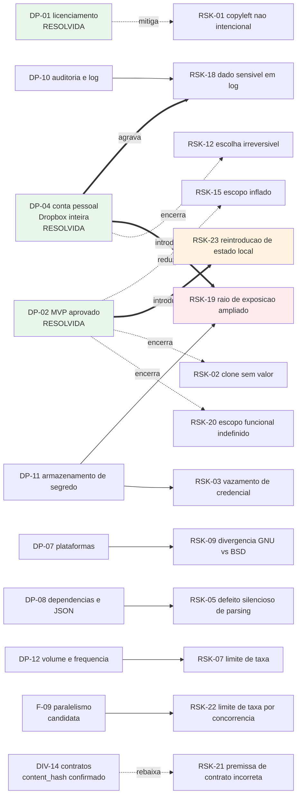

# Riscos, Restricoes e Licenciamento

| Campo | Valor |
|---|---|
| Projeto | `dropbox_api` |
| Responsavel | Business Analyst |
| Data | 2026-10-18 |
| Versao | **v0.16** — fase 8 (2026-10-21; escopo v1.24, secao 5.17, perfis nomeados de credencial, `F-18`): `RSK-85` a `RSK-93` criados (revogacao em cascata entre perfis de mesma identidade, estado nao atribuivel a um perfil, nome de perfil virando caminho, comando destrutivo no perfil errado por `DBX_PERFIL`, superficie nova de arquivos de segredo, auditorias de `DP-05` enfraquecidas). *Anterior:* **v0.15** — fase 7b (2026-10-21; escopo v1.23, secao 5.16): `RSK-84` criado (recebimento do `sync` sem o hash da listagem como esperado, `F-43`). `DIV-221` a `DIV-234` decididas: `RSK-78` ganha mudanca so de caixa (`DIV-227`) e `include_deleted` (`DIV-231`). `RSK-77` a `RSK-83` criados (retrato velho omite transferencia, contratos do cursor nao exercitados, tamanho do registro, dado sensivel no registro, custo das confirmacoes, adulteracao do retrato, divergencia de equivalencia). **v0.14** — fase 7a (2026-10-21; escopo v1.22; memoria `2026-10-20-2315-retomada`, divergencias `DIV-191` a `DIV-202`): `RSK-75` criado (`.part` orfao invisivel de registro ilegivel podado, `DIV-198`); `RSK-72` ganha o custo do `get_metadata` extra por download (`DIV-192`, medicao na fase 9/`F-34`); `RSK-70` referencia o contrato do cliente HTTP (`DIV-202`); `RSK-76` criado (corrida entre a checagem de arquivo regular e a abertura do registro de estado, OBS-3, aceito pelo solicitante em 2026-10-21; limite da barreira, OBS-4). **v0.13** — fase 7a (2026-10-20; escopo v1.21, secao 5.15; memoria `2026-10-20-2315-retomada`): `RSK-69` (estado de retomada decidindo integridade ou escrita destrutiva), `RSK-70` (contratos de sessao e de `Range` nao exercitados e divergentes entre documentacao e `files.stone`), `RSK-71` (`.part` e estado orfaos ocupando disco), `RSK-72` (custo de releitura e de gravacao antecipada), `RSK-73` (upload retomado divergente ja publicado), `RSK-74` (estado compartilhado entre hosts); mitigacoes ajustadas as decisoes de `DIV-171` a `DIV-190` e as condicoes `C1` a `C6` do DBA. **v0.12** — fase 6 (2026-10-20; escopo v1.20, secao 5.14): `RSK-67` (tag da recusa por `parent_rev` divergente nao documentada no `files.stone`, `DIV-149`; conferir no servico real); `RSK-62` (listagem incoerente: `path_lower` repetido e caminho nao normalizado, `DIV-158`, `DIV-159`) e `RSK-64` (`Date` da ultima pagina, `DIV-160`) ajustados pelos achados do QA, ciclo 1; `RSK-62` ajustado pelos ciclos 2 e 3 (chave sem caixa de `RF-54` nas tres barreiras contra caminho duplicado, `DIV-161`; guarda sem a lista de quem fica, `DIV-162`; marca combinante, `DIV-164`; lista de quem fica so com caminho canonico, `DIV-165`) e `RSK-68` criado (tabela Unicode da Dropbox diferente da do sistema, falha fechada; custo aceito de `DIV-164`); `RSK-62` ajustado pelos ciclos 4 e 5 (barreira estrutural por identidade: `id` e `rev` obrigatorios e unicos na listagem e comparados pela guarda (7), `DIV-167`; UTF-8 valido por bytes, `DIV-168`) e `RSK-68` ampliado com o risco residual da `DIV-170` (composicoes NFC fora dos blocos de marcas), aceito pelo solicitante em 2026-10-20. *Registro anterior:* **v0.11** — fase 6 (2026-10-20; escopo v1.19, secao 5.14): `RSK-62` (apagar o backup errado), `RSK-63` (padrao amplo demais), `RSK-64` (relogio e `server_modified`), `RSK-65` (recuperacao limitada ao prazo da lixeira e falha parcial) e `RSK-66` (concorrencia sem trava); mitigacoes ajustadas as decisoes de `DIV-130` a `DIV-147` (2026-10-20, todas conforme as recomendacoes): `RSK-64` com a conferencia do relogio pelo `Date` (`DIV-134`). *Registro anterior:* **v0.10** — fase 5 (2026-10-20; atualizado com as decisoes de `DIV-104` a `DIV-120`: `RSK-58`, `RSK-59` e `RSK-61`; e com os ciclos do QA `QA-B5-01..19`: `RSK-58`): `RSK-57` (exposicao publica por link), `RSK-58` (vazamento da senha do link), `RSK-59` (revogacao de link fora da raiz), `RSK-60` (link temporario irrevogavel) e `RSK-61` (restricao de plano e escopo `sharing.read`). *Registro anterior:* **v0.9** — fase 4 (2026-10-19): `RSK-56` (estado de corpo vazado entre chamadas HTTP, `DIV-95`, mitigado). *Registro anterior:* **v0.8** — fase 4 (2026-10-19): `RSK-54` (filtro mal escrito) e `RSK-55` (ilusao de backup completo com filtro ativo). *Registro anterior:* **v0.7** — fase 3 (2026-10-19): `RSK-51` (exclusao permanente irreversivel), `RSK-52` (conta pessoal e escopo opcional) e `RSK-53` (custo de API na restauracao recursiva). *Registro anterior:* **v0.6** — fase 2 (2026-10-19): `RSK-50` (duas credenciais da mesma conta nao se excluem, `DIV-47`). *Registro anterior:* **v0.5** — fase 2 (2026-10-19): `RSK-47` (trava presa, reuso de pid, outro host) e `RSK-48` (janela de sinal e tratadores que se sobrescrevem; migracao para `lib/tmp`). *Registro anterior:* **v0.4** — fase 3 (`DP-34`): `RSK-37` encerrado pela implementacao do skip condicionado (`RF-60`); `RSK-27` aplicado as auditorias da fase; `RSK-42` a `RSK-45` criados a partir do handoff do DBA; `RSK-46` (atualizacao de formato v1 para v2, achado `QA-P3-01`; mitigacao principal passa a `RF-41(b)` reescrito apos `QA-P3-05..07`). *Registro anterior:* **v0.3** — acrescenta `RSK-36` e `RES-18`, e revalida `RES-05` contra o `files.stone` do ramo `main` de `dropbox/dropbox-api-spec`. *(A v0.2 atualizava o documento apos as decisoes do solicitante e a revalidacao de contratos via Context7; o campo nao foi mantido versao a versao entre a v0.2 e esta, e a lacuna e registrada em vez de reconstruida.)* |
| Status | **DP-01 resolvida.** Risco de licenciamento mitigado por decisao; novos riscos decorrentes de DP-04 registrados. 🔴 **Novo na v0.3: `RSK-36`** — conteudo truncado publicado com codigo de saida `0` quando o produtor de um cano anonimo morre no meio. **Medido, sem mitigacao dentro do processo** (`DIV-18`, `DP-29`) |
| Documentos relacionados | [Escopo e requisitos](escopo-requisitos-e-criterios-de-aceite.md) · [Decisoes pendentes](decisoes-pendentes.md) · [Funcionalidades candidatas](funcionalidades-candidatas.md) · [System Design](../arquitetura/system-design.md) |

> **Aviso.** Este documento apresenta analise de risco para apoiar decisao. Nao constitui parecer juridico. Se houver distribuicao a terceiros, recomenda-se validacao juridica formal.

---

## 0. Decisao de licenciamento — RESOLVIDA

> **O solicitante decidiu pela reimplementacao independente (cenario B da analise abaixo).** O `Dropbox-Uploader` sera usado como **referencia conceitual apenas**. Nenhum trecho de codigo GPLv3 sera copiado, adaptado ou traduzido.
>
> **Consequencia:** nao ha obrigacao copyleft. O projeto e livre para adotar qualquer licenca. A escolha da licenca especifica permanece aberta como **DP-20**, em prioridade P1, e deve ser publicada **antes do primeiro commit de codigo**.
>
> A analise das secoes 1.1 a 1.5 e mantida como registro da fundamentacao da decisao e como fonte das salvaguardas operacionais que continuam vinculantes (RES-02).

---

## 1. Analise de licenciamento (registro da fundamentacao)

### 1.1 Fato observado

O projeto de referencia `/home/sales/Dropbox-Uploader` esta licenciado sob **GNU General Public License v3**. O cabecalho do arquivo principal declara:

- `Copyright (C) 2010-2021 Andrea Fabrizi <andrea.fabrizi@gmail.com>`
- "This program is free software; you can redistribute it and/or modify it under the terms of the GNU General Public License as published by the Free Software Foundation; either version 3 of the License, or (at your option) any later version."

Referencia: `/home/sales/Dropbox-Uploader/dropbox_uploader.sh`, linhas 5 a 19, e `/home/sales/Dropbox-Uploader/LICENSE`.

### 1.2 Consequencia

A GPLv3 e uma licenca **copyleft forte**. Uma obra que incorpore, adapte ou traduza codigo licenciado sob GPLv3 e considerada trabalho derivado e, quando distribuida, deve ser distribuida sob a mesma licenca, com disponibilizacao do codigo-fonte completo e preservacao dos avisos de copyright originais.

Em shell script o limite entre "inspiracao" e "derivacao" e mais tenue do que em outras linguagens, porque a estrutura de um script frequentemente sobrevive a renomeacao de variaveis. Copiar funcoes e adaptar nomes **nao** descaracteriza derivacao.

### 1.3 Fronteira do que nao gera obrigacao

Os elementos abaixo nao sao protegidos pelo copyright do projeto de referencia e podem ser usados livremente:

- Os endpoints, parametros e contratos da **Dropbox API v2**, que sao documentacao publica da Dropbox e nao do autor do modelo.
- A **lista de funcionalidades** e os nomes de comando de uso comum (`upload`, `download`, `list`, `delete`).
- O **conceito** de assistente de configuracao passo a passo, de envio em partes ou de expansao de curinga.
- Conhecimento adquirido pela leitura do codigo, aplicado em implementacao propria.

### 1.4 Cenarios e impacto

| Cenario | Descricao | Licenca resultante | Impacto |
|---|---|---|---|
| **A — Derivacao** | Trechos do `dropbox_uploader.sh` sao copiados ou adaptados | GPLv3 obrigatoria na distribuicao | Impede distribuicao sob licenca proprietaria ou permissiva; exige aviso de copyright do autor original; exige disponibilizar o fonte a quem receber o binario/script |
| **B — Reimplementacao independente** | O modelo e lido como referencia funcional; todo o codigo e escrito do zero | Livre escolha do solicitante | Sem obrigacao copyleft; permite MIT, Apache-2.0, proprietaria ou uso interno fechado |
| **C — Uso interno sem distribuicao** | Mesmo derivando codigo, o resultado nunca sai da organizacao | GPLv3 aplicavel apenas na distribuicao | A GPLv3 nao obriga publicacao quando nao ha distribuicao a terceiros; porem qualquer distribuicao futura, inclusive a fornecedor ou cliente, reativa a obrigacao. Cenario fragil no medio prazo |

### 1.5 Recomendacao — **acatada pelo solicitante**

**Cenario B — reimplementacao independente.** Salvaguardas operacionais, agora vinculantes por RES-02:

1. Registrar explicitamente que nenhum trecho de codigo do `Dropbox-Uploader` foi copiado para este projeto.
2. Tomar a **documentacao oficial da Dropbox** como fonte primaria dos contratos de integracao, e nao o codigo do modelo.
3. Nao replicar a estrutura interna de funcoes, os nomes internos de variaveis nem o texto literal de mensagens do modelo.
4. Nao copiar o `README` nem a documentacao do modelo.
5. Declarar a licenca escolhida na raiz do repositorio antes do primeiro commit de codigo (RNF-17).

Ganho colateral confirmado: a reimplementacao independente **evita herdar os defeitos ja identificados no modelo** (endpoint de busca fora da documentacao vigente, variantes de endpoint superadas, exposicao de credencial na tabela de processos, interpretacao fragil de JSON, arquivos temporarios previsiveis). Esses itens compoem o Bloco 0 de base endurecida em [funcionalidades-candidatas.md](funcionalidades-candidatas.md).

---

## 2. Matriz de riscos

Escala de impacto e probabilidade: Baixa | Media | Alta.

| ID | Risco | Impacto | Probab. | Mitigacao | Owner |
|---|---|---|---|---|---|
| RSK-01 | ✅ **Mitigado por decisao.** Obrigacao copyleft nao intencional por derivacao de codigo GPLv3 | Alto | **Baixa** (era Alta) | DP-01 resolvida: reimplementacao independente. Risco residual e apenas de disciplina de execucao, endereçado por RES-02 e pela declaracao formal de nao derivacao no fechamento | Senior Developer (execucao), Tech Lead (verificacao) |
| RSK-02 | ✅ **Encerrado.** Projeto entregar um clone sem valor incremental | Alto | — | DP-02 resolvida com escopo aprovado. O MVP entrega tres capacidades ausentes no modelo: envio por fluxo sem disco intermediario, omissao de reenvio por comparacao de conteudo e contrato de automacao consumivel por orquestrador | Solicitante |
| RSK-03 | Vazamento de credencial pela tabela de processos ao passar segredo em `argv` | Alto | Alta se o padrao do modelo for replicado | RNF-03: entrada de segredo por `stdin` ou arquivo de configuracao do cliente HTTP; verificacao explicita em teste | Senior Developer |
| RSK-04 | Uso de endpoints ausentes da documentacao vigente da Dropbox API | Alto | Alta se o modelo for tomado como fonte de contrato | RNF-12: auditoria estatica proibindo `search`, `copy`, `move`, `delete` e `create_folder` sem sufixo `_v2`; RES-02 obriga a tomar a documentacao oficial como fonte primaria, e nao o codigo do modelo | Senior Developer, verificado por QA |
| RSK-05 | Defeito silencioso na interpretacao de resposta JSON por expressao regular | Alto | Media | DP-08 e RNF-11: definir estrategia de interpretacao; testes com JSON de formatacao variada e valores contendo delimitadores | Senior Developer |
| RSK-06 | Corrupcao ou truncamento de arquivo em envio interrompido | Alto | Media | RNF-09 e RF-09: sessao em partes com retentativa por parte e verificacao de `content_hash` no fechamento | Senior Developer, verificado por QA |
| RSK-07 | Bloqueio por limite de taxa da Dropbox em rotinas de alto volume | Medio | Media | RNF-07: recuo exponencial com variacao aleatoria respeitando `Retry-After`; DP-12 para dimensionar concorrencia | Senior Developer |
| RSK-08 | Revogacao de refresh token interrompendo rotinas nao assistidas sem alerta | Alto | Media | RF-29 e RF-30: codigo de saida dedicado a falha de autenticacao e mensagem acionavel; recomendacao de alerta no orquestrador | Engenheiro de automacao do solicitante |
| RSK-09 | Divergencia de comportamento entre utilitarios GNU e BSD (`stat`, `sed`, `date`, `base64`) quebrando o suporte multiplataforma | Medio | Media se macOS/BSD entrarem no escopo | DP-07 e RNF-01: declarar plataformas suportadas e cobrir cada uma na suite de testes | Senior Developer |
| RSK-10 | Corrupcao de nomes de arquivo com espacos, acentos ou caracteres especiais por expansao de shell | Medio | Media | RNF-10: conjunto de nomes adversariais na suite de testes; citacao rigorosa de variaveis; analise estatica obrigatoria | Senior Developer |
| RSK-11 | Ataque por link simbolico ou corrida em area temporaria compartilhada | Medio | Baixa | RNF-05: `mktemp` e limpeza deterministica por `trap` | Senior Developer |
| RSK-12 | ✅ **Encerrado por decisao.** Escolha irreversivel de tipo de acesso do aplicativo Dropbox | Medio | — | DP-04 resolvida: acesso a Dropbox inteira. A consequencia foi assumida e desdobrada em RSK-19 | Solicitante |
| RSK-13 | Mudanca unilateral de contrato ou politica pela Dropbox durante o ciclo de vida | Medio | Baixa por evento, certa no longo prazo | Isolar o acesso a API em componente unico (`lib/http`); acompanhar avisos de descontinuidade; cobertura de teste de contrato | Senior Developer |
| RSK-14 | Manutencao a longo prazo de codigo shell extenso e pouco testavel | Medio | Alta se o padrao monolitico do modelo for reproduzido | RNF-13, RNF-14 e RNF-16: modularizacao, analise estatica e suite automatizada desde o inicio | Tech Lead |
| RSK-15 | Escopo inflado por busca de paridade completa com o modelo sem necessidade declarada | Medio | Media | DP-06: fixar o conjunto de comandos do MVP; secao de escopo fora no documento de requisitos | Business Analyst |
| RSK-16 | Contaminacao de contexto pela memoria de projeto herdada do pacote de origem | Baixo | Alta ja materializada | DIV-09: nao acumular registros sobre o conteudo herdado; solicitar decisao do Tech Lead sobre reinicializacao ou segregacao da memoria | Tech Lead |
| ~~RSK-17~~ | ❌ **Removido na v0.2 por erro factual.** Registrava indisponibilidade do Context7 MCP | — | — | O Context7 estava ativo; as ferramentas exigem descoberta previa por serem de carregamento diferido. Os contratos foram revalidados e as correcoes constam de RES-04 a RES-14 e DIV-11 a DIV-14 | Business Analyst |
| RSK-18 | Exposicao de dado sensivel em log por registro de nomes e caminhos de arquivos | Medio | Media *(elevada por DP-04)* | Definir politica de log em DP-10; mascaramento de caminho se aplicavel. Com acesso amplo a conta, o log pode revelar a estrutura integral do Dropbox do usuario | Business Analyst e Solicitante |
| **RSK-19** | **Raio de exposicao ampliado pelo acesso a Dropbox inteira (DP-04).** Comprometimento da credencial expoe todo o conteudo da conta; caminho remoto mal formado ou exclusao acidental alcancam qualquer area | **Alto** | Media | RNF-20: escopos OAuth minimos, confinamento configuravel do caminho raiz e confirmacao obrigatoria em operacao destrutiva. DP-11 ganha peso: o refresh token passa a ser o unico controle entre um usuario local e a conta inteira. Recomendacao adicional: aplicativo separado com acesso restrito a pasta do aplicativo para rotinas nao assistidas que nao precisem de alcance total. **Ressalva (2026-10-19):** o confinamento remoto so passa a valer a partir da fase 1b (`F-36`); o confinamento local configuravel e o `F-38`, ainda nao implementado | Solicitante e Senior Developer |
| ~~RSK-20~~ | ✅ **Encerrado na v0.3.** Escopo funcional indefinido | Alto | — | DP-02 resolvida. Escopo do MVP aprovado e formalizado em RF-31 a RF-36, com criterio de aceite verificavel cada um. Ha MVP definido, estimavel e com criterio de pronto | Solicitante |
| **RSK-24** | ✅ **DEIXA DE SER RISCO ACEITO — mitigacao estrutural adotada em `DP-26`.** TOCTOU no confinamento de caminho local | **Alto** | **Baixa** *(era Media)* | **O solicitante seguiu a recomendacao do QA e nao manteve o aceite.** Mitigacao adotada: **travessia por descida** — descer um nivel por vez mantendo o diretorio aberto e operar sempre com **nome relativo**. Em `bash`, `cd` referencia o **inode**, nao o texto do caminho; e o equivalente em shell de `openat` com `O_NOFOLLOW` por componente. **Verificado experimentalmente pelo QA:** com caminho absoluto reconstruido, a troca por symlink em componente intermediario **apaga fora da raiz**; com descida e nome relativo, **na mesma janela de ataque, o alvo sobrevive**. ⚠️ **Limite honesto, do proprio QA:** protege os componentes **ja percorridos**, e nao a troca imediatamente antes de descer. E **reducao de superficie, nao eliminacao** — o risco permanece no registro com probabilidade reduzida, nao encerrado. Requisito: `RNF-28` | Senior Developer, verificado por QA |
| **RSK-34** | **Risco composto `RSK-32` × `RSK-24`: escape gravado na linha de base vira exclusao diferida.** Uma travessia que escapou da raiz grava na linha de base caminhos de **fora** dela; na execucao seguinte esses caminhos aparecem como orfaos e sao apagados — **com o atacante ja ausente**. A janela de ataque e transitoria; a consequencia, persistente | **Critico** | Baixa | **Regra fixada:** a linha de base **so registra o que a propria descida verificou**, nunca por re-resolucao de caminho a partir de texto. `RF-50`. O que torna este risco grave e o **diferimento**: a exclusao nao ocorre durante o ataque, e sim depois, o que desacopla causa e efeito e torna o diagnostico praticamente impossivel. Sem a regra, a mitigacao de `RNF-28` protegeria a execucao corrente e deixaria o dano para a seguinte | Senior Developer, verificado por QA |
| ~~RSK-24 (aceite anterior)~~ | ✅ **ACEITE RECONFIRMADO na v0.6 — reabertura encerrada.** TOCTOU no confinamento de caminho local: entre a resolucao fisica do caminho e o uso efetivo, um `rename` concorrente pode trocar o alvo, permitindo escapar da raiz confinada | Medio | Baixa | **A reavaliacao ocorreu COM `DP-07` ja resolvida** — este registro existe para que o aceite nao volte a parecer apoiado no argumento que caiu. O argumento de portabilidade (`/proc/self/fd` ser exclusivo de Linux) **nao vale mais e nao integra a fundamentacao**: a plataforma e Linux por decisao. O solicitante reconfirmou o aceite com base **exclusivamente** nos dois argumentos remanescentes, ambos verificados: **(a)** validar por `readlink` compara **texto de caminho**, mutavel por `rename` entre a verificacao e o uso — a mitigacao correta exigiria comparacao por **dispositivo e inode**, e nao a que estava avaliada; **(b)** a mitigacao **nao cobre percurso recursivo**, que e justamente o caso real em operacao de lote. Ou seja: a mitigacao disponivel protegeria o caso menos frequente e deixaria descoberto o mais frequente. **Aceitar conscientemente e preferivel a mitigar mal.** Revisitar apenas se surgir mitigacao que cubra percurso recursivo e compare identidade de inode | Solicitante (aceite reconfirmado), Senior Developer (vigilancia) |
| ~~RSK-25~~ | ❌ **ENCERRADO na v0.5 — apoiava-se em evidencia falsa.** Registrava o padrao "premissa de escopo criada por conveniencia tecnica e registrada como se fosse decisao do solicitante" | — | — | **O unico caso citado nao sustentava o risco:** o solicitante **havia** decidido DP-07 e DP-08. A implementacao nao antecipou nada. Ver o julgamento completo na secao 6 | Business Analyst |
| **RSK-27** | **Garantia de auditoria estatica que cobre apenas a forma obvia da classe, produzindo falsa seguranca.** Uma verificacao declarada como defesa contra uma classe de defeito, mas que casa somente o padrao mais evidente, e pior que nenhuma: desliga a vigilancia humana sem entregar a protecao prometida | **Alto** | **Media — ja materializado** | **Evidencia:** a auditoria declarada como garantia contra a classe do `$( )` casava apenas `=[$]\(`, deixando passar `+=" ... $(...)"`, e **havia ocorrencia viva em `lib/errors.sh`**. Agravante: era a defesa declarada contra uma classe que **ja ocorrera tres vezes** no projeto. Padrao ampliado e ocorrencia corrigida. **Mitigacao permanente:** toda auditoria estatica declarada como garantia deve ser acompanhada de **teste de mutacao que introduza a forma nao obvia** da classe e confirme a reprovacao; auditoria sem esse par nao pode ser declarada como garantia, apenas como indicio. **Aplicacoes na fase 3 (v0.4, `DP-34`):** as auditorias de ausencia de `sqlite3`/`python3` (`RNF-02(a)`), de `dbx_db_` (`RNF-33(a)`), de `DBX_TRANSFER_HASH` (`RF-61(j)`) e do ramo sem `client_secret` (`RF-63(b)`) so contam como garantia com a mutacao da forma nao obvia correspondente | Senior Developer (construcao), QA (verificacao do par auditoria+mutacao) |
| **RSK-28** | **Instrumento de observacao interfere na propriedade observada.** Classe recorrente nomeada pelo QA. O mecanismo usado para medir, verificar ou transportar altera justamente aquilo que deveria apenas registrar | **Alto** | **Alta — quatro instancias em dois ciclos** | Tratamento completo, com as instancias e o criterio de projeto, na secao 7. **Mitigacao:** ao introduzir qualquer instrumento de verificacao, medicao ou transporte, perguntar explicitamente o que ele **altera** no objeto observado; preferir canal proprio a canal compartilhado; validar o instrumento com um caso cuja resposta correta seja conhecida de forma independente | Todos os papeis |
| **RSK-26** | **Falha de propagacao de decisao: decisao tomada pelo solicitante e nao refletida nos artefatos, com o documento desatualizado passando a ser tratado como fonte de verdade** | **Alto** | 🔴 **Alta — TRES ocorrencias** | Ver o registro detalhado das tres ocorrencias e a mitigacao reforcada na secao 8 | Tech Lead, coordenacao e Business Analyst |
| **RSK-29** | 🔴 **Exclusao em massa a partir de travessia local parcial ou defeituosa.** Ponto de montagem nao pronto, permissao negada ou ciclo de symlink fazem a arvore local parecer vazia ou truncada; com espelhamento ligado, isso e lido como "o usuario apagou tudo" e propagado ao remoto | **Critico** | **Media** | ⚠️ **`DP-24` dispensou o teto de exclusoes, entao `RF-41(a)` passou a ser a UNICA protecao estrutural contra este risco** — e foi por isso elevada a **bloqueante**. Criterio reforcado: a condicao e **"qualquer erro, em qualquer profundidade"**, e o efeito e **desabilitar a exclusao na execucao inteira**, nao apenas no ramo que falhou. Verificacao obrigatoria com subdiretorio ilegivel em profundidade 1 e N, e ponto de montagem removido durante a travessia; **mutacao que restrinja o efeito ao ramo com erro reprova a suite**. `RF-48` acrescenta reconhecimento obrigatorio na primeira execucao sobre par de raizes sem base. **Sem teto, nao ha segunda linha de defesa: se `RF-41(a)` falhar, nada mais impede a exclusao em massa** | Senior Developer, verificado por QA |
| **RSK-30** | ✅ **ACEITO por decisao em `DP-21` e `DP-22`.** Perda de dado na resolucao de conflito: a politica "ultimo a escrever vence" descarta a versao perdedora, e a eleicao por carimbo de tempo pode errar | **Critico** | **Media** | **Risco assumido com o custo apresentado.** A recomendacao contraria (recusar e reportar) e sua razao estao registradas na secao 5.8.3 dos requisitos. **Mitigacoes construidas dentro da decisao, sem contraria-la:** **(1)** a incerteza foi **confinada a ordenacao** — `RF-39` proibe carimbo de tempo na **deteccao**, que usa so `content_hash` contra a base, com mutacao que reprova se vazar; **(2)** a **qualidade do sinal** foi elevada por `RF-39a` e `RNF-27` — comparacao de diferencas contra a base cancela o offset entre relogios, e `client_modified` definido por esta aplicacao substitui `server_modified`; **(3)** `RF-40a` faz o desempate preferir o **lado recuperavel**; **(4)** `RF-47` torna cada perda **nominal e visivel depois da acao**, marcada como recuperavel ou permanente. **Mitigacao residual externa:** o historico de revisoes da Dropbox recupera as perdas em que o lado perdedor e o remoto — o que torna `F-07` do backlog materialmente mais valioso | Solicitante (aceite), Senior Developer (mitigacoes) |
| **RSK-33** | **Assimetria de recuperabilidade entre os dois lados.** Sob `DP-21` e `DP-22`, metade das perdas recai sobre o remoto — recuperavel pelo historico de revisoes da Dropbox — e metade sobre o local, onde e **permanente e sem rastro** | **Alto** | **Media** | `RF-40a` faz o desempate preferir o local, deslocando a perda para o lado recuperavel sempre que a ordenacao for indeterminada. `RF-47` marca cada perda como `recuperavel` ou `permanente`, de modo que o operador saiba **quais** exigem acao imediata. **Recomendacao registrada:** promover `F-07` (revisoes e restauracao) do backlog quando o `sync` estabilizar — e o unico caminho de recuperacao existente, e hoje ele nao esta no MVP | Business Analyst (recomendacao), Solicitante (decisao de promocao) |
| **RSK-31** | **Linha de base corrompida ou ausente tratada como vazia.** Interpretar "sem base" como "nada foi sincronizado" e seguro; interpretar como "tudo foi apagado" e catastrofico. A diferenca esta em uma linha de codigo | **Critico** | Baixa | `RF-38` e `RF-42`: base com versao de formato e verificacao de integridade; base ausente degrada obrigatoriamente para "novo nos dois lados" e **nunca** para exclusao; base corrompida **recusa a execucao** e exige consentimento explicito; reconstrucao forca desabilitar propagacao de exclusao naquela execucao. `RNF-25` exige escrita atomica, para que interrupcao nunca deixe base parcial | Senior Developer |
| **RSK-32** | **Conflacao entre o cursor de enumeracao da Dropbox e a linha de base de sincronizacao.** Sao dois artefatos com ciclos de vida distintos; a Dropbox invalida o primeiro com `reset`, e aplicar essa invalidacao ao segundo apagaria a memoria do que ja foi sincronizado | Alto | Media | `RF-43`: separacao estrita, com teste que reprova se a linha de base for substituida pelo cursor. A politica `reiniciar` da taxonomia vale **apenas** para a enumeracao. Este risco e sutil justamente porque ambos sao chamados de "cursor" na conversa corrente | Senior Developer |
| **RSK-23** | 🔄 **REESCRITO de novo por `DP-27b` (v1.1).** ~~Reintroducao inadvertida de estado local persistente~~ ~~Estado persistente alem do delimitado~~ **Estado persistente que volta a DECIDIR.** `DP-06` autorizou estado e `DP-27b` o rebaixou a memoria de desempenho. A vigilancia deixa de ser "nao exceder o estado autorizado" e passa a ser **"nenhum artefato persistente participa de decisao"** | Medio | Media | `RNF-26` delimita o autorizado. A verificacao que fecha o risco esta em `RF-37`: apagar a memoria entre duas execucoes **nao pode mudar o conjunto de operacoes decididas**. Se mudar, a memoria voltou a arbitrar e `DP-27b` foi violada — detectavel por caso, e nao por leitura de codigo. **O invariante original continua valendo integralmente para `upload`, `download`, `list`, `delete` e `info`** | Tech Lead |
| **RSK-35** | 🔴 **NOVO (`DP-27`). Perda da garantia estrutural de que a primeira execucao nunca apaga.** Na matriz de tres estados, exclusao exigia linha de base presente: um caminho nunca visto jamais podia ser apagado. No modelo direcional, "ausente na origem, presente no destino" e observavel sem historico algum, e com espelhamento ligado e ordem de exclusao integral. Uma raiz de origem apontada por engano — diretorio vazio, ponto de montagem que nao subiu, caminho remoto trocado — apaga o destino inteiro na primeira execucao | **Alto** | Media | Quatro barreiras que deixaram de ser redundantes e passaram a ser a defesa unica: `RF-40` (espelhamento desabilitado por padrao), `RF-41(a)` (origem ilegivel ou incompleta **aborta** em vez de virar exclusao), `RF-48` (reconhecimento obrigatorio na primeira execucao com espelhamento) e `RF-47` (registro nominal de toda perda). `DP-24` dispensou o teto de exclusoes, o que concentra a protecao em `RF-41(a)` | Tech Lead |
| ~~RSK-23 (redacao original)~~ | **Reintroducao inadvertida de estado local persistente.** O MVP foi deliberadamente desenhado sem persistencia; uma implementacao "conveniente" de cache de resumos, cursor ou arquivo de trava introduziria silenciosamente o que a decisao de escopo excluiu | Medio | Media | Registro explicito em quatro artefatos de que o MVP nao possui estado local; criterio de aceite arquitetural verificando ausencia de escrita persistente fora do arquivo de configuracao; qualquer proposta nesse sentido e tratada como mudanca de escopo, com nova decisao do solicitante e reabertura de DP-09 | Tech Lead |
| 🔴 **RSK-36** | **NOVO na v0.3, e MEDIDO — nao inferido. Conteudo truncado publicado com codigo de saida `0` quando o produtor de um cano anonimo morre no meio.** Em `tar czf - /dados \| dbx upload - /destino.tgz`, a morte prematura do produtor e **indistinguivel de fim de fluxo legitimo**: o cano fecha e o leitor ve EOF nos dois casos, e o status de saida do produtor pertence ao shell do operador, nunca chegando ao nosso processo | **Alto** — o caso de uso primario de `RF-31` e backup por fluxo, e um backup truncado que se reporta como sucesso so e descoberto na hora de restaurar | **Media** — depende de o produtor falhar, o que e o cenario normal de disco cheio, permissao negada no meio da arvore ou processo morto por limite de memoria | **Nao ha mitigacao dentro do processo** — o Senior Developer procurou e nao encontrou (`DIV-18`). **Contramedida disponivel, fora do processo:** `set -o pipefail` no shell de quem encadeia, que faz o encadeamento devolver o status do produtor. **Medicao:** produtor que escreve 5.000.000 bytes e sai com status `3` faz o comando publicar os 5.000.000 bytes e sair com `0`; com `pipefail`, o encadeamento devolve `3`. ✅ **A contramedida foi formalmente incorporada ao texto de ajuda de `bin/dbx` (`dbx help` e `dbx help upload`)** apos a conclusao do PR #13 e PR #15, e coberta por testes automatizados em `comandos_test.sh`. **Alternativa estrutural, que e mudanca de requisito e nao correcao: `DP-29`** — contrato explicito de tamanho total declarado, com a limitacao registrada la de que **nao cobre origens que desconhecem o proprio tamanho**, incluindo o `tar` do exemplo. **O que NAO esta em risco:** falha de **leitura** (EIO, truncamento sob leitura) aborta antes de qualquer `finish`, sem publicar nada e sem residuo | Solicitante (decisao em `DP-29`), Senior Developer (texto de ajuda em `bin/dbx` implementado e verificado) |
| **RSK-37** | **Skip do `upload` decidido so pelo cache local: viola o invariante de `RSK-23`.** Se o remoto foi apagado ou alterado, o envio e dispensado indevidamente (inclusive com `--modo overwrite`), e a divergencia passa despercebida | Alto | Media | `DP-32`: skip so com `content_hash` remoto (`get_metadata`) igual ao local; cache vira otimizacao de hash. ~~**Aberto ate a fase 3** (`F-26`).~~ ✅ **Encerrado pela implementacao do skip condicionado na fase 3 (`DP-34`, `RF-60`)**, com a identidade forte do cache em `RF-61(b)`; o fechamento formal se da com a evidencia do QA em `TC-SKP-06..07` (cache valido com remoto apagado ou alterado reenvia) no registro de entrega da fase 3. Verificacao: apagar o arquivo remoto e reexecutar `upload` deve reenviar | Tech Lead |
| **RSK-38** | **`RNF-07` declara respeitar `Retry-After`, mas a implementacao nao le o cabecalho (`DIV-22`).** O criterio de aceite do requisito nao e cumprido hoje; `RSK-07` depende dele | Alto | Alta | **Em tratamento na fase 2 (`DIV-22` encerrada; `RNF-07` emendado).** A implementacao extrai `Retry-After` e o usa como espera, com teto de 300 s; teste exigido: `429` com `Retry-After: 5` implica espera >= 5 s (`TC-RTY-03`). Encerrar com evidencia de QA | Senior Developer |
| **RSK-39** | **Perda ou corrupcao de dado local/remoto por defeitos de integridade no `sync`/`download`** (caixa de caminho, recebimento nao atomico, `rm` de arquivo do usuario, `umask` vazado, area temporaria vazada). Corrobora `RSK-35` | Critico | Media | Fase P1 (`DP-31`): `RF-54` a `RF-57` e `RNF-29`, cada um com criterio verificavel e mutacao que reprova. Encerrar ao fechar o PR da P1 com evidencia de QA | Tech Lead |
| **RSK-40** | **Retomada do upload (`RF-58`) com `correct_offset` hostil ou arquivo alterado durante o envio:** offset fora de `[0, tamanho]` ou arquivo que mudou entre leituras pode publicar conteudo misturado ou laco infinito | Alto | Baixa | `RF-58(b)` recusa offset fora de `[0, min(tamanho, enviado)]`, em particular acima do que o cliente ja enviou; `RF-58(e)` limita as retomadas pelas tentativas e recusa mudanca de tamanho; `content_hash` final conferido (`RF-34`). Verificacao: `TC-RSM-02` | Senior Developer |
| **RSK-41** | **Vazamento de segredo ou corpo bruto nas linhas `falha` do `sync` (`RF-59`)** — a saida por item passa a carregar texto derivado de erro | Alto | Baixa | `RF-59(c)`: resumo so de classe e prefixo de `error_summary`; teste com token e corpo sentinelas (`TC-FLH-03`); `RNF-03` e `RNF-22` mantidos | Senior Developer |
| **RSK-42** | **Hash local obsoleto reaproveitado do cache leva a dispensa indevida.** Arquivo reescrito no mesmo segundo, com o mesmo tamanho, e remoto igual ao conteudo antigo: o hash em cache parece valido e iguala o remoto | Alto | Baixa | `RF-61(b)` a (d): `mtime`/`ctime` em nanossegundos, dispositivo e inode, `stat` antes e depois, regra anti-corrida de 2 s; caso obrigatorio em `TC-UPC`. **Vale tambem para a memoria do `sync`, que passa a usar a mesma identidade forte (`RF-38(e)`; `DIV-26` resolvida pelo Tech Lead em 2026-10-18)** | Senior Developer |
| **RSK-43** | **Precisao de nanossegundos de `stat` indisponivel no coreutils minimo suportado**, degradando a identidade de `RF-61(b)` para segundos | Medio | Media | Confirmar em teste no ambiente minimo; recuo para o formato textual com nanossegundos (`%y`/`%z`); sem precisao disponivel, nao gravar cache (fica so o custo de recalcular) | Senior Developer |
| **RSK-44** | **Legado `dbx.db*` esquecido em disco, com caminhos absolutos de arquivos enviados** | Baixo | Alta | `RNF-33(c)`: `README` e notas da versao com o comando de remocao; `unlink` o remove (`RF-51(f)`). Remocao automatica rejeitada (apagaria arquivo do usuario sem pedido) | Business Analyst |
| **RSK-45** | **`upload` escrevendo na memoria do `sync` libera espelhamento sem reconhecimento (`RF-48`)**, porque "par visto" deriva da existencia do arquivo de memoria | Alto | Baixa | Namespace proprio `upload-*` (`RF-61(a)`) e teste que confirma que o `upload` nao cria `memoria-*` | Senior Developer, QA |
| **RSK-46** | **Primeira execucao apos a atualizacao de formato (memoria `1` para `2`) apagando no destino.** Toda instalacao existente tem `memoria-*` em versao `1`, descartada na carga: o par continua "visto" (`RF-48` nao atua) e a base vazia anularia a guarda de `RF-41(b)`; com `--espelhar --confirmar` sobre origem vazia ou montagem ausente, o destino seria apagado. Vale igual para memoria truncada ou corrompida (achado `QA-P3-01`) | Critico | Alta na primeira execucao apos a atualizacao | **Mitigacao principal (decisao do solicitante, 2026-10-18, apos `QA-P3-05` a `QA-P3-07`): `RF-41(b)` reescrito** — no `--espelhar`, origem vazia com algo a apagar e sempre recusada (codigo `14`), independente da memoria, e so `--permitir-origem-vazia` dispensa; `--confirmar` nao basta. `TC-DEL-09..11`. **Defesa em profundidade, para origem parcial:** `RF-41(f)` (decisao do Tech Lead, 2026-10-18; memoria ilegivel conta como descartada; regravacao so apos travessia completa): memoria existente descartada desabilita a propagacao de exclusao naquela execucao, com motivo no relatorio e saida diferente de `0`; regravacao em v2 apos travessia completa. **Nota operacional:** na atualizacao, cada par espelhado leva **uma** execucao sem exclusoes e com saida diferente de `0`, e so na seguinte volta ao normal; rotinas agendadas devem tolerar ou ser avisadas (notas da versao). Verificacao: `TC-DEL-08` | Senior Developer, QA |
| **RSK-47** | **Trava presa (fase 2, `RF-69`).** Execucao morta por `SIGKILL`, queda de energia ou OOM deixa o arquivo de trava; a retomada automatica so vale no mesmo host e com pid sem processo. Em outro host (estado em disco compartilhado, container com nome de host variavel) a trava nunca e retomada, e a rotina agendada recusa ate alguem remover a mao. **Reuso de pid:** pid de uma trava orfa pode ser reaproveitado por outro processo e a trava passa por viva (falha para o lado seguro, mas pode prender o par). Trava ilegivel (`DIV-40`) tambem nao e retomada | Medio | Media em container efemero ou em disco de rede; baixa em maquina unica | `RF-71` mostra a trava e o remedio exato (caminho e comando); a recusa (`7`) traz pid, host e inicio, o que permite conferir a mao; `--esperar` nao mascara a trava de outro host. **Nota operacional:** em container, fixar o nome do host (ou nao compartilhar o diretorio de estado). Verificacao: `TC-TRV-10`, `TC-TRV-11`, `TC-TRV-17`, `TC-DIA-12` | Senior Developer, QA |
| **RSK-49** | **Exclusao entre hosts em NFS e de melhor esforco (fase 2, parecer do DBA).** Em diretorio de estado em NFS o `link(2)` e atomico, mas a resposta pode se perder e o `ln` retornar `EEXIST` tendo criado o elo; o cache de atributos pode mostrar estado velho; `kill -0` nao atravessa hosts. Dois hosts podem, em casos raros, achar que detem a mesma trava | Medio | Baixa (o padrao `$XDG_STATE_HOME` e local) | `RF-69(j)`: sucesso pelo inode (`-ef`), nunca pelo codigo do `ln`; trava de outro host nunca retomada; relogio fora de toda decisao; `diagnostico` avisa quando detecta NFS (`RF-69(q)`); garantia declarada na documentacao. A memoria nao decide (`RF-38`), entao o pior caso e recalculo. Verificacao: `TC-TRV-23`, `TC-TRV-35` | Senior Developer, DBA |
| **RSK-50** | **Duas credenciais da mesma conta no mesmo diretorio de estado nao se excluem (fase 2, `RF-69(a)`, `DIV-47`).** A chave da trava usa um resumo local da credencial (`APP_KEY` e `REFRESH_TOKEN`), e nao o `account_id`, porque obte-lo exige rede e quebraria `RF-69(d)`, `RF-65(b)` e `RF-65(c)`. Dois refresh tokens da mesma conta (reautorizacao, dois aplicativos) tem chaves diferentes e podem rodar `sync` do mesmo par ao mesmo tempo, com a memoria do par disputada (gravacao atomica por `mv`, sem corromper, mas com ultima-gravacao-vence). Efeito inverso nao existe: a mesma credencial sempre gera a mesma chave | Baixo | Baixa (exige duas credenciais ativas da mesma conta apontando ao mesmo par e ao mesmo diretorio de estado) | Custo aceito pelo Tech Lead (`DIV-47`); nota operacional: um unico `REFRESH_TOKEN` por usuario e diretorio de estado. Verificacao: `TC-TRV-37` | Senior Developer, QA |
| **RSK-51** | **Exclusao permanente irreversivel (fase 3, `RF-76`).** `permanently_delete` apaga item **vivo** antes de expurgar (spec); caminho errado, item restaurado por outra pessoa entre a guarda e a chamada (TOCTOU) ou confirmacao automatizada por reflexo destroem dado sem volta | Critico | Baixa com as guardas | `RF-76(c)`: so `DeletedMetadata` segue (`DIV-54`); confirmacao explicita, digitacao do caminho no terminal, sem terminal so com `--confirmar-caminho` igual ao alvo (literal ou normalizado, caixa exata), unica opcao de confirmacao (`DIV-55`, `DIV-73`); `--dry-run`; confinamento a `raiz_remota` antes da rede; alvo nunca e a raiz. Residual: janela TOCTOU entre a guarda e a chamada, **declarada e aceita pelo Tech Lead** (`DIV-54`) | Tech Lead, Senior Developer, QA |
| **RSK-52** | **Conta pessoal e escopo opcional (fase 3, `RF-76(f)(g)`, `RF-77`).** A exclusao permanente so existe em Dropbox Business, e a forma da recusa em conta pessoal nao e documentada (`DIV-57`); sem mapeamento, sairia `1` ou `2` com mensagem enganosa. O escopo `files.permanent_delete` so vale depois de habilitado no App Console **e** de reautorizar; remedio decidido: `dbx unlink` e depois `dbx config` (`DIV-56`) | Medio | Alta para o solicitante sem Business | `permissao` `6` com mensagem e remedio (`dbx delete`); `missing_scope` `5` com remedio do App Console; `diagnostico` mostra o escopo como opcional; resposta real nao exercitada pela suite, que nao tem rede (`DIV-57`) | Senior Developer, QA |
| **RSK-53** | **Custo de API na restauracao recursiva de pasta grande (fase 3, `RF-74`).** Duas chamadas por arquivo (`list_revisions` e `restore`) mais as listagens: 10 mil arquivos sao mais de 20 mil chamadas, com `too_many_write_operations`/`429` provaveis e execucao longa; falha parcial no meio deixa a pasta pela metade | Medio | Media em pastas com milhares de arquivos | Sequencial (`RNF-21`), recuo e `Retry-After` (`RNF-07`); resumo com o que faltou e saida `14`; reexecucao idempotente restaura so o que falta (`RF-74(h)`); `--dry-run` mostra o total antes. Paralelismo e lote ficam no backlog (`F-08`, `F-09`, `F-34`) | Senior Developer, QA |
| **RSK-54** | **Filtro mal escrito (fase 4, `RF-79`, `RF-80`).** Padrao com erro de digitacao, ancoragem trocada (`doc/a` ancora; `a` nao), `*` esperado cruzando `/`, ou `--incluir` que deixa quase tudo de fora: o `sync` filtra nada ou filtra demais, sem erro, e o operador so descobre quando precisa do arquivo. Com `--espelhar`, um padrao que **deixa de casar** (filtro removido ou corrigido) devolve itens ao escopo e o espelhamento passa a apaga-los no destino | Alto | Media | Malformado recusado com `2` antes da rede (`RF-79(j)`); desvios do gitignore declarados e `!` recusado (`DIV-79`); avisos de padrao sem casamento e de origem toda filtrada (`RF-80(m)`, `DIV-91`); `--dry-run` com os padroes e as contagens de filtrados (`RF-80(i)`); guarda de origem vazia no escopo (`RF-80(e)`, `DIV-81`); ajuda e README dizem que remover um filtro devolve os itens ao escopo (`RF-83`). Residual: padrao valido que casa o que nao devia nao e detectavel | Tech Lead, Senior Developer, QA |
| **RSK-55** | **Ilusao de backup completo com filtro ativo (fase 4, `RF-80`, `RF-81`).** O `sync` agendado com `--excluir`/`--incluir` ou com data e tamanho sai `0` e o operador (ou o monitoramento, que so olha o codigo) entende que a arvore inteira esta no destino; o que foi filtrado nunca foi copiado nem verificado, e o `verificar` com os mesmos filtros tambem sai `0` | Alto | Media | Contagens `filtrados_origem`/`filtrados_destino` e `filtros sim` com os padroes no resumo, no plano e no `--json` (`RF-80(i)(j)`); README com aviso de que backup com filtro e parcial (`RF-83`); `verificar` sem filtros mostra o que ficou de fora. Residual: aceito; a decisao de filtrar e do operador | Tech Lead, QA |
| **RSK-56** | ✅ **MITIGADO na fase 4 (`DIV-95`, escopo v1.16, `RF-80(d6)`).** **Estado de requisicao vazado entre chamadas HTTP.** `lib/http` guardava o arquivo de corpo de um envio de conteudo (`_DBX_HTTP_ARQUIVO_CORPO`) e nao o limpava nos modos bearer e formulario: a chamada seguinte levava o arquivo como corpo. No `sync --enviar --espelhar`, o `delete_v2` apos um envio iria com o conteudo do arquivo (item vira falha) e uma renovacao de token logo apos um envio enviaria o arquivo ao endpoint de token | Alto | Baixa *(era Alta antes da correcao)* | Defeito anterior a fase, achado pelo registro de chamadas de `TC-FES-07`; corrigido em `dbx_http_requisitar`/`dbx_http_formulario` com teste de regressao `teste_div95_*`, que reprova na base. Residual: qualquer estado global novo em `lib/http` deve ser zerado por chamada (mesma classe; vigiar na revisao de conformidade) | Senior Developer, QA |
| **RSK-57** | **Exposicao publica por link compartilhado (fase 5, `RF-85`, `RF-87`).** `--publico` torna o item acessivel a qualquer pessoa com a URL; a URL vaza por historico de terminal, e-mail, log de quem a recebe ou captura de tela. Modificar link existente para mais aberto (equipe para publico, senha removida, expiracao mais tarde) amplia a exposicao de uma URL que ja circula | Alto | Media | Visibilidade **sempre explicita**, nunca publica por omissao (`RF-85(b)`); alvo `/` recusado (`DIV-120`); confinamento a `raiz_remota` antes da rede; avisos em stderr de link publico e de exposicao ampliada com o antes e o depois (`RF-87(c)(e)`); `--expira` e `--senha` disponiveis; `--listar` mostra o que esta exposto e `--revogar` desfaz. Residual: a decisao de publicar e do operador | Tech Lead, Senior Developer, QA |
| **RSK-58** | **Vazamento da senha do link (fase 5, `RF-86`).** Senha em `argv` (tabela de processos), em variavel de ambiente herdada por filhos, na configuracao do cURL, em `--debug`, em mensagem de erro, em `xtrace` ou em arquivo temporario esquecido; ou corpo de erro que ecoe `link_password`, que a redacao atual nao mascara (`DIV-111`) | Alto | Media sem as guardas | Fontes so terminal sem eco e `--senha-stdin`, sem forma com valor e sem ambiente (`RF-86(a)`); corpo por arquivo da area de `lib/http` (`lib/tmp`, `0700`, removida em sinal); variavel `local` apagada apos a serializacao (decidido, `DIV-110`); `link_password` entre as chaves sensiveis (decidido, `DIV-111`); verificacao com sentinela em argv, ambiente, stdout, stderr, `--debug` e `TMPDIR` (`TC-SNH-09..12`). Ciclos do QA: arquivo de corpo nasce `0600` (`QA-B5-05`); senha redigida pelo valor (`QA-B5-02`) e, quando enviada, nenhum texto bruto do servico em stderr ou `--debug`, so mensagem do dbx, codigo HTTP e tag reconhecida, que nao e citada se for igual a senha (`QA-B5-08/09/17`, `DIV-128`). Residual: `bash -x` ligado pelo operador expoe variaveis (fora do controle da aplicacao; documentar). **Limitacao declarada (`QA-B5-05`):** depois de `SIGKILL` durante a chamada, o arquivo de corpo com a senha fica na area `0700` do usuario (nenhum tratador roda); outro usuario nao o le | Senior Developer, QA |
| **RSK-59** | **Revogacao ou listagem de link fora da raiz (fase 5, `RF-88`, `RF-89`).** O `--revogar` recebe uma URL, nao um caminho: sem guarda, revogaria link de qualquer item da conta, inclusive fora da `raiz_remota`; uma guarda que dependesse de estado local (cache, memoria, listagem anterior) seria contornavel (memoria "guarda de seguranca sem estado") | Alto | Media sem a guarda | `get_shared_link_metadata` na mesma execucao e autorizacao so com `path_lower` presente, sem chave repetida e dentro da raiz; ausente recusa `13` mesmo com raiz `/` (`RF-89(c)`, decidido, `DIV-114`); sem confirmacao, porque `RNF-20(f)` nao se aplica a revogacao (Tech Lead); nenhuma fonte local (`RF-89(d)`, `TC-RVG-04`); `--listar` omite link sem `path_lower` ou fora da raiz e nunca imprime a URL dele (`RF-88(c)`). Residual: janela entre a leitura de metadados e a revogacao (item movido para fora da raiz nesse intervalo), aceita como em `DIV-54` | Tech Lead, Senior Developer, QA |
| **RSK-60** | **Link temporario irrevogavel (fase 5, `RF-84`).** A API nao revoga link temporario: quem o obtiver baixa o arquivo por 4 horas, sem autenticacao | Medio | Media | Aviso em stderr com a validade estimada; `--dry-run` nao gera link (`DIV-115`); link so em stdout, nunca em stderr ou `--debug`; `--revogar` recusa o host do link temporario com mensagem explicativa (`RF-89(b)`); ajuda e README (`RF-92`). Residual: aceito pelo uso (`F-15`) | Tech Lead, QA |
| **RSK-61** | **Restricao de plano e escopo `sharing.read` (fase 5, `RF-90`, `RF-91`, `DP-18`, `DIV-106`).** Conta Basic so cria link publico sem senha e sem expiracao; `--listar`, reuso de link existente e revogacao exigem `sharing.read`. *(2026-10-20: `sharing.read` habilitado pelo solicitante, `DIV-106` resolvida; o risco de escopo fica para outras instalacoes e para reautorizacao sem ele.)* Sem mapeamento, o operador veria `1` ou mensagem enganosa | Medio | Alta em conta Basic; **Baixa** quanto ao escopo na conta do solicitante | `settings_error/not_authorized` → `6` com mensagem e remedio de plano; `missing_scope` → `5` nomeando o escopo e o remedio de reautorizacao; `diagnostico` mostra `sharing.write`/`sharing.read` como opcionais. Resposta real nao exercitada pela suite, que nao tem rede | Senior Developer, QA |
| **RSK-62** | **Apagar o backup errado (fase 6, `RF-94`, `RF-97`, `RF-98`).** A rotacao apaga em lote, sem operador. Caminhos para o erro: pasta errada no argumento; listagem incompleta ou incoerente tomada como completa; arquivo substituido por um backup novo de mesmo nome entre a listagem e o `delete_v2` (o novo seria apagado); `delete_v2` sobre pasta (apaga o conteudo); guarda que confie em estado local (memoria "guarda de seguranca sem estado") | Alto | Media sem as guardas | Confinamento a `raiz_remota` antes da rede, com recusa de quebra de linha (`RF-97(a)`); so o nivel de cima e so `.tag=file` (`RF-94(b)(c)`, `DIV-130`); listagem completa e coerente antes de qualquer exclusao, senao `10` e zero `delete_v2` (`RF-94(e)(g)`, `DIV-147`), inclusive `path_lower` repetido em qualquer pagina (`DIV-158`) e `name` `.`/`..` ou `path_lower` nao normalizado (`DIV-159`); unicidade pela chave sem caixa de `RF-54` (minuscula Unicode, nao so ASCII) nas tres barreiras, listagem, plano e guarda (7), com `path_lower` diferente da propria chave, chave repetida ou chave incalculavel fora do ASCII saindo `10` (`DIV-161`); `path_lower` com marca combinante (NFD, que o servidor compoe) saindo `10` (`DIV-164`); guarda por item que recusa quando o caminho de quem sai e igual ao de algum item que fica, por caminho e nao por indice (`DIV-158`), que recusa sem a lista de quem fica ou com lista vazia (`DIV-162`) e que exige caminho canonico em cada elemento dessa lista (`DIV-165`); **barreira estrutural por identidade, decisiva e independente de tabela Unicode** (`DIV-167`): todo arquivo da listagem traz `id` e `rev`, unicos entre os arquivos em qualquer pagina (falta ou repeticao sai `10`, zero `delete_v2`), e a guarda (7) recusa quando o `rev` (`parent_rev`) ou o `id` de quem sai e igual ao de algum item que fica, com as listas de `rev` e `id` de quem fica obrigatorias e nao vazias; as barreiras por grafia (chave, marca combinante, normalizacao) ficam como defesa adicional; `name` e `path_lower` em UTF-8 valido, conferido por bytes sem depender da localidade, senao `10` (`DIV-168`); conferencia de cada item no ponto do `delete_v2` so com a listagem da mesma execucao (`RF-97(b)(d)`); `parent_rev` em todo `delete_v2` (`DIV-138`); minimo de 1 e guarda redundante do mais novo (`RF-95(e)`, `RF-97(b)(6)`); plano sem `--confirmar` (`RF-96(a)`); exclusao so para a lixeira, recuperavel. Residual: exclusao certa pela politica errada que o operador escreveu (`RSK-63`); tabela de minusculas da Dropbox diferente da do sistema e composicoes NFC fora dos blocos de marcas com `id`/`rev` distintos (`RSK-68`, `DIV-170`) | Tech Lead, QA |
| **RSK-63** | **Padrao amplo demais (fase 6, `RF-93(g)`, `RF-96(f)`).** `--padrao '*'` (ou outro que case arquivos que nao sao artefatos) numa pasta mista poe na rotacao documentos que nao sao backup; a comparacao sem caixa amplia o casamento (`*.TAR` casa `x.tar`) | Medio | Media | Padrao casa so o nome, um nivel, so arquivos, `/` recusado (`DIV-131`); aviso em stderr para padrao sem parte literal (`DIV-132`); plano sem `--confirmar` mostra o que sai; minimo de 1; lixeira. Residual aceito: `DIV-132` decidida como "aceitar com aviso" | Tech Lead |
| **RSK-64** | **Relogio e `server_modified` (fase 6, `RF-95(a)(d)`).** **(1)** `--dias` compara o `server_modified` (relogio do servidor) com o agora da maquina: relogio local **adiantado** faz sair artefatos que deveriam ficar, e isso nao aparece na listagem. **(2)** `server_modified` e a hora em que o Dropbox recebeu a versao, nao a hora do backup: regravar, restaurar (`dbx restaurar`) ou copiar um artefato antigo o torna "o mais novo", e um artefato realmente novo pode sair no lugar dele com `--manter` | Alto | Baixa (1) com NTP; Media (2) depois de uma restauracao | (1) conferencia do relogio local contra o cabecalho `Date` da resposta da listagem da mesma execucao, exposto por `lib/http`, tomado da **ultima** pagina, com o agora lido logo depois dela para que listagem longa nao gere divergencia falsa (`DIV-160`): recusa `3` acima de 300 s, `10` sem cabecalho valido (decidido, `DIV-134`); residual: erro de relogio abaixo de 300 s desloca o corte no maximo nisso; (2) decisao do solicitante (`server_modified` autoritativo): ajuda e README dizem que restaurar ou regravar um artefato o torna o mais novo (`RF-100`); plano sem `--confirmar` antes de mudar a rotina; lixeira | Tech Lead, QA |
| **RSK-65** | **Recuperacao limitada ao prazo da lixeira e falha parcial (fase 6, `RF-98`).** A exclusao e recuperavel so dentro do prazo de retencao de itens apagados do plano da conta; depois disso, o erro de politica e definitivo. Uma falha no meio do lote deixa a pasta entre o estado antigo e o novo | Medio | Baixa | Exclusao do mais velho para o mais novo (`DIV-142`); resumo com `apagados`, `falhas` e `nao_tentados` e saida `14`; rodar de novo e idempotente (`ja_ausentes`, `DIV-141`); a saida final e a ajuda citam `dbx lixeira` e `dbx restaurar`; nunca exclusao permanente nem `delete_batch` (`RF-97(f)`) | Tech Lead |
| **RSK-66** | **Concorrencia sem trava (fase 6, `RF-98(g)`, `DIV-140`).** O `reter` roda em cron junto do upload; um artefato pode surgir, ser substituido ou ser apagado por outra execucao durante a rotacao | Medio | Media | Artefato que surge depois da listagem nao esta no plano e fica; substituicao barrada por `parent_rev` (`DIV-138`); `not_found` vira `ja_ausentes` (`DIV-141`); cada execucao mantem o mais novo da propria listagem. Residual: com duas execucoes de politicas diferentes, vale a mais restritiva, sempre com pelo menos 1 artefato | Tech Lead |
| **RSK-67** | **Tag da recusa por `parent_rev` divergente nao documentada (fase 6, `RF-97(c)`, `RF-98(d)`, `DIV-149`).** O `files.stone` nao define a tag com que o `delete_v2` recusa um `parent_rev` diferente do `rev` atual; a classificacao foi escrita sem a resposta real. Se a tag nao contiver `conflict`, o item substituido por um backup novo de mesmo nome aparece como falha de outra classe (motivo enganoso no resumo), e nao como `conflito` | Baixo (o arquivo novo nunca e apagado: a barreira e o proprio `parent_rev`; erro so no motivo relatado, sempre com saida `14`) | Media (contrato nao documentado; a suite nao tem rede) | Recusa com `conflict` na tag vira `conflito`; qualquer outra e falha do item com a propria classe; **nunca** nova tentativa sem `parent_rev` (decidido, `DIV-149`). **Pendente:** conferir a tag no servico real (substituir o arquivo entre a listagem e o `delete_v2`) e ajustar o mapeamento e o teste se divergir | Senior Developer, QA |
| **RSK-68** | **Comparacao de nomes Unicode diferente da do servidor (fase 6, `RF-54`, `RF-94(g)`, `RF-97(b)(7)`, `DIV-161`, `DIV-163`, `DIV-164`, `DIV-167`, `DIV-170`).** **(1) Tabela de minusculas.** A chave sem caixa vem da localidade `C.UTF-8` da glibc (tabela do Unicode 16), e a Dropbox dobra a caixa com a sua propria tabela, de versao mais antiga (Unicode 4.1, segundo documentacao de terceiros). Num ponto de codigo em que as duas divergem, o `path_lower` da listagem nao e igual a chave calculada aqui. **(2) Normalizacao.** O servidor compoe nomes decompostos; a chave nao normaliza (NFC e NFD seguem distintos), por isso qualquer marca combinante e recusada. **Custo aceito de `DIV-164`:** pasta com artefato de nome decomposto, ou sem forma composta (ex.: `i̇`), **nao passa pelo `reter`**: o comando recusa com `10` e nunca apaga, mesmo que a politica estivesse correta. **(3) Composicoes fora dos blocos de marcas (`DIV-170`, OBS-2 do QA, ciclo 5; risco residual aceito pelo solicitante em 2026-10-20).** Composicoes NFC cujo segundo elemento nao esta nos cinco blocos de marcas combinantes (ex.: `が`, `한`, `ऩ`) escapam as barreiras por grafia; so as barreiras por identidade (`DIV-167`) as cobrem. Apagar o que fica exigiria que o servidor listasse o mesmo arquivo com dois `id` e dois `rev` diferentes, sendo vigente o `rev` da copia que sai, o que contradiz o contrato (`id` estavel por arquivo) | Baixo (falha fechada: o efeito e um `10` falso, zero `delete_v2`, nunca exclusao errada) | Baixa (medido: sob `C.UTF-8`, glibc 2.43, a chave coincide com o `lower()` do Unicode 16 em 154.903 pontos de codigo fora do ASCII, sem falso `10`; nomes de artefato de backup costumam ser ASCII) | Toda divergencia vira incoerencia da listagem (`path_lower` diferente da propria chave, chave repetida, chave incalculavel sem `C.UTF-8`, marca combinante): `erro_remoto` `10`, zero `delete_v2` (`DIV-161`, `DIV-164`); casefold completo nao exigido, porque a Dropbox usa a minuscula simples 1:1 (`ß`/`ss`, `ς`/`σ` fora da classe). **Residual:** `10` falso em pasta com nome fora da tabela comum; contorno do operador e renomear o artefato para a forma composta ou ASCII. Normalizacao caseira rejeitada (`DIV-164`). Para (3): `id` e `rev` unicos na listagem e comparados pela guarda (7) (`DIV-167`); `parent_rev` em todo `delete_v2`; recusar o conjunto completo de segundos elementos de composicao foi rejeitado por exigir tabela Unicode caseira. **Residual aceito (`DIV-170`):** violacao do contrato de identidade pelo proprio servidor | Senior Developer, QA |
| **RSK-69** | **Estado de retomada decidindo integridade ou escrita destrutiva (fase 7a, `RF-101`, `RF-103`, `RF-104`, `RF-107`).** Caminhos: sufixo novo enviado sobre prefixo antigo de sessao (arquivo hibrido **publicado**); `.part` de outra revisao ou corrompido trocado pelo destino; poda ou `unlink` apagando arquivo do usuario com nome parecido ou trocado por ligacao simbolica | Alto | Media sem as barreiras | Arquivo inalterado provado por identidade forte **e** `prefixo_hash` relido antes do primeiro `append_v2` (`RF-103(c)`, `DIV-173`, `C1`); `correct_offset` adiante so com a parte em voo conferida (`DIV-172`); leitor limitado e reconferencia byte a byte da chave (`RF-101(e)(f)`, `C3`, `C4`); retomada depois da decisao do comando (`C5`); download por `rev:` fixo e `206` conferido (`DIV-176`, `DIV-177`); `content_hash` antes da troca (`RF-104(f)`); todo descarte de `.part` so pela barreira de identidade (`RF-104(e)`, `RF-107(b)`); estado invalido descartado sem falhar (`RF-101(e)`). Mutacoes em `TC-RMU-05`, `TC-RMU-07`, `TC-RMD-05`, `TC-RMD-09` | Senior Developer, QA |
| **RSK-70** | **Contratos de sessao e de faixa nao exercitados (fase 7a, `DIV-171`, `DIV-174`, `DIV-176`).** A validade da sessao diverge (7 dias na documentacao vigente, 48 h no `files.stone`); o suporte a `Range` no `files/download` nao aparece no `files.stone`; o `content_hash` por chamada so existe na documentacao vigente | Medio | Media (a suite nao tem rede) | Nenhum relogio local decide a validade; `not_found`/`closed` recomeca do zero (`RF-103(f)`); resposta sem `206` coerente recomeca do zero sem acrescentar bytes (`RF-104(d)`); `content_hash` por chamada nao usado. O cliente HTTP ganhou o contrato `continue-at`, saida 33 do curl (faixa recusada, sem escrita) e `416` com status 0 (`DIV-202`), medido contra curl 8.18 e servidor local, nao contra o servico; o `206` com total errado e pego pelo `content_hash` do `.part` inteiro antes do `mv` (`DIV-193`). **Pendente:** exercitar contra o servico real uma sessao retomada apos horas e um `Range` com `rev:` | Senior Developer, QA |
| **RSK-71** | **`.part` e estado orfaos ocupando disco (fase 7a, `RF-106`, `RF-107`).** A retomada deixa de proposito o `.part` (ate o tamanho do arquivo) no diretorio do destino; um download abandonado o deixa ate a poda | Medio | Media | Poda de `retomada-*` com mais de 8 dias e teto de 1.000 registros, com descarte do `.part` pela barreira (`DIV-184`); `unlink` apaga os `.part` que passam a barreira e informa quantos ficaram, listando-os (`DIV-185`); `diagnostico` lista os pendentes e os que ficaram (`RF-107(d)`); `--sem-retomada` mantem o comportamento antigo; `README` explica onde vive e como limpar. Residual: `.part` que nao passa a barreira fica ate o operador agir | Business Analyst, Senior Developer |
| **RSK-72** | **Custo da retomada (fase 7a, `RF-103(a)(h)`, `DIV-172`, `DIV-173`).** Retomar rele o prefixo e depois o arquivo inteiro (ate duas leituras completas); a gravacao antecipada grava o estado a cada parte de 4 MiB | Baixo | Alta (e o desenho) | Leitura medida em ~320 MB/s (`DP-12`), muito abaixo do custo de reenviar pela rede; registro de menos de 1 KiB (teto 16 KiB), gravado sem `fsync` pela funcao atomica existente **antes de cada parte de 4 MiB** (decidido, `DIV-172`, em vez dos 64 MiB/30 s propostos pelo DBA: mais gravacoes em troca de nunca reenviar uma parte confirmada); a releitura do prefixo alimenta o acumulador do `content_hash` final (uma leitura completa); limiar de 150 MiB (`DIV-179`). Sem `DP-12`, o custo nao foi comparado com volumes reais. **Custo acrescido (`DIV-192`):** todo download para arquivo faz um `get_metadata` a mais, tambem abaixo de 150 MiB, para fixar o `rev` antes da decisao de retomar; aceito pelo Tech Lead e a medir na fase 9 (`F-34`) | Senior Developer |
| **RSK-73** | **Upload retomado com `content_hash` divergente ja publicado (fase 7a, `RF-103(g)`, `DIV-175`).** A conferencia final so existe depois do `finish`; uma divergencia deixa no destino um arquivo nao integro, com `11` | Alto | Baixa com `RF-103(b)(c)` | As barreiras antes do primeiro byte retomado tornam a divergencia improvavel; quando ocorre, `11` e mensagem "nao considere o item integro", como ja e hoje sem retomada; nenhuma acao remota automatica (P1) | Tech Lead |
| **RSK-74** | **Estado de retomada compartilhado entre hosts (fase 7a, `RF-105`).** Diretorio de estado em NFS ou copiado entre maquinas: a trava por chave e de melhor esforco entre hosts (`RSK-49`) e a identidade do `.part` (dispositivo, inode) nao vale fora da maquina | Medio | Baixa | Nome do host gravado e conferido: host diferente descarta o registro (`RF-101(h)`); chave inclui a credencial; identidade de outro dispositivo reprova a barreira; `prefixo_hash` pega o resto; trava de outro host faz seguir sem retomada; `diagnostico` ja avisa NFS (`RF-69(q)`) | Senior Developer |
| **RSK-75** | **`.part` orfao invisivel de registro ILEGIVEL podado (fase 7a, `RF-107(b)`, `DIV-198`).** Quando a poda remove um `retomada-*` ilegivel, o `.part` que ele apontava fica no disco, na arvore do usuario, sem registro: nao aparece no `diagnostico` nem na listagem do `unlink`, e nada o apaga. **So o registro ilegivel** gera o residual: registro legivel descartado por cabecalho divergente passa o `.part` pela barreira antes de sair (QA-B7A-02, a corrigir) | Baixo | Baixa (exige registro corrompido e depois podado) | Aceito como residual pelo Tech Lead: nada e apagado sem a barreira de identidade, que precisa do registro, e o estado nunca decide sozinho uma exclusao (P1). Mitigacao futura em `F-42`: varredura de `.part` orfao por padrao de nome, **so listando, nunca apagando**. Enquanto isso, `README` explica o padrao `.<nome>.dbx-part.XXXXXX` para limpeza manual | Business Analyst, Senior Developer |
| **RSK-76** | **Corrida entre a checagem de arquivo regular e a abertura do registro de estado (fase 7a, `RF-101(f)`, OBS-3; QA-B7A-01).** Entre o `-f` e a abertura, uma FIFO ou ligacao simbolica colocada no lugar do `retomada-*` por `rename` pode bloquear a leitura. So o proprio usuario pode explorar a janela (diretorio `0700`); o efeito e travar o comando, nunca corromper nem apagar. **Limite da barreira (OBS-4):** um registro plantado pelo proprio usuario, apontando para um arquivo dele com nome no padrao `.*.dbx-part.??????` e o mesmo `dispositivo\|inode`, no diretorio do alvo, e apagado por desenho; nao e caminho de ataque de terceiro | Baixo | Muito baixa (sonda de 60 execucoes nao reproduziu) | **Aceito pelo solicitante em 2026-10-21.** O leitor so abre arquivo regular (QA-B7A-01) e todo o resto e descartado; a barreira de `RF-104(c)` limita o que um registro pode apagar. Endurecimento possivel (abertura nao bloqueante) fica no backlog | Senior Developer, Tech Lead |
| **RSK-77** | **Retrato velho omite uma transferencia (fase 7b, `RF-116(e)`, `DIV-208`).** Se o servico deixar de relatar uma mudanca no delta, o plano compara o local com um `content_hash` remoto desatualizado e omite o download, sem sintoma. Nunca apaga | Alto | Baixa | Varredura completa obrigatoria apos 7 dias ou 100 incrementais (`RF-113(d)`), `--varredura-completa`, `verificar` sempre completo, teste diferencial (`TC-CUV-03`); mudanca so de caixa nao relatada pelo servidor (`DIV-227`) | Senior Developer, QA |
| **RSK-78** | **Contratos do cursor nao exercitados (fase 7b, `DIV-219`, `DIV-211`).** Forma da entrada `deleted` (so caminho), `reset`, se o `continue` relata exclusoes sem `include_deleted`, validade do cursor e cobertura do cursor da ultima pagina; nao reconsultados pelo BA. **Pontos da 7b (`DIV-227`, `DIV-231`, 2026-10-21):** o `continue` nao relata mudanca so de caixa (retrato com grafia antiga ate a periodica; so arquivo local novo sob pasta renomeada so na caixa nasce com ela) e `include_deleted` no `continue` nao e confirmavel (exclusao nao relatada so mantem arquivo local extra ate a periodica, lado seguro) | Medio | Media | **Decidido (`DIV-219`, 2026-10-21):** o SD confere os contratos antes de implementar; o nao confirmado permanece aqui e cai em varredura completa. Divergencia cai em "em duvida, varredura completa" (`RF-113`); sem relato de exclusoes, so se mantem arquivo local extra ate a periodica (direcao segura) | Senior Developer, QA |
| **RSK-79** | **Tamanho e custo de carga do registro (fase 7b, `RF-111`, `DIV-216`).** ~250 B por entrada (100 mil = ~25 MB), regravado inteiro a cada sucesso; leitura em `bash` e SHA-256 do arquivo | Medio | Media em arvores grandes | Teto de 1.000.000 entradas e 512 MiB (acima, sem cursor), leitor em duas leituras por entrada, medicao na fase 9 (`F-34`); expansao para segmentos com diario de deltas | DBA, Senior Developer |
| **RSK-80** | **Dado sensivel novo no diretorio de estado (fase 7b, `RF-111(e)`).** O registro guarda nomes e hashes remotos (privacidade) e um cursor opaco que identifica ponto e namespace da conta | Medio | Media | `0600`/`0700`, nada de segredo, cursor fora de toda saida e log, `unlink` apaga o diretorio, poda de 8 dias; copia de backup do home leva o dado (documentar no `README`) | Senior Developer, QA |
| **RSK-81** | **Custo e limite de taxa das confirmacoes de exclusao (fase 7b, `RF-114(c)`, `DIV-209`).** Cada raiz candidata gasta um `get_metadata` | Baixo | Media | Teto de 50, acima disso varredura completa; sequencial (`RNF-21`) | Senior Developer |
| **RSK-82** | **Retrato adulterado ou truncado levando a exclusao local (fase 7b, `RF-116`, `DIV-210`).** No `--espelhar`, "local existe, remoto nao" poderia nascer do estado | Alto | Muito baixa | Toda candidata, inclusive a ausencia no retrato, e confirmada no servidor na mesma execucao; rodape SHA-256; `0600`; so o proprio usuario forja (como `RSK-76`) | Senior Developer, QA |
| **RSK-83** | **Divergencia de equivalencia entre incremental e completa (fase 7b, `RF-112(d)`).** Erro na aplicacao do delta ou no filtro pos-reconstrucao produz plano diferente do da varredura completa | Alto | Media | Teste diferencial obrigatorio (`TC-CUV-03`, `TC-CUR-03`), varredura periodica, `--varredura-completa` | Senior Developer, QA |
| **RSK-84** | **Recebimento do `sync` aceita conteudo divergente da listagem se o cabecalho `Dropbox-API-Result` faltar (anterior a 7b, achado `O2` do QA, base `a6b5376`).** `dbx_cmd_receber_arquivo` so confere o `content_hash` contra o cabecalho; o hash da listagem nao e passado como valor esperado | Alto (integridade) | Baixa (a API real sempre envia o cabecalho) | Corrigir em `F-43` (o `sync` passa o hash da listagem como esperado); ate la, o cabecalho e a unica barreira | Senior Developer, QA |
| **RSK-85** | **Revogacao em cascata atinge outro perfil que partilha o token (fase 8, `RF-124(e)`, `DIV-237`).** Dois perfis com a mesma `app_key` e o mesmo refresh token tem a mesma identidade; `unlink --perfil A` revoga o token e invalida `B` sem o operador ter pedido | Alto | Media (copiar a credencial para outro perfil e o caminho mais curto) | Decidido (`DIV-237`): nao revogar nem remover o estado quando outro perfil tem a mesma identidade, avisar nomeando o(s) outro(s) e deixar a revogacao para `unlink --perfil B`; `TC-PFU-08` | Senior Developer, QA |
| **RSK-86** | **Estado nao atribuivel a um perfil: residuo e travas (fase 8, `RF-125`, `DIV-236`, `DIV-247`).** `memoria-*` e chaveada pelo `account_id`, `upload-*` nao tem conta e `trava-*` nao carrega identidade; a remocao por perfil nao os remove, e uma trava viva de **outro** perfil recusa o `unlink` | Medio | Alta (e o desenho) | A memoria so acelera e e chaveada pela conta (`RF-38`, `RF-52`): outra conta nunca a le; a recusa por trava viva e a de hoje (`conflito`, `7`) e e dita na mensagem; `TC-PFE-03`, `TC-PFU-10` | Tech Lead, Senior Developer |
| **RSK-87** | **Nome de perfil virando caminho (fase 8, `RF-121`, `RNF-37`).** Nome com `/`, `..`, byte de controle ou acento comporia caminho fora de `perfis/` ou diretorio estranho | Alto (escrita ou leitura fora do diretorio, segredo) | Muito baixa com a gramatica e o ponto unico de composicao | Validacao estrutural antes de qualquer acesso, ponto unico, auditoria estatica e mutacao (`RNF-37`, `TC-PFN-11..13`); ligacao simbolica em `perfis/` recusada (`RF-122(c)`) | Senior Developer, QA |
| **RSK-88** | **Comando destrutivo na conta errada por `DBX_PERFIL` esquecida no ambiente (fase 8, `RF-128`, `DIV-248`).** `sync --espelhar`, `delete`, `reter`, `lixeira --excluir` e `unlink` agem no perfil que a variavel indica, sem sinal na saida | Alto (exclusao na conta errada) | Media (variavel persistente em sessao de shell) | Decidido (`DIV-248`): uma linha de aviso em stderr quando o perfil vem da variavel; a opcao e explicita; `config` e `unlink` dizem o perfil no resultado; `dbx perfis` mostra `ativo`; os guardas existentes do `--espelhar` (`RF-48`) e do `delete` seguem | Tech Lead |
| **RSK-89** | **Superficie nova de arquivos de segredo (fase 8, `RF-122`, `RF-123`).** Cada perfil e um arquivo com `app_secret` e refresh token; `perfis/` e um diretorio novo sujeito a permissao frouxa, plantio e ligacao simbolica; o aceite de `RSK-24` (TOCTOU) agora cobre mais arquivos | Medio | Baixa | Mesmas verificacoes da credencial (`0600`, dono, diretorios sem bits para grupo e outros), mais recusa de ligacao simbolica em `perfis/` e no arquivo, falha antes de perguntar no `config`; fronteira de confianca inalterada (o usuario do sistema); `TC-PFC-04..09`, `TC-PFG-04..05` | Senior Developer, QA |
| **RSK-90** | **Auditorias estaticas de `DP-05` enfraquecidas ao serem reescritas (fase 8, `RF-130(c)`, achado A9).** `teste_nenhuma_funcao_recebe_identificador_de_perfil` e `teste_nao_recebe_identificador_de_conta_ou_perfil` reprovam hoje qualquer nocao de perfil; remove-las para a fase passar tiraria a barreira que mantem as outras camadas sem seletor (mesma classe de `RSK-27`) | Alto (a protecao some sem sinal) | Media | Reescrever, nao remover: lista fechada de funcoes de `lib/config`, nenhuma outra camada com perfil, caminho composto com nome nao validado reprova; mutacao que reintroduz o perfil cru reprova a suite; revisao do QA da diferenca das duas auditorias; `TC-PFR-08..10`; as auditorias sao reescritas pelo Senior Developer com mutacao que demonstra que continuam reprovando seletor fora de `lib/config` (`DIV-249`) | Senior Developer, QA |
| **RSK-91** | **`memoria-*` por `account_id` colide entre apps de tipo diferente na mesma conta (fase 8, `DIV-251`, risco `R2` do DBA; `F-44`).** Dois perfis da mesma conta com apps de tipo diferente compartilham o "visto" de `RF-48`, e o reconhecimento do `--espelhar` de um vale para o outro | Medio | Baixa (exige dois apps na mesma conta e o mesmo par de raizes) | **Fora da fase.** Backlog `F-44`: corrigir exige memoria v3 (com `cred-` no cabecalho), o que faz **todos** os pares voltarem a "nao visto" e pedirem de novo o reconhecimento; decidir em separado. Ate la, a memoria so acelera (`RF-38`) e o `--espelhar` segue exigindo `--confirmar` na primeira execucao do par | Tech Lead, DBA |
| **RSK-92** | **Tetos globais de poda (fase 8, risco `R3` do DBA).** Os tetos de `retomada-*` (1000) e `cursor-*` (100) valem para todos os perfis juntos; a poda feita por um perfil pode remover registro de outro | Baixo (so desempenho: o registro podado e refeito) | Baixa | **Risco aceito pelo Tech Lead em 2026-10-21:** o estado so acelera (`P1`); nenhum efeito sobre integridade nem exclusao. Capacidade: ~300 B por perfil, sem crescimento alem dos tetos | Tech Lead, DBA |
| **RSK-93** | **Dois `sync --receber` de perfis distintos sobre a mesma raiz local (fase 8, risco `R1` do DBA; `DIV-250`).** A trava do par inclui a identidade; credenciais diferentes geram travas diferentes e os dois escreveriam na mesma arvore | Alto (escrita concorrente na arvore do operador) | Media (varios perfis apontando o mesmo destino) | **Mitigado em `RF-132`:** trava adicional pela identidade fisica `dev:inode` da raiz local canonica, independente de perfil, recusa com `7` e respeita `--esperar`; `TC-PFT-01..10`. Nao cobre raizes aninhadas (fora do escopo) | Senior Developer, QA |
| **RSK-94** | **`429` em rajada sob paralelismo (fase 9, `RF-135`, `DIV-258`).** N transferencias simultaneas podem exceder a cota e provocar `429` em cadeia, agravando a retentativa | Medio | Media | N max 8, padrao 1; `Retry-After` respeitado; `429` contado e medido na bancada; reducao dinamica de N decidida em `DIV-258` |
| **RSK-95** | **Ordem de saida sob paralelismo (fase 9, `RF-134(d)`, `DIV-257`).** Saida em ordem de conclusao quebra scripts que dependem da ordem do plano | Medio | Media | Recomendado: buffer e descarga na ordem do plano; teste de equivalencia N=1 vs N>1 |
| **RSK-96** | **Job de lote preso ou nao confirmado (fase 9, `RF-136`, `RF-137`, `DIV-262`).** `delete_batch` fica `in_progress` alem do teto, ou o `check` omite entrada; o operador acha que apagou ou nao | Alto (exclusao nao confirmada) | Baixa | Item nao confirmado e falha, nunca sucesso; teto explicito; sem nova exclusao ao estourar; guardas antes do lote; idempotencia na reexecucao (`DIV-263`) |
| **RSK-97** | **Bancada tocando a conta real (fase 9, `RF-138`).** Defeito na pasta/prefixo apaga ou le fora da pasta dedicada, ou deixa lixo de 500 MB | Alto | Muito baixa | Prefixo fixo e marcador, recusa se a pasta nao for sua, confirmacao do solicitante a cada execucao, `trap` de limpeza, teste estatico de caminhos |
| **RSK-48** | **Janela de sinal na criacao de area temporaria e tratadores que se sobrescrevem (fase 2, `RNF-35`).** Hoje cada modulo arma o proprio `trap` (`lib/hash`, `lib/transfer`, `commands/sync`, `commands/verificar`, `lib/cmd`); `trap` e estado unico do processo, e o ultimo armado vence. Dai `OBS-02` (`dbx-http.*` apos `TERM` na renovacao do token), `OBS-03` (sinal entre `mktemp` e o registro) e `OBS-04` (stdout em socket que fecha cedo, classificado como configuracao). A migracao para `lib/tmp` mexe em todos esses modulos de uma vez | Medio | Alta durante a migracao (regressao de limpeza em um modulo esquecido) | `RNF-35(a)`: auditoria estatica com mutacao proibe `mktemp` e `trap` fora de `lib/tmp`; `RNF-35(c)`: matriz de sinais por fase com `TMPDIR` privado; `RNF-36`: sem codigo gemeo entre `sync` e `verificar`. Verificacao: `TC-TMP-01..09`, `TC-CNF-01` | Senior Developer, QA |
| **RSK-21** | 🟢 **Rebaixado na v0.3.** Contratos nao confirmados tratados como certos | Medio | **Baixa** (era Media) | **`content_hash` CONFIRMADO** — algoritmo publicado e vetor de teste oficial adotado como criterio de aceite em RF-34; `lib/hash` desbloqueado. Cabecalho de correlacao corroborado por fonte secundaria, e RF-30 nao depende do nome exato. **Residual:** mapeamento escopo-por-endpoint de quatro chamadas, cuja ausencia produz `401` explicito na primeira execucao, e nao defeito silencioso | Senior Developer |
| **RSK-22** | **Paralelismo aumentando a incidencia de limite de taxa.** Chamadas simultaneas de listagem para o mesmo usuario produzem erro de limite de taxa por construcao (RES-11) | Medio | Alta se F-09 for confirmada sem cuidado | RNF-21: padrao sequencial, limite configuravel, e documentacao da relacao entre paralelismo e limite de taxa. Retentativa cega agrava o problema em vez de resolver. *(v0.4)* Paralelismo limitado e APIs em lote ficaram adiados pelo solicitante, no backlog com medicao previa (`F-34`) | Senior Developer | *(v0.17, fase 9)* Passa a **risco ativo**: `RF-133`/`RF-135` (N max 8, listagem sequencial, `Retry-After` por processo, `429` medido pela bancada `RF-138`; reducao dinamica de N em `DIV-258`).

---

## 3. Mapa de risco por decisao pendente

**Risco dominante apos o fechamento do escopo:** `RSK-19`. Com DP-02 e RSK-20 encerrados, o unico risco de impacto Alto e probabilidade nao residual e o raio de exposicao decorrente do acesso amplo a conta. Ele **nao** mudou de peso com o fechamento do escopo — nenhuma funcionalidade aprovada o amplia nem o reduz — mas passou a ser o item de maior severidade da matriz, e sua mitigacao depende de `DP-11`, ainda em aberto.

---

## 4. Restricoes consolidadas

| ID | Restricao | Natureza | Verificavel por |
|---|---|---|---|
| RES-01 | Implementacao em shell script | Imposicao do solicitante | Inspecao do repositorio |
| RES-02 | **Nao derivar codigo do modelo.** Referencia conceitual apenas; nenhum trecho, estrutura de funcoes, nome interno ou mensagem literal pode ser copiado | Decisao (DP-01) | Declaracao formal de nao derivacao no fechamento; revisao de diff pelo Tech Lead |
| RES-03 | Contrato da Dropbox API v2 nao e negociavel | Externa | Testes de contrato |
| RES-04 | Access token de curta duracao; acesso nao assistido exige refresh token com `token_access_type=offline`; validade informada em `expires_in` | Externa | Teste de renovacao de token |
| RES-05 | Envio em requisicao unica limitado a **150 MiB**; limite por requisicao de sessao tambem de 150 MiB; maximo por sessao de 2^41 − 2^22 bytes. ✅ **REVALIDADA em 2026-08-19 e CONFIRMADA nas duas afirmacoes** contra `dropbox/dropbox-api-spec`, `files.stone`, **ramo `main`**: `payload_too_large` = *"The request payload must be at most 150 MiB"*; teto por sessao = *"2^41 - 2^22 (2,199,019,061,248) bytes"*. ⚠️ Contrato **documentado e lido, nao exercitado** | Externa | Teste com arquivo acima do limite |
| **RES-18** | **Nova na v0.3. A sessao de envio (`upload_session`) vale no maximo 7 dias**; passado o prazo, o `session_id` devolve `not_found`. **Classificada como restricao informativa, e nao como requisito:** o MVP nao retoma sessao entre execucoes (`F-03` fora de escopo), entao nenhuma sessao sobrevive ao processo que a criou e o prazo e inalcancavel na pratica. **Vira requisito se `F-03` for promovida** | Externa — `files.stone`, ramo `main`; **documentado e lido, nao exercitado**. ⚠️ O ramo `master` do mesmo repositorio diz **48 horas** e esta desatualizado (`DIV-21`) | Nenhuma verificacao exigivel enquanto `F-03` estiver fora de escopo. Com `F-03`, teste de sessao expirada |
| RES-06 | Busca por `search_v2` com paginacao por `search/continue_v2` e teto de 10.000 correspondencias; endpoint sem sufixo nao consta da documentacao vigente | Externa | Auditoria estatica e teste de paginacao |
| RES-07 | Operacoes vigentes sao `copy_v2`, `move_v2`, `delete_v2` e `create_folder_v2`; variantes sem sufixo nao constam da documentacao vigente | Externa | Auditoria estatica |
| RES-08 | Shell nao possui interpretador JSON nativo | Tecnica | Decisao em DP-08 |
| RES-09 | Projeto alvo sem git inicializado e sem stack instalada | Ambiente | Estado de `/home/sales/dropbox_api` |
| RES-10 | Multiplo de 4.194.304 bytes obrigatorio apenas em sessao concorrente | Externa | Teste dos dois tipos de sessao |
| RES-11 | Chamadas simultaneas de listagem para o mesmo usuario produzem erro de limite de taxa | Externa | Teste de ausencia de concorrencia em listagem ; a fase 9 mantem a listagem sequencial com `--paralelo` (`RF-135(c)`) |
| RES-12 | Revogacao de token invalida tambem o refresh token e todos os access tokens derivados | Externa | Teste de desvinculo |
| RES-13 | Acesso amplo (`Full Dropbox`) concedido ao aplicativo | Decisao (DP-04) | Verificacao de escopos minimos e de confinamento de raiz (RNF-20) |
| RES-14 | Busca pode duplicar resultados entre paginas ou omitir resultados | Externa | Teste de deduplicacao |

---

## 6. Julgamento sobre RSK-25 — encerrado, e por que

Registro do raciocinio, solicitado explicitamente, para que a decisao de encerrar possa ser contestada com base no criterio e nao apenas no resultado.

### O que RSK-25 afirmava

Que existia o padrao de **"premissa de escopo criada por conveniencia tecnica e registrada como se fosse decisao do solicitante"**, tendo como unica evidencia o caso de `DIV-15`: a adocao de recursos de `bash` 4+ na camada de dominio, supostamente sem decisao do solicitante sobre plataforma.

### Por que a evidencia caiu

O solicitante **havia decidido**. Respondeu "so cURL, `bash` 4+, Linux" a uma pergunta explicitamente rotulada como "Dependencias e plataforma (DP-07 e DP-08)". A implementacao seguiu uma decisao real. **Nao houve antecipacao, nem conveniencia tecnica travestida de decisao.**

### Decisao: encerrar, e nao manter "em tese"

Considerei manter o risco vivo em tese, apoiado em outra evidencia. **Nao encontrei outra evidencia neste projeto.** As demais decisoes de escopo foram tomadas pelo solicitante e registradas com rastreabilidade — DP-01 a DP-04, DP-02, DP-09, DP-11 e agora DP-07, DP-08 e DIV-16b.

Manter um risco cujo unico exemplo foi retratado teria dois efeitos ruins, ambos concretos:

1. **Dilui a atencao.** Um registro de riscos sustentado por hipoteses sem evidencia perde a capacidade de sinalizar o que de fato importa. `RSK-19` e `RSK-26` competem por atencao com um item vazio.
2. **Mantem uma acusacao infundada em artefato versionado.** O risco imputava ao Senior Developer um padrao de conduta que nao ocorreu. Preservar isso "por precaucao" seria injusto e factualmente errado.

> Um registro de riscos e um instrumento de evidencia, nao de suspeita. Risco sem evidencia e ruido, e ruido em registro de risco custa atencao onde ela e escassa.

### O que ficou no lugar: RSK-26

A falha real **existiu**, mas era outra: **falha de propagacao de decisao**. A decisao foi tomada, nao chegou ao artefato, e o artefato desatualizado passou a ser tratado como fonte de verdade.

Esse risco tem evidencia direta e custo mensurado: gerou uma divergencia falsa contra a implementacao, o congelamento indevido de um requisito, a criacao de um risco inexistente e a distorcao de uma recomendacao tecnica em `RSK-24`. Foi classificado como **impacto Alto e probabilidade Alta**, porque **ja se materializou uma vez** neste projeto.

A diferenca entre os dois nao e semantica. `RSK-25` apontava para a implementacao; `RSK-26` aponta para o fluxo documental — que e onde a falha de fato esteve, e onde o Business Analyst tem responsabilidade direta.

---

## 8. `RSK-26` — tres ocorrencias, e por que a mitigacao original nao bastava

### As tres ocorrencias

| # | Decisao | O que aconteceu | Sujeito | Custo incorrido |
|---|---|---|---|---|
| 1 | `DP-07` e `DP-08` | Solicitante respondeu "so cURL, `bash` 4+, Linux"; a resposta nunca chegou aos requisitos. Tres versoes registraram as decisoes como abertas | Coordenacao | `DIV-15` — **acusacao falsa contra a implementacao**; `RNF-01` congelado sem motivo; `RSK-25` criado sobre exemplo inexistente; `RSK-24` distorcido, recusando `/proc/self/fd` por invocar uma `DP-07` ja fechada |
| 2 | `DP-26` — mitigacao de `RSK-24` | Registro proprio afirmou que `RF-41(a)` seria mitigacao compensatoria do TOCTOU. O QA demonstrou que **nao e**: eixos ortogonais | Business Analyst | Afirmacao conceitualmente errada replicada em tres artefatos |
| 3 | `DP-20` — titular do copyright | Solicitante informou o titular; `LICENSE` corrigido, commitado e publicado em `develop` e `master`. Tech Lead registrou `DP-20` e `DIV-E` como encerradas no fechamento do incremento 1 da Etapa 3. **Este documento nunca soube** | Coordenacao | Reporte de "unica pendencia com custo crescente" repetido por **varias rodadas**, com urgencia falsa; atencao dirigida a uma pendencia inexistente |

### Por que a mitigacao original nao bastava

A mitigacao registrada era: *"toda decisao do solicitante deve ser propagada ao artefato correspondente na mesma rodada em que e recebida"*.

Ela **depende de alguem lembrar**. Nas tres ocorrencias, alguem nao lembrou. **Disciplina que depende de memoria nao e mitigacao — e intencao.** O proprio risco foi registrado para nao depender disso, e ainda assim sua mitigacao dependia.

Uma observacao ja havia sido feita em rodada anterior por este agente — *"enquanto isso depender de o coordenador lembrar de repassar, o risco permanece ativo mesmo com rodadas rapidas"* — e nao foi convertida em mecanismo. A terceira ocorrencia e a consequencia.

### Mitigacao reforcada — verificacao unilateral por evidencia observavel

**Nem toda decisao tem artefato observavel, mas as que tem podem ser verificadas sem depender de propagacao.**

`DP-20` tinha: bastava abrir o `LICENSE`. Este agente reportou a pendencia por varias rodadas **sem nunca abrir o arquivo que a responderia** — a informacao estava a uma leitura de distancia, num arquivo fora de qualquer area restrita.

**Regra adotada:** decisao com artefato observavel **nao pode ser reportada como pendente sem verificacao do artefato na mesma rodada**. O mapeamento decisao → evidencia esta mantido em [decisoes-pendentes.md](decisoes-pendentes.md).

| Camada | Mecanismo | Depende de |
|---|---|---|
| 1 — original | Propagar na mesma rodada em que a decisao e recebida | Alguem lembrar |
| 2 — **nova** | Verificar o artefato antes de reportar pendencia | **Ninguem. Executavel unilateralmente** |
| 3 | Ausencia em documento **nao** e evidencia de ausencia de decisao; divergencia contra a implementacao exige verificar a **origem** da decisao, nao o estado do registro | Disciplina de raciocinio |

**Limite honesto da camada 2:** cobre apenas decisoes com artefato observavel. `DP-10` (politica de log) e `DP-12` (volumes de negocio) sao informacao que so existe com o solicitante — para elas, a propagacao continua sendo o unico caminho, e o risco permanece ativo. **Isso e reducao de superficie, nao eliminacao** — a mesma distincao exigida em `RNF-28` e catalogada em `RSK-27`.

**Ganho verificavel imediato:** aplicada a regra a todas as decisoes do projeto, **nenhuma outra divergencia foi encontrada**. Nao ha hoje decisao ja tomada que os artefatos deixem de refletir sem perceber.

---

## 7. Classe recorrente — "instrumento de observacao interfere na propriedade observada"

**Julgamento: merece registro proprio. Sim.** Registrada como `RSK-28` e incorporada ao vocabulario do projeto.

### Criterio do julgamento

Diferentemente de `RSK-25`, que encerrei por falta de evidencia, esta classe tem **quatro instancias documentadas em dois ciclos**, oriundas de **tres papeis diferentes**. Nao e hipotese: e padrao observado com frequencia alta e custo real.

| # | Instancia | Instrumento | O que ele alterou |
|---|---|---|---|
| 1 | Subshell em `assert_status` | Verificacao de status | O subshell isolava o efeito que o teste deveria observar |
| 2 | Conversao de terminador antes da redacao | Transporte de saida | Alterava o texto antes de a politica de redacao agir sobre ele |
| 3 | Sondas do proprio QA | Medicao | A sonda influenciava o comportamento medido |
| 4 | Verificacao por `grep` cega por byte NUL | Verificacao documental | O documento continha `NUL`; o `grep` passou a trata-lo como binario e deixou de reportar — **falha silenciosa da propria verificacao** |

### Por que vale mais do que um risco isolado

A observacao mais util do QA e que esta classe **e a mesma familia do problema central do projeto: dado em banda com o canal que o transporta.** Isso nao e coincidencia — e a estrutura recorrente desta base de codigo:

| Manifestacao no produto | Dado | Canal |
|---|---|---|
| Segredo destruindo o identificador de correlacao (`RNF-22`) | Diagnostico | Linha de texto |
| Nome com quebra de linha em saida orientada a linha (`RNF-10`, `DIV-16b`) | Nome de arquivo | Registro delimitado por linha |
| Colisao de chave composta (`E2-01`) e nome de contexto de origem externa (`RNF-24`) | Identificador | Chave composta |
| `$( )` consumindo bytes de controle | Conteudo | Substituicao de comando |

Ou seja: **o projeto inteiro e um exercicio de separar dado de canal**, e as falhas de instrumentacao sao a mesma doenca aparecendo do lado de quem observa, em vez do lado de quem transporta. Nomear a classe da poder preditivo — permite antecipar onde procurar, em vez de descobrir por reprovacao.

### Criterio de projeto derivado

Ao introduzir qualquer instrumento de verificacao, medicao ou transporte:

1. **Perguntar o que o instrumento altera** no objeto observado, antes de confiar no que ele reporta.
2. **Preferir canal proprio a canal compartilhado** — foi a solucao adotada em `PRJ-DEC-14` (agregado da suite por `DBX_HARNESS_RESUMO`) e e a mesma logica do `--null` em `DIV-16b`.
3. **Validar o instrumento contra um caso de resposta conhecida** de forma independente. O `grep` cego por `NUL` teria sido pego por um unico caso cuja resposta era sabida.
4. **Desconfiar de silencio.** Nas instancias 1 e 4, o instrumento nao errou o valor: **deixou de reportar**. Ausencia de alerta nao e evidencia de ausencia de problema — o mesmo raciocinio de `RSK-26`.

---

## 5. Recomendacao de encaminhamento

0. 🔴 **`RF-41(a)` e agora bloqueante e sem segunda linha de defesa.** `DP-24` dispensou o teto de exclusoes, o que concentra toda a protecao contra exclusao em massa nessa unica salvaguarda. Ela precisa de verificacao adversarial — subdiretorio ilegivel em varias profundidades, ponto de montagem removido durante a travessia — e de mutacao que reprove se o efeito for restrito ao ramo com erro. **Se `RF-41(a)` falhar, nada mais impede a exclusao em massa.**
0.1. ⚠️ **Correcao conceitual — `RF-41(a)` NAO compensa `RSK-24`.** Versoes anteriores deste documento afirmaram que sim. **Estava errado, e o QA demonstrou por que:** `RF-41(a)` dispara diante de **erro** de travessia, e um TOCTOU bem-sucedido **nao gera erro algum** — a travessia conclui normalmente. Sao eixos **ortogonais**: `RF-41(a)` protege contra arvore **incompleta** (eixo de volume, `RSK-29`); `RSK-24` produz arvore **completa e errada** (eixo de identidade). Nenhuma das duas cobre a outra. `RF-41(a)` **continua valendo integralmente contra `RSK-29`**, e a mitigacao de `RSK-24` e `RNF-28`, adotada em `DP-26`.
1. **Os demais comandos podem prosseguir.** Nao ha decisao bloqueante para `upload`, `download`, `list`, `delete` e `info`. A sequencia recomendada, com o que esta destravado e o que depende de P1, esta em [decisoes-pendentes.md](decisoes-pendentes.md), secao "O que o Senior Developer precisa para comecar".
2. ⚠️ **Fechar `DP-20` com urgencia.** A recomendacao anterior — publicar a licenca antes do primeiro commit — **nao foi cumprida**: o repositorio foi publicado com o `LICENSE` contendo o titular do copyright em **espaco reservado**, e o placeholder esta no historico publico de `github.com:salesadriano/dropbox_sync`. Um arquivo de licenca sem titular identificado tem eficacia juridica duvidosa, e o custo de formalizar cresce a cada commit e a cada contribuidor. **E a unica pendencia do projeto com custo crescente.**
3. ✅ **`RSK-24` encerrado.** A reavaliacao ocorreu **com `DP-07` ja resolvida**, e o solicitante reconfirmou o aceite. A fundamentacao repousa agora apenas nos dois argumentos tecnicos verificados — `readlink` compara texto e falha sob `rename`; a mitigacao nao cobre percurso recursivo, que e o caso real em lote. O argumento de portabilidade foi retirado da fundamentacao.
4. **Vigiar `RNF-23` na implementacao de `lib/http`.** O teto de 256 KiB de `lib/json` e restricao de projeto entre componentes, nao detalhe interno do analisador. Uma chamada de colecao sem `limit` explicito produz falha de analise onde deveria haver paginacao.
3. Tratar **RSK-19 como o risco dominante do projeto**: com acesso a Dropbox inteira, o refresh token e o unico controle entre um usuario local e todo o conteudo da conta. Responder DP-11 com esse peso. O fechamento do escopo nao alterou este risco, apenas o tornou o mais severo da matriz.
4. Vigiar **RSK-23**: o MVP foi deliberadamente desenhado sem estado local persistente. Cache de resumos, cursor ou arquivo de trava introduzidos "por conveniencia" durante a implementacao reintroduzem o que a decisao de escopo excluiu, e reabrem DP-09 e o handoff do DBA.
5. Confirmar a pendencia residual de DIV-14 — escopo OAuth exigido por quatro endpoints — durante a implementacao. Baixo risco: a ausencia produz `401` explicito, e nao defeito silencioso.
6. Manter as divergencias DIV-01 a DIV-06 como Bloco 0 de base endurecida — piso de qualidade aprovado, nao diferencial.
