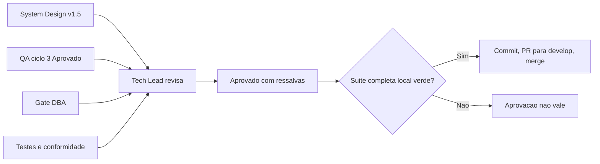

# Aprovação Final do Tech Lead — Cache único, skip do upload e segredo (fase 3)

## Identificação

- Projeto ou produto: `dropbox_sync` (`dbx`)
- Responsável Tech Lead: Tech Lead, instância `myPCWin/Adriano Sales Santos`
- Data da aprovação: 2026-10-19
- Escopo avaliado: fase 3 (cache único em `lib/state`, remoção de `lib/db`, skip do upload, chave canônica, `client_secret` obrigatório, guarda de origem vazia), branch `feature/cache-unico-p3` sobre `develop` @ `007f3ec`
- Uso do template padrão neste fechamento?: Sim
- Em caso de não, justificativa explícita para exceção: Não aplicável: template padrão usado
- Status final: **Aprovado com ressalvas** (Tech Lead, 2026-10-19), **válida apenas com a suíte completa local verde**
- Porte da demanda: G
- Registro de entrega: [2026-10-18-2243-registro-cache-unico-p3.md](2026-10-18-2243-registro-cache-unico-p3.md)

## Artefatos obrigatórios revisados

- Revisão consolidada do Tech Lead: realizada
- Link ou referência do arquivo concreto da revisão consolidada do Tech Lead: [2026-10-18-2243-revisao-consolidada-cache-unico.md](2026-10-18-2243-revisao-consolidada-cache-unico.md)
- System Design revisado: [system-design.md](../arquitetura/system-design.md) v1.5 (sai `lib/db`; `lib/state` com dois namespaces; PKCE no backlog)
- Template padrão de System Design utilizado?: Sim (documento existente do projeto, atualizado)
- Em caso de não, justificativa explícita: Não aplicável
- PRD aplicável?: Sim
- Referência do PRD revisado: [escopo-requisitos-e-criterios-de-aceite.md](../requisitos/escopo-requisitos-e-criterios-de-aceite.md) v1.5
- ARD aplicável?: Sim
- Referência do ARD revisado: [system-design.md](../arquitetura/system-design.md) v1.5
- Resumo das divergências resolvidas entre PRD, ARD, implementação e evidências de validação: DIV-25 a DIV-29 (DIV-28 revista); QA-P3-01 a 07; direção de dependência `lib/state` para `lib/walk`; contradição do segredo opcional em `lib/config.sh`
- Bloqueios remanescentes aceitos ou justificados: ressalvas O-1, O-5, O-6, O-7 (Senior Developer, próxima fase), RSK-43 (QA Expert, próxima fase), SC2034 pré-existente em `tests/unit/progress_test.sh:219` (Senior Developer, fase 5); backlog F-34, F-35 e F-32 (Business Analyst, fase 5)
- Validação QA frontend aplicável?: Não
- Template QA frontend utilizado?: Não
- Documento de validação QA frontend referenciado no fechamento final: Não aplicável: CLI sem interface gráfica; vale a [validação do QA](2026-10-18-2243-validacao-qa-cache-unico.md) (ciclo 3, Aprovado)
- Trecho, link ou evidência reaproveitada da validação QA frontend: Não aplicável
- Em caso de não, justificativa explícita: o projeto é uma CLI em shell script, sem frontend
- Documento de Design System referenciado?: Não (sem interface)
- Evidências adicionais consultadas: [parecer de testes](2026-10-18-2243-parecer-tdd-cache-unico.md), [parecer de conformidade](2026-10-18-2243-parecer-conformidade-cache-unico.md), [parecer do DBA](2026-10-18-2243-parecer-dba-cache-unico.md), [aceite do solicitante](../../.github/agents/memoria/entradas/2026-10-18-2243-aceite-testes-qa-p3.md), [log de prompt](../prompts/2026-10-18_2243_cache-unico-p3.md)

## Gates aplicados

| Gate | Aplicável | Resultado | Evidência | Observações |
|---|---|---|---|---|
| Business Analyst / System Design | Sim | Aprovado | Requisitos v1.5 e System Design v1.5 | Decisões propagadas na mesma rodada |
| QA Expert / Validação frontend | Sim (validação independente; sem frontend) | Aprovado no ciclo 3 | [validação do QA](2026-10-18-2243-validacao-qa-cache-unico.md) | Ciclos 1 e 2 Reprovados; suíte do QA com 41 casos aprovada pelo solicitante |
| UX Expert / Interface | Não | Não aplicável | — | Sem interface gráfica |
| DBA / Persistência | Sim | Aprovado com ressalvas, atendidas | [parecer do DBA](2026-10-18-2243-parecer-dba-cache-unico.md) | Persistência e autenticação mudaram; gate obrigatório em G |
| Testes (`protocolo-tdd`) | Sim | Aprovado (ciclos 1 a 4) | [parecer de testes](2026-10-18-2243-parecer-tdd-cache-unico.md) | — |
| Conformidade (`protocolo-conformidade`) | Sim | Aprovado com ressalvas | [parecer de conformidade](2026-10-18-2243-parecer-conformidade-cache-unico.md) | Achado 2 (menor) aberto com owner |
| Suíte completa local (`sh scripts/suite-completa.sh`) | Sim | **PENDENTE** | — | Condição de validade desta aprovação |

## Critérios de aceite consolidados

| Critério | Status | Evidência | Observações |
|---|---|---|---|
| Revisão consolidada do Tech Lead registrada | Atendido | [revisão consolidada](2026-10-18-2243-revisao-consolidada-cache-unico.md) | — |
| Referência concreta ao arquivo da revisão consolidada | Atendido | Link acima | — |
| Requisitos claros e rastreáveis | Atendido | Requisitos v1.5; RF-60 a RF-63, RNF-33 | — |
| PRD revisado quando aplicável | Atendido | v1.5 | — |
| ARD revisado quando aplicável | Atendido | System Design v1.5 | — |
| Divergências entre PRD, ARD, implementação e evidências tratadas | Atendido | Revisão consolidada | DIV-28 revista |
| System Design aderente ao template padrão | Atendido | v1.5 | — |
| Vínculo entre System Design e Design System | Não aplicável | — | Sem interface |
| Validação QA frontend registrada | Não aplicável | — | Sem frontend; validação independente do QA aprovada |
| Referência direta ao documento de validação QA frontend | Não aplicável | — | — |
| Riscos residuais aceitáveis | Atendido, com ressalvas | Abaixo | RSK-46 mitigado e com nota de versão obrigatória |
| Suíte completa local verde | **Pendente** | — | Sem ela a aprovação não vale |

## Riscos residuais e rollback

- Riscos residuais aceitos:
  - O-1 (recusa no `--receber` pela guarda antiga, sem o campo `recusada`), O-6 (nome enganoso de caso de teste) e O-7 (travessia parcial não grava entradas novas): Info, sem impacto em exclusão;
  - O-5 / achado 2 de conformidade (leitura de JSON em `upload.sh`, candidata a `lib/cmd`);
  - RSK-43 (`stat` validado só no uutils);
  - RSK-46, mitigado por RF-41(b), (e) e (f), com a nota de versão: em cada par espelhado, a primeira execução após a atualização não propaga exclusões e sai com código diferente de 0 (a memória v1 é descartada), e rotinas agendadas precisam tolerar isso; origem vazia com `--espelhar` exige `--permitir-origem-vazia`; o `dbx.db` legado fica intacto.
- Riscos residuais não aceitos: nenhum identificado.
- Plano de rollback: reverter o merge na `develop`; o `dbx.db` legado permanece no disco e as memórias v2 são descartadas e reconstruídas pela versão anterior (cache descartável); sem migração irreversível.
- Dependências críticas para monitoramento: código de saída da primeira execução pós-atualização em rotinas agendadas; uso de `--permitir-origem-vazia`; precisão de `stat` em ambientes com GNU coreutils.

## Decisão final

- Decisão do Tech Lead: **Aprovado com ressalvas — Tech Lead, 2026-10-19**.
- Condições para fechamento:
  - suíte completa local verde (`sh scripts/suite-completa.sh`, conferida por `--conferir` antes do push), hoje PENDENTE;
  - commit com o trailer `Remocao-de-casos: tests/unit/db_test.sh 4` e corpo com `Registro:` e `Prompt:`, hoje PENDENTE;
  - PR para `develop`, hoje PENDENTE, seguido de `sh scripts/limpar-worktrees.sh` após o merge.
- Pendências remanescentes (owner e prazo):
  - O-1, O-5, O-6, O-7: Senior Developer, próxima fase;
  - RSK-43: QA Expert, próxima fase;
  - F-32: Business Analyst, fase 5;
  - SC2034 em `tests/unit/progress_test.sh:219`: Senior Developer, fase 5;
  - F-34 e F-35: backlog.
- Escalonamentos necessários: nenhum; 2 reprovações do QA, abaixo do limite de 3 ciclos.
- Síntese final do impacto global da entrega: cache único sem dependência externa, skip do upload decidido pelo hash remoto, segredo obrigatório e guarda de exclusão em massa que não depende de estado. Lição: uma guarda de segurança que depende de estado é frágil a cada falha desse estado.
- Justificativa consolidada para eventual desvio do template padrão: não houve desvio.

