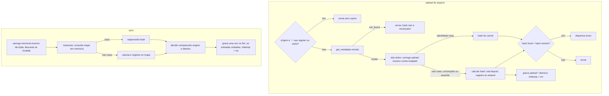

# Parecer do DBA — Cache unico de `content_hash` em `lib/state` (fase 3)

## Identificacao

| Campo | Valor |
|---|---|
| Sistema ou modulo | `lib/state` (cache unico), `lib/db` (removido), `commands/upload.sh`, `commands/sync.sh` |
| Responsavel DBA | DBA, por delegacao do Tech Lead (regra 44) |
| Data da versao | 2026-10-18 |
| Porte | **G** (remove componente de persistencia e muda o contrato de estado local) |
| Branch | `feature/cache-unico-p3`, a partir de `develop` (`007f3ec`) |
| Log de prompt | [2026-10-18_2243_cache-unico-p3.md](../prompts/2026-10-18_2243_cache-unico-p3.md) |
| Registro de entrega | [2026-10-18-2243-registro-cache-unico-p3.md](2026-10-18-2243-registro-cache-unico-p3.md) |
| Memoria transposta | `2026-10-18-2243-cache-unico-e-segredo`, `2026-10-18-1745-skip-upload-condicionado` (citadas por id, regra 43) |
| Destinatarios | Business Analyst (handoff, regra 26) e Tech Lead (parecer) |
| Baseline de formato | `lib/state` versao `1` (`DBX_STATE_VERSAO`); `lib/db` com DDL de `metadados_arquivos` e `operacoes_arquivos` |

## Contexto

Decisao do solicitante: o `lib/state` (arquivo de registros terminados em NUL) passa a ser o **unico** cache de `content_hash`; o `lib/db` (SQLite via `sqlite3` ou `python3`) sai. Pela decisao `2026-10-18-1745-skip-upload-condicionado`, o upload so dispensa o envio quando o `content_hash` remoto (`get_metadata`) for igual ao local; o cache apenas evita recalcular o hash local.

Estado atual verificado no codigo:

- `lib/state`: um arquivo por tripla (conta, origem, destino), nome `memoria-<resumo[0:32]>` sob `$XDG_STATE_HOME/dbx` (recuo `~/.local/state/dbx`, `DP-23`). Cabecalho de 4 campos (versao, conta, origem, destino) e registros `hash\ttamanho\tmtime\tcaminho_relativo\0`. Carga para array associativo, consulta em memoria, gravacao unica no fim por `mktemp` no mesmo diretorio e `mv`.
- `lib/db`: banco em `$XDG_STATE_HOME/dbx/dbx.db` (modo WAL, portanto tambem `dbx.db-wal` e `dbx.db-shm`). Chave de `metadados_arquivos` e o caminho **cru** recebido (`$origem` no upload, `$raiz/$relativo` no sync), sem conta e sem canonizacao. Cada chamada abre um processo `sqlite3` ou `python3`.
- O `sync` usa **os dois** caches hoje: consulta `lib/state`, depois `lib/db` como segundo nivel, e grava nos dois (`commands/sync.sh`, `_dbx_cmd_sync_resumo_local`). A remocao do `lib/db` toca tambem o `sync`, e nao so o upload.

## 1. Modelo do registro do upload

### Namespace: proprio, e nao o arquivo do `sync`

**Recomendacao: o upload usa namespace proprio**, com prefixo distinto (`upload-<resumo>`), no mesmo diretorio de estado. Razoes, em ordem de peso:

1. **`RF-48` depende da existencia do arquivo do `sync`.** `DBX_STATE_VISTO='sim'` e derivado de o arquivo da tripla existir, e libera o espelhamento sem o reconhecimento obrigatorio. Se o upload criasse ou escrevesse nesse arquivo, um par de raizes nunca sincronizado passaria por "ja visto" e a salvaguarda de primeira execucao com `--espelhar` seria dispensada. E o unico efeito colateral do compartilhamento que nao e "so desempenho".
2. **O upload nao tem par de raizes.** A chave do `sync` e relativa a raiz de origem; o upload recebe um arquivo isolado e um destino que nao influencia o hash local. Inventar uma tripla para o upload misturaria identidades.
3. **Ciclo de gravacao incompativel.** O `sync` reescreve o arquivo inteiro a partir do mapa em memoria no fim da execucao; um upload concorrente que gravasse no mesmo arquivo seria apagado pela regravacao do `sync`, e vice-versa.

O upload de **diretorio** ja delega ao `sync` (`dbx_cmd_sync_executar --enviar`) e continua no namespace do `sync`, sem mudanca.

### Granularidade: um arquivo de cache por origem

| Opcao | Custo por upload | Concorrencia | Crescimento |
|---|---|---|---|
| U1. Um arquivo por conta com todos os uploads | Le e regrava o arquivo inteiro: ~210 ms com 10 mil entradas, ~1,1 s com 50 mil (medido, ver item 3) | Dois uploads de arquivos diferentes disputam o mesmo arquivo; o ultimo apaga a entrada do outro | Uma entrada por caminho ja enviado, sem limite |
| **U2. Um arquivo por (conta, caminho canonico)** | Cabecalho e um registro: leitura e gravacao abaixo de 5 ms, independente do historico | Disputa so entre uploads da **mesma** origem, que gravam o mesmo valor | Um arquivo pequeno (~200 B, um bloco) por origem distinta; exige poda (item 2) |

**Recomendacao: U2.** O custo fica constante, a concorrencia entre uploads distintos desaparece por construcao, e a poda por idade e simples (cada arquivo tem o proprio `mtime`).

### Chave canonica (P4.2)

- **Caminho fisico absoluto** da origem, com ligacoes simbolicas resolvidas: `readlink -e` (ja na lista de `lib/preflight`) ou, sem processo extra, `cd -P` no diretorio pai e `pwd -P` com o nome final, seguido de resolucao do ultimo componente quando ele for ligacao. Assim `./a.txt`, `/home/u/a.txt` e uma ligacao para ele caem na mesma entrada. Ligacoes fisicas (mesmo inode, caminhos diferentes) geram entradas duplicadas, o que so custa espaco.
- O nome do arquivo de cache e o resumo de `conta\ncaminho_canonico`, pelo mesmo `dbx_hash_conteudo_fluxo` que o `lib/state` ja usa; nada do texto do caminho entra no nome (mesma razao documentada em `lib/state`).
- **Recomenda-se aplicar a mesma canonizacao a raiz local do `sync`** antes de calcular o resumo da tripla: hoje `sync --origem ./x` e `sync --origem /home/u/x` designam memorias diferentes e, pior para `RF-48`, pares "nunca vistos" diferentes.

### Vinculo a conta (`RF-52`)

O registro do upload guarda **apenas dado local** (identidade, tamanho, carimbos e hash do proprio arquivo). Esse hash nao depende da conta: um `content_hash` local reaproveitado apos troca de conta continua correto, e a decisao de dispensar o envio vem do `content_hash` remoto da conta corrente. O risco que motivou o `RF-52` (omitir transferencia por hash de outra conta) nao existe para este registro.

Por outro lado, o upload hoje **nao conhece** o `account_id`: ele so chega na troca do codigo de autorizacao (`lib/auth`, `DBX_AUTH_CONTA`), nao e persistido na credencial, e a renovacao de token nao o devolve. Vincular a conta custa uma chamada extra a `users/get_current_account` por upload.

| Alternativa | Efeito |
|---|---|
| A. Vincular literalmente (cabecalho com conta, chamada extra por upload) | Conformidade textual com `RF-38`/`RF-52`/`RNF-26`; +1 requisicao por upload, da mesma ordem de custo do `get_metadata` |
| **B. Emendar o `RF-52`**: o vinculo a conta vale para memoria que guarde dado **derivado do remoto** (como o `rev` que o `RF-38` preve); memoria que guarde so dado local nao precisa de conta | Sem requisicao extra; o `unlink` continua apagando tudo (`RF-51`) |
| C. Persistir o `account_id` na credencial ao vincular | Elimina a chamada, mas muda o formato do arquivo de credencial e exige recuo para credenciais antigas; fora do escopo desta fase |

**Recomendacao: B**, com decisao do solicitante (muda o texto de um requisito P0). Se o solicitante preferir A, a chamada deve ser feita uma vez por execucao e, em falha, o upload segue **sem cache** (nunca com conta `sem-identidade`, ver achado abaixo).

**Achado lateral (`RF-52`, `sync`):** quando `get_current_account` falha, o `sync` usa a conta literal `sem-identidade`. Duas contas diferentes que falhem a identificacao compartilham a mesma memoria. Como a memoria nao decide, o efeito e so desempenho, mas contraria a letra do `RF-52`; o correto e seguir sem memoria nesse caso, como o comentario de `_dbx_cmd_sync_conta` ja descreve.

### Campos do registro do upload

Cabecalho (verificado na carga, redundante com o resumo do nome, como no `sync`): `versao`, `tipo=upload`, `conta` (se a alternativa A for escolhida), `caminho_canonico`.

Registro unico: `content_hash`, `tamanho`, `mtime` e `ctime` em nanossegundos, `dispositivo`, `inode`.

- **`ctime` e `inode` entram porque o cache agora alimenta uma comparacao com o remoto.** Hash local obsoleto com remoto igual ao conteudo **antigo** faz o upload dispensar um envio necessario. `mtime` em segundos (o que `lib/state` e `lib/db` guardam hoje) nao distingue reescrita no mesmo segundo com o mesmo tamanho, e `mtime` pode ser restaurado por `touch -d`; `ctime` nao pode ser definido pelo usuario e muda a cada escrita.
- **Formato dos carimbos:** `stat -c '%.9Y %.9Z %d %i %s'` funciona no ambiente medido (uutils 0.8.0); a precisao em `%Y`/`%Z` precisa ser confirmada no GNU coreutils minimo suportado, com recuo para `%y`/`%z` (texto com nanossegundos) se faltar.
- **Regra anti-corrida (como o "racy git"):** nao registrar entrada cujo `mtime` esteja a menos de 2 s do relogio no momento do calculo; ela sera recalculada na proxima vez.
- **Ordem de captura:** `stat` antes **e** depois do calculo do hash; so registrar se os dois forem identicos. Hash calculado com carimbo lido depois de uma escrita concorrente ficaria associado ao carimbo novo e seria reaproveitado indevidamente.

### Entrada padrao e origem nao regular

- **Entrada padrao (`-`): sem cache**, nem leitura nem gravacao. O fluxo nao tem identidade nem carimbo, e e consumido no envio.
- **Origem que nao e arquivo regular** apos a resolucao (FIFO, dispositivo, socket): o upload ja recusa por `-f`; o cache nao deve ser consultado nem gravado.
- **Arquivo regular de tamanho 0: nao cachear.** O hash do vazio e constante e gratis, e arquivos de pseudo-sistemas (`/proc`, `/sys`) reportam tamanho 0 com conteudo variavel.
- **Calculo preguicoso:** quando `get_metadata` responde `not_found`, o envio ocorre sem precisar do hash local (`RF-33`, "sem consulta redundante"); o cache so e lido quando existe remoto para comparar.

## 2. Integridade

| Tema | Avaliacao | Recomendacao |
|---|---|---|
| Escrita atomica (`RNF-25`) | O padrao `mktemp` no mesmo diretorio e `mv` ja e atomico e o `mktemp` cria em `0600`. O **diretorio** de estado, porem, e criado por `mkdir -p` com o `umask` do usuario (tipicamente `0755`) em `lib/state` e em `lib/db`; o `dbx.db` atual e criado pelo SQLite com `0644` | Criar o diretorio com `umask 077`/`0700`, como `lib/config` faz; o upload reaproveita a mesma funcao de gravacao, sem caminho proprio |
| Dois uploads simultaneos da mesma origem | Gravam o mesmo valor (ou o de um conteudo que mudou entre os dois, que a dupla leitura de `stat` filtra); o `mv` garante arquivo inteiro | Nada a fazer: ultimo vence |
| Dois uploads de origens diferentes | Arquivos diferentes em U2 | Nada a fazer |
| Upload junto com `sync` | Namespaces diferentes; nenhuma interacao | Nada a fazer |
| Dois `sync` do mesmo par | Ultimo `mv` vence e descarta os hashes calculados pelo outro | **Aceitavel**: o cache nao decide (`RSK-23`, `RF-37`), a perda custa so recalculo. Nao introduzir trava: arquivo de trava e escrita persistente fora do `RNF-26` |
| Arquivo corrompido, truncado, versao desconhecida, cabecalho divergente | `dbx_state_carregar` ja descarta e segue com memoria vazia (`DP-27b`, `RF-42`) | Manter para o upload; registro com campo nao numerico tambem descarta |
| Temporarios orfaos (`.memoria.<pid>.*`) de processo interrompido | Acumulam no diretorio de estado; o `unlink` os remove, mais nada | Na gravacao, apagar `.memoria.*`/`.upload.*` com mais de 1 dia |
| Crescimento do `sync` | **Achado:** a gravacao escreve todo o mapa carregado mais o novo; entrada de arquivo apagado na origem nunca sai. A memoria cresce monotonicamente | Gravar apenas as entradas **visitadas** na execucao quando a travessia terminou completa; com travessia interrompida, manter o comportamento atual |
| Crescimento do upload (U2) | Um arquivo por origem distinta, sem limite | Poda por idade: ao gravar, remover `upload-*` sem acesso ha mais de 90 dias (`find -mtime +90`, `find` ja esta no `lib/preflight`); rodar so quando a contagem passar de um teto (ex.: 1024) para nao listar o diretorio a cada upload |

## 3. Desempenho

Medicao local (WSL2, bash, uutils 0.8.0; script em area temporaria, nao versionado):

| Entradas no arquivo NUL | Tamanho | Carga para o mapa | Regravacao |
|---|---|---|---|
| 1 | 117 B | < 1 ms | < 1 ms |
| 1.000 | 105 KB | 16 ms | 3 ms |
| 10.000 | 1,06 MB | 174 ms | 38 ms |
| 50.000 | 5,3 MB | 913 ms | 233 ms |

Processo `python3` com `sqlite3`: **~10 ms por processo** neste ambiente (o `sqlite3` CLI nao esta instalado, entao o `lib/db` usa sempre `python3`).

- **Upload (U2):** hoje o `lib/db` abre de 4 a 6 processos por upload (inicializar, consultar operacao, consultar metadado, salvar metadado, salvar operacao), ~40–60 ms. Com U2 o custo cai para um arquivo de um registro, abaixo de 5 ms.
- **Sync:** hoje o segundo nivel em `lib/db` abre um processo por arquivo nao encontrado na memoria e um por arquivo enviado ou identico: com 10 mil arquivos, da ordem de **100–200 s** so de processos. O `lib/state` sozinho custa ~0,2 s para o mesmo volume. A remocao do `lib/db` e o maior ganho de desempenho desta fase.
- **Indice:** desnecessario. O array associativo do bash ja e um indice de espalhamento em memoria; a consulta e O(1).
- **Escrita em lote:** o `sync` ja grava uma vez no fim; manter. O upload grava uma vez apos o envio bem-sucedido (ou apos a dispensa, quando o hash foi calculado).
- **Gatilho de revisao:** se uma raiz passar de ~100 mil arquivos (carga ~2 s), avaliar `mapfile -d ''` (bash 4.4+) no lugar do laco `read`, ou particionar a memoria do `sync` por subdiretorio de primeiro nivel.

## 4. Dado legado (`dbx.db`)

Caminho: `${XDG_STATE_HOME:-$HOME/.local/state}/dbx/dbx.db`, com `dbx.db-wal` e `dbx.db-shm` (modo WAL), no mesmo diretorio do `lib/state`.

| Opcao | Avaliacao |
|---|---|
| Migrar o conteudo | **Rejeitada.** Exige `sqlite3`/`python3`, justamente a dependencia que sai; as chaves sao caminhos crus sem conta, o `mtime` e em segundos e nao ha `ctime`/inode, entao nada migrado atenderia ao modelo novo. E so cache: o primeiro uso recalcula |
| Remover automaticamente | **Rejeitada.** Apagar arquivo do usuario sem pedido; e a versao nova nao deve conhecer o formato antigo nem ter caminho de remocao para ele |
| **Deixar intocado e documentado** | **Recomendada.** A versao nova nunca le nem escreve o `dbx.db`. O `unlink` ja remove o diretorio de estado inteiro (`RF-51`), e o arquivo sai por la. Documentar no README e nas notas da versao: o arquivo ficou obsoleto, contem caminhos absolutos de arquivos enviados e pode ser removido com `rm -f ~/.local/state/dbx/dbx.db*` |

Nomes nao colidem: o `lib/state` usa `memoria-*` e (proposto) `upload-*`.

## 5. Auditoria do `RNF-26` apos a mudanca

| Escrita persistente | Componente | Situacao frente ao `RNF-26` |
|---|---|---|
| Arquivo de credencial em `~/.config/dropbox_sync/` | `lib/config` | Fora do estado (configuracao, `DP-23`); autorizada a parte |
| Memoria do `sync` (`memoria-*`) | `lib/state` | Autorizada (`RF-38`) |
| **Memoria do upload (`upload-*`)** | `lib/state` | **Nao coberta pelo texto atual**, que autoriza so a memoria "do `sync`". Precisa de emenda |
| Temporarios `.memoria.*` no diretorio de estado | `lib/state` | Transitorio, mas pode ficar orfao; coberto pela poda proposta |
| Cursor de enumeracao | — | Autorizado e **nao implementado** (o cursor de `lib/sync` so pagina em memoria) |
| `dbx.db*` | `lib/db` | **Deixa de ser escrito**; o arquivo existente fica como legado inerte |
| Areas `mktemp -d` em `$TMPDIR` (`lib/hash`, `lib/http`, `lib/transfer`, `lib/walk`, `commands/sync`) | varios | Transitorias, removidas na execucao; nao sao estado |
| Temporario de recebimento ao lado do destino | `lib/cmd` | Escrita no arquivo do usuario, nao e estado |

**`operacoes_arquivos`:** os unicos leitores sao `dbx_db_consultar_operacao`, chamado so por `dbx_db_arquivo_alterado`, chamado so pelo upload — ou seja, o **caminho de decisao que viola o `RSK-23`** (`RSK-37`), em que o skip olhava so o lado local. No `sync` a tabela e somente escrita. Fora isso, so `tests/unit/db_test.sh`. Nenhum comando, relatorio ou script le o historico. A remocao nao perde funcao legitima; o `rev_remoto` que ela guardava nao era usado por ninguem.

Depois da mudanca, o criterio do `RNF-26` ("nenhum artefato persistente participa de decisao") volta a valer para o upload, **desde que** o hash em cache so seja usado para comparar com o `content_hash` remoto e a identidade do arquivo inclua `ctime` (item 1); com `mtime` em segundos, o cache pode levar a dispensa indevida e, nesse sentido estreito, ainda participaria da decisao.

## 6. Handoff ao Business Analyst (regra 26)

Itens que precisam virar requisito ou emenda, nesta fase:

1. **`RNF-26`:** incluir a memoria auxiliar de `content_hash` do **upload** no estado autorizado; registrar a remocao do `lib/db`/`dbx.db` e da dependencia `sqlite3`/`python3`.
2. **`RF-38`:** estender a memoria ao upload, com namespace proprio (um arquivo por origem canonica) e a proibicao de o upload criar ou tocar a memoria do `sync` (protecao de `RF-48`).
3. **`RF-52`:** decidir entre A (vincular o upload a conta, +1 requisicao) e B (emendar: vinculo obrigatorio so para memoria com dado derivado do remoto). **Decisao do solicitante.** Incluir tambem: sem identidade de conta, o `sync` segue sem memoria, nunca com `sem-identidade`.
4. **Novo criterio (P4.2):** chave pelo caminho fisico canonico; aplicar a mesma canonizacao a raiz local do `sync`.
5. **Novo criterio de corretude do cache:** identidade do arquivo com tamanho, `mtime` e `ctime` em nanossegundos, dispositivo e inode; regra anti-corrida de 2 s; `stat` antes e depois do hash. Caso de teste: reescrever arquivo no mesmo segundo com mesmo tamanho e remoto igual ao conteudo antigo **nao** pode ser dispensado.
6. **`RF-42`/`RNF-25`:** diretorio de estado em `0700`; descarte de registro malformado no upload; poda de temporarios orfaos.
7. **Crescimento:** `sync` grava so entradas visitadas em travessia completa; upload com poda por idade (90 dias) acionada por teto de contagem. Valores sujeitos a confirmacao do solicitante.
8. **Entrada padrao e origem nao regular ou vazia:** sem cache, por requisito explicito.
9. **Legado `dbx.db`:** deixar intocado; documentar no README e nas notas da versao como obsoleto e removivel; o `unlink` cobre a remocao. Atualizar `install.sh`, que ainda anuncia o `sqlite3` como recomendado.
10. **Rastreabilidade:** `RSK-37` passa a fechado pela fase 3; `F-25` atendido em "escolha de cache unico" e "chave canonica"; os itens de SQL (validacao, parametros, erros do recuo `python3`) ficam sem objeto com a remocao.
11. **System Design:** retirar `lib/db` da tabela de componentes, atualizar `lib/state` (dois namespaces) e substituir o diagrama abaixo no capitulo de estado local.

## Riscos e mitigacoes

| Risco | Impacto | Probabilidade | Mitigacao | Responsavel |
|---|---|---|---|---|
| Hash local obsoleto (mesmo segundo, mesmo tamanho) leva a dispensa indevida | Alto | Baixa | `ctime`/inode em ns, regra anti-corrida, dupla leitura de `stat` | Senior Developer |
| Upload escrevendo na memoria do `sync` libera espelhamento sem reconhecimento (`RF-48`) | Alto | Baixa | Namespace proprio e teste que verifica que upload nao cria `memoria-*` | Senior Developer, QA |
| Precisao de `stat` indisponivel no coreutils minimo | Medio | Media | Confirmar em teste; recuo para `%y`/`%z` | Senior Developer |
| Memoria do `sync` crescendo sem limite | Baixo | Alta | Gravar so entradas visitadas | Senior Developer |
| `dbx.db` legado com caminhos absolutos esquecido em disco | Baixo | Alta | Documentacao e `unlink` | Business Analyst |

Nao aplicavel: capacidade de compute, replica, backup e sharding — o cache e local, por usuario, descartavel e reconstruivel; nao ha servidor de banco. Monitoracao operacional: nao aplicavel alem do gatilho de revisao do item 3, por nao haver telemetria no produto.

## Parecer

**Aprovado com ressalvas** para a decisao do solicitante (cache unico em `lib/state`, remocao do `lib/db`). Ressalvas bloqueantes para o fechamento da implementacao: namespace proprio do upload (item 1), identidade do arquivo com `ctime` e regra anti-corrida (item 1), e decisao do solicitante sobre o `RF-52` (alternativa A ou B). Os demais itens sao recomendacoes com owner no handoff. Necessita revisao do Tech Lead: sim.

## Ciclo de leitura e escrita do cache

