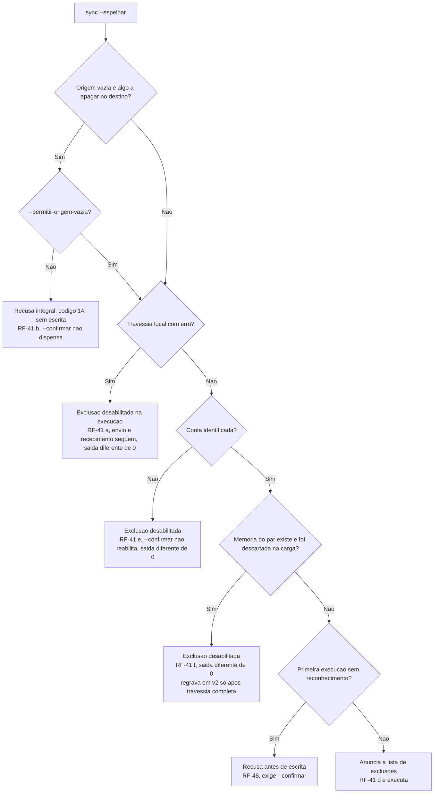

# Registro de entrega — Cache único, skip do upload e segredo obrigatório (fase 3)

## Identificação

| Campo | Valor |
|---|---|
| Projeto | `dropbox_sync` (`dbx`) |
| Porte | **G** (remove o componente `lib/db`, muda a persistência e a autenticação) |
| Branch | `feature/cache-unico-p3`, a partir de `develop` @ `007f3ec` |
| Instância | `myPCWin/Adriano Sales Santos` |
| Data | 2026-10-18 a 2026-10-19 |
| Agent do registro | `documentation-writer` (por delegação do Tech Lead, regra 42) |
| Log de prompt | [2026-10-18_2243_cache-unico-p3.md](../prompts/2026-10-18_2243_cache-unico-p3.md) |
| Fonte da demanda | [2026-10-18-analise-melhorias.md](../sources/2026-10-18-analise-melhorias.md) (P3 e P4) |
| Revisão consolidada | [2026-10-18-2243-revisao-consolidada-cache-unico.md](2026-10-18-2243-revisao-consolidada-cache-unico.md) |
| Aprovação final | [2026-10-18-2243-aprovacao-final-cache-unico.md](2026-10-18-2243-aprovacao-final-cache-unico.md) |
| Histórico da fase | [2026-10-19-0604-fase-3-cache-unico.md](../../.github/agents/memoria/historico/2026-10-19-0604-fase-3-cache-unico.md) |

## Contexto e objetivo

O pedido e a cadeia de decisões do solicitante estão no [log de prompt](../prompts/2026-10-18_2243_cache-unico-p3.md); aqui não se repetem. Em resumo operacional: a fase 3 do plano `2026-10-18-1745-melhorias-em-fases` unifica o cache de `content_hash` em `lib/state`, remove `lib/db` e a dependência de `sqlite3`/`python3`, condiciona o skip do upload ao `content_hash` remoto, torna o `client_secret` obrigatório na biblioteca (PKCE fora) e reforça a guarda contra exclusão em massa do `sync --espelhar`.

## Decisões (por id, em `.github/agents/memoria/entradas/`)

| Id | Assunto |
|---|---|
| [`2026-10-18-2243-cache-unico-e-segredo`](../../.github/agents/memoria/entradas/2026-10-18-2243-cache-unico-e-segredo.md) | `lib/state` é o cache único; `lib/db` sai; `client_secret` obrigatório; paralelismo adiado |
| [`2026-10-18-2243-cache-do-upload`](../../.github/agents/memoria/entradas/2026-10-18-2243-cache-do-upload.md) | Cache do upload sem vínculo a conta, com poda; DIV-26 a DIV-29; DIV-28 revista; QA-P3-01 |
| [`2026-10-18-2243-guarda-origem-vazia`](../../.github/agents/memoria/entradas/2026-10-18-2243-guarda-origem-vazia.md) | Guarda de origem vazia independe da memória; opção `--permitir-origem-vazia` |
| [`2026-10-18-1745-skip-upload-condicionado`](../../.github/agents/memoria/entradas/2026-10-18-1745-skip-upload-condicionado.md) | Skip do upload só com `content_hash` remoto igual (RSK-23); anterior, implementado nesta fase |
| [`2026-10-18-2243-aceite-testes-qa-p3`](../../.github/agents/memoria/entradas/2026-10-18-2243-aceite-testes-qa-p3.md) | Aceite do solicitante da suíte do QA e da remoção do `db_test` |

## Escopo técnico e arquivos modificados

Levantamento por `git status --short` e `git diff --numstat 007f3ec` (acréscimos/remoções); arquivos novos contados por linhas.

| Grupo | Arquivo | Alteração |
|---|---|---|
| Código | `lib/db.sh` | removido (-207) |
| Código | `lib/state.sh` | +361/-93 (dois namespaces, identidade forte, poda, `DBX_STATE_DESCARTADA`, versão 2) |
| Código | `lib/hash.sh` | +40 (`dbx_hash_identidade`, definição única de identidade no domínio) |
| Código | `lib/auth.sh` | +43/-2 (segredo obrigatório, classe `configuracao`, `dbx_auth_preparar`) |
| Código | `lib/errors.sh` | +53/-22 |
| Código | `lib/walk.sh` | +20/-10 |
| Código | `lib/path.sh` | +15 (chave canônica, RF-62) |
| Código | `lib/http.sh` | +11/-4 (P3.4, subshells duplicados) |
| Código | `lib/config.sh` | +5/-3 (comentário do segredo) |
| Código | `commands/sync.sh` | +149/-48 (memória por entradas visitadas, guardas RF-41, `--permitir-origem-vazia`) |
| Código | `commands/upload.sh` | +94/-21 (skip pelo hash remoto, cache do upload, `--rev` sem skip) |
| Código | `bin/dbx` | +17/-2 (ajuda do `sync`) |
| Código | `install.sh` | -7 (sai o `sqlite3` recomendado) |
| Teste | `tests/unit/state_test.sh` | novo (488 linhas) |
| Teste | `tests/unit/cmd_test.sh` | novo (181 linhas) |
| Teste | `tests/unit/db_test.sh` | removido (-106; 4 casos, redução declarada) |
| Teste | `tests/unit/{auth,errors,hash,http,path,preflight,walk}_test.sh` | ampliados (+92, +44, +75, +33, +41, +79, +44) |
| Teste | `tests/integracao/{comandos,composicao,sync}_test.sh` | ampliados (+464/-18, +3, +436) |
| Teste (QA) | `tests/integracao/qa_cache_unico_p3_test.sh` | novo (974 linhas, 33 casos) |
| Teste (QA) | `tests/unit/qa_state_p3_test.sh` | novo (249 linhas, 8 casos) |
| Documentação viva | `CLAUDE.md`, `README.md`, `docs/arquitetura/system-design.md` (v1.5), `docs/testes/mapa-modulos.md` | atualizados |
| Requisitos | `escopo-requisitos-e-criterios-de-aceite.md` (v1.5), `decisoes-pendentes.md`, `funcionalidades-candidatas.md`, `riscos-restricoes-e-licenciamento.md` | atualizados |
| Governança | 5 entradas de memória em `entradas/`, log de prompt, 4 pareceres e este conjunto de fechamento | novos |

Requisitos criados: RF-60 a RF-63, RNF-33, RSK-42 a RSK-46, F-34, F-35, DP-34. Emendados: RF-33, RF-38, RF-41 (alínea (b) reescrita; (e) e (f) novas), RF-42, RF-48, RF-51(f), RF-52, RF-53(e), RNF-02, RNF-25, RNF-26, RNF-32(d). RSK-37 encerrado. DIV-25 a DIV-29 resolvidas.

## Decisão

Resumo em formato ADR; a análise de três abordagens por item está no [parecer de testes](2026-10-18-2243-parecer-tdd-cache-unico.md) e o modelo de dados no [parecer do DBA](2026-10-18-2243-parecer-dba-cache-unico.md).

- **Contexto:** dois caches de hash coexistiam (SQLite em `lib/db`, arquivo NUL em `lib/state`); o do upload exigia `sqlite3`/`python3`, com achados P3.1, P4.3 e P4.4.
- **Decisão:** `lib/state` único, com um namespace por uso (memória do `sync`, registro do `upload` por origem canônica); identidade do arquivo por inode, dispositivo e `mtime`/`ctime` em nanossegundos, com `stat` antes e depois do hash e regra anti-corrida de 2 s; poda acima de 10 mil entradas removendo as não usadas há mais de 90 dias; diretório de estado em 0700; skip do upload somente com `content_hash` remoto igual.
- **Alternativas rejeitadas:** manter `lib/db` (dependência e superfície de SQL); vincular o cache do upload à conta (RF-52, +1 requisição sem ganho de proteção, já que a comparação com o hash remoto protege entre contas); implementar PKCE (backlog F-35); paralelismo (backlog F-34, com medição prévia).
- **Trade-off principal:** a guarda de exclusão. Ver a lição na seção seguinte e o diagrama.

### Guarda de origem vazia: de uma guarda dependente de estado a uma guarda sem memória

A primeira decisão (DIV-28) abria a exclusão em massa sem conta, e foi revista pelo Tech Lead. O QA-P3-01 foi tratado por desabilitação da exclusão quando a memória é descartada, mas isso apenas adiava a exclusão (QA-P3-05 a 07). O solicitante escolheu a guarda sem memória: origem vazia com algo a apagar é sempre recusada, salvo `--permitir-origem-vazia`.

**Lição registrada:** uma guarda de segurança que depende de estado é frágil a cada falha desse estado.

## Evidências de validação

Pareceres em arquivos próprios, referenciados por link e não transcritos:

| Gate | Documento | Resultado |
|---|---|---|
| DBA (handoff ao BA, regra 26) | [parecer do DBA](2026-10-18-2243-parecer-dba-cache-unico.md) | Aprovado com ressalvas (incorporadas; ver decisão `cache-do-upload`) |
| Testes (`protocolo-tdd`), ciclos 1 a 4 | [parecer de testes](2026-10-18-2243-parecer-tdd-cache-unico.md) | Aprovado em todos os ciclos |
| Conformidade (`protocolo-conformidade`), ciclos 1 a 4 | [parecer de conformidade](2026-10-18-2243-parecer-conformidade-cache-unico.md) | Aprovado com ressalvas (achado 2, menor, aberto) |
| QA Expert | [validação do QA](2026-10-18-2243-validacao-qa-cache-unico.md) | Ciclo 1 Reprovado; ciclo 2 Reprovado; ciclo 3 **Aprovado** |

Ciclos do QA: no ciclo 1, QA-P3-01 (bloqueante), QA-P3-02 e 03 (maiores) e 04 (menor); no ciclo 2, QA-P3-05 e 06 (bloqueantes) e 07 (maior); o ciclo 3 aprovou com as observações O-1, O-6 e O-7. Detalhe na validação e no histórico da fase.

### Testes rodados (contagens literais do runner)

| Comando | Resultado |
|---|---|
| `bash tests/run.sh < /dev/null` (ciclo 3 do QA) | 26 arquivos, **894 aprovados, 0 falhas, 2 pulados** (853 do desenvolvimento e das fases anteriores e 41 do QA) |
| `bash scripts/verificar-remocao-de-casos.sh` | guarda de remoção de casos de 772 para **833**, com a redução **declarada** de `tests/unit/db_test.sh` em 4, aprovada pelo solicitante |
| `shellcheck` | 0 achados no código e nos testes da fase; SC2034 pré-existente em `tests/unit/progress_test.sh:219` (fora do diff, ressalva abaixo) |

O parecer de testes registra 890 no ciclo 4 do desenvolvimento (antes dos 4 casos novos do QA); o número de 894 é o da execução do QA no ciclo 3.

### Suíte do QA (aprovada pelo solicitante, [aceite](../../.github/agents/memoria/entradas/2026-10-18-2243-aceite-testes-qa-p3.md))

| Arquivo | Casos | sha256 |
|---|---|---|
| `tests/integracao/qa_cache_unico_p3_test.sh` | 33 | `a77147099fef95b28ac2ded66b02820612866e11080399ad4f241263ec316649` |
| `tests/unit/qa_state_p3_test.sh` | 8 | `abc531546531dec8209094ec3f0154af27fe4f27de83161c507dd1dbc496aa12` |

### Suíte completa local, commit e PR

| Item | Estado |
|---|---|
| Suíte completa local (`sh scripts/suite-completa.sh`) | verde em `9407c9a`: 26 arquivos, 894 aprovados, 0 reprovados, 2 pulados (vetor oficial sem rede), 142 s; `--conferir` com saida 0 |
| Commit | `9407c9a` (implementacao, com `Remocao-de-casos: tests/unit/db_test.sh 4`, aceita pela guarda) e o commit de documentacao que preenche os registros |
| PR | [#37](https://github.com/salesadriano/dropbox_sync/pull/37) para `develop`, labels `review` e `enhancement` |

Nenhum desses três itens foi executado nem registrado até a emissão deste documento. A aprovação do Tech Lead só vale com a suíte completa local verde.

## Seção de persistência e dados

- **Modelo:** arquivo NUL por uso no diretório de estado do usuário, diretório 0700, arquivos 0600; escrita por temporário e renomeação; registro malformado descartado e reconstruído.
- **Versão do formato:** memória do `sync` passa de v1 para v2 (RSK-46).
- **Legado:** `dbx.db*` permanece intacto e documentado como obsoleto; `unlink` o remove; sem migração.
- **Rollback de persistência:** reverter o merge restaura `lib/db`; o `dbx.db` legado continua no disco, e as memórias v2 são descartadas pela versão anterior e reconstruídas (cache descartável).

## Diagrama (Mermaid): decisão de exclusão no `sync --espelhar`

A guarda (b) vem primeiro e não consulta a memória; (a), (e) e (f) cobrem a origem não vazia com base inutilizável (defesa em profundidade). Em `--dry-run` com origem vazia e algo a apagar, o plano anuncia `recusaria=origem vazia` e sai com 0 (RF-44).

## Riscos, impacto e rollback

| Risco | Estado |
|---|---|
| RSK-46: primeira execução após a atualização, por par espelhado, não propaga exclusões e sai com código diferente de 0 | Mitigado por RF-41(b) reescrito e RF-41(f); **nota de versão obrigatória** abaixo |
| RSK-43: `stat` com nanossegundos validado só no uutils, não no GNU coreutils | Aberto; owner QA Expert, próxima fase |
| RSK-42, 44, 45 (handoff do DBA) | Tratados nos requisitos; ver [riscos](../requisitos/riscos-restricoes-e-licenciamento.md) |
| RSK-37 | Encerrado pelo skip condicionado (RF-60) |

**Nota de versão (RSK-46), a constar da publicação:**

- Em cada par espelhado, a primeira execução após a atualização **não propaga exclusões e sai com código diferente de 0**, porque a memória v1 é descartada. Rotinas agendadas precisam tolerar isso.
- Origem vazia com `--espelhar` agora exige `--permitir-origem-vazia`.
- O `dbx.db` legado fica intacto e pode ser removido.
- O `client_secret` é obrigatório; a recusa sem segredo sai na classe `configuracao` (código 3).

**Rollback:** reverter o commit de merge na `develop`. Sem migração de dados irreversível; o legado não foi tocado.

## Próximos passos e ressalvas (owner e prazo)

| Item | Descrição | Owner | Prazo |
|---|---|---|---|
| O-1 | No `--receber`, a recusa sai pela guarda antiga, sem o campo `recusada` no plano | Senior Developer | Próxima fase |
| O-6 | Nome de `sem_conta_origem_vazia_com_confirmar_nao_apaga_nada` ficou enganoso | Senior Developer | Próxima fase |
| O-7 | Travessia parcial não grava entradas novas | Senior Developer | Próxima fase |
| O-5 / achado 2 | Leitura de JSON em `upload.sh`, candidata a `lib/cmd` | Senior Developer | Próxima fase |
| RSK-43 | Validar `stat` no GNU coreutils | QA Expert | Próxima fase |
| F-34, F-35 | Paralelismo (com medição) e PKCE | Backlog | Sem prazo |
| F-32 | Caixa fora do ASCII | Business Analyst | Fase 5 |
| SC2034 | Pré-existente em `tests/unit/progress_test.sh:219` | Senior Developer | Fase 5 |

## Aceites

- Solicitante: aprovou a suíte do QA e a remoção dos 4 casos do `db_test` ([aceite](../../.github/agents/memoria/entradas/2026-10-18-2243-aceite-testes-qa-p3.md)); declaração no commit por `Remocao-de-casos: tests/unit/db_test.sh 4`.
- QA Expert: Aprovado no ciclo 3.
- Tech Lead: "Aprovado com ressalvas — Tech Lead, 2026-10-19", válido apenas com a suíte completa local verde ([aprovação final](2026-10-18-2243-aprovacao-final-cache-unico.md)).

## Intervenção humana (regra 48)

`sh scripts/alteracoes-externas.sh --detectar` antes da escrita: sem alteração externa pendente. Os arquivos deste conjunto são registrados com `--registrar` ao final.
