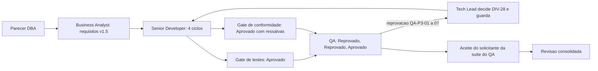

# Revisão Consolidada do Tech Lead — Cache único, skip do upload e segredo (fase 3)

## Identificação

- Projeto ou produto: `dropbox_sync` (`dbx`)
- Responsável Tech Lead: Tech Lead, instância `myPCWin/Adriano Sales Santos`
- Data da revisão: 2026-10-19
- Escopo revisado: fase 3 (cache único em `lib/state`, remoção de `lib/db`, skip do upload, chave canônica, `client_secret` obrigatório, guarda de origem vazia); branch `feature/cache-unico-p3` sobre `develop` @ `007f3ec`
- Agents envolvidos: Tech Lead, Senior Developer, QA Expert, Business Analyst, DBA (documentation-writer como utilitário)
- Status da revisão: Concluída com ressalvas
- Porte da demanda: G
- Registro de entrega: [2026-10-18-2243-registro-cache-unico-p3.md](2026-10-18-2243-registro-cache-unico-p3.md)
- Log de prompt: [2026-10-18_2243_cache-unico-p3.md](../prompts/2026-10-18_2243_cache-unico-p3.md)

## Resumo executivo

- Objetivo da entrega: unificar o cache de `content_hash` em `lib/state`, remover `lib/db` e a dependência de `sqlite3`/`python3`, condicionar o skip do upload ao hash remoto, exigir o `client_secret` na biblioteca e fechar a brecha de exclusão em massa do `sync --espelhar`.
- Contexto consolidado: decisões em [`cache-unico-e-segredo`](../../.github/agents/memoria/entradas/2026-10-18-2243-cache-unico-e-segredo.md), [`cache-do-upload`](../../.github/agents/memoria/entradas/2026-10-18-2243-cache-do-upload.md) e [`guarda-origem-vazia`](../../.github/agents/memoria/entradas/2026-10-18-2243-guarda-origem-vazia.md); o skip condicionado vem de [`skip-upload-condicionado`](../../.github/agents/memoria/entradas/2026-10-18-1745-skip-upload-condicionado.md).
- Resultado executivo da revisão: gates de testes e conformidade aprovados; QA aprovou no ciclo 3 após duas reprovações; a suíte do QA e a remoção do `db_test` têm aceite do solicitante. Suíte local de referência: 26 arquivos, 894 aprovados, 0 falhas, 2 pulados. A **suíte completa local, o commit e o PR estão PENDENTES**.
- Recomendação do Tech Lead: aprovar com ressalvas, condicionado à suíte completa local verde.

## PRD e ARD

- PRD aplicável?: Sim
- Referência do PRD: [escopo, requisitos e critérios de aceite](../requisitos/escopo-requisitos-e-criterios-de-aceite.md) v1.5
- ARD aplicável?: Sim
- Referência do ARD: [System Design](../arquitetura/system-design.md) v1.5

| Artefato | Item revisado | Consistência com entrega | Lacunas encontradas | Observações |
|---|---|---|---|---|
| PRD | RF-60 a RF-63, RNF-33; emendas RF-33, RF-38, RF-41, RF-42, RF-48, RF-51(f), RF-52, RF-53(e), RNF-02, RNF-25, RNF-26, RNF-32(d) | Consistente; RF-41(b) reescrito após a decisão do solicitante | Nenhuma em aberto no escopo | RF-41(e) e (f) passam a defesa em profundidade |
| ARD | Sai `lib/db`; `lib/state` com dois namespaces; identidade no domínio (`lib/hash`); PKCE para o backlog | Consistente | `CLAUDE.md` ainda citava `lib/db.sh` (apontado pela conformidade) | Resolvido: o Tech Lead corrigiu o `CLAUDE.md` (verificador de instruções sem drift) e o Business Analyst reescreveu a linha "Natureza do dado" do System Design com o formato v2; conferido pelo Tech Lead no fechamento |

## Divergências entre PRD, ARD, implementação e evidências de validação

| Divergência | Origem | Impacto | Resolução adotada | Status |
|---|---|---|---|---|
| DIV-25 | Business Analyst | Escopo do cache | Resolvida pela decisão do solicitante (DP-34) | Resolvida |
| DIV-26: identidade fraca da memória do `sync` | Business Analyst | Dispensa indevida por arquivo reescrito no mesmo segundo | Memória do `sync` usa a identidade forte (RF-38(e)) | Resolvida |
| DIV-27: `upload --rev` com skip | Business Analyst | Skip esconderia o rev | Sem skip com `--rev`; o servidor faz valer o rev (RF-60(i)) | Resolvida |
| DIV-28: sem identidade de conta | Business Analyst, Senior Developer | Exclusão em massa sem conta | Decidida e depois **revista** (ver Decisões do Tech Lead) | Resolvida |
| DIV-29: modo do diretório de estado | Business Analyst | Estado legível por outros | Correção para 0700 quando o diretório é do usuário (RNF-25(b1)) | Resolvida |
| `lib/config.sh` declarava o segredo opcional; recusa saía com código 2 | QA (QA-P3-02) | Contradizia RF-63 e RF-03 | Recusa na classe `configuracao` (3); comentário corrigido; dois casos do `auth_test` passaram a afirmar 3 | Resolvida |
| Dependência `lib/state` para `lib/walk` | Conformidade (achado 1) | Contra a direção das camadas | Identidade definida em `lib/hash`; guarda de regressão | Resolvida |

- Conclusão específica sobre divergências entre PRD e ARD: nenhuma em aberto; o System Design v1.5 e os requisitos v1.5 foram atualizados na mesma rodada das decisões (regra do solicitante de propagar decisões aos requisitos).
- Conclusão específica sobre divergências entre artefatos, implementação e evidências: as lacunas encontradas pelo QA (QA-P3-01 a 07) foram corrigidas e cobertas por caso e por mutante; restam apenas as observações O-1, O-6 e O-7 (Info).

## Artefatos consolidados por agent

| Agent | Artefato (link) | Veredito ou resultado registrado lá | Ressalva do Tech Lead |
|---|---|---|---|
| Senior Developer | [registro de entrega](2026-10-18-2243-registro-cache-unico-p3.md), [parecer de testes](2026-10-18-2243-parecer-tdd-cache-unico.md), [parecer de conformidade](2026-10-18-2243-parecer-conformidade-cache-unico.md) | Testes: Aprovado (ciclos 1 a 4). Conformidade: Aprovado com ressalvas (achado 2, menor) | Achado 2 e O-5 com owner e prazo (ver Pendências) |
| QA Expert | [validação](2026-10-18-2243-validacao-qa-cache-unico.md) | Ciclo 1 Reprovado; ciclo 2 Reprovado; ciclo 3 Aprovado, com O-1, O-6, O-7 | Observações aceitas como ressalva; RSK-43 a validar |
| Business Analyst | [requisitos v1.5](../requisitos/escopo-requisitos-e-criterios-de-aceite.md), [System Design v1.5](../arquitetura/system-design.md) | Requisitos criados e emendados; DIV-25 a DIV-29 resolvidas | Nenhuma |
| UX Expert | Não aplicável: sem interface gráfica; a saída de CLI não mudou de contrato além do campo `recusada` e da opção nova | — | — |
| DBA | [parecer](2026-10-18-2243-parecer-dba-cache-unico.md) | Aprovado com ressalvas; handoff ao BA (regra 26) incorporado | Ressalvas bloqueantes atendidas: namespace próprio, identidade com `ctime` e anti-corrida, decisão do RF-52 |

## Decisões próprias do Tech Lead

| Decisão | Motivação | Impacto | Status |
|---|---|---|---|
| DIV-26, DIV-27, DIV-29 | Divergências do Business Analyst sem decisão do solicitante | Identidade forte no `sync`; sem skip com `--rev`; diretório de estado corrigido para 0700 | Ativa |
| **DIV-28 decidida e depois revista** | A primeira decisão (pedir reconhecimento sem identidade de conta) abria a exclusão em massa sem conta: rotina com `--confirmar` sobre origem vazia apagaria o destino | Revista: sem conta, a exclusão fica desabilitada na execução, como RF-41(a), nos dois sentidos; `--confirmar` não reabilita (RF-41(e)) | Ativa |
| QA-P3-01 (bloqueante): memória descartada desabilita exclusões | Memória existente mas descartada (versão antiga, truncada, corrompida) zerava a base e apagava o destino | RF-41(f); regrava em v2 após travessia completa | Ativa como defesa em profundidade |
| Complemento sobre `--dry-run` | Simulação com origem vazia | Plano anuncia `recusaria=origem vazia` e sai com 0 (RF-44) | Ativa |
| Manter RF-41(e) e (f) após a guarda sem memória | Defesa em profundidade para origem parcial com base inutilizável | Memória ilegível conta como descartada; só se regrava após travessia completa | Ativa |
| Recomendações do DBA aceitas | Namespace próprio, identidade forte, 0700, legado intacto | Ver decisão `cache-do-upload` | Ativa |

**Lição registrada:** o QA-P3-01, corrigido de início por desabilitação, só adiava a exclusão (QA-P3-05 a 07). Por isso o solicitante escolheu a guarda sem memória. Uma guarda de segurança que depende de estado é frágil a cada falha desse estado.

## Itens impactados e pontos validados

| Item | Tipo | Evidência (link) | Risco | Mitigação |
|---|---|---|---|---|
| Exclusão no `sync --espelhar` | Segurança, P0 | [validação do QA, ciclo 3](2026-10-18-2243-validacao-qa-cache-unico.md); mutantes MG1 a MG5 | Exclusão em massa | Guarda (b) sem memória; (a), (e), (f) em profundidade |
| Skip do upload | Integridade de dados | [parecer de testes](2026-10-18-2243-parecer-tdd-cache-unico.md); casos do QA | Dispensa indevida (RSK-37) | Skip só com hash remoto igual; RSK-37 encerrado |
| Cache em disco (estado local) | Persistência | [parecer do DBA](2026-10-18-2243-parecer-dba-cache-unico.md) | Cache obsoleto, permissões, crescimento | Identidade forte, 0700/0600, poda |
| `client_secret` obrigatório | Autenticação | [parecer de testes](2026-10-18-2243-parecer-tdd-cache-unico.md), seção de segurança | Recusa sem motivo | Classe `configuracao`, código 3, zero chamadas de rede |
| Remoção de `lib/db` e `db_test` | Arquitetura | Aceite do solicitante; `Remocao-de-casos` no commit | Redução de casos | Guarda de remoção de casos: 772 para 833, redução declarada de 4 |
| Primeira execução após a atualização | Operação | RSK-46 | Rotina agendada com código diferente de 0 | Nota de versão obrigatória no registro de entrega |

## Pendências, bloqueios e riscos residuais

| Tipo | Descrição | Impacto | Owner | Próxima ação |
|---|---|---|---|---|
| Pendência de gate | Suíte completa local, commit e PR: PENDENTE | Bloqueia o fechamento | Tech Lead | `sh scripts/suite-completa.sh` e registro antes do push |
| Ressalva | O-1: no `--receber`, recusa pela guarda antiga, sem o campo `recusada` no plano | Mensagem menos precisa; lado seguro | Senior Developer | Próxima fase |
| Ressalva | O-6: nome de `sem_conta_origem_vazia_com_confirmar_nao_apaga_nada` enganoso | Legibilidade do teste | Senior Developer | Próxima fase |
| Ressalva | O-7: travessia parcial não grava entradas novas | Custo de recálculo | Senior Developer | Próxima fase |
| Ressalva | O-5 / achado 2: leitura de JSON em `upload.sh`, candidata a `lib/cmd` | Gêmeos de leitura | Senior Developer | Próxima fase |
| Risco | RSK-43: `stat` validado só no uutils | Identidade degradada em outro ambiente | QA Expert | Próxima fase |
| Backlog | F-34 (paralelismo, com medição) e F-35 (PKCE) | — | Backlog | Sem prazo |
| Backlog | F-32 (caixa fora do ASCII) | — | Business Analyst | Fase 5 |
| Pendência | SC2034 pré-existente em `tests/unit/progress_test.sh:219` | Lint | Senior Developer | Fase 5 |

## Impacto global da entrega

- Impacto no negócio: elimina a dependência de `sqlite3`/`python3` e fecha a brecha de exclusão em massa; exige que rotinas agendadas tolerem a primeira execução pós-atualização.
- Impacto técnico: um único cache sem dependência; `lib/db` removido; identidade do arquivo no domínio; `client_secret` obrigatório.
- Impacto operacional: nota de versão (RSK-46); origem vazia com `--espelhar` exige `--permitir-origem-vazia`; `dbx.db` legado intacto e removível.
- Impacto em UX: não aplicável; mudam apenas ajuda do `sync`, README e mensagens de CLI.
- Impacto em dados: memória v1 descartada e reconstruída em v2; registro do upload novo; sem migração.

## Encaminhamento para fechamento

- Pronto para aprovação final?: Sim, com a condição da suíte completa local verde
- Dependências para `templates/aprovacao-final-tech-lead-template.md`: suíte completa local verde; commit com `Remocao-de-casos: tests/unit/db_test.sh 4`; PR para `develop`
- Arquivo concreto desta revisão consolidada para referência no fechamento final: `docs/reviews/2026-10-18-2243-revisao-consolidada-cache-unico.md`
- Resumo das divergências resolvidas que devem constar no fechamento final: DIV-25 a DIV-29 (DIV-28 revista), QA-P3-01 a 07, direção de dependência `lib/state` para `lib/walk`, contradição do segredo opcional
- Bloqueios remanescentes que precisam constar no fechamento final: suíte completa local PENDENTE; ressalvas O-1, O-5, O-6, O-7, RSK-43, SC2034
- Observações finais do Tech Lead: a guarda de origem vazia sem memória é o ponto de maior risco da fase; a lição de que guarda dependente de estado é frágil orienta as próximas fases.

