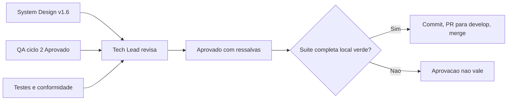

# Aprovação Final do Tech Lead — Documentação, manutenção e aliases em inglês (fase 4)

## Identificação

- Projeto ou produto: `dropbox_sync` (`dbx`)
- Responsável Tech Lead: Tech Lead, instância `myPCWin/Adriano Sales Santos`
- Data da aprovação: 2026-10-19
- Escopo avaliado: fase 4 (aliases em inglês RF-64, guarda de origem vazia pelo plano, localidade da comparação sem caixa, comentários de `lib/http.sh` e `lib/transfer.sh`, RNF-34, poda do pacote de agents), branch `feature/docs-e-aliases-p4` sobre `develop` @ `6b00bcd`
- Uso do template padrão neste fechamento?: Sim
- Em caso de não, justificativa explícita para exceção: Não aplicável: template padrão usado
- Status final: **Aprovado com ressalvas** (Tech Lead, 2026-10-19), **válida apenas com a suíte completa local verde**
- Porte da demanda: G
- Registro de entrega: [2026-10-19-0829-registro-docs-e-aliases-p4.md](2026-10-19-0829-registro-docs-e-aliases-p4.md)

## Artefatos obrigatórios revisados

- Revisão consolidada do Tech Lead: realizada
- Link ou referência do arquivo concreto da revisão consolidada do Tech Lead: [2026-10-19-0829-revisao-consolidada-docs-e-aliases.md](2026-10-19-0829-revisao-consolidada-docs-e-aliases.md)
- System Design revisado: [system-design.md](../arquitetura/system-design.md) v1.6 (decisão v0.3 marcada como revogada)
- Template padrão de System Design utilizado?: Sim (documento existente do projeto, atualizado)
- Em caso de não, justificativa explícita: Não aplicável
- PRD aplicável?: Sim
- Referência do PRD revisado: [escopo-requisitos-e-criterios-de-aceite.md](../requisitos/escopo-requisitos-e-criterios-de-aceite.md) v1.6
- ARD aplicável?: Sim
- Referência do ARD revisado: [system-design.md](../arquitetura/system-design.md) v1.6
- Resumo das divergências resolvidas entre PRD, ARD, implementação e evidências de validação: DIV-30 a DIV-32; QA-P4-01 (comentários de `lib/config.sh` e `lib/auth.sh`); QA-P4-02 (marca de revogação no System Design)
- Bloqueios remanescentes aceitos ou justificados: risco O-QA-1 aceito e documentado; ressalvas O-QA-2 e O-QA-3 (QA Expert, backlog), O-5 e O-7 da fase 3 (Senior Developer, backlog), RSK-43 (QA Expert, backlog); backlog F-34 e F-35
- Validação QA frontend aplicável?: Não
- Template QA frontend utilizado?: Não
- Documento de validação QA frontend referenciado no fechamento final: Não aplicável: CLI sem interface gráfica; vale a [validação do QA](2026-10-19-0829-validacao-qa-docs-e-aliases.md) (ciclo 2, Aprovado)
- Trecho, link ou evidência reaproveitada da validação QA frontend: Não aplicável
- Em caso de não, justificativa explícita: o projeto é uma CLI em shell script, sem frontend
- Documento de Design System referenciado?: Não (sem interface)
- Evidências adicionais consultadas: [parecer de testes](2026-10-19-0829-parecer-tdd-docs-e-aliases.md), [parecer de conformidade](2026-10-19-0829-parecer-conformidade-docs-e-aliases.md), [aceite do solicitante](../../.github/agents/memoria/entradas/2026-10-19-0829-aceite-testes-qa-p4.md), [decisões](../../.github/agents/memoria/entradas/2026-10-19-0829-aliases-poda-e-comentarios.md), [log de prompt](../prompts/2026-10-19_0829_docs-e-aliases-p4.md)

## Gates aplicados

| Gate | Aplicável | Resultado | Evidência | Observações |
|---|---|---|---|---|
| Business Analyst / System Design | Sim | Aprovado | Requisitos v1.6 e System Design v1.6 | Decisões propagadas na mesma rodada |
| QA Expert / Validação frontend | Sim (validação independente; sem frontend) | Aprovado no ciclo 2 | [validação do QA](2026-10-19-0829-validacao-qa-docs-e-aliases.md) | Ciclo 1 Reprovado (só documentação); suíte do QA com 16 casos aprovada pelo solicitante; 7 mutantes mortos |
| UX Expert / Interface | Não | Não aplicável | — | Sem interface gráfica |
| DBA / Persistência | Não | Não aplicável | — | Sem mudança de persistência, schema ou dado |
| Testes (`protocolo-tdd`) | Sim | Aprovado (ciclos 1 e 2) | [parecer de testes](2026-10-19-0829-parecer-tdd-docs-e-aliases.md) | 935 aprovados, 0 reprovados, 2 pulados |
| Conformidade (`protocolo-conformidade`) | Sim | Aprovado (ciclos 1 e 2) | [parecer de conformidade](2026-10-19-0829-parecer-conformidade-docs-e-aliases.md) | Achados menores do ciclo 1 decididos pelo Tech Lead |
| Suíte completa local (`sh scripts/suite-completa.sh`) | Sim | **PENDENTE** | — | Condição de validade ainda não cumprida |

## Critérios de aceite consolidados

| Critério | Status | Evidência | Observações |
|---|---|---|---|
| Revisão consolidada do Tech Lead registrada | Atendido | [revisão consolidada](2026-10-19-0829-revisao-consolidada-docs-e-aliases.md) | Inclui o balanço das quatro fases |
| Referência concreta ao arquivo da revisão consolidada | Atendido | Link acima | — |
| Requisitos claros e rastreáveis | Atendido | Requisitos v1.6; RF-64, RNF-34, DP-35 | — |
| PRD revisado quando aplicável | Atendido | v1.6 | — |
| ARD revisado quando aplicável | Atendido | System Design v1.6 | — |
| Divergências entre PRD, ARD, implementação e evidências tratadas | Atendido | Revisão consolidada | DIV-30 a DIV-32 |
| System Design aderente ao template padrão | Atendido | v1.6 | — |
| Vínculo entre System Design e Design System | Não aplicável | — | Sem interface |
| Validação QA frontend registrada | Não aplicável | — | Sem frontend; validação independente do QA aprovada |
| Referência direta ao documento de validação QA frontend | Não aplicável | — | — |
| Riscos residuais aceitáveis | Atendido, com ressalvas | Abaixo | O-QA-1 aceito e documentado |
| Suíte completa local verde | **Pendente** | — | Sem ela a aprovação não vale |

## Riscos residuais e rollback

- Riscos residuais aceitos:
  - O-QA-1: com `--allow-empty-source`, `--pull` espelhado sobre pasta remota existente e vazia (caminho digitado errado) apaga o destino local; é o efeito que a opção explícita libera, a ajuda e o README avisam (RF-53(e)) e a raiz remota inexistente continua recusada;
  - O-QA-2 (memória ausente sem `--confirmar` cai em RF-48 antes do plano) e O-QA-3 (validação de links que inclua `historico/` acusará skills removidas): QA Expert, backlog;
  - O-5 e O-7 (fase 3): Senior Developer, backlog;
  - RSK-43 (`stat` validado só no uutils): QA Expert, backlog.
- Riscos residuais não aceitos: nenhum identificado.
- Plano de rollback: reverter o merge na `develop`; sem migração de dados; a poda se desfaz por sincronização com o `ai_team` sem aplicar a regra de poda.
- Dependências críticas para monitoramento: uso de `--allow-empty-source` com `--espelhar`; aviso de localidade em ambientes sem `C.UTF-8`; precisão de `stat` em ambientes com GNU coreutils.

## Decisão final

- Decisão do Tech Lead: **Aprovado com ressalvas — Tech Lead, 2026-10-19**.
- Condições para fechamento:
  - suíte completa local verde (`sh scripts/suite-completa.sh`, conferida por `--conferir` antes do push): `PENDENTE`;
  - commit com corpo contendo `Ref:` e `Prompt:`: `PENDENTE`;
  - PR para `develop`, seguido de `sh scripts/limpar-worktrees.sh` após o merge: `PENDENTE`.
- Pendências remanescentes (owner e prazo):
  - O-QA-2 e O-QA-3: QA Expert, backlog;
  - O-5 e O-7: Senior Developer, backlog;
  - RSK-43: QA Expert, backlog;
  - F-34 e F-35: backlog.
- Escalonamentos necessários: nenhum; 1 reprovação do QA, abaixo do limite de 3 ciclos.
- Síntese final do impacto global da entrega: aliases em inglês sem retirar o português, guarda de origem vazia pelo plano nos dois sentidos, comparação sem caixa independente da localidade, comentários só com o porquê atual, documentação coerente com `lib/state` e pacote de agents podado de 9,5 MB para 1,9 MB. Fecha o plano de quatro fases.
- Justificativa consolidada para eventual desvio do template padrão: não houve desvio.

