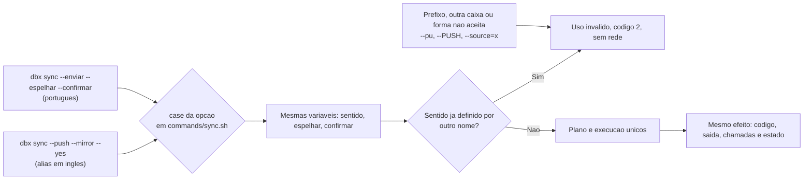

# Registro de entrega — Documentação, manutenção e aliases em inglês (fase 4)

## Identificação

| Campo | Valor |
|---|---|
| Projeto | `dropbox_sync` (`dbx`) |
| Porte | **G** (altera o contrato público da CLI e a regra transversal do `sync`; a poda muda as referências do protocolo do pacote) |
| Branch | `feature/docs-e-aliases-p4`, a partir de `develop` @ `6b00bcd` |
| Instância | `myPCWin/Adriano Sales Santos` |
| Data | 2026-10-19 |
| Agent do registro | `documentation-writer` (por delegação do Tech Lead, regra 42) |
| Log de prompt | [2026-10-19_0829_docs-e-aliases-p4.md](../prompts/2026-10-19_0829_docs-e-aliases-p4.md) |
| Fonte da demanda | [2026-10-18-analise-melhorias.md](../sources/2026-10-18-analise-melhorias.md) (P5) e ressalvas das fases 2 e 3 com prazo nesta fase |
| Revisão consolidada | [2026-10-19-0829-revisao-consolidada-docs-e-aliases.md](2026-10-19-0829-revisao-consolidada-docs-e-aliases.md) |
| Aprovação final | [2026-10-19-0829-aprovacao-final-docs-e-aliases.md](2026-10-19-0829-aprovacao-final-docs-e-aliases.md) |
| Histórico da fase | [2026-10-19-0932-fase-4-docs-e-aliases.md](../../.github/agents/memoria/historico/2026-10-19-0932-fase-4-docs-e-aliases.md) |

## Contexto e objetivo

O pedido e as decisões do solicitante estão no [log de prompt](../prompts/2026-10-19_0829_docs-e-aliases-p4.md); aqui não se repetem. Em resumo operacional: a fase 4, última do plano `2026-10-18-1745-melhorias-em-fases`, entrega aliases em inglês para as opções de `sync`, `unlink` e `config` (RF-64), poda do pacote de agents (skills de stacks que o projeto não usa), enxugamento dos comentários de `lib/http.sh` e `lib/transfer.sh`, correção das contradições de documentação (RNF-34), a comparação sem caixa fora do ASCII (F-32) e as ressalvas O-1, O-6 e SC2034.

## Decisões (por id, em `.github/agents/memoria/entradas/`)

| Id | Assunto |
|---|---|
| [`2026-10-19-0829-aliases-poda-e-comentarios`](../../.github/agents/memoria/entradas/2026-10-19-0829-aliases-poda-e-comentarios.md) | Aliases em inglês; poda do pacote; comentários só com o porquê atual; F-32 (localidade `C.UTF-8` só na comparação, DIV-32); DIV-30 (guarda antiga de origem vazia sai); DIV-31 (repetir o sentido continua uso inválido); `DBX_SYNC_LOCALIDADE` como apoio de teste; opcionais do `config --debug` fora do preflight |
| [`2026-10-19-0829-aceite-testes-qa-p4`](../../.github/agents/memoria/entradas/2026-10-19-0829-aceite-testes-qa-p4.md) | Aceite do solicitante da suíte do QA (16 casos) e risco O-QA-1 aceito como documentado |

## Escopo técnico e arquivos modificados

Levantamento por `git status --short` e `git diff --numstat 6b00bcd` (acréscimos/remoções); arquivos novos contados por linhas quando conhecidas. As skills removidas entram como um grupo.

| Grupo | Arquivo | Alteração |
|---|---|---|
| Código | `bin/dbx` | +30/-12 (ajuda dos três comandos com os dois nomes por opção) |
| Código | `commands/sync.sh` | +45/-52 (aliases no mesmo ramo do `case`; guarda de origem vazia pelo plano nos dois sentidos; aviso único de localidade) |
| Código | `commands/unlink.sh` | +3/-3 (`--yes`, `--keep-app`) |
| Código | `commands/config.sh` | +3/-3 (`--replace`, `--root`) |
| Código | `lib/sync.sh` | +29/-4 (comparação sem caixa com `LC_ALL` local, detecção pela conversão, `DBX_SYNC_LOCALIDADE`) |
| Código | `lib/preflight.sh` | +3/-2 (utilitários que o código invoca) |
| Código | `lib/output.sh` | +3/-2 (comentário) |
| Código (só comentário) | `lib/http.sh` | +55/-79 |
| Código (só comentário) | `lib/transfer.sh` | +72/-154 |
| Código (só comentário) | `lib/config.sh`, `lib/auth.sh` | +4/-3 e +2/-2 (QA-P4-01) |
| Teste | `tests/integracao/sync_test.sh` | +323/-6 |
| Teste | `tests/integracao/comandos_test.sh` | +94 |
| Teste | `tests/integracao/composicao_test.sh` | +26 |
| Teste | `tests/unit/preflight_test.sh` | +42/-1 |
| Teste | `tests/unit/progress_test.sh` | +1 (SC2034, diretiva) |
| Teste (QA) | `tests/integracao/qa_docs_aliases_p4_test.sh` | novo (16 casos) |
| Documentação viva | `README.md` | +32/-8 (11 pares de opções, utilitários do preflight, opcionais do `config --debug`) |
| Documentação viva | `docs/arquitetura/system-design.md` | +11/-1 (v1.6; decisão v0.3 marcada como revogada) |
| Documentação viva | `docs/testes/mapa-modulos.md` | +5/-4 |
| Requisitos | `escopo-requisitos-e-criterios-de-aceite.md` (v1.6), `decisoes-pendentes.md` | +15/-5 e +2/-1 |
| Histórico dos comentários | `docs/registros/2026-10-19-historico-comentarios-http-transfer.md` | novo (21 seções) |
| Pacote de agents | `.github/agents/AGENTS.md` | +2/-18 (regra 37 e tabela de stack, só referências; nenhuma regra mudou) |
| Pacote de agents | 7 personas (`business-analyst`, `dba`, `documentation-writer`, `qa-expert`, `senior-developer`, `tech-lead`, `ux-expert`) | referências de skill (+1/-1 a +6/-6) |
| Pacote de agents | `.github/skills/SKILLS_SYNC.md`, `SKILL_HIERARCHY.md` | +8/-7 e +5/-290; seção "Poda deste projeto" e regra de sincronização |
| Pacote de agents | `protocolo-conformidade`, `protocolo-tdd`, `security-best-practices`, `shellcheck-configuration` (7 arquivos) | referências |
| Poda | 31 diretórios de skill fora da stack em `.github/skills/` | removidos (404 arquivos, entre eles imagens); `.github` de 9,5 MB para 1,9 MB |
| Governança | 2 entradas de memória, log de prompt, 3 pareceres e este conjunto de fechamento | novos |

Requisitos criados: RF-64, RNF-34, DP-35. Emendados: RF-41(b) (O-1, TC-DEL-13), RF-54(e) a (g), RF-53(f), RF-51(g) e RF-01. DIV-30 a DIV-32 resolvidas.

## Decisão

Resumo em formato ADR; o detalhe está nos pareceres e na [memória](../../.github/agents/memoria/entradas/2026-10-19-0829-aliases-poda-e-comentarios.md).

- **Contexto:** `sync` só tinha opções em português; o pacote de agents trazia 31 skills de stacks que o projeto não usa; os comentários de `lib/http.sh` e `lib/transfer.sh` guardavam histórico de defeitos; a documentação ainda afirmava "sem estado local persistente".
- **Decisão:** 11 aliases em inglês no padrão rsync/git, resolvidos no mesmo ramo do `case` que o nome em português; poda das skills com regra de sincronização que repete a poda; comentários só com o porquê atual e histórico em `docs/registros`; `LC_ALL=C.UTF-8` fixado só dentro da comparação sem caixa.
- **Alternativas rejeitadas:** aceitar prefixos ou outra caixa nas opções (recusados como uso inválido, sem rede, igual ao português); fixar a localidade no processo inteiro (mudaria contagens em bytes); manter a guarda antiga de origem vazia do `--receber` (O-1, substituída pela guarda pelo plano).
- **Trade-off principal:** O-QA-1, aceito como risco documentado (ver riscos).

### Resolução de opção: português e inglês chegam ao mesmo efeito

Os dois nomes caem no mesmo ramo; por isso a repetição, o último valor e as recusas seguem a regra do português (RF-64(b), (d), (e)). O alias de um comando é recusado nos outros.

## Evidências de validação

Pareceres em arquivos próprios, referenciados por link e não transcritos:

| Gate | Documento | Resultado |
|---|---|---|
| Testes (`protocolo-tdd`), ciclos 1 e 2 | [parecer de testes](2026-10-19-0829-parecer-tdd-docs-e-aliases.md) | Aprovado nos dois ciclos (ciclo 1 com 2 achados menores) |
| Conformidade (`protocolo-conformidade`), ciclos 1 e 2 | [parecer de conformidade](2026-10-19-0829-parecer-conformidade-docs-e-aliases.md) | Aprovado nos dois ciclos (ciclo 1 com 2 achados menores, para decisão do Tech Lead) |
| QA Expert | [validação do QA](2026-10-19-0829-validacao-qa-docs-e-aliases.md) | Ciclo 1 **Reprovado** (QA-P4-01, maior; QA-P4-02, menor; ambos de documentação); ciclo 2 **Aprovado** |
| DBA | Não aplicável: sem mudança de persistência, schema ou dado | — |
| UX Expert | Não aplicável: CLI sem interface gráfica | — |

Ciclos do QA: no ciclo 1, os aliases, a guarda de origem vazia pelo plano, a localidade e os comentários foram aprovados; RNF-34 reprovou por QA-P4-01 (`lib/config.sh` e `lib/auth.sh` ainda diziam "única escrita persistente") e QA-P4-02 (linha da decisão v0.3 do System Design sem marca de revogação). O ciclo 2 confirmou as duas correções, ambas só de comentário e de uma linha de documento.

### Testes rodados (contagens literais do runner)

| Comando | Resultado |
|---|---|
| `bash tests/run.sh` (ciclo 2 do QA) | 27 arquivos, **935 aprovados, 0 reprovados, 2 pulados** |
| Diff de código sem comentários e sem linhas em branco (`lib/http.sh`, `lib/transfer.sh`) | **0**, conferido pelo developer e pelo QA |
| `validate-skill-links`, `verificar-instrucoes-do-projeto`, `memoria-index --check` | saída 0; o hook confere |

### Suíte do QA (aprovada pelo solicitante, [aceite](../../.github/agents/memoria/entradas/2026-10-19-0829-aceite-testes-qa-p4.md))

| Arquivo | Casos | sha256 |
|---|---|---|
| `tests/integracao/qa_docs_aliases_p4_test.sh` | 16 | `adf7f5c2b33b63ce7278e0f44e458dd3fde67c7f7ec7cd67d4ea09042a373fc1` |

Mutantes: 7 não equivalentes mortos; 1 equivalente descartado (detalhe na [validação do QA](2026-10-19-0829-validacao-qa-docs-e-aliases.md)).

### Suíte completa local, commit e PR

| Item | Estado |
|---|---|
| Suíte completa local (`sh scripts/suite-completa.sh`) | verde em `2636a89`: 27 arquivos, 935 aprovados, 0 reprovados, 2 pulados (vetor oficial sem rede), 157 s; `--conferir` com saida 0 |
| Commit | `2636a89` (implementacao) e o commit de documentacao que preenche os registros |
| PR | [#38](https://github.com/salesadriano/dropbox_sync/pull/38) para `develop`, labels `review` e `enhancement` |

Nenhum desses três itens foi executado nem registrado até a emissão deste documento. A aprovação do Tech Lead só vale com a suíte completa local verde.

## Poda do pacote de agents

- 31 skills fora da stack removidas; a lista e a regra de sincronização estão em [`SKILLS_SYNC.md`](../../.github/skills/SKILLS_SYNC.md), seção "Poda deste projeto". O `ai_team` continua sendo a fonte; uma sincronização futura repete a poda sem reimportar essas skills.
- `.github` passou de 9,5 MB para 1,9 MB.
- `AGENTS.md` (regra 37 e tabela de stack) e as personas só tiveram referências ajustadas; nenhuma das 48 regras mudou.
- Conferências: `validate-skill-links`, `verificar-instrucoes-do-projeto` e `memoria-index --check` saem 0; o hook de guarda confere. Citações a skills removidas restam apenas em `memoria/historico/` (registro imutável; O-QA-3).

## Comentários de `lib/http.sh` e `lib/transfer.sh`

O histórico foi para [`docs/registros/2026-10-19-historico-comentarios-http-transfer.md`](../registros/2026-10-19-historico-comentarios-http-transfer.md) (21 seções). O diff de código sem comentários deu 0, conferido pelo developer e pelo QA; nenhum dos arquivos tem heredoc.

## Seção de persistência e dados

Sem mudança de modelo, schema ou formato de estado. Rollback de persistência: não aplicável.

## Riscos, impacto e rollback

| Risco | Estado |
|---|---|
| O-QA-1: com `--allow-empty-source`, `--pull` espelhado sobre pasta remota existente e vazia (caminho digitado errado) apaga o destino local; a mensagem não distingue vazia de inexistente | **Aceito como risco documentado** pelo Tech Lead; é o efeito que a opção explícita libera; ajuda e README avisam (RF-53(e)); raiz remota inexistente continua recusada |
| RSK-43: `stat` com nanossegundos validado só no uutils, não no GNU coreutils | Aberto; owner QA Expert, backlog |
| `DBX_SYNC_LOCALIDADE` como variável de ambiente a mais | Aceita como apoio de teste (como `DBX_HASH_BACKEND`), com alfabeto fechado; sem efeito quando a localidade existe |

**Nota de versão:**

- Os nomes em português continuam valendo; os aliases em inglês são acréscimo.
- Sem `--espelhar`, origem vazia deixa de ser recusada: é operação vazia com saída 0 (DIV-30). Com `--espelhar`, a recusa vem do plano nos dois sentidos (`recusada=origem vazia`, código 14), salvo `--permitir-origem-vazia` ou `--allow-empty-source`.
- Sem a localidade `C.UTF-8`, a comparação sem caixa vale no ASCII e o `sync` avisa uma vez, em stderr.

**Rollback:** reverter o commit de merge na `develop`. Sem migração de dados. A poda é reversível por sincronização com o `ai_team` sem aplicar a regra de poda.

## Próximos passos e ressalvas (owner e prazo)

| Item | Descrição | Owner | Prazo |
|---|---|---|---|
| O-QA-1 | Risco aceito e documentado (ver acima) | Tech Lead | Aceito |
| O-QA-2 | Achado 2 do parecer de testes: memória ausente sem `--confirmar` cai em RF-48 antes do plano; o caso do QA usa `--yes` | QA Expert | Backlog |
| O-QA-3 | Uma validação de links que inclua `historico/` acusará caminhos de skills removidas (registros imutáveis) | QA Expert | Backlog |
| O-5 | Leitura de JSON em `upload.sh`, candidata a `lib/cmd` (fase 3) | Senior Developer | Backlog |
| O-7 | Travessia parcial não grava entradas novas (fase 3) | Senior Developer | Backlog |
| RSK-43 | Validar `stat` no GNU coreutils | QA Expert | Backlog |
| F-34, F-35 | Paralelismo (com medição) e PKCE | Backlog | Sem prazo |

Fechadas nesta fase: O-1, O-6, F-32 e SC2034.

## Aceites

- Solicitante: aprovou a suíte do QA (16 casos) e as decisões sobre aliases, poda e comentários ([aceite](../../.github/agents/memoria/entradas/2026-10-19-0829-aceite-testes-qa-p4.md)).
- QA Expert: Aprovado no ciclo 2.
- Tech Lead: "Aprovado com ressalvas — Tech Lead, 2026-10-19", válido apenas com a suíte completa local verde ([aprovação final](2026-10-19-0829-aprovacao-final-docs-e-aliases.md)).

## Intervenção humana (regra 48)

`sh scripts/alteracoes-externas.sh --detectar` antes da escrita: sem alteração externa pendente. Os arquivos deste conjunto são registrados com `--registrar` ao final.
