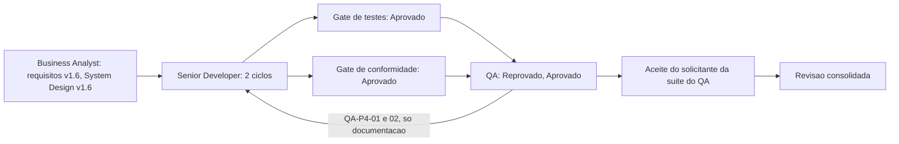

# Revisão Consolidada do Tech Lead — Documentação, manutenção e aliases em inglês (fase 4)

## Identificação

- Projeto ou produto: `dropbox_sync` (`dbx`)
- Responsável Tech Lead: Tech Lead, instância `myPCWin/Adriano Sales Santos`
- Data da revisão: 2026-10-19
- Escopo revisado: fase 4 (aliases em inglês RF-64, guarda de origem vazia pelo plano nos dois sentidos, localidade da comparação sem caixa, comentários de `lib/http.sh` e `lib/transfer.sh`, contradições de documentação RNF-34, poda do pacote de agents); branch `feature/docs-e-aliases-p4` sobre `develop` @ `6b00bcd`
- Agents envolvidos: Tech Lead, Senior Developer, QA Expert, Business Analyst (documentation-writer como utilitário)
- Status da revisão: Concluída com ressalvas
- Porte da demanda: G
- Registro de entrega: [2026-10-19-0829-registro-docs-e-aliases-p4.md](2026-10-19-0829-registro-docs-e-aliases-p4.md)
- Log de prompt: [2026-10-19_0829_docs-e-aliases-p4.md](../prompts/2026-10-19_0829_docs-e-aliases-p4.md)

## Resumo executivo

- Objetivo da entrega: oferecer aliases em inglês no padrão rsync/git sem retirar os nomes em português, podar do pacote de agents as skills de stacks fora do projeto, deixar nos comentários de `lib/http.sh` e `lib/transfer.sh` só o porquê atual, corrigir as contradições de documentação e fechar as ressalvas O-1, O-6, F-32 e SC2034.
- Contexto consolidado: decisões em [`aliases-poda-e-comentarios`](../../.github/agents/memoria/entradas/2026-10-19-0829-aliases-poda-e-comentarios.md) e [`aceite-testes-qa-p4`](../../.github/agents/memoria/entradas/2026-10-19-0829-aceite-testes-qa-p4.md).
- Resultado executivo da revisão: gates de testes e conformidade aprovados nos ciclos 1 e 2; QA reprovou o ciclo 1 (QA-P4-01 e QA-P4-02, só documentação) e aprovou o ciclo 2; a suíte do QA tem aceite do solicitante. Suíte local de referência: 27 arquivos, 935 aprovados, 0 reprovados, 2 pulados. Suíte completa local, commit e PR: `PENDENTE`.
- Recomendação do Tech Lead: aprovar com ressalvas, condicionado à suíte completa local verde.

## PRD e ARD

- PRD aplicável?: Sim
- Referência do PRD: [escopo, requisitos e critérios de aceite](../requisitos/escopo-requisitos-e-criterios-de-aceite.md) v1.6
- ARD aplicável?: Sim
- Referência do ARD: [System Design](../arquitetura/system-design.md) v1.6

| Artefato | Item revisado | Consistência com entrega | Lacunas encontradas | Observações |
|---|---|---|---|---|
| PRD | RF-64, RNF-34, DP-35 criados; RF-41(b) (O-1, TC-DEL-13), RF-54(e) a (g), RF-53(f), RF-51(g) e RF-01 emendados | Consistente | A lista de contradições do RNF-34 (a a f) não trazia "única escrita persistente" (apontado pelo QA) | QA recomenda acrescentar a busca ao TC-DOC-01 |
| ARD | System Design v1.6; decisão v0.3 ("ausência deliberada de estado local persistente") marcada como revogada na própria linha | Consistente após o ciclo 2 | QA-P4-02 (linha sem marca) | Resolvido |

## Divergências entre PRD, ARD, implementação e evidências de validação

| Divergência | Origem | Impacto | Resolução adotada | Status |
|---|---|---|---|---|
| DIV-30: guarda antiga de origem vazia do `--receber` (O-1) | Business Analyst | Recusa pela guarda antiga, sem o campo `recusada` no plano | Guarda antiga sai; sem `--espelhar`, origem vazia é operação vazia com saída 0; raiz inexistente continua recusada | Resolvida |
| DIV-31: repetir `--enviar`/`--receber` pelo alias | Business Analyst | Regra de sentido com dois nomes | Continua uso inválido, mesmo pelo alias | Resolvida |
| DIV-32: localidade na comparação sem caixa (F-32) | Business Analyst | Fixar `C.UTF-8` no processo mudaria contagens em bytes | Fixada somente dentro da comparação; sem a localidade, ASCII e aviso único | Resolvida |
| QA-P4-01: `lib/config.sh` e `lib/auth.sh` diziam "única escrita persistente" | QA | Contradizia RF-38, RF-61 e RNF-26 | Comentários reescritos; diff sem comentários deu 0 | Resolvida |
| QA-P4-02: linha da decisão v0.3 sem marca de revogação | QA | Contradizia RNF-34(f) | Marca de revogação na própria linha | Resolvida |

- Conclusão específica sobre divergências entre PRD e ARD: nenhuma em aberto; requisitos v1.6 e System Design v1.6 foram atualizados na mesma rodada das decisões.
- Conclusão específica sobre divergências entre artefatos, implementação e evidências: as duas falhas do QA foram corrigidas e cobertas por caso; restam apenas as observações O-QA-1 a O-QA-3.

## Artefatos consolidados por agent

| Agent | Artefato (link) | Veredito ou resultado registrado lá | Ressalva do Tech Lead |
|---|---|---|---|
| Senior Developer | [registro de entrega](2026-10-19-0829-registro-docs-e-aliases-p4.md), [parecer de testes](2026-10-19-0829-parecer-tdd-docs-e-aliases.md), [parecer de conformidade](2026-10-19-0829-parecer-conformidade-docs-e-aliases.md) | Testes: Aprovado (ciclos 1 e 2). Conformidade: Aprovado (ciclos 1 e 2), com 2 achados menores em cada parecer do ciclo 1 | Achados decididos pelo Tech Lead: `DBX_SYNC_LOCALIDADE` aceita como apoio de teste; opcionais do `config --debug` fora do preflight; O-QA-2 em backlog |
| QA Expert | [validação](2026-10-19-0829-validacao-qa-docs-e-aliases.md) | Ciclo 1 Reprovado (QA-P4-01 maior, QA-P4-02 menor); ciclo 2 Aprovado; 7 de 7 mutantes mortos | O-QA-1 aceito como risco documentado; O-QA-2 e O-QA-3 em backlog |
| Business Analyst | [requisitos v1.6](../requisitos/escopo-requisitos-e-criterios-de-aceite.md), [System Design v1.6](../arquitetura/system-design.md) | RF-64, RNF-34, DP-35 criados; emendas RF-41(b), RF-54(e) a (g), RF-53(f), RF-51(g), RF-01; DIV-30 a 32 resolvidas | Nenhuma |
| UX Expert | Não aplicável: sem interface gráfica | — | — |
| DBA | Não aplicável: sem mudança de persistência, schema ou dado | — | — |

## Decisões próprias do Tech Lead

| Decisão | Motivação | Impacto | Status |
|---|---|---|---|
| F-32 e DIV-32: `C.UTF-8` só dentro da comparação | Nenhuma contagem em bytes pode mudar | Sem a localidade, ASCII e aviso único em stderr | Ativa |
| DIV-30: guarda antiga de origem vazia sai | O-1; a guarda pelo plano cobre os dois sentidos | Sem `--espelhar`, origem vazia sai com 0 | Ativa |
| DIV-31: repetir o sentido continua inválido | Coerência com o português | Recusa com código 2, sem rede | Ativa |
| `DBX_SYNC_LOCALIDADE` aceita como apoio de teste | Padrão de `DBX_HASH_BACKEND`; alfabeto fechado; sem efeito quando a localidade existe | Uma variável de ambiente a mais, só para a suíte | Ativa |
| Opcionais do `config --debug` (`mount`, `grep`, `getenforce`, `lsattr`) fora do preflight | Protegidos por `command -v` | README os lista como opcionais | Ativa |
| O-QA-1 aceito como risco documentado | É o efeito que `--allow-empty-source` libera; ajuda e README avisam (RF-53(e)) | `--pull` espelhado sobre pasta remota vazia por caminho errado apaga o destino local | Ativa |

## Itens impactados e pontos validados

| Item | Tipo | Evidência (link) | Risco | Mitigação |
|---|---|---|---|---|
| Aliases (11 pares) | Contrato público da CLI | [validação do QA](2026-10-19-0829-validacao-qa-docs-e-aliases.md), casos 1 a 6; mutantes M3 e M4 | Divergência entre os dois nomes | Mesmo ramo do `case`; prefixos, outra caixa e `--opcao=x` recusados sem rede |
| Guarda de origem vazia pelo plano | Segurança | Casos 9 a 11; 15 casos da fase 3 sem alteração, 15 de 15; mutante M5 | Exclusão em massa | Recusa pelo plano nos dois sentidos, sem depender de memória |
| Localidade | Integridade | Casos 12 a 16; mutantes M1, M2, M6, M7 | Contagem em bytes mudar | `LC_ALL` local à função; restaurado no retorno |
| Comentários de `lib/http.sh` e `lib/transfer.sh` | Manutenção | Diff sem comentários 0; [histórico](../registros/2026-10-19-historico-comentarios-http-transfer.md) | Mudança de comportamento | Prova por diff filtrado, developer e QA |
| Poda do pacote | Governança | `validate-skill-links`, `verificar-instrucoes-do-projeto`, `memoria-index --check`, hook | Link vivo para skill removida | Saída 0; citações só em `historico/` (imutável) |
| Documentação (RNF-34) | Documentação | Casos 7 e 8 do QA (ciclo 2) | Contradição com o código | QA-P4-01 e QA-P4-02 corrigidos |

## Pendências, bloqueios e riscos residuais

| Tipo | Descrição | Impacto | Owner | Próxima ação |
|---|---|---|---|---|
| Pendência de gate | Suíte completa local, commit e PR | `PENDENTE` | Tech Lead | Rodar `sh scripts/suite-completa.sh` e registrar; sem ela a aprovação não vale |
| Risco aceito | O-QA-1 | Apagar o destino local por caminho remoto errado com `--allow-empty-source` | Tech Lead | Aceito; documentado na ajuda e no README |
| Ressalva | O-QA-2: memória ausente sem `--confirmar` cai em RF-48 antes do plano | Mensagem; lado seguro | QA Expert | Backlog |
| Ressalva | O-QA-3: validação de links que inclua `historico/` acusará skills removidas | Falso positivo futuro | QA Expert | Backlog |
| Ressalva | O-5: leitura de JSON em `upload.sh`, candidata a `lib/cmd` | Gêmeos de leitura | Senior Developer | Backlog |
| Ressalva | O-7: travessia parcial não grava entradas novas | Custo de recálculo | Senior Developer | Backlog |
| Risco | RSK-43: `stat` validado só no uutils | Identidade degradada em outro ambiente | QA Expert | Backlog |
| Backlog | F-34 (paralelismo, com medição) e F-35 (PKCE) | — | Backlog | Sem prazo |

## Balanço do plano em quatro fases (`2026-10-18-1745-melhorias-em-fases`)

Esta é a última fase. O balanço é só de resultado; os detalhes estão nos registros de cada fase.

| Fase | PR | O que a análise externa pediu | O que foi entregue | O que ficou no backlog |
|---|---|---|---|---|
| 1, integridade de dados (P1) | [#35](https://github.com/salesadriano/dropbox_sync/pull/35) | Defeitos com risco de perda ou corrupção: caixa no `sync`, recebimento atômico, `rm` de destino, `umask`, `rev` no envio | Correções de integridade ([registro](2026-10-18-1745-registro-integridade-de-dados-p1.md), porte M) | Ver o registro da fase |
| 2, robustez de rede (P2) | [#36](https://github.com/salesadriano/dropbox_sync/pull/36) | Timeout, `Retry-After`, mais tentativas, upload retomável, falhas por arquivo | Limites de rede por ambiente, retomada do envio, saída de falhas, parada da suíte ([registro](2026-10-18-2045-registro-robustez-de-rede-p2.md), porte M) | Ver o registro da fase |
| 3, cache e correção (P3 e P4) | [#37](https://github.com/salesadriano/dropbox_sync/pull/37) | Dois caches sobrepostos, SQL por interpolação, skip do upload só local, chave não canônica, PKCE | Cache único em `lib/state`, `lib/db` removido, skip pelo hash remoto, chave canônica, segredo obrigatório, guarda de origem vazia ([registro](2026-10-18-2243-registro-cache-unico-p3.md), porte G) | F-34 paralelismo, F-35 PKCE, O-5, O-7, RSK-43 |
| 4, documentação e aliases (P5) | esta PR (número `PENDENTE`) | Documentação contraditória, comentários narrativos, peso do `.github`, aliases em inglês | RNF-34, comentários enxutos, poda de 31 skills (`.github` de 9,5 MB para 1,9 MB), 11 aliases, F-32, O-1, O-6, SC2034 | O-QA-2, O-QA-3, O-5, O-7, RSK-43, F-34, F-35 |

Itens da análise que ficam fora do plano: paralelismo (F-34, exige medição prévia) e PKCE (F-35, o segredo passou a ser obrigatório). A lição que atravessa as fases: uma guarda de segurança que depende de estado é frágil a cada falha desse estado (fase 3), e a mesma guarda passou a valer nos dois sentidos sem memória (fase 4).

## Impacto global da entrega

- Impacto no negócio: operadores de língua inglesa usam o padrão rsync/git sem perder o português; pacote do repositório cerca de cinco vezes menor.
- Impacto técnico: aliases no mesmo ramo do `case`; guarda pelo plano nos dois sentidos; comparação sem caixa independente da localidade; documentação coerente com `lib/state`.
- Impacto operacional: nota de versão no registro (origem vazia sem `--espelhar` sai com 0; aviso único de localidade); regra de sincronização com o `ai_team` que repete a poda.
- Impacto em UX: não aplicável; muda a ajuda e o README.
- Impacto em dados: nenhum.

## Encaminhamento para fechamento

- Pronto para aprovação final?: Sim, com a condição da suíte completa local verde
- Dependências para `templates/aprovacao-final-tech-lead-template.md`: suíte completa local verde; commit; PR para `develop`
- Arquivo concreto desta revisão consolidada para referência no fechamento final: `docs/reviews/2026-10-19-0829-revisao-consolidada-docs-e-aliases.md`
- Resumo das divergências resolvidas que devem constar no fechamento final: DIV-30 a DIV-32, QA-P4-01 e QA-P4-02
- Bloqueios remanescentes que precisam constar no fechamento final: nenhum bloqueio de gate; ressalvas O-QA-2, O-QA-3, O-5, O-7, RSK-43; risco aceito O-QA-1
- Observações finais do Tech Lead: o único risco material é o O-QA-1, aceito e documentado; a aprovação não vale sem a suíte completa local verde.

