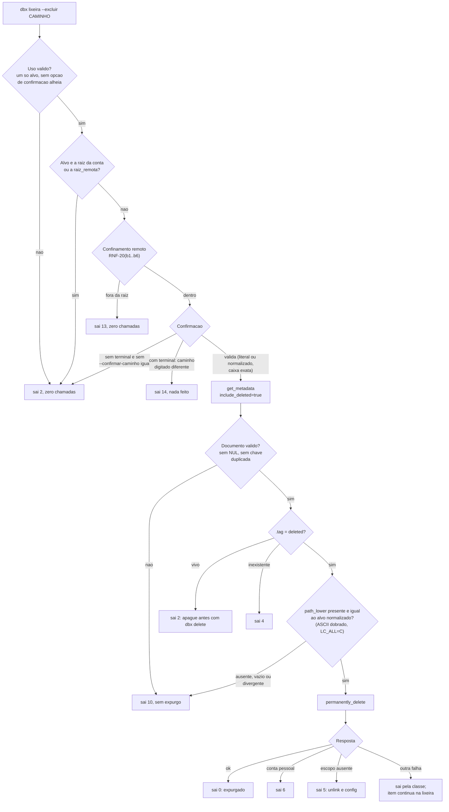

# Fase 3 do backlog (B3): revisoes, restauracao e lixeira com exclusao permanente (F-07, F-20)

## 1. Pedido e porte

| Campo | Valor |
|---|---|
| Pedido | Fase 3 do plano do backlog: `dbx revisoes`, `dbx restaurar` (arquivo e pasta apagada) e `dbx lixeira`, com exclusao permanente (`lixeira --excluir`). Requisitos `RF-72` a `RF-78`, secao 5.11 do escopo v1.14. |
| Porte | **G**. Fluxo destrutivo e irreversivel, escopo OAuth novo (`files.permanent_delete`) e integracao externa nova (`files/list_revisions`, `files/restore`, `files/permanently_delete` e `list_folder` com `include_deleted`). `scripts/porte.sh` nao existe neste projeto; classificado pelos gatilhos da regra 40. |
| Log de prompt | [docs/prompts/2026-10-19_1828_backlog-fase-3-recuperacao.md](../prompts/2026-10-19_1828_backlog-fase-3-recuperacao.md) |
| Branch / base | `feature/recuperacao-b3` sobre `develop` @ `ef1efb2` (nenhum PR aberto na abertura) |
| Agents | Business Analyst (requisitos v1.14, System Design v1.11); Senior Developer (implementacao sob `protocolo-tdd` e `protocolo-conformidade`, 3 ciclos); QA Expert (validacao independente, 30 casos, 3 ciclos); Tech Lead (decisoes, fechamento); Documentation Writer (este registro). |
| Data | 2026-10-19 |

## 2. Causa ou decisao

Decisoes do solicitante (memoria [2026-10-19-1828-recuperacao-e-lixeira](../../.github/agents/memoria/entradas/2026-10-19-1828-recuperacao-e-lixeira.md)):

- Nomes: `dbx revisoes <arq>` (`revisions`), `dbx restaurar <arq>` (`restore`) com `--rev R` ou `--antes-de DATA`, e `dbx lixeira [pasta]` (`trash`). O `restaurar` tambem traz de volta item apagado.
- Exclusao permanente entra na fase: irreversivel, so em contas Dropbox Business, exige o escopo `files.permanent_delete`, que o solicitante habilita no App Console antes de reautorizar.
- Pasta apagada: restauracao recursiva, arquivo por arquivo, na ultima revisao, com `--dry-run` e resumo; falha parcial sai 14 e diz o que faltou.
- Restaurar sobre arquivo existente: permitido direto; a saida mostra a revisao substituida, para desfazer.

Divergencias decididas pelo Tech Lead (DIV-54 a DIV-78; texto completo na memoria):

- DIV-54: a exclusao permanente so aceita item ja apagado (`get_metadata` com `include_deleted` devolvendo `DeletedMetadata`); senao 2. Janela entre a checagem e a chamada e risco residual (RSK-51).
- DIV-55: `lixeira --excluir <caminho>` (`--purge`). Com terminal, o operador digita o caminho; sem terminal, `--confirmar-caminho <caminho>` identico ao alvo. Nao ha `--yes` nem `-y`. Sem confirmacao valida, 2 antes de qualquer chamada; resposta errada no terminal, 14. Complemento: com terminal e `--confirmar-caminho` identico, a pergunta e dispensada.
- DIV-56: remedio do escopo ausente e `dbx unlink` e depois `dbx config`. DIV-57: conta pessoal (400 sem JSON ou `invalid_account_type`) sai 6 com remedio.
- DIV-58: mapeamento de tags da API (`invalid_revision`->4; `invalid_before_rev`, `before_rev_not_supported`, `unsupported_content_type`->2; `locked`->7; `team_folder`, `operation_suppressed`, `access_restricted`->6; `in_progress`->10 com retentativa, depois 14; `too_many_files`->14).
- DIV-59: o `rev` precisa constar do historico do proprio caminho. DIV-60: `--antes-de` compara `server_modified` (`AAAA-MM-DD` fim do dia UTC inclusivo, ou `AAAA-MM-DDTHH:MM:SSZ`). DIV-61: arquivo apagado sem `--rev` restaura a ultima revisao; vivo sem selecao, 2. DIV-62: a pasta apagada traz tudo o que estiver apagado sob ela. DIV-63: os tres comandos nao pegam a trava. DIV-64 a DIV-69 aceitas como recomendadas.
- DIV-70 a DIV-77 (Senior Developer, aceitas): escopo opcional na linha `escopos` do `diagnostico`; `lixeira -R` desce so em pastas vivas; `restaurar` sobre pasta viva sai 2; confirmacao aceita o literal ou a forma normalizada, com caixa exata; item fora da raiz ou sem revisao conta como falha (14) e `--dry-run` sai 0; `in_progress` vira 14 em todo ponto de escrita; contagem do aviso de pasta cobre um nivel; texto alinhado a DIV-55/56.
- DIV-78 (observacao do QA): na pasta, item devolvido fora da pasta pedida, mesmo dentro da `raiz_remota`, nunca e restaurado e conta como falha (14).
- Decisoes QA-B3: 01 (`rev` alheio sai 2, e `rst05` corrigido); 02 (guarda exige o `path_lower` do proprio alvo, caixa dobrada so no ASCII sob `LC_ALL=C`; divergencia sai 10); 03 (`in_progress`->14 vale para os pontos de `_dbx_cmd_escrita_remota`; upload mantem 10); 04 (`lib/json` recusa `\u0000`); 05 (guarda recusa chave duplicada, com 10; recusa global descartada por quebrar dois casos aprovados de `json_test`); 06 (descida so em descendente estrito, com conjunto de visitados).

Fluxo da guarda de exclusao permanente (RF-76, DIV-54, DIV-55, QA-B3-02/04/05). A guarda e sem estado: a decisao vem so da resposta da API, nunca da memoria local do sync.

## 3. Arquivos

Levantado com `git status --short` e `git diff --stat` (20 arquivos rastreados alterados, +634/-18, sem os novos); arquivos novos contados por `wc -l`. Nenhum commit ainda.

| Arquivo | Alteracao | Linhas |
|---|---|---|
| `commands/revisoes.sh` | Novo | 110 |
| `commands/restaurar.sh` | Novo (arquivo e pasta apagada) | 467 |
| `commands/lixeira.sh` | Novo (lista e `--excluir`) | 279 |
| `lib/cmd.sh` | Alterado (`_dbx_cmd_escrita_remota` com modo silencioso e `in_progress`; `dbx_cmd_remoto_confinado`; `dbx_cmd_listar_nivel`; `dbx_cmd_campo_caminho`; `dbx_cmd_descendente_estrito`; duplicadas) | +170 (total do diff rastreado: +634/-18) |
| `lib/errors.sh` | Alterado (DIV-58) | +19 |
| `lib/json.sh` | Alterado (recusa de `\u0000`; contagem de chaves duplicadas) | +14 |
| `lib/sync.sh` | Alterado (`dbx_sync_ordem_sem_caixa`) | +15 |
| `lib/cli.sh` | Alterado (tabela, aliases, arquivos literais) | +13 |
| `bin/dbx` | Alterado (ajudas) | +63 |
| `commands/diagnostico.sh` | Alterado (RF-77) | +14 |
| `completions/dbx.bash` | Alterado | +14 |
| `README.md` | Alterado (secao 11) | +40 |
| `docs/testes/mapa-modulos.md` | Alterado | +11 |
| `docs/arquitetura/system-design.md` | Alterado (BA, v1.11) | +70 |
| `docs/requisitos/escopo-requisitos-e-criterios-de-aceite.md` | Alterado (BA, v1.14) | +66 |
| `docs/requisitos/funcionalidades-candidatas.md`, `riscos-restricoes-e-licenciamento.md`, `decisoes-pendentes.md` | Alterados (BA) | +7, +5, +3 |
| `tests/integracao/recuperacao_test.sh` | Novo (61 casos) | 1096 |
| `tests/integracao/qa_recuperacao_b3_test.sh` | Novo (QA, 30 casos) | 836 |
| `tests/integracao/completar_test.sh`, `composicao_test.sh`, `diagnostico_test.sh`, `tests/unit/errors_test.sh`, `tests/unit/json_test.sh` | Alterados: so casos acrescentados | +25, +13, +29, +28, +33 |
| `.github/agents/memoria/entradas/2026-10-19-1828-recuperacao-e-lixeira.md` | Novo (decisao) | documental |
| `docs/prompts/2026-10-19_1828_backlog-fase-3-recuperacao.md` | Novo (log de prompt) | documental |
| `docs/reviews/2026-10-19-1828-*.md` (parecer TDD, parecer de conformidade, validacao do QA, este registro) | Novos | documental |

Pendencia documental: DIV-78 e QA-B3-01 a QA-B3-06 constam na memoria, mas ainda nao nos requisitos v1.14 nem no System Design v1.11 (busca por `DIV-78` e `QA-B3` nao acha nada nesses arquivos). Cabe ao Business Analyst propagar, segundo a regra de propagar decisoes do solicitante na mesma rodada.

## 4. Testes rodados

Contagens literais dos pareceres do Senior Developer ([TDD](2026-10-19-1828-parecer-tdd-recuperacao-b3.md)).

| Arquivo de teste | Item afetado que o justifica | Comando | Total | Aprovados | Falhos |
|---|---|---|---|---|---|
| `recuperacao_test.sh` (ciclo 3) | `commands/revisoes`, `restaurar`, `lixeira`, `lib/cmd` | `bash tests/run.sh recuperacao` | 61 | 61 | 0 |
| `qa_recuperacao_b3_test.sh` (ciclo 3) | guarda do expurgo, descida, `lib/json` | `bash tests/run.sh qa_recuperacao_b3` | 30 | 30 | 0 |
| `json_test.sh` (ciclo 3) | `lib/json` | `bash tests/run.sh json` | 62 | 62 | 0 |
| `errors_test.sh` | `lib/errors` | `bash tests/run.sh errors` | 82 | 82 | 0 |
| `http_test`, `cabecalho`, `qa_rede` | `lib/http` | idem | 53, 17, 25 | todos | 0 |
| `cli_test`, `composicao`, `cmd_test`, `config_test`, `auth_test` | `lib/cli`, `commands/*`, `lib/cmd` | idem | 17, 28, 23, 40, 41 | todos | 0 |
| `sync_test`, `sync_plano`, `verificar_test` | `lib/sync` | idem | 85, 6, 17 | todos | 0 |
| Suite inteira do ciclo 1 | `lib/`, `commands/` | `bash tests/run.sh < /dev/null` | 42 arquivos, 1259 | 1259 | 0 (2 pulados, vetor oficial sem rede) |

- Red: 62 casos novos do ciclo 1 (56 + 6) reprovando contra a base, cada um rodado isolado. Cinco passavam por acaso (comando desconhecido tambem sai 2: rvs02, rst03, rpa03, rpa08, exp11) e foram endurecidos. Ciclo 2: rst05, `exp_guarda_exige_path_lower_do_proprio_alvo` e `rpa_div78` vermelhos antes do conserto. Ciclo 3: 2 casos novos em `json_test` e 3 em `recuperacao_test`, vermelhos contra o ciclo 2.
- Guarda de remocao de casos (`bash scripts/verificar-remocao-de-casos.sh`): 1209 -> 1217, sem reducao. Nenhum caso aprovado alterado ou removido.
- `shellcheck` 0.10.0 limpo nos ciclos 1 a 3; nenhum `scripts/*.sh` alterado.
- Seguranca e acesso (regra 6): toda recusa da exclusao permanente ocorre antes da chamada destrutiva (`permanently_delete` contado igual a 0 em exp02/03/04/05/06/10/11); recusas de uso, raiz, confinamento e confirmacao sem nenhuma chamada, nem a renovacao do token; `get_metadata` com `include_deleted` antes do expurgo (ordem em exp01); sentinelas de credencial ausentes de stdout, stderr e `--debug` (exp14); TTY real por `script(1)` (exp05); sinal real por `setsid` (rpa10: 14, resumo parcial, `TMPDIR` limpo). Suite do QA: 26 tentativas de ataque no ciclo 1, matriz de NUL, chave duplicada e listagem hostil nos ciclos 2 e 3.
- Piramide 70/20/10 e E2E: Testcontainers e Cypress nao se aplicam (CLI em shell, sem banco nem UI). Integracao ponta a ponta pelo `bin/dbx` real com duplo de `curl` na fronteira de rede. Formularios (regra 7): nao aplicavel.
- **Suite completa local no push para a PR de `develop` (regra 8):** comando oficial `sh scripts/suite-completa.sh` (`bash tests/run.sh`), **verde** em `f433e33`, depois dos tres ciclos: 43 arquivos, 1296 aprovados, 0 reprovados, 2 pulados (vetor oficial sem rede), 783 s; `--conferir` com saida 0. Guarda de remocao de casos: 1308 -> 1308, sem reducao. O commit de documentacao que preenche este registro reexecuta a suite antes do proprio push. Na reexecucao, a suite ficou vermelha em `qa_docs_aliases_p4_test.sh`, por um caso instavel que ja existia: ele falha cerca de 2 a cada 5 rodadas tambem no `develop`. A causa e a memoria do sync, que grava ctime e inode, alterados pelo `cp -a` entre as rodadas. O QA corrigiu o caso, comparando a memoria pelo conteudo semantico; ele passou nas 15 rodadas, e um mutante no hash reprova. A mudanca foi reaprovada pelo solicitante (regra 12, sha256 `8df6bf4e...`) e entrou num commit `test(qa-p4)` proprio, seguido de uma nova suite completa.

## 5. Gates

| Gate | Skills aplicadas | Achados | Veredito |
|---|---|---|---|
| `protocolo-tdd` ([parecer](2026-10-19-1828-parecer-tdd-recuperacao-b3.md)) | Regras 1 a 9; excecao de piramide do projeto shell | Ciclo 1: nenhum bloqueante. Ciclo 2: massas do QA sem `path_lower` reprovam 4 casos do QA (E07, E10, E11, E12), conserto na massa do QA. Ciclo 3: nenhum | Ciclos 1, 2 e 3 Aprovado |
| `protocolo-conformidade` ([parecer](2026-10-19-1828-parecer-conformidade-recuperacao-b3.md)) | `clean-architecture`, `shellcheck-configuration`, `security-best-practices` | Ciclo 1: DIV-70 a DIV-77 para o Tech Lead, todas aceitas. Ciclos 2 e 3: nenhum | Ciclos 1, 2 e 3 Aprovado |

- Ciclo: 3. Status dos achados do QA: QA-B3-01, 02, 04, 05, 06 e DIV-78 corrigidos; QA-B3-03 aceito (so comentario). Observacoes baixas do ciclo 3 aceitas (secao 6).

## 6. QA

Detalhe em [validacao-qa-recuperacao-b3](2026-10-19-1828-validacao-qa-recuperacao-b3.md).

- Suite `tests/integracao/qa_recuperacao_b3_test.sh`, 30 casos, sha256 `2044fa23...` (versao final). O solicitante aprovou tres versoes pela regra 12: `c34c2120...` (26 casos), `e77153d5...` (30 casos) e `2044fa23...` (correcao do padrao de contagem do R10).
- Ciclo 1: **Reprovado**. QA-B3-01 (alta): `rev` alheio saia 4, e nao 2. QA-B3-02 (media, seguranca): a guarda lia so o `.tag`, e um `DeletedMetadata` de outro caminho autorizava o expurgo. QA-B3-03 (baixa): upload com `in_progress` sai 10. Observacao que virou a DIV-78.
- Ciclo 2: **Reprovado**. QA-B3-04 (media, seguranca): NUL `\u0000` em `path_lower` contornava a guarda. QA-B3-05 (baixa): chave duplicada, ultima vencendo. QA-B3-06 (media): descida sem fim quando a listagem traz a propria pasta.
- Ciclo 3: **Aprovado**, com duas observacoes baixas aceitas: corpo HTTP cortado no primeiro NUL cru (sem poder extra a um servidor hostil) e fila da descida quadratica (6,4 s com 4000 pastas), que vai para a fase 9.
- Veredito do QA: **Aprovado**, 2026-10-19 (ciclo 3).

## 7. Riscos e rollback

- Riscos residuais:
  - Janela entre `get_metadata` e `permanently_delete` (DIV-54, RSK-51): o item poderia ser restaurado por outra pessoa nesse intervalo.
  - A resposta real de conta pessoal (400 sem JSON ou `invalid_account_type`) e a listagem de pasta apagada sao suposicoes validadas so por duplo (DIV-57, DIV-65); nao ha rede na suite.
  - Fila da descida quadratica (6,4 s com 4000 pastas); fase 9.
  - Corpo HTTP cortado no primeiro NUL cru (sem poder extra).
  - `lixeira -R` nao desce em pasta apagada (DIV-71); pasta apagada vazia nao e recriada; filtro por data da restauracao de pasta no backlog (F-39).
- Licoes:
  - A guarda de seguranca sem estado passou a exigir tambem a identidade do alvo na resposta (`path_lower`), e nao so o tipo (`.tag`). Verificar o tipo sem verificar de quem e a resposta deixa um `DeletedMetadata` alheio autorizar o expurgo (QA-B3-02). Complementa a licao `guarda-de-seguranca-sem-estado`.
  - O parser JSON descartava NUL em silencio, e isso contornava a comparacao da guarda (QA-B3-04). Um parser usado por uma guarda deve recusar o que nao consegue representar.
  - A descida de arvore precisa resistir a uma listagem hostil: so descendente estrito e conjunto de visitados (QA-B3-06).
- Impacto: contrato. Tres comandos novos com aliases (`revisions`, `restore`, `trash`) e opcoes `--rev`, `--antes-de`/`--before`, `--por-id`/`--by-id`, `--recursivo`/`-R`, `--excluir`/`--purge`, `--confirmar-caminho`; escopo opcional `files.permanent_delete` (OAuth); `lib/json` passa a recusar `\u0000` em todo documento; nenhum codigo de saida novo; nada em `lib/state`; sem dependencia nova.
- Rollback: `git revert f433e33` (e do commit de documentacao) basta. Sem migracao de dado ou credencial. A exclusao permanente ja executada por um operador nao se desfaz.
- **Acao do solicitante pendente:** habilitar `files.permanent_delete` no App Console e refazer a autorizacao com `dbx unlink` e depois `dbx config`. A exclusao permanente so funciona em contas Business.

## 8. Links e aceites

- Entradas de memoria: `2026-10-19-1828-recuperacao-e-lixeira`.
- Documentacao sincronizada: [escopo-requisitos-e-criterios-de-aceite.md](../requisitos/escopo-requisitos-e-criterios-de-aceite.md) (secao 5.11, RF-72..78), [system-design.md](../arquitetura/system-design.md), [funcionalidades-candidatas.md](../requisitos/funcionalidades-candidatas.md), [riscos-restricoes-e-licenciamento.md](../requisitos/riscos-restricoes-e-licenciamento.md), [decisoes-pendentes.md](../requisitos/decisoes-pendentes.md), [mapa-modulos.md](../testes/mapa-modulos.md), `README.md`. DIV-78 e QA-B3-01..06 propagados pelo BA ao escopo v1.14 (RF-73..76, emenda do RNF-11, TC-RPA-11..12, TC-LIX-08, TC-EXP-16..17, TC-JSN-01..04) e ao System Design v1.11.
- Pareceres: [TDD](2026-10-19-1828-parecer-tdd-recuperacao-b3.md), [conformidade](2026-10-19-1828-parecer-conformidade-recuperacao-b3.md), [QA](2026-10-19-1828-validacao-qa-recuperacao-b3.md).
- Suite completa local: verde em `f433e33` (1296/0/2, 783 s).
- Commit(s): `f433e33` (fase 3) e o commit de documentacao que preenche este registro.
- PR: [#44](https://github.com/salesadriano/dropbox_sync/pull/44) para `develop`, labels `review` e `enhancement`.
- Tech Lead: aceite com a validacao independente do QA aprovada no ciclo 3, os tres aceites da regra 12 pelo solicitante e a suite completa local verde em `f433e33`. Requisitos e System Design alinhados as decisoes finais (DIV-54..78, QA-B3-01..06).
- Solicitante: aceite do `qa-*` por sha256 (regra 12) concedido tres vezes (`c34c2120...`, `e77153d5...`, `2044fa23...`); a versao final e `2044fa23...`.
