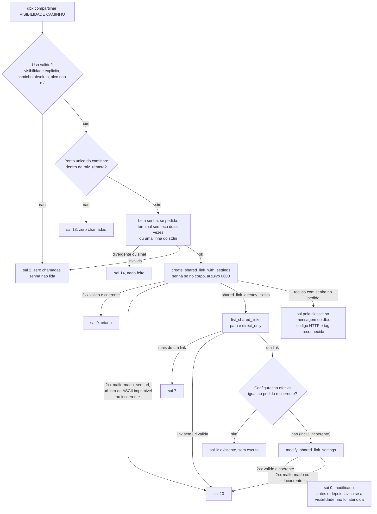
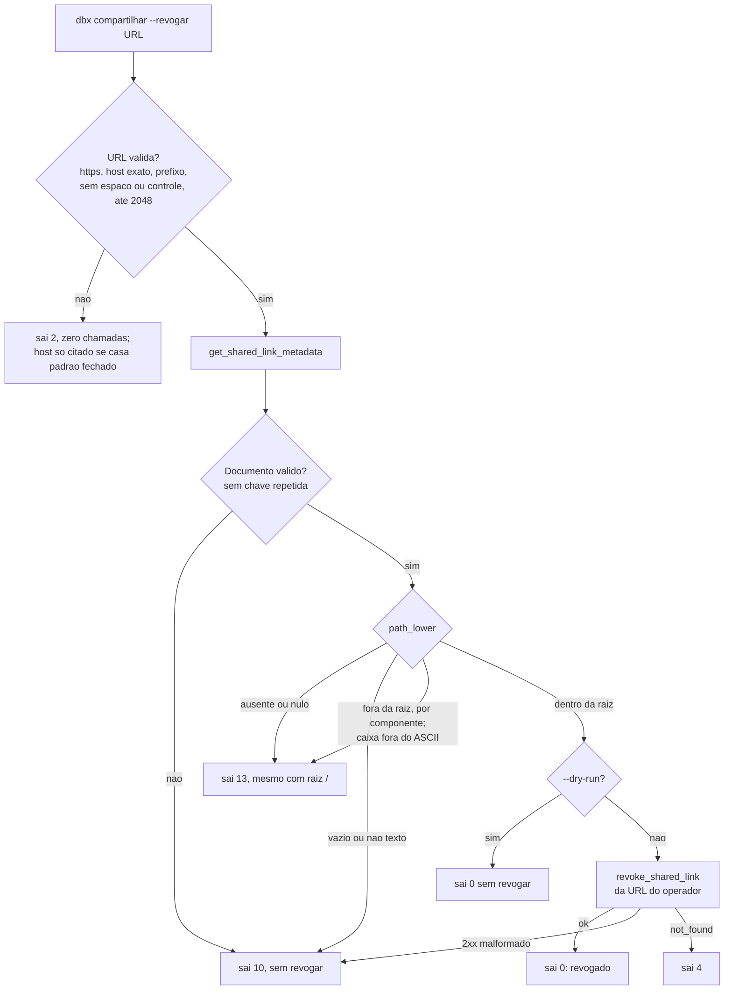

# Fase 5 do backlog (B5): link temporario e link compartilhado (F-15, F-16)

## 1. Pedido e porte

| Campo | Valor |
|---|---|
| Pedido | Fase 5 do plano do backlog, retomada depois do merge da PR #45: `dbx link-temporario <arquivo>` (`temp-link`), URL direta de 4 h por `files/get_temporary_link` (F-15), e `dbx compartilhar <caminho>` (`share`), link compartilhado com `--publico`, `--equipe`, `--senha`/`--senha-stdin` e `--expira`, mais `--listar` e `--revogar <url>` (F-16). Requisitos `RF-84` a `RF-92`, secao 5.13 do escopo v1.18. |
| Porte | **G**. Integracao externa nova (endpoints `sharing/*` e `files/get_temporary_link`, escopos `sharing.write` e `sharing.read`), exposicao de dado para fora da conta (fronteira de seguranca) e segredo novo (senha do link). Classificado pelos gatilhos da regra 40. |
| Log de prompt | [docs/prompts/2026-10-20_1110_backlog-fase-5-compartilhamento.md](../prompts/2026-10-20_1110_backlog-fase-5-compartilhamento.md) |
| Branch / base | `feature/compartilhamento-b5` sobre `develop` @ `e42168f` (nenhum PR aberto na abertura) |
| Agents | Business Analyst (requisitos v1.18 em tres rodadas, System Design v1.13, riscos e candidatas v0.10); Senior Developer (implementacao sob `protocolo-tdd` e `protocolo-conformidade`, 4 ciclos); QA Expert (validacao independente e adversarial, 43 casos, 3 ciclos); Tech Lead (decisoes, fechamento); Documentation Writer (este registro). |
| Data | 2026-10-20 |

## 2. Causa ou decisao

Decisoes do solicitante (memoria [2026-10-20-1110-compartilhamento](../../.github/agents/memoria/entradas/2026-10-20-1110-compartilhamento.md)):

- Dois comandos: `dbx link-temporario <arquivo>` (alias `temp-link`) e `dbx compartilhar <caminho>` (alias `share`), com `--listar` e `--revogar <url>`.
- Visibilidade explicita: sem `--publico`, `--equipe` ou `--senha`, o `compartilhar` sai 2. Nunca publica por omissao.
- Senha nunca no argv nem em variavel de ambiente: `--senha` pede no terminal, sem eco; `--senha-stdin` le uma linha da entrada.
- Link existente: sem configuracao diferente, devolve o existente; com configuracao diferente, aplica `modify_shared_link_settings` e mostra o antes e o depois.
- Escopos: o solicitante habilitou `sharing.write` e `files.permanent_delete` no App Console e refez a autorizacao.
- **DIV-106, decidida pelo solicitante em 2026-10-20 ("Ja esta habilitado"):** o escopo `sharing.read` ja estava concedido. A fase saiu completa, com `--listar`, o reuso de link existente e a guarda do `--revogar`. Propagada ao escopo v1.18 (segunda rodada) e ao RSK-61.
- **DP-18 resolvida** (DIV-116): senha, equipe e expiracao entram no escopo; a restricao do plano contratado sai com 6 (`RF-90(b)`). Registrada em `decisoes-pendentes.md`.

Divergencias decididas pelo Tech Lead (DIV-104 a DIV-129; texto completo na memoria):

- DIV-104, 105 e 107 a 120 (BA): aceitas como recomendadas. Destaques: DIV-104 (reuso sem escrita quando nada difere do estado efetivo); DIV-107 (reuso sempre por `list_shared_links` com `path` e `direct_only`; mais de um link sai 7); DIV-108 (`--senha` sobre link existente sempre redefine a senha); DIV-109 (senha digitada duas vezes no terminal, divergencia sai 14; vazia, com controle ou `\r`, acima de 1024 bytes ou fora de UTF-8 e recusada); DIV-110 (variavel `local` do shell, apagada logo depois, e aceita); DIV-111 (`link_password` nas chaves sensiveis de `lib/errors`); DIV-112 (`audience` e `require_password`; `--equipe --senha` sai 2); DIV-114 (`--revogar` sem confirmacao; URL validada antes da rede; `path_lower` ausente ou fora da raiz sai 13, mesmo com raiz `/`); DIV-117 (modulo `lib/compartilhamento`; leitura sem eco num ponto unico de `lib/cli`); DIV-118 (`path_lower` fora do ASCII falha fechada); DIV-120 (alvo `/` recusado).
- DIV-121 a DIV-127 (Senior Developer): aceitas. DIV-121 (grafia `link_temporario` aceita pelo despacho, nao documentada); DIV-122 (frase "no plano Basic, so link publico, sem senha e sem expiracao", para nao ser redigida); DIV-123 (caminho relativo sai 2 em todos os modos, inclusive `--listar`; corrigido); DIV-124 (`list_shared_links` sem `limit`; pagina acima de 256 KiB sai 10); DIV-125 (vocabulario `ResolvedVisibility`); DIV-126 (`read -s` restaura o eco; sinal na leitura sai 14); DIV-127 (criar, modificar e revogar idempotentes para a retentativa).
- DIV-128: vale a decisao de QA-B5-08/09; o QA ajustou o `qa_c02` para exigir que nenhum texto do servico apareca, e a suite voltou ao solicitante.
- DIV-129: link existente incoerente nunca e igual ao pedido; vai ao `modify`, cuja resposta e conferida (10 se seguir incoerente). O ramo de reuso sem escrita mantem a checagem como guarda redundante.
- Decisoes QA-B5 (ciclo 1): 01 (modify compara a visibilidade resolvida com a pedida); 02 (senha redigida pelo valor); 03 (pagina vazia com `has_more` sai 10); 04 (recusa de URL nunca cita credencial); 05 (corpo nasce 0600; resto apos SIGKILL declarado no RSK-58); 06 e 07 (link com quebra ou resposta sem `url` sai 10).
- Decisoes QA-B5 (ciclo 2): 08 e 09 (com a senha no pedido, nenhum texto bruto do servico vai a stderr ou `--debug`; classificacao pelo resumo original; mascara por valor como segunda barreira); 11 (host citado so se casa `^[A-Za-z0-9.-]+(:[0-9]+)?$`); 12 e 13 (2xx malformado ou reuso sem `url` sai 10); 14 (teto de 1000 paginas no `--listar`); 15 (espaco ou controle no link sai 10); 16 (`password` com `require_password false` sai 10).
- Decisoes QA-B5 (ciclo 3, corrigidas antes do commit, pela regra 17): 17 (tag igual a senha nao e citada); 18 (URL ou link so em ASCII imprimivel, `^[!-~]+$`); 19 (`resolved_visibility` em {`password`, `team_and_password`} se e somente se `require_password`; incoerencia sai 10 na criacao, no modify e no reuso).
- `files.stone`: confirmados `email_not_verified` (sai 6) e `path/not_file` (sai 2).

Fluxo da criacao e do reuso (RF-85 a RF-87, DIV-104, DIV-107, DIV-129, QA-B5-01/12/13/18/19):

Guarda do `--revogar` (RF-89, DIV-114, DIV-118, RSK-59). A guarda e sem estado: decide so pela resposta de `get_shared_link_metadata` da mesma execucao, nunca por memoria local, listagem anterior ou arquivo em `XDG_STATE_HOME`.

## 3. Arquivos

Levantado com `git diff --numstat` (16 arquivos rastreados alterados, +423/-39) e `git status --short`; arquivos novos contados por `wc -l`. Nenhum commit ainda.

| Arquivo | Alteracao | Linhas |
|---|---|---|
| `commands/compartilhar.sh` | Novo (criar, reusar, modificar, `--listar`, `--revogar`) | 797 |
| `commands/link_temporario.sh` | Novo | 171 |
| `lib/compartilhamento.sh` | Novo (dominio puro: `--expira`, senha, URL, corpo, confinamento, exposicao) | 324 |
| `lib/errors.sh` | Alterado (`settings_error`, tags do RF-90(a), `link_password` sensivel, `dbx_errors_tag_reconhecida`) | +47/-0 |
| `lib/cli.sh` | Alterado (tabela, aliases, `dbx_cli_ler_oculto`) | +39/-2 |
| `lib/cmd.sh` | Alterado (idempotencia em `_dbx_cmd_escrita_remota`) | +12/-3 |
| `lib/http.sh` | Alterado (arquivo de corpo nasce 0600) | +4/-1 |
| `lib/tmp.sh` | Alterado (`dbx_tmp_armar`) | +6/-0 |
| `commands/config.sh` | Alterado (app secret pela leitura unica de `lib/cli`) | +4/-6 |
| `commands/diagnostico.sh` | Alterado (RF-91) | +16/-0 |
| `bin/dbx` | Alterado (ajudas) | +62/-1 |
| `completions/dbx.bash` | Alterado | +9/-3 |
| `README.md` | Alterado | +34/-0 |
| `docs/testes/mapa-modulos.md` | Alterado | +21/-7 |
| `docs/arquitetura/system-design.md` | Alterado (BA, v1.13) | +74/-6 |
| `docs/requisitos/escopo-requisitos-e-criterios-de-aceite.md` | Alterado (BA, v1.18) | +77/-2 |
| `docs/requisitos/funcionalidades-candidatas.md`, `riscos-restricoes-e-licenciamento.md`, `decisoes-pendentes.md` | Alterados (BA) | +6/-6, +6/-1, +6/-1 |
| `tests/integracao/compartilhar_test.sh` | Novo (83 casos) | 1477 |
| `tests/unit/compartilhamento_test.sh` | Novo (16 casos) | 266 |
| `tests/integracao/diagnostico_compartilhamento_test.sh` | Novo (2 casos) | 116 |
| `tests/integracao/qa_compartilhamento_b5_test.sh` | Novo (QA, 43 casos) | 1656 |
| `.github/agents/memoria/entradas/2026-10-20-1110-compartilhamento.md` | Novo (decisao) | documental |
| `docs/prompts/2026-10-20_1110_backlog-fase-5-compartilhamento.md` | Novo (log de prompt) | documental |
| `docs/reviews/2026-10-20-1110-*.md` (parecer TDD, parecer de conformidade, validacao do QA, este registro) | Novos | documental |

Nenhum arquivo de teste existente alterado.

Propagacao documental concluida na mesma rodada:
- DIV-128, DIV-129 e QA-B5-01 a QA-B5-19 estao no escopo v1.18 (nota "Decisoes dos ciclos de validacao do QA" na secao 5.13 e secao 9) e no System Design v1.13.
- As marcas † da tabela de contratos sairam depois da conferencia do `files.stone`.
- O cabecalho de `decisoes-pendentes.md` foi para v1.4, com a DP-18 resolvida.

## 4. Testes rodados

Contagens literais dos pareceres do Senior Developer ([TDD](2026-10-20-1110-parecer-tdd-compartilhamento-b5.md)) e do QA ([validacao](2026-10-20-1110-validacao-qa-compartilhamento-b5.md)).

| Arquivo de teste | Item afetado que o justifica | Comando | Total | Aprovados | Falhos |
|---|---|---|---|---|---|
| `compartilhar_test`, `compartilhamento_test`, `diagnostico_compartilhamento_test`, `qa_compartilhamento_b5_test` (ciclo 4) | `commands/compartilhar`, `link_temporario`, `lib/compartilhamento` | `bash tests/run.sh compartilh` | 4 arquivos, 144 | 144 | 0 |
| Suites `qa_*` (ciclo 4) | regressao das suites aprovadas | `bash tests/run.sh qa_` | 13 arquivos, 290 | 290 | 0 |
| `qa_compartilhamento_b5_test.sh` (QA, ciclo 3) | P0 de senha, revogar, visibilidade | `bash tests/run.sh qa_compartilhamento` | 43 | 43 | 0 |
| `json_test.sh` | `lib/json` (escape da senha) | `bash tests/run.sh json` | 62 | 62 | 0 |
| `http_test.sh` | `lib/http` | `bash tests/run.sh http` | 53 | 53 | 0 |
| Selecao pelo mapa (ciclo 1) | `cli_test`, `composicao`, `tmp_test`, `preflight`, `errors`, `completar`, `comandos`, `config`, `cmd_test`, `filtro`, `banda`, `recuperacao`, `auth_test` | idem | todos | todos | 0 |
| Suite inteira (ultima do developer, ciclo 4) | `lib/`, `commands/` | `bash tests/run.sh < /dev/null` | 52 arquivos | 1545 | 0 (2 pulados, vetor oficial sem rede) |

- Red: ciclo 1 contra `e42168f`, cada caso isolado: 16 de 16 (`compartilhamento_test`), 2 de 2 (`diagnostico_compartilhamento_test`) e 68 de 71 (`compartilhar_test`; os 3 verdes sao de ausencia, discriminados por mutante). `snh11` reforcado. DIV-123, ciclos 2, 3 e 4: cada caso novo ou do QA vermelho antes do conserto.
- Suites anteriores do developer: ciclo 1, 51 arquivos, 1490/0/2; ciclo 2, 52 arquivos, 1527/0/2; ciclo 3, reprovada so pelo `qa_c02` (DIV-128), os outros 51 arquivos aprovados um a um.
- Guarda de remocao de casos (`bash scripts/verificar-remocao-de-casos.sh`): nenhuma reducao, nos quatro ciclos. Nenhum caso aprovado alterado ou removido; `lst06` e `snh11`, do proprio ciclo de desenvolvimento, foram ajustados pelas decisoes de QA-B5-03 e QA-B5-09.
- `shellcheck` 0.10.0 limpo nos quatro ciclos, inclusive nos testes novos.
- Seguranca e acesso (regra 6): sentinela de senha ausente de argv (o duble varre `/proc/*/cmdline`), ambiente (`/proc/*/environ`), `-K -`, stdout, stderr, `--debug`, `--json`, `--null`, TMPDIR, estado e config, inclusive com TERM, INT e HUP durante a chamada; `--senha` em pseudo-terminal real com eco desligado nas duas leituras e religado ao fim; guarda do `--revogar` provada contra 20 metadados hostis, 18 URLs hostis e estado plantado em `XDG_STATE_HOME`; 33 combinacoes de visibilidade invalida saem 2 sem chamada; mutantes do developer (M1..M9) e do QA (35 no ciclo 1, MC2..MC11b nos ciclos 2 e 3) mortos, salvo o MC2, equivalente na saida observavel (secao 6).
- Piramide 70/20/10 e E2E: Testcontainers e Cypress nao se aplicam (CLI em shell, sem banco nem UI). Integracao ponta a ponta pelo `bin/dbx` real com duplo de `curl` na fronteira de rede. Formularios (regra 7): nao aplicavel.
- **Suite completa local no push para a PR de `develop` (regra 8):** comando oficial `sh scripts/suite-completa.sh` (`bash tests/run.sh`). **Pendente:** resultado, duracao e sha do commit em que rodou.

## 5. Gates

| Gate | Skills aplicadas | Achados | Veredito |
|---|---|---|---|
| `protocolo-tdd` ([parecer](2026-10-20-1110-parecer-tdd-compartilhamento-b5.md)) | Regras 1 a 9; excecao de piramide do projeto shell | Ciclo 1: dois Menores registrados (relogio sem duble no TC-CMP-07; avisos com terminal sem caso). Ciclo 3: DIV-128 (conflito com `qa_c02`). Ciclo 4: DIV-129 (reuso de link incoerente) | Ciclos 1 a 4 Aprovado |
| `protocolo-conformidade` ([parecer](2026-10-20-1110-parecer-conformidade-compartilhamento-b5.md)) | `clean-architecture`, `shellcheck-configuration`, `security-best-practices`, `api-security-best-practices` | Ciclo 1: DIV-121 a DIV-127 (Maior, ja decididas; DIV-123 corrigida); grafia `link_temporario` (Menor). Ciclos 2 a 4: nenhum | Ciclos 1 a 4 Aprovado |

- Ciclos: 4 do developer, 3 do QA. Status dos achados do QA: QA-B5-01 a 09 e 11 a 19 corrigidos; a observacao do `lst06` corrigida. DIV-128 e DIV-129 decididas pelo Tech Lead.

## 6. QA

Detalhe em [validacao-qa-compartilhamento-b5](2026-10-20-1110-validacao-qa-compartilhamento-b5.md).

- Suite `tests/integracao/qa_compartilhamento_b5_test.sh`, 43 casos, sha256 `8adf68023874b67e2fb51de3b946d43b489b2a5952621b3b01203e4ecb566a76` (versao final). Versoes anteriores: `72f035f8...` (32 casos, ciclo 1) e `97935ad1...` (40 casos, ciclo 2).
- **Aprovacao do solicitante pela regra 12, em 2026-10-20 ("Aprovo"):** suite do QA com 43 casos e sha256 `8adf68023874b67e2fb51de3b946d43b489b2a5952621b3b01203e4ecb566a76`.
- Ciclo 1: **Reprovado**. Tres Maiores: QA-B5-01 (modify devolvia link publico como se atendesse `--senha` ou `--equipe`), QA-B5-02 (senha crua em `error_summary` JSON) e QA-B5-03 (`--listar` sem fim). Quatro Menores: QA-B5-04 a 07.
- Ciclo 2: **Reprovado**. Quatro Maiores: QA-B5-08 (mascara antes da classificacao, oraculo da senha), QA-B5-09 (senha em pedacos), QA-B5-11 (credencial com `/`, seguranca) e QA-B5-12 (2xx malformado saia 0). Quatro Menores: QA-B5-13 a 16; observacao do `lst06`.
- Ciclo 3: **Aprovado, com tres ressalvas Menores**, QA-B5-17 a 19, corrigidas no ciclo 4 do developer antes do commit (regra 17). O mutante MC2 (mascara com padrao sem aspas) ficou vivo por ser equivalente na saida observavel: com a senha no pedido, nenhum texto do servico chega a mensagem.
- Veredito do QA: **Aprovado**, 2026-10-20 (ciclo 3).

## 7. Riscos e rollback

- Riscos residuais:
  - Exposicao publica por link (RSK-57): `--publico` torna o item acessivel a quem tiver a URL; mitigado pela visibilidade sempre explicita e pelo aviso de exposicao ampliada.
  - Vazamento da senha (RSK-58): depois de SIGKILL no meio da chamada, o arquivo de corpo com a senha fica no TMPDIR, dentro do diretorio 0700 do usuario e com modo 0600; nao ha varredura de areas orfas.
  - Revogacao fora da raiz (RSK-59): guarda sem estado pela resposta da mesma execucao; o `modify` confia na `url` do item listado com o mesmo `path_lower`, no mesmo modelo.
  - Link temporario irrevogavel por 4 h (RSK-60); aviso em stderr e `--dry-run` que nao gera link.
  - Restricao de plano e escopo `sharing.read` (RSK-61, DP-18): conta Basic so cria link publico, sem senha e sem expiracao (sai 6). Os contratos da API foram conferidos na documentacao e no `files.stone`, mas validados so por duplo; nao ha rede na suite.
  - Avisos condicionados a terminal (`--publico`, link temporario) sem caso de teste; o relogio do `--expira` nao tem duble (Menores do ciclo 1).
- Licoes:
  - Mascarar o segredo pelo valor nao basta: a mascara aplicada antes da classificacao mudou o desfecho e transformou a tag conhecida num oraculo da senha (QA-B5-08), e o corte de 120 bytes e a forma escapada deixavam pedacos (QA-B5-09). Com o segredo no pedido, o mais seguro e nao citar texto do servico; a mascara fica como segunda barreira.
  - Sucesso HTTP nao e sucesso do comando: 2xx malformado, sem `url`, com URL fora de ASCII imprimivel ou incoerente com `require_password` tem de sair 10, porque um script veria sucesso de uma escrita que pode ter ocorrido (QA-B5-12, 18, 19).
  - A guarda do `--revogar` segue a licao `guarda-de-seguranca-sem-estado`: decide pela resposta da mesma execucao e confere a identidade do alvo (`path_lower`), nao so a existencia.
  - Paginacao vinda de servidor precisa de teto, alem da deteccao de cursor repetido (QA-B5-03, 14).
- Impacto: contrato. Dois comandos novos com aliases (`link-temporario`/`temp-link`, `compartilhar`/`share`) e opcoes `--publico`/`--public`, `--equipe`/`--team`, `--senha`/`--password`, `--senha-stdin`/`--password-stdin`, `--expira`/`--expires`, `--listar`/`--list`, `--revogar`/`--revoke`; escopos opcionais `sharing.write` e `sharing.read` (OAuth), citados pelo `diagnostico`; `lib/http` passa a criar o arquivo de corpo com 0600; `config` le o app secret pela leitura unica de `lib/cli`; nenhum codigo de saida novo; nada em `lib/state`; sem dependencia nova.
- Rollback: `git revert <pendente: sha do commit da fase 5>` (e do commit de documentacao) basta. Sem migracao de dado ou credencial. Links ja criados ou modificados por um operador continuam no Dropbox; revogue-os com `dbx compartilhar --revogar <url>` antes do revert, se for o caso. Link temporario ja emitido vale ate expirar.

## 8. Links e aceites

- Entradas de memoria: `2026-10-20-1110-compartilhamento`.
- Documentacao sincronizada (versoes finais): [escopo-requisitos-e-criterios-de-aceite.md](../requisitos/escopo-requisitos-e-criterios-de-aceite.md) **v1.18** (secao 5.13, RF-84..92; tres rodadas: fase 5, DIV-104..120, DIV-121..127), [system-design.md](../arquitetura/system-design.md) **v1.13**, [funcionalidades-candidatas.md](../requisitos/funcionalidades-candidatas.md) **v0.10**, [riscos-restricoes-e-licenciamento.md](../requisitos/riscos-restricoes-e-licenciamento.md) **v0.10** (RSK-57..61), [decisoes-pendentes.md](../requisitos/decisoes-pendentes.md) (DP-18 resolvida; cabecalho em v1.3), [mapa-modulos.md](../testes/mapa-modulos.md), `README.md`. Pendencias de propagacao na secao 3.
- Pareceres: [TDD](2026-10-20-1110-parecer-tdd-compartilhamento-b5.md), [conformidade](2026-10-20-1110-parecer-conformidade-compartilhamento-b5.md), [QA](2026-10-20-1110-validacao-qa-compartilhamento-b5.md).
- Suite completa local: **pendente** (resultado, duracao e sha).
- Commit(s): **pendente** (hash do commit da fase 5) e o commit de documentacao que preenche este registro.
- PR: **pendente** (numero) para `develop`.
- Tech Lead: aceite pendente da suite completa local verde; validacao independente do QA aprovada no ciclo 3 com as ressalvas corrigidas no ciclo 4.
- Solicitante: DIV-106 decidida (`sharing.read` habilitado); aceite do `qa-*` por sha256 (regra 12) concedido em 2026-10-20 para `8adf68023874b67e2fb51de3b946d43b489b2a5952621b3b01203e4ecb566a76` (43 casos).
