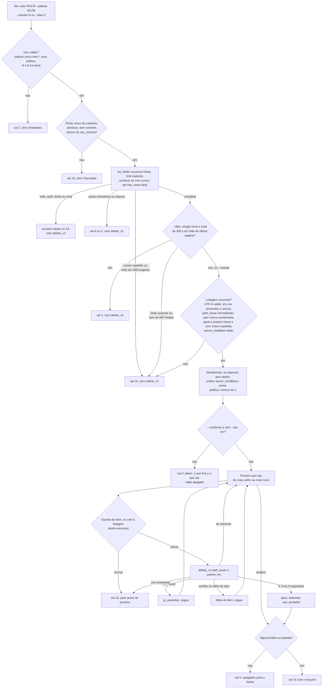
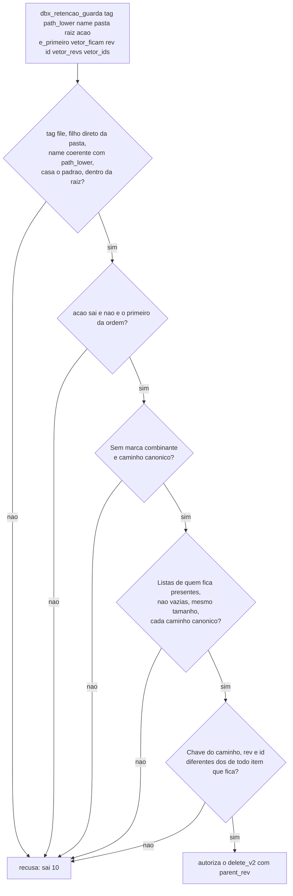

# Fase 6 do backlog (B6): retencao e rotacao de backup (F-10)

## 1. Pedido e porte

| Campo | Valor |
|---|---|
| Pedido | Fase 6 do plano do backlog, retomada depois do merge da PR #46: `dbx reter <pasta-remota> --padrao GLOB (--manter N \| --dias D) [--confirmar]` (alias `retain`). O comando lista o nivel de cima da pasta, ordena os arquivos que casam o padrao por `server_modified` e apaga o excedente para a lixeira por `delete_v2`, so com `--confirmar` e sempre mantendo pelo menos 1 artefato (F-10). Requisitos `RF-93` a `RF-100`, secao 5.14 do escopo v1.20. |
| Porte | **G**. Operacao destrutiva em lote no destino remoto, sem operador (fronteira de seguranca dos dados), integracao externa nova (`delete_v2` com `parent_rev`, cabecalho `Date` da listagem) e regra de guarda transversal. Classificado pelos gatilhos da regra 40. |
| Log de prompt | [docs/prompts/2026-10-20_2010_backlog-fase-6-retencao.md](../prompts/2026-10-20_2010_backlog-fase-6-retencao.md) |
| Branch / base | `feature/retencao-b6` sobre `develop` @ `d696c1d` (nenhum PR aberto na abertura) |
| Agents | Business Analyst (requisitos v1.19 e v1.20, System Design v1.14, riscos e candidatas v0.11 e v0.12); Senior Developer (implementacao sob `protocolo-tdd` e `protocolo-conformidade`, 5 ciclos); QA Expert (validacao independente e adversarial, 60 casos, 5 ciclos); Tech Lead (decisoes, fechamento); Documentation Writer (este registro). |
| Data | 2026-10-20 |

## 2. Causa ou decisao

Decisoes do solicitante (memoria [2026-10-20-2010-retencao](../../.github/agents/memoria/entradas/2026-10-20-2010-retencao.md)):

- Comando proprio, `dbx reter <pasta-remota> --padrao GLOB (--manter N | --dias D)`, com o alias `retain`. Nao e opcao do upload; roda sozinho, por exemplo num cron depois do upload.
- Ordem: pelo `server_modified`; em empate, pelo nome.
- Exclusao: para a lixeira, por `delete_v2`, recuperavel com `dbx lixeira` ou `dbx restaurar` dentro do prazo do plano. Nunca exclusao permanente.
- Protecao: sem `--confirmar`, so mostra o plano (o que fica e o que sai) e sai 0, sem apagar. Sempre mantem pelo menos 1 artefato.
- Guarda destrutiva sem estado local (licao `guarda-de-seguranca-sem-estado`).
- **Aprovacoes de 2026-10-20 (Prompt 2 do log):** suite do QA aprovada pela regra 12 ("Aprovo"); troca do teste aprovado TC-CPL-08 autorizada (DIV-148, "Autorizo"); risco residual da DIV-170 aceito e registrado no RSK-68 ("Aceito o risco").

Divergencias decididas pelo Tech Lead (DIV-130 a DIV-170; texto completo na memoria):

- DIV-130 a DIV-147 (BA): aceitas como recomendadas. Destaques: DIV-130 (so o nivel de cima); DIV-131 (`--padrao` obrigatorio e unico, `/` recusado, `**` equivale a `*`); DIV-132 (padrao amplo aceito com aviso); DIV-133 (`--manter` e `--dias` mutuamente exclusivos); DIV-134 (relogio local conferido contra o `Date` da listagem; acima de 300 s sai 3; `lib/http` expoe o `Date`); DIV-135 (`--dry-run` vence `--confirmar`; aliases `--yes`/`-y` aceitos porque a exclusao e recuperavel); DIV-137 (guarda fora do ASCII falha fechada); DIV-138 (todo `delete_v2` leva `parent_rev`); DIV-139 (`delete_v2` por item); DIV-140 (sem trava); DIV-141 (`not_found` conta em `ja_ausentes`); DIV-142 (do mais velho para o mais novo; para em 5, 8 ou 9 esgotados e sai 14); DIV-143 (`limit` explicito, teto de 1000 paginas e cursor repetido saem 10); DIV-145 e DIV-147 (`server_modified` invalido ou listagem incoerente: 10 sem nenhum delete); DIV-146 (nada casa: 0 com aviso; pasta inexistente: 4).
- DIV-148 a DIV-157 (Senior Developer): DIV-148 (TC-CPL-08, ver abaixo); DIV-149 (tag da recusa por `parent_rev` divergente nao documentada: `*conflict*` vira `conflito`, nunca nova tentativa sem `parent_rev`; RSK-67); DIV-150 e DIV-151 (defeitos preexistentes fora do escopo, `limit` no `list_folder/continue` e `invalid_grant` classificado como 2; backlog F-40 e F-41); DIV-152 a DIV-157 aceitas como implementadas (opcoes globais so antes do comando; relogio conferido nos tres modos; `Date` so em IMF-fixdate; item em curso no resumo do sinal; coerencia `name` x `path_lower` so dos candidatos; `chave=valor` sem terminal).
- **DIV-148, autorizada pelo solicitante:** TC-CPL-08 (`tests/integracao/completar_test.sh:150`) exigia `_completar re` = `restaurar restore revisions revisoes`, e `reter`/`retain` tambem comecam com `re`. A assercao exata de `re` virou tres assercoes exatas: `res` (restaurar restore), `rev` (revisions revisoes) e `ret` (retain reter). Nenhum caso removido.
- Achados do QA, decididos pelo Tech Lead:
  - Ciclo 1: DIV-158 (QA-B6-01, P0: `path_lower` repetido sai 10 sem delete; guarda (7) compara caminho, nao indice); DIV-159 (QA-B6-02, P1: `name` `.`/`..` e `path_lower` nao normalizado recusados na listagem); DIV-160 (`Date` da ultima pagina).
  - Ciclo 2: DIV-161 (QA-B6-03, P0: chave sem caixa de RF-54 nas tres barreiras; `path_lower` diferente da propria chave sai 10); DIV-162 (QA-B6-04, P1: guarda (7) recusa sem a lista de quem fica); DIV-163 (ajuste do `qa_s11`).
  - Ciclo 3: DIV-164 (QA-B6-05, P0: marca combinante dos cinco blocos sai 10, falha fechada ampla); DIV-165 (QA-B6-06, P1: lista de quem fica so com caminho canonico); DIV-166 (ajuste de `qa_s09` e `qa_s20`).
  - Ciclo 4, **mudanca de abordagem**: quatro ciclos acharam a mesma classe de P0 por variantes de grafia, e uma lista de recusa por grafia nunca fecha essa classe. DIV-167 (QA-B6-07, P0: **barreira estrutural por identidade**, `id` e `rev` obrigatorios e unicos na listagem e comparados pela guarda (7); assinatura nova de 12 argumentos); DIV-168 (QA-B6-08, P1: UTF-8 valido por bytes); DIV-169 (ajuste de oito casos do QA).
  - Ciclo 5: aprovado. DIV-170 (OBS-2): composicoes NFC fora dos cinco blocos (`が`, `한`, `ऩ`) com `id` e `rev` distintos escapam as barreiras por grafia; explorar exige o servidor violar o contrato de `id` estavel. Risco residual aceito pelo solicitante (RSK-68).

Fluxo do `reter` (RF-93 a RF-99; DIV-134, DIV-142, DIV-143, DIV-147, DIV-158 a DIV-168):

Guarda por item no ponto de cada `delete_v2` (RF-97(b), DIV-158, DIV-162, DIV-164, DIV-165, DIV-167). A guarda e sem estado: decide so pela listagem da mesma execucao, nunca por `lib/state`, cache ou plano anterior. A barreira decisiva e a identidade; as por grafia ficam como defesa adicional. As condicoes sao cumulativas: o diagrama as agrupa, sem reproduzir a ordem do codigo.

## 3. Arquivos

Levantado com `git diff --numstat` (12 arquivos rastreados alterados, +375/-38) e `git status --short`; arquivos novos contados por `wc -l`. Nenhum commit ainda.

| Arquivo | Alteracao | Linhas |
|---|---|---|
| `commands/reter.sh` | Novo (uso, confinamento, listagem paginada com teto e conferencia de coerencia e identidade, plano, `delete_v2` por item, resumo) | 728 |
| `lib/retencao.sh` | Novo (dominio puro: politica, carimbo, data HTTP, plano, minimo de 1, guarda por item, chave, caminho canonico, marca combinante, UTF-8) | 513 |
| `lib/filtro.sh` | Alterado (validacao unica do glob `_dbx_filtro_validar_padrao`; nome avulso; padrao amplo) | +113/-21 |
| `lib/http.sh` | Alterado (`DBX_HTTP_DATA`, cabecalho `Date`) | +12/-1 |
| `lib/cli.sh` | Alterado (tabela, alias `retain`, arquivo do comando) | +5/-1 |
| `bin/dbx` | Alterado (ajuda) | +32/-1 |
| `completions/dbx.bash` | Alterado | +6/-3 |
| `README.md` | Alterado | +23/-0 |
| `docs/testes/mapa-modulos.md` | Alterado | +15/-4 |
| `docs/arquitetura/system-design.md` | Alterado (BA, v1.14) | +62/-2 |
| `docs/requisitos/escopo-requisitos-e-criterios-de-aceite.md` | Alterado (BA, v1.19 e v1.20) | +92/-1 |
| `docs/requisitos/funcionalidades-candidatas.md`, `riscos-restricoes-e-licenciamento.md` | Alterados (BA, v0.12) | +4/-2, +8/-1 |
| `tests/integracao/completar_test.sh` | Alterado: TC-CPL-08, assercao de `re` trocada por `res`, `rev` e `ret` (DIV-148, autorizada pelo solicitante) | +3/-1 |
| `tests/integracao/reter_test.sh` | Novo (84 casos) | 1683 |
| `tests/unit/retencao_test.sh` | Novo (38 casos) | 694 |
| `tests/integracao/qa_retencao_b6_test.sh` | Novo (QA, 60 casos) | 1776 |
| `.github/agents/memoria/entradas/2026-10-20-2010-retencao.md` | Novo (decisao) | documental |
| `docs/prompts/2026-10-20_2010_backlog-fase-6-retencao.md` | Novo (log de prompt) | documental |
| `docs/reviews/2026-10-20-2010-*.md` (parecer TDD, parecer de conformidade, validacao do QA, este registro) | Novos | documental |

Um teste aprovado alterado, com autorizacao do solicitante: TC-CPL-08 (DIV-148). Nenhum caso removido.

Propagacao documental concluida na mesma rodada:
- DIV-130 a DIV-170 estao no escopo v1.20 (secao 5.14 e secao 9) e no System Design v1.14 (secao "Retencao e rotacao de backup", com a fronteira de seguranca e o fluxo em Mermaid).
- DIV-149 virou o RSK-67; DIV-150 e DIV-151 viraram F-40 e F-41; o risco residual da DIV-170 esta no RSK-68.
- `decisoes-pendentes.md` nao muda nesta fase.

## 4. Testes rodados

Contagens literais dos pareceres do Senior Developer ([TDD](2026-10-20-2010-parecer-tdd-retencao-b6.md)) e do QA ([validacao](2026-10-20-2010-validacao-qa-retencao-b6.md)).

| Arquivo de teste | Item afetado que o justifica | Comando | Total | Aprovados | Falhos |
|---|---|---|---|---|---|
| `reter_test.sh` (ciclo 5) | `commands/reter`, `lib/retencao`, `lib/http` (`Date`) | `bash tests/run.sh reter` | 84 | 84 | 0 |
| `retencao_test.sh` (ciclo 5) | `lib/retencao` | `bash tests/run.sh retencao_test` | 38 | 38 | 0 |
| `retencao_test` e `qa_retencao_b6_test` (QA, ciclo 5) | regressao das duas suites da fase | `bash tests/run.sh retencao` | 2 arquivos, 98 | 98 | 0 |
| `qa_retencao_b6_test.sh` (QA, ciclo 5) | P0 de confirmacao, selecao, `parent_rev`, identidade, listagem, delete, sinal | `bash tests/run.sh qa_retencao_b6` | 60 | 60 | 0 |
| `completar_test.sh` (TC-CPL-08 trocado) | `completions/dbx.bash`, `lib/cli` | `bash tests/run.sh completar` | 17 | 17 | 0 |
| Selecao pelo mapa (ciclo 1) | `retencao_test`, `json`, `http`, `preflight`, `composicao`, `tmp_test`, `cli`, `filtro` | idem | 8 arquivos | 27, 62, 53, 35, 28, 16, 17, 34 | 0 |
| `json`, `composicao`, `tmp_test` (ciclos 2 a 5) | auditorias RNF-24, ponto unico, `lib/tmp` | idem | 3 arquivos | todos | 0 |

- Red: ciclo 1 contra `d696c1d`, cada caso P0 isolado: `retencao_test` reprova por `lib/retencao.sh` ausente; `reter_test` reprova em cada P0 com `comando desconhecido: reter`. Ciclos 2 a 5: cada caso novo do developer e os casos do QA que expunham o achado deram `not ok` antes do conserto (`div168_mutante_sem_a_validacao_reprova` saiu `ok` vacuo no red do ciclo 5, porque a marca ainda nao existia; o caso `marcas_de_mutacao_existem` cobre esse risco).
- Suite inteira do developer no ciclo 1: REPROVADA so pelo TC-CPL-08 (31 arquivos, 1012 ok, parou no primeiro erro). Numa copia do worktree com so a linha 150 trocada: APROVADA, 54 arquivos, 1641 aprovados, 0 reprovados, 2 pulados. A troca real foi feita depois da autorizacao do solicitante (DIV-148); `completar` 17/17 em 2026-10-20.
- Guarda de remocao de casos (`bash scripts/verificar-remocao-de-casos.sh`): 1557 -> 1557, nenhuma reducao, nos cinco ciclos.
- `shellcheck` 0.10.0 limpo nos cinco ciclos (`lib/*.sh commands/*.sh bin/* scripts/*.sh`; `shellcheck -x` nos testes novos).
- Seguranca e acesso (regra 6): confinamento (13 sem chamada, inclusive `\n`/`\r`); estado envenenado em `XDG_STATE_HOME` identico ao vazio; `parent_rev` em todo `delete_v2`; pasta, item fora da pasta, da raiz ou do padrao nunca apagado; sentinelas de token, refresh e segredo ausentes de stdout, stderr, `--debug` e argv do `curl`; padrao tratado como dado (`$(touch S)` nao executa); auditoria estatica sem `permanently_delete` nem `delete_batch`. Mutantes do developer nos cinco ciclos e barreiras em camadas (cada barreira removida isolada e todas juntas) mortos.
- Piramide 70/20/10 e E2E: Testcontainers e Cypress nao se aplicam (CLI em shell, sem banco nem UI). Unidade (38) sobre as funcoes puras com relogio fixado e propriedade sobre 200 listagens; integracao ponta a ponta pelo `bin/dbx` real com duble de `curl` na fronteira de rede. Formularios (regra 7): nao aplicavel.
- **Suite completa local no push para a PR de `develop` (regra 8):** comando oficial `sh scripts/suite-completa.sh` (`bash tests/run.sh`). **[A PREENCHER pelo Tech Lead: resultado (APROVADA/REPROVADA), arquivos, aprovados, reprovados, pulados, tempo em s, sha do commit e instante do `--conferir`.]**

## 5. Gates

| Gate | Skills aplicadas | Achados | Veredito |
|---|---|---|---|
| `protocolo-tdd` ([parecer](2026-10-20-2010-parecer-tdd-retencao-b6.md)) | Regras 1 a 9; excecao de piramide do projeto shell | Ciclo 1: TDD-01 (Maior: TC-CPL-08 conflita com o nome decidido, DIV-148, resolvida pela autorizacao do solicitante); TDD-02 (Menor: TC-RTC-05 depende de `script(1)`). Ciclos 2 a 5: conflitos com a suite do QA nao aprovada (DIV-163, DIV-166, DIV-169), ajustados pelo QA | Ciclos 1 a 5 Aprovado |
| `protocolo-conformidade` ([parecer](2026-10-20-2010-parecer-conformidade-retencao-b6.md)) | `clean-architecture`, `shellcheck-configuration`, `security-best-practices`, `api-security-best-practices` | CNF-01 e CNF-02 (Maior, preexistentes, fora do diff: DIV-151 e DIV-150, backlog F-41 e F-40); CNF-03 (Menor: tag do conflito de `parent_rev`, DIV-149, RSK-67) | Ciclos 1 a 5 Aprovado com ressalvas |

- Ciclos: 5 do developer, 5 do QA. Status dos achados do QA: QA-B6-01 a 08 corrigidos; OBS-1 corrigida (DIV-160); OBS-2 aceita como risco residual (DIV-170, RSK-68).

## 6. QA

Detalhe em [validacao-qa-retencao-b6](2026-10-20-2010-validacao-qa-retencao-b6.md).

- Suite `tests/integracao/qa_retencao_b6_test.sh`, 60 casos, sha256 `cd0178992648fc24132d992c86927c29b418e7cdcf3ac873ae426c591e258cad` (versao final). Versoes anteriores: `21fc8c1f...` (41 casos, ciclo 1), `08cc0440...` (48, ciclo 2), `d4ca76fe...` (53, ciclo 3) e `bb17b865...` (57, ciclo 4).
- **Aprovacao do solicitante pela regra 12, em 2026-10-20 ("Aprovo"):** suite do QA com 60 casos e sha256 `cd0178992648fc24132d992c86927c29b418e7cdcf3ac873ae426c591e258cad`.
- Ciclo 1: **Reprovado**. QA-B6-01 (P0: entrada duplicada na listagem apagava o unico artefato) e QA-B6-02 (P1: `.`/`..` como `name` so parava na guarda, depois de exclusoes); OBS-1 (`Date` da primeira pagina).
- Ciclo 2: **Reprovado**. QA-B6-03 (P0: duplicata em caixa fora do ASCII) e QA-B6-04 (P1: guarda (7) falhava aberta sem a lista de quem fica).
- Ciclo 3: **Reprovado**. QA-B6-05 (P0: o mesmo nome em NFC e NFD) e QA-B6-06 (P1: guarda (7) aprovava lista vazia na pratica).
- Ciclo 4: **Reprovado**. QA-B6-07 (P0: composicoes canonicas fora dos cinco blocos) e QA-B6-08 (P1: UTF-8 invalido no `path_lower` recebia `delete_v2`).
- Ciclo 5: **Aprovado**, 60 de 60, com a OBS-2 (DIV-170) como risco residual, aceito pelo solicitante.
- Veredito do QA: **Aprovado**, 2026-10-20 (ciclo 5).

## 7. Riscos e rollback

- Riscos residuais:
  - Apagar o backup errado (RSK-62): mitigado pela listagem completa e coerente antes de qualquer exclusao, pela barreira estrutural por identidade (`id` e `rev`), pelas barreiras por grafia, pela guarda sem estado no ponto de cada `delete_v2`, por `parent_rev`, pelo minimo de 1 e pelo plano sem `--confirmar`. Resta a exclusao certa pela politica errada que o operador escreveu (RSK-63).
  - Padrao amplo demais (RSK-63): aceito com aviso (DIV-132).
  - Relogio e `server_modified` (RSK-64): erro de relogio abaixo de 300 s desloca o corte no maximo nisso; restaurar ou regravar um artefato o torna o mais novo (documentado na ajuda e no README).
  - Recuperacao limitada ao prazo da lixeira e falha parcial (RSK-65); concorrencia sem trava (RSK-66).
  - Tag da recusa por `parent_rev` divergente nao documentada (RSK-67, DIV-149): conferir no servico real; o arquivo novo nunca e apagado, so o motivo relatado pode sair enganoso.
  - Comparacao Unicode diferente da do servidor (RSK-68): falha fechada (10 falso, zero `delete_v2`); pasta com nome decomposto nao passa pelo `reter`; composicoes NFC fora dos cinco blocos com `id`/`rev` distintos dependem do contrato de identidade do servidor (DIV-170, aceito pelo solicitante).
  - Defeitos preexistentes fora do escopo, contornados no `reter`: `limit` no `list_folder/continue` (F-40) e `invalid_grant` classificado como 2 (F-41).
  - Contratos validados so por duplo; nao ha rede na suite nem credencial de teste.
- Licoes:
  - Lista de recusa por grafia nao fecha a classe "mesmo arquivo em duas entradas": quatro ciclos acharam variantes (caixa ASCII, caixa Unicode, NFD, composicoes fora dos blocos). A barreira decisiva tem de ser estrutural e independente de tabela Unicode: `id` e `rev` (DIV-167). As barreiras por grafia ficam como defesa adicional.
  - Guarda que compara indice nao protege caminho: o minimo de 1 e "nao e o primeiro" valiam por posicao, e uma duplicata deslocava o que fica (QA-B6-01).
  - Defesa em profundidade so vale se falhar fechada: a guarda (7) aprovava sem a lista de quem fica ou com lista vazia na pratica (QA-B6-04, QA-B6-06).
  - A licao `guarda-de-seguranca-sem-estado` se manteve: toda autorizacao vem da listagem da mesma execucao.
- Impacto: contrato. Comando novo `reter` com alias `retain` e opcoes `--padrao`/`--pattern`, `--manter`/`--keep`, `--dias`/`--days`, `--confirmar`/`--yes`/`-y`; `lib/http` passa a expor `DBX_HTTP_DATA`; `lib/filtro` expoe validacao e casamento de nome avulso; nenhum codigo de saida novo; nenhum escopo OAuth novo; nada em `lib/state`; sem dependencia nova.
- Rollback: **[A PREENCHER pelo Tech Lead: `git revert <hash>` do commit da fase (e do commit de documentacao, se houver).]** Sem migracao de dado ou credencial. Itens ja apagados por um `reter --confirmar` estao na lixeira e voltam com `dbx lixeira` ou `dbx restaurar` dentro do prazo do plano; o revert nao os restaura.

## 8. Links e aceites

- Entradas de memoria: `2026-10-20-2010-retencao`.
- Documentacao sincronizada (versoes finais): [escopo-requisitos-e-criterios-de-aceite.md](../requisitos/escopo-requisitos-e-criterios-de-aceite.md) **v1.20** (secao 5.14, RF-93..100; rodadas v1.19 e v1.20), [system-design.md](../arquitetura/system-design.md) **v1.14**, [funcionalidades-candidatas.md](../requisitos/funcionalidades-candidatas.md) **v0.12** (F-40, F-41), [riscos-restricoes-e-licenciamento.md](../requisitos/riscos-restricoes-e-licenciamento.md) **v0.12** (RSK-62..68), [mapa-modulos.md](../testes/mapa-modulos.md), `README.md`. Propagacao concluida (secao 3).
- Pareceres: [TDD](2026-10-20-2010-parecer-tdd-retencao-b6.md), [conformidade](2026-10-20-2010-parecer-conformidade-retencao-b6.md), [QA](2026-10-20-2010-validacao-qa-retencao-b6.md).
- Suite completa local: **[A PREENCHER pelo Tech Lead: resultado e tempo, no hash do commit.]**
- Commit(s): **[A PREENCHER pelo Tech Lead: hash]** - `feat(retencao): dbx reter com plano, lixeira e guarda por identidade`; mais o commit de documentacao que preenche este registro, se houver.
- PR: **[A PREENCHER pelo Tech Lead: #numero e link]** para `develop`.
- Tech Lead: **[A PREENCHER pelo Tech Lead: aceite, depois da suite completa verde.]** A validacao independente do QA foi aprovada no ciclo 5; o solicitante aprovou a suite do QA (regra 12). O merge fica com o solicitante.
- Solicitante: aceite do `qa-*` por sha256 (regra 12) concedido em 2026-10-20 para `cd0178992648fc24132d992c86927c29b418e7cdcf3ac873ae426c591e258cad` (60 casos); DIV-148 autorizada (troca do TC-CPL-08); risco residual da DIV-170 aceito (RSK-68).
