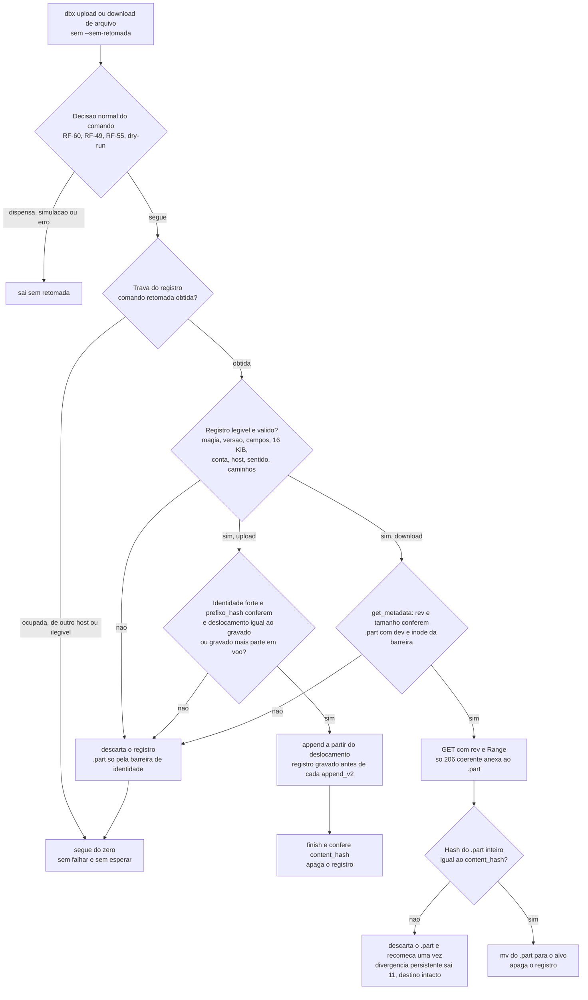
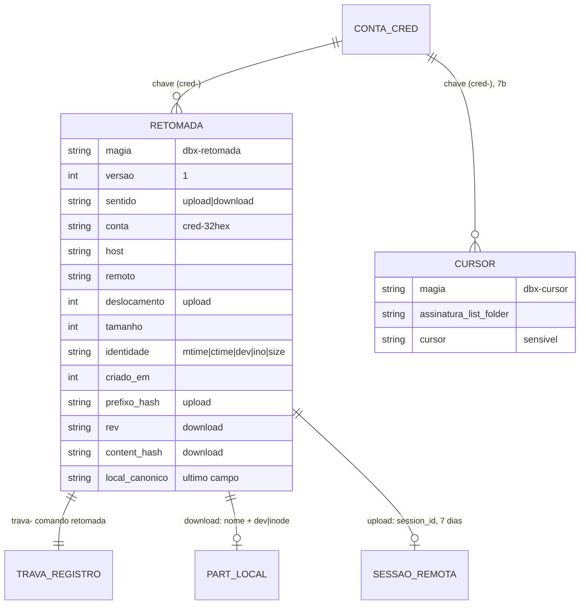
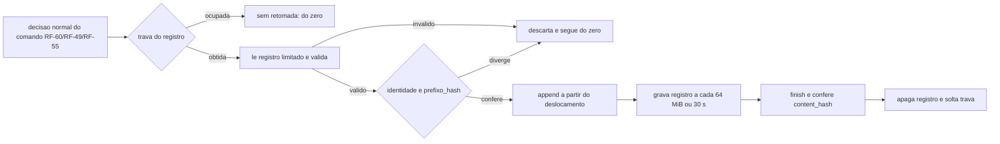

# Fase 7a do backlog (B7a): retomada de transferencia entre execucoes (F-03)

## 1. Pedido e porte

| Campo | Valor |
|---|---|
| Pedido | Fase 7 do plano do backlog, retomada depois do merge da PR #47 (fase 6). Fase 7a: retomada entre execucoes de `upload` e `download` de arquivo acima de 150 MiB (F-03, requisitos RF-101 a RF-109, secao 5.15 do escopo v1.21). A 7b (F-14, cursor do sync remoto para local) fica para outra PR. |
| Porte | **G**. Introduz estado persistente entre execucoes com dado remoto vivo (sessao de upload e `.part` na arvore do usuario), reabre a DP-09 e aciona o DBA. Classificado pelos gatilhos da regra 40. |
| Log de prompt | [docs/prompts/2026-10-20_2315_backlog-fase-7a-retomada.md](../prompts/2026-10-20_2315_backlog-fase-7a-retomada.md) |
| Memoria de decisao | [.github/agents/memoria/entradas/2026-10-20-2315-retomada.md](../../.github/agents/memoria/entradas/2026-10-20-2315-retomada.md) |
| Branch / base | `feature/retomada-b7a` sobre `develop` @ `3c9a702` (nenhum PR aberto na abertura) |
| Agents | Business Analyst (escopo v1.22, secao 5.15, RF-101 a RF-109; System Design v1.15; riscos e candidatas); DBA (parecer de formato, localizacao, versionamento, concorrencia e limpeza, com condicoes C1 a C6); Senior Developer (implementacao sob `protocolo-tdd` e `protocolo-conformidade`, 2 ciclos); QA Expert (validacao independente e adversarial, 41 casos, 2 ciclos); Tech Lead (decisoes DIV-171 a DIV-203, fechamento); Documentation Writer (este registro). |
| Data | 2026-10-20 (pedido, parecer do DBA, ciclo 1 de desenvolvimento e QA); 2026-10-21 (ciclo 2 e aprovacoes do solicitante) |

## 2. Causa ou decisao

### 2.1 Contexto

Antes da 7a, a retomada do `dbx` valia so dentro da mesma execucao (RF-58): a sessao de upload vivia em memoria e um `.part` de download era removido na saida. Uma interrupcao entre execucoes (queda de rede, `kill -9`, queda de energia) fazia o arquivo ser enviado ou baixado do zero. A F-03 cobre esse caso para arquivos grandes.

Pelo parecer do DBA ([secao 0 do anexo A](#anexo-a-parecer-do-dba-texto-integral)), a F-03 e a primeira funcionalidade em que o estado persistente guarda **dado remoto vivo** (`session_id` de upload e `.part` na arvore do usuario). Por isso o porte e G e a DP-09 e reaberta.

### 2.2 Decisoes do solicitante

Registradas no log de prompt (Prompt 1 e Prompt 2, [log](../prompts/2026-10-20_2315_backlog-fase-7a-retomada.md)):

- **Divisao:** duas PRs. Esta e a 7a (F-03). A 7b (F-14) vem depois.
- **Alcance (F-03):** upload e download.
  - Upload: guarda sessao e deslocamento; so retoma se o arquivo local nao mudou; confere o `content_hash` final.
  - Download: retoma um `.part` por `Range`; confere o `content_hash` antes de trocar o destino.
- **Suite do QA:** aprovada em 2026-10-21 ("Aprovo"), 41 casos, sha256 `bb76e2637255b4410e41aabe64163bd490dccbdc24c12bb74f0d3c91c91ff900`.
- **OBS-3 do QA (corrida entre a conferencia de arquivo regular e a abertura):** risco aceito pelo solicitante em 2026-10-21, registrado no RSK-76.

Princípios do Tech Lead, aceitos para a fase: o estado persistente nunca decide sozinho uma escrita destrutiva nem a integridade do resultado; estado corrompido, de outra versao ou de outra conta e descartado sem falhar a operacao; estado tem dono e permissao 0600 e nunca guarda segredo.

### 2.3 Decisao arquitetural (ADR resumido)

**Decisao.** Um registro de retomada por transferencia, em `$XDG_STATE_HOME/dbx` (0700), em namespace proprio `retomada-<resumo32>` com magia `dbx-retomada` e versao 1. Formato de campos terminados em NUL, com contagem fixa e o caminho local no ultimo campo. O `.part` de download fica junto do alvo, e o registro guarda apenas o nome e o `dev|inode`. Uma trava por registro (`trava-<resumo>`, comando `retomada`) serializa o acesso; trava ocupada faz o processo seguir sem retomada, sem falhar e sem esperar. A retomada entra depois da decisao normal do comando (RF-60, RF-49, RF-55).

**Alternativas consideradas e descartadas** (fonte: parecer do DBA, secoes 1 a 5):

| Alternativa | Motivo do descarte |
|---|---|
| Formato `chave=valor` ou uma linha por registro | Caminho com `\n` ou `=` exigiria escape; escape em shell e fonte de bug. |
| Incrementar `DBX_STATE_VERSAO` | Descartaria toda `memoria-*` e desabilitaria a exclusao na primeira execucao (RF-41(f), RSK-46). Custo sem beneficio. |
| Reivindicar o registro por `mv` para um nome do processo | Depois de `kill -9` o registro ficaria preso no nome reivindicado, perdendo a retomada no cenario que motiva a F-03. |
| Trava so do par de raizes (como `sync`/`verificar`) | Nao cobre `upload`/`download` avulsos; dois uploads simultaneos do mesmo arquivo liam o mesmo registro. |
| `fsync` do registro | Estado e advisorio; a perda custa so aceleracao. Leitor descarta arquivo vazio ou lixo. |
| `boot_id` para validar a sessao | Impediria justamente a retomada apos reinicio, que e o caso de uso. |
| Migrar `memoria-*` e `upload-*` para magia por namespace | Sem outra razao para mudar a versao deles; o que se unifica e o codigo (leitor limitado, gravacao atomica, varredura). |
| Cursor (F-14) no namespace `memoria-*` | Viola a separacao linha de base x cursor (system-design, RSK-32). Fica para a 7b em `cursor-*`. |

**Trade-offs aceitos:**

- Custo por parte no upload: uma regravacao do registro e um SHA-256 da cadeia do prefixo, que cresce com o numero de partes (CNF-02; RSK-72).
- Download passa a fazer um `get_metadata` antes de qualquer recebimento para arquivo, inclusive abaixo de 150 MiB (DIV-192). O custo entra no RSK-72 e na medicao da fase 9 (F-34).
- Sem fsync: a perda de energia pode deixar o registro antigo (deslocamento atrasado), um arquivo vazio ou lixo. Os tres casos sao descartados, nunca causam falha.
- `sync` e upload ou download de pasta ficam fora da 7a (DIV-180); a retomada desses casos vai para a F-42.

### 2.4 Divergencias decididas pelo Tech Lead

Texto integral na memoria [2026-10-20-2315-retomada](../../.github/agents/memoria/entradas/2026-10-20-2315-retomada.md). Resumo:

- **Parecer do DBA:** aprovado com condicoes C1 a C6 (secao 9 do anexo A). C1 (prefixo_hash obrigatorio), C2 (trava por registro), C3 (leitor limitado, tambem para `upload-*`), C4 (chave com NUL e reconferencia byte a byte), C5 (retomada depois da decisao do comando) e C6 (`session_id` fora de qualquer saida) estao implementados.
- **Divergencias do BA aceitas como recomendadas:** DIV-171 C, 173 B, 174 B, 175 A, 176 A, 177 A, 178 B, 179 A, 181 A, 182 A, 183 A, 184 A, 186 A, 187 A, 188 A, 189 A, 190 A.
  - DIV-171 C: nenhum relogio local decide se a sessao e valida; quem decide e o servidor (`not_found` ou `closed` recomeca do zero uma vez). O relogio so poda orfaos depois de 8 dias (DIV-184).
- **DIV-172 B (substitui a frequencia proposta pelo DBA):** o estado e gravado antes de cada `append_v2`, com o deslocamento confirmado e o tamanho da parte em voo. O deslocamento do servidor so e aceito se for igual ao confirmado, ou ao confirmado mais a parte em voo. Caem a regra de 64 MiB, a de 30 s e a janela de 4 MiB do parecer do DBA (secoes 4 e 8.4 do anexo A, superadas por esta decisao).
- **DIV-180 A:** `sync` e upload ou download de pasta ficam fora da 7a; retomada nesses casos vai para a F-42.
- **DIV-185 A (revisao da D1 do DBA):** `unlink` apaga os registros de retomada da conta e os `.part` que passam na barreira de identidade. Os `.part` que nao passam nao sao apagados; `unlink` informa quantos sao e lista os caminhos. A D1 original (so avisar, sem listar) fica superada.
- **Condicionados ao DBA:** formato NUL com magia `dbx-retomada` v1; trava `trava-<resumo>` com comando `retomada`; leitor com limite de tamanho aplicado tambem a `upload-*`; retomada depois da decisao do comando.
- **Divergencias da implementacao aceitas (DIV-191..202):**
  - Aceitas como implementadas: DIV-191, 193, 194, 195, 197, 199, 201 e 202.
  - DIV-193: a barreira e o hash do `.part` inteiro antes do `mv`. Um `206` com total errado que o curl ja anexou e descartado antes de qualquer uso, sem mudar o destino.
  - DIV-202: o contrato do cliente HTTP ganha `continue-at`, a saida 33 do curl e o `416`. O `Range` contra o servico real fica como risco residual (RSK-70).
  - DIV-192, aceita com custo registrado: `get_metadata` em todo download para arquivo (ver 2.3).
  - DIV-196, aceita como mudanca de comportamento: `too_large` sai 10 em todas as sessoes, inclusive `sync --enviar`, que antes saia 1.
  - DIV-198, aceita como risco residual: o `.part` de um registro ilegivel podado fica no disco sem aparecer em lugar nenhum (RSK-75). Vai para a F-42 (varredura de `.part` orfao por padrao de nome, so listando).
  - DIV-200, aceita: prevalece RF-104(e); o `.part` maior que o esperado nao e tocado. O BA corrige a redacao do TC-RMD-13.
- **DIV-203 (QA, observacao do `correct_offset` em cadeia JSON):** mantida, porque a seguranca vem do SHA da parte em voo. O BA alinhou a redacao da RF-103(b) ao leitor (escopo v1.22).

### 2.5 Achados do QA decididos pelo Tech Lead

- **Ciclo 1, reprovado.**
  - QA-B7A-01 (P1), corrigido: o leitor limitado so abre arquivo regular. Uma FIFO `retomada-*` nao pode pendurar `diagnostico` nem `unlink`.
  - QA-B7A-02 (P2), corrigido: registro de download legivel, descartado por cabecalho divergente, passa o `.part` pela barreira de identidade antes de sair. DIV-198 continua valendo so para registro ilegivel.
- **Ciclo 2, aprovado.** As duas correcoes se sustentaram no reataque. Observacoes OBS-3 e OBS-4 viraram risco aceito (RSK-76).

## 3. Escopo tecnico e arquivos modificados

Linhas inseridas e removidas por `git diff --numstat` contra `3c9a702`, conferidas pelo Tech Lead antes do commit:

- **Codigo:** `lib/state.sh` +609/-7, `lib/transfer.sh` +399/-24, `lib/cmd.sh` +375/-0, `lib/http.sh` +59/-5, `lib/hash.sh` +6/-0, `lib/auth.sh` +4/-2.
- **Comandos e CLI:** `commands/download.sh` +52/-2, `commands/upload.sh` +42/-1, `commands/diagnostico.sh` +38/-0, `commands/unlink.sh` +35/-0, `bin/dbx` +26/-3, `completions/dbx.bash` +2/-2.
- **Documentacao:** `README.md` +25/-0, `docs/arquitetura/system-design.md` +57/-4, `docs/testes/mapa-modulos.md` +15/-4.
- **Requisitos:** escopo +84/-2, riscos +9/-1, candidatas +8/-4, decisoes pendentes +14/-2.

Os arquivos novos estao na tabela.

| Arquivo | Alteracao |
|---|---|
| `lib/state.sh` | Namespace `retomada-*`: contexto, chave SHA-256 com NUL, carga com descarte, gravacao atomica, poda, barreira do `.part`, listagem. Leitor NUL limitado (16 KiB, por descritor, so arquivo regular), aplicado a `upload-*` (C3). Trava de registro (`comando retomada`), alem da trava de par. Varredura de `.retomada.*`. |
| `lib/transfer.sh` | Laco de sessao reescrito em `_dbx_transfer_conduzir` e `_dbx_transfer_percurso`: gravacao antecipada do registro, carga com identidade e `prefixo_hash` (relido para o acumulador), primeiro `append_v2` retomado restrito, recomeco unico (expirada, fechada ou deslocamento), `too_large` para 10, limpeza do registro por desfecho. Limiar de 150 MiB. |
| `lib/cmd.sh` | `dbx_cmd_retomada_preparar` e `dbx_cmd_retomada_limpar`; `dbx_cmd_receber_retomavel` (`.part`, barreira pelo descritor, `rev:<rev>`, faixa, conferencia, `mv`); `dbx_cmd_avisar`. |
| `lib/http.sh` | Pedido de faixa (`continue-at`), status 33 do curl mapeado para `DBX_HTTP_FAIXA_IGNORADA`, `Content-Range` publicado, `416` com status 0. |
| `lib/auth.sh` | Ajustes de contrato do cliente para o pedido de faixa. |
| `lib/hash.sh` | `DBX_HASH_ULTIMO_BLOCO` (SHA-256 da parte em voo, sem reler). |
| `commands/upload.sh` | `--sem-retomada` / `--no-resume`; ordem C5; campos `retomada` e `retomado_de` so no caminho retomavel. |
| `commands/download.sh` | `--sem-retomada` / `--no-resume`; `get_metadata` antes do recebimento de arquivo (DIV-192). |
| `commands/unlink.sh` | Apaga registros de retomada da conta e `.part` que passam na barreira; lista os que ficam (DIV-185). |
| `commands/diagnostico.sh` | Checagem `retomada`: linha por registro ilegivel ou aviso; nunca pendura nem expoe `session_id` (DIV-197: sem registro, nenhuma linha). |
| `bin/dbx`, `completions/dbx.bash` | Ajuda e completacao de `--sem-retomada` / `--no-resume`. |
| `README.md` | Documentacao de uso e de estado. |
| `docs/testes/mapa-modulos.md` | Mapa de modulos atualizado. |
| `docs/arquitetura/system-design.md` | System Design v1.15: secao da retomada com Mermaid; DIV-a a DIV-c aplicadas (cursor ainda nao existe; RNF-26 emendado para `retomada-*`, `cursor-*` e `.part`; "F-03 segue fora" removido). DIV-d (separadores `\n` nas chaves antigas) vai para o backlog. |
| `docs/requisitos/escopo-requisitos-e-criterios-de-aceite.md` | Escopo v1.22, secao 5.15 (RF-101 a RF-109), DIV-171 a DIV-203. |
| `docs/requisitos/funcionalidades-candidatas.md` | Candidatas v0.14: inclusao da F-42 e revisao de candidatas. |
| `docs/requisitos/riscos-restricoes-e-licenciamento.md` | Riscos v0.14: RSK-69 a RSK-76. |
| `docs/requisitos/decisoes-pendentes.md` | DP-09 reaberta, com o parecer do DBA. |
| `tests/unit/retomada_estado_test.sh` | Novo. 23 casos (1 pulado sem root). |
| `tests/integracao/retomada_upload_test.sh` | Novo. 39 casos. |
| `tests/integracao/retomada_download_test.sh` | Novo. 23 casos. |
| `tests/integracao/qa_retomada_b7a_test.sh` | Novo, suite do QA. 41 casos, sha256 `bb76e2637255b4410e41aabe64163bd490dccbdc24c12bb74f0d3c91c91ff900`. Aprovada pelo solicitante em 2026-10-21. |
| `.github/agents/memoria/entradas/2026-10-20-2315-retomada.md` | Novo (memoria de decisao). |
| `docs/prompts/2026-10-20_2315_backlog-fase-7a-retomada.md` | Novo (log de prompt). |
| `docs/reviews/2026-10-20-2315-*.md` | Este registro e os pareceres TDD, de conformidade e de QA. |

Nenhum teste aprovado foi alterado nesta fase. Nenhum caso do QA foi removido. Os ajustes feitos pelo QA na propria suite, no ciclo 2 (`qa_u10` e `qa_l03`, para atender RNF-24), foram aprovados pelo solicitante junto com o sha final.

### 3.1 Propagacao documental

Aplicada na mesma rodada: escopo v1.22, System Design v1.15, riscos, candidatas, mapa de modulos, README, ajuda e completacao. Confirmacao de cobertura feita pelo developer e pelo QA; a revisao documental formal ficou com o `documentation-sync` deste registro (ver 8).

## 4. Diagrama (Mermaid)

Fluxo de decisao da retomada, por execucao de `upload` ou `download` de arquivo acima de 150 MiB. O fluxo foi derivado dos pareceres e do anexo A; o diagrama detalhado da chave, do registro e da trava esta no anexo A.



## 5. Evidencias de validacao

### 5.1 Testes rodados

Contagens literais dos pareceres do Senior Developer ([TDD](2026-10-20-2315-parecer-tdd-retomada-b7a.md)) e do QA ([validacao](2026-10-20-2315-validacao-qa-retomada-b7a.md)).

| Arquivo de teste | Item afetado que o justifica | Comando | Total | Aprovados | Falhos |
|---|---|---|---|---|---|
| `retomada_estado_test.sh` (ciclo 1) | `lib/state` (namespace, leitor, trava, barreira) | `bash tests/run.sh retomada_estado` | 23 | 23 (1 pulado sem root) | 0 |
| `retomada_upload_test.sh` (ciclo 1) | `lib/transfer` (upload retomado, C1, DIV-172) | `bash tests/run.sh retomada_upload` | 39 | 39 | 0 |
| `retomada_download_test.sh` (ciclo 1) | `lib/cmd` (download por faixa, barreira, `mv`) | `bash tests/run.sh retomada_download` | 23 | 23 | 0 |
| `qa_retomada_b7a_test.sh` (QA, ciclo 1) | sessao 1 do QA, execucao caso a caso | `bash tests/run.sh qa_retomada_b7a` | 34 | 31 (3 falhos: `qa_d13`, `qa_l01`, `qa_l02`) | 3 |
| `qa_retomada_b7a_test.sh` (QA, ciclo 2) | suite final, aprovada pelo solicitante | `bash tests/run.sh qa_retomada_b7a` | 41 | 41 | 0 |
| `retomada` (4 arquivos, QA, ciclo 2) | regressao das suites da fase | `bash tests/run.sh retomada` | 4 arquivos | 132 ok e 1 pulado (root) | 0 |
| `json` (QA, ciclo 2) | auditoria RNF-24 da suite | `bash tests/run.sh json` | 62 | 62 | 0 |
| Selecao pelo mapa (dev, ciclo 1) | json, http, preflight, composicao, tmp_test, cli, state, trava, transfer, auth, banda, comandos, confinamento_remoto, diagnostico, completar, hash_, cmd_test, sync, espaco, verificar, filtros, reter_test, compartilhar, recuperacao, qa_, retomada | `bash tests/run.sh <filtro>` | por filtro | todos aprovados (`json` 42, `qa_` 350, `retomada` 84 com 1 pulado) | 0 |
| Selecao pelo mapa (dev, ciclo 2) | `qa_retomada_b7a`, `retomada`, `qa_`, `state`, `trava`, `diagnostico` | `bash tests/run.sh <filtro>` | 34, 125 ok e 1 pulado, 384, 60, 82, 39 | todos aprovados | 0 |
| `json` (dev, ciclo 2) | auditoria RNF-24 (a suite do QA acusava 5 linhas dos testes novos do dev, corrigidas com `printf -v`) | `bash tests/run.sh json` | 41 de 42 na 1a rodada; aprovada depois da correcao | aprovado apos a correcao | 0 |

- **Red do ciclo 1 de desenvolvimento:** os tres arquivos novos foram copiados para a arvore da base `3c9a702` (`git archive`) e cada caso rodou isolado. Resultado: 79 RED, 1 SKIP (outro dono, sem root) e 5 casos que ja passam na base por serem invariantes de comportamento atual. Todos os casos P0 e todos os mutantes estao entre os RED.
- **Red do ciclo 2 de QA:** os casos novos (`qa_l04`, `qa_l05`, `qa_l06`, `qa_u19`, `qa_d14`, `qa_d15`, `qa_d16`) foram conferidos contra o codigo do ciclo 1 antes da correcao.
- **Mutantes:** cada P0 tem mutante que reprova o caso que o protege (lista completa no parecer TDD). No ciclo 2, o mutante sem a conferencia de arquivo regular faz `diagnostico` pendurar (espera 124) e o mutante sem a barreira no descarte deixa o `.part` orfao.
- **Shellcheck:** `shellcheck lib/*.sh commands/*.sh bin/* scripts/*.sh` com 0 achados (ciclo 1, com uma supressao SC2016 justificada; ciclo 2 sem alteracao). `shellcheck -x` nos testes novos com 0 achados; `shellcheck tests/integracao/qa_retomada_b7a_test.sh` limpo.
- **Guarda de remocao de casos:** `bash scripts/verificar-remocao-de-casos.sh` com 1739 para 1739, nenhuma reducao, nos dois ciclos.
- **Piramide e E2E:** a CLI e shell com duble de `curl` na fronteira de rede. Sem E2E contra o servico real (sem credencial de teste; mesmo criterio das fases 3 a 6). Formularios (regra 7): nao aplicavel.
- **Suite completa local no push para a PR de `develop` (regra 8):** comando oficial `sh scripts/suite-completa.sh`.
  - **Primeira rodada, REPROVADA, em `7674bb8`:** o `harness_test` recusou `erro()` redefinido em dois dubles de curl da suite do QA. O solicitante autorizou trocar o do download por `erro_download` (3 linhas, nenhum caso alterado) e aprovou o novo sha `bb76e263...`.
  - **Segunda rodada, APROVADA, em `7baf2f9`:** 59 arquivos, 1859 aprovados, 0 reprovados, 3 pulados, em 1475 s. O `--conferir` registrou "suite completa verde para 7baf2f9 em 2026-10-21T11:18:08Z".
  - O commit de documentacao que preenche este registro tem execucao propria, citada na PR.

### 5.2 Gates

| Gate | Skills aplicadas | Achados | Veredito |
|---|---|---|---|
| `protocolo-tdd` ([parecer](2026-10-20-2315-parecer-tdd-retomada-b7a.md)) | Regras 1 a 9; excecao de piramide do projeto shell | Ciclo 1: TDD-01 (Menor: TC-RME-11 e TC-RMD-06, de outro dono, so rodam como root; caso pulado sem root, DIV-201); TDD-02 (Menor: contrato `Range` e `rev:` medido contra curl 8.18, nao contra o servico real, RSK-70). Ciclo 2: sem achado novo; a pendencia de RNF-24 no arquivo do QA foi resolvida pelo QA. | Ciclos 1 e 2 Aprovado |
| `protocolo-conformidade` ([parecer](2026-10-20-2315-parecer-conformidade-retomada-b7a.md)) | `clean-architecture`, `shellcheck-configuration`, `security-best-practices`, `api-security-best-practices` | CNF-01 (Menor: `get_metadata` extra no download para arquivo, DIV-192); CNF-02 (Menor: custo por parte, DIV-172, RSK-72); CNF-03 (Info: `206` de total errado anexado antes da conferencia, descartado, DIV-193). | Ciclos 1 e 2 Aprovado |

### 5.3 QA

Detalhe em [validacao-qa-retomada-b7a](2026-10-20-2315-validacao-qa-retomada-b7a.md).

- Ciclo 1: **reprovado**. QA-B7A-01 (P1, FIFO `retomada-*` pendura `diagnostico` e `unlink`) e QA-B7A-02 (P2, `.part` invisivel depois de registro legivel descartado). Nenhum P0 violado.
- Ciclo 2: **aprovado**. Ambos fechados. Observacoes OBS-3 (TOCTOU, RSK-76) e OBS-4 (limite da barreira, RSK-76). OBS-1 e OBS-2 sem severidade.
- Suite: 41 casos, sha256 `bb76e2637255b4410e41aabe64163bd490dccbdc24c12bb74f0d3c91c91ff900`, aprovada pelo solicitante em 2026-10-21.

## 6. Riscos, impacto e rollback

### 6.1 Riscos residuais

- **RSK-70 (Range contra o servico real):** o contrato de `continue-at` e `rev:` foi medido com curl 8.18 contra servidor local, nao contra o servico Dropbox. Sem E2E real (sem credencial de teste). Conferir no primeiro uso real.
- **RSK-72 (custo):** `get_metadata` em todo download para arquivo (DIV-192), e custo por parte no upload (CNF-02). Medicao na fase 9 (F-34).
- **RSK-75 (DIV-198):** o `.part` de um registro ilegivel podado fica no disco sem aparecer em lugar nenhum. O `unlink` nao o lista. Nada e apagado sem a barreira de identidade, que precisa do registro. Vai para a F-42.
- **RSK-76 (OBS-3 e OBS-4):**
  - OBS-3: janela de troca entre `[[ -f ]]` e a abertura do registro ou `.part`, no diretorio 0700 do proprio usuario. Explorar exige escrita nesse diretorio. Efeito e so de disponibilidade (travar), sem corromper e sem apagar. Aceito pelo solicitante em 2026-10-21. O endurecimento possivel (`<>` ou `timeout`) fica no backlog.
  - OBS-4: um registro plantado pelo proprio usuario, apontando para um `.part` dele com o mesmo `dev|inode`, no diretorio do alvo, e apagado por desenho. Nao e caminho de ataque de terceiro.
- **Divergencia da DP-09:** a formalizacao da DP-09 reaberta segue o parecer do DBA; o registro do que foi decidido esta na memoria e no anexo A.

### 6.2 Impacto

- **Contrato externo:** pedido `files/download` com `path = "rev:<rev>"` e `Range`; `upload_session/append_v2` com deslocamento confirmado; `upload_session/finish` com `content_hash` final. Nenhum endpoint novo.
- **Estado:** novos namespaces `retomada-*` e `trava-*` (comando `retomada`) em `$XDG_STATE_HOME/dbx`, e `.part` na arvore do usuario. `DBX_STATE_VERSAO` nao muda. `memoria-*` e `upload-*` seguem no formato v2 e passam ao leitor limitado.
- **Comportamento:** ver a secao 7.
- **Codigos de saida:** `too_large` passa a sair 10 em todas as sessoes (DIV-196). A taxonomia 0..15 nao ganha codigo novo.
- **OAuth:** nenhum escopo novo. Sem dependencia nova.

### 6.3 Rollback

- `git revert` do commit da 7a em `develop` (ou do merge da PR, `git revert -m 1 <merge>`). Sem migracao de dado nem de credencial.
- Apos o revert, a versao anterior nao le `retomada-*` nem `.part`. O `unlink` dela (`_dbx_cmd_unlink_remover_estado`, conferido pelo Tech Lead em `3c9a702`) apaga toda entrada do diretorio de estado, exceto `trava-*`, e com isso leva os registros `retomada-*`. Ele nao varre `.part` fora desse diretorio. Para limpar um `.part` orfao, e preciso remove-lo a mao.
- O revert nao restaura arquivo que a retomada tiver concluido. O comportamento do `sync` e o `too_large` voltam a valer como antes (`too_large` de `sync --enviar` volta a sair 1).

### 6.4 Licoes

- Estado persistente com dado remoto vivo exige barreira por identidade e prefixo do conteudo, e nao so por tamanho e mtime (DBA, 8.1).
- O QA achou dois defeitos de robustez em caminhos que o desenvolvedor nao tinha testado: FIFO no lugar de arquivo de estado (QA-B7A-01) e registro legivel descartado por cabecalho (QA-B7A-02). Ambos reproduziram com casos novos que o parecer do desenvolvedor nao cobria.
- Duas correcoes que mudam a ordem de pedidos foram tratadas com cautela: DIV-172 (gravacao antecipada) e DIV-195 (RF-58 dentro da execucao desliga a retomada entre execucoes).

## 7. Mudancas de comportamento

- **Comando e opcoes:** `--sem-retomada` e `--no-resume` em `upload` e `download`.
- **Arquivos acima de 150 MiB:** retomados entre execucoes. Abaixo disso, o caminho e o de hoje, com a excecao do `get_metadata` do download (DIV-192).
- **`.part` ao lado do alvo:** o `.part` de download fica no diretorio do destino, com nome `.<nome>.dbx-part.??????`. Ele fica na arvore do usuario entre execucoes.
- **`too_large` sai 10 em todas as sessoes**, inclusive `sync --enviar`, que antes saia 1 (DIV-196).
- **`get_metadata` extra em todo download para arquivo**, inclusive abaixo de 150 MiB (DIV-192). Saida e codigos preservados.
- **`unlink`:** apaga os registros de retomada da conta e os `.part` que passam na barreira de identidade. Lista os `.part` que nao passam, com os caminhos (DIV-185).
- **`diagnostico`:** ganha a checagem `retomada`. Sem registro, nenhuma linha (DIV-197). Com registro ilegivel, uma linha de aviso. Nunca mostra `session_id`.
- **`sync`:** nao liga a retomada (DIV-180).

## 8. Proximos passos

- **F-42** (backlog): retomada em `sync` e em upload ou download de pasta (DIV-180); varredura de `.part` orfao por padrao de nome, so listando (DIV-198, RSK-75).
- **7b, F-14:** cursor do sync remoto para local, em `cursor-*` com a mesma infraestrutura NUL (DIV-a, parecer do DBA secao 7). Vai em PR propria.
- **Endurecimento da OBS-3:** o solicitante aceitou o risco (RSK-76). O endurecimento por `<>` na abertura ou por `timeout` fica no backlog.
- **DIV-d:** separadores `\n` nas chaves antigas (`memoria-*`, `upload-*`, `trava-*`), risco teorico, para o backlog.
- **RSK-70:** conferir o `Range` e o `rev:` contra o servico real, no primeiro uso real.
- **Suite completa e PR:** suite verde em `7baf2f9`; PR [#48](https://github.com/salesadriano/dropbox_sync/pull/48) para `develop`. O merge fica com o solicitante.
- **`documentation-sync` deste registro:** os documentos vivos afetados foram listados na secao 3.1; a conferencia final fica com o Tech Lead antes do merge.

## 9. Diagrama de contexto (Mermaid, retomada e estado)

O diagrama de relacionamento entre a conta, a retomada, a trava por registro, o `.part` e a sessao remota esta no anexo A (DBA, secao 3 e 4 do parecer). Esta secao nao reproduz o diagrama, para nao duplicar a fonte.

## 10. Aceites

- **Solicitante, regra 12:** suite do QA aprovada em 2026-10-21 ("Aprovo", sha `445ba4fc…`). Depois, autorizada e reaprovada ("Autorizo e aprovo") a troca de `erro()` por `erro_download` no duble de download, exigida pelo `harness_test`, sem mudar caso. Sha256 final `bb76e2637255b4410e41aabe64163bd490dccbdc24c12bb74f0d3c91c91ff900`, 41 casos.
- **Solicitante, OBS-3:** risco aceito em 2026-10-21 ("Aceito o risco (Recomendado)"), registrado no RSK-76.
- **Tech Lead:** decisoes DIV-171 a DIV-203 registradas na memoria [2026-10-20-2315-retomada](../../.github/agents/memoria/entradas/2026-10-20-2315-retomada.md). Aceite final depende da suite completa no push e do commit.
- **QA Expert:** validacao independente aprovada no ciclo 2 (ver [validacao](2026-10-20-2315-validacao-qa-retomada-b7a.md)).
- **Senior Developer:** gates aprovados nos ciclos 1 e 2 (ver pareceres TDD e de conformidade).
- **Merge:** fica com o solicitante.

## Anexo A. Parecer do DBA (texto integral)

Copia integral de [b7a-dba.md](/tmp/claude-1000/-home-sales-dropbox-api/79c5663b-427b-43f7-afa1-0bdb22ddd6bf/scratchpad/b7a-dba.md), conforme a decisao do Tech Lead ("Texto integral copiado para o registro da fase"). As secoes 4 e 8.4 e a D1 da secao 11 foram superadas pelas DIV-172 B e DIV-185 A (ver 2.4).

# Parecer do DBA — fase 7a, F-03 (retomada entre execucoes), reabertura da DP-09

Data: 2026-10-20 · Branch: feature/retomada-b7a (3c9a702) · Modo: somente leitura
Base: memória `2026-10-20-2315-retomada`, lib/state.sh, lib/config.sh, lib/hash.sh, lib/tmp.sh,
lib/transfer.sh, lib/cmd.sh, lib/sync.sh, docs/arquitetura/system-design.md.

**Veredito: aprovado com condições.** O mecanismo de arquivo NUL por resumo do `lib/state` serve à F-03
e à F-14. As condições bloqueantes são C1 a C6 (seção 9).

---

## 0. O que existe hoje, e o que a F-03 muda

- O diretório de estado é `${XDG_STATE_HOME:-$HOME/.local/state}/dbx`, dado por uma única função
  (lib/config.sh:168-178). Ele é separado da credencial, que fica em `$XDG_CONFIG_HOME/dbx`
  (lib/config.sh:155-161).
- Há três namespaces: `memoria-*`, `upload-*` e `trava-*`. O nome de cada arquivo é derivado por
  resumo, sem texto externo (lib/state.sh:59-62, 329-342, 416-426, 617-632).
- O formato tem campos terminados em NUL, com o caminho no último campo e sem escape
  (lib/state.sh:51-57). A versão é única e compartilhada, `DBX_STATE_VERSAO=2` (lib/state.sh:86).
- A gravação atômica usa um temporário `dbx_tmp_arquivo` no mesmo diretório, seguido de `mv -f`
  (lib/state.sh:168-183). Não há fsync.
- O diretório é criado ou corrigido para 0700. Diretório de outro dono não é lido e recebe recusa como
  `permissao` (lib/state.sh:142-160). Temporários `.memoria.*`, `.upload.*` e `.trava.*` com mais de
  24 h são varridos (lib/state.sh:157).
- A trava cobre só `sync` e `verificar`, uma por processo, por par sem sentido
  (lib/state.sh:671-675, 949-952, 1007). Ela **não cobre `upload` nem `download` avulsos**.
- O que a F-03 muda: hoje nenhum registro guarda dado **remoto vivo**, como uma sessão do servidor ou
  um `.part` na árvore do usuário. A F-03 introduz os dois. A retomada RF-58, que hoje vale só na
  mesma execução, mantém a sessão em memória (system-design.md:705).

---

## 1. Localização e formato

**Localização.** O mesmo diretório `$XDG_STATE_HOME/dbx`, obtido por `dbx_config_caminho_de_estado`
(lib/config.sh:168), com o mesmo 0700 e as mesmas regras de dono de `_dbx_state_preparar_diretorio`
(lib/state.sh:142-160). Não criar um segundo diretório. O `unlink` já apaga o diretório inteiro e já
respeita as travas vivas (commands/unlink.sh:72-104). Um segundo lugar viraria um segundo `rm` a
manter.

- O namespace novo é `retomada-<resumo32>`, com temporário `.retomada.*`. O `.retomada.*` entra na
  varredura de 24 h de lib/state.sh:157.
- Na 7b vem `cursor-<resumo32>`, com temporário `.cursor.*`.
- O `.part` do download **não** mora no diretório de estado. Ele fica junto do destino, porque precisa
  do mesmo sistema de arquivos para o `mv` atômico (lib/cmd.sh:600-614). O registro guarda só o nome
  dele.

**Formato: um arquivo por transferência, com campos terminados em NUL e contagem fixa.** É o padrão de
`upload-*` (lib/state.sh:433-460). Dá para fazer em shell puro, sem jq, preserva qualquer byte exceto
NUL e pode ser lido com `read -r -d ''`. Não usar `chave=valor` nem linha por registro: caminho com
`\n` ou `=` exigiria escape, e escape em shell é fonte de bug.

Layout v1 (campos na ordem; o caminho local vem por último):

```
0 dbx-retomada          magia do namespace (não reutilizar DBX_STATE_VERSAO)
1 1                     versão do formato deste namespace
2 upload|download       sentido
3 cred-<32hex>          conta (dbx_config_identidade, lib/config.sh:190-199)
4 <host>                nome do host (só o nome; ver 8.2)
5 <remoto>              caminho remoto como foi dado ao comando
6..N campos do sentido  (seção 3)
N+1 <local canônico>    caminho físico canônico, sempre o último
```

- A leitura tem limite. Recusar o arquivo com mais de 16 KiB pelo `stat -c %s` antes de ler, ou pela
  leitura por descritor com `-n`, como a trava faz em lib/state.sh:647-662. Recusar também quando a
  contagem de campos passar do número fixo.
- Hoje `dbx_state_upload_consultar` (lib/state.sh:446-450) limita o **número** de campos, mas não o
  **tamanho** de um campo. Um arquivo de 1 GB sem NUL seria lido inteiro para a memória. Corrigir isso
  junto, no leitor genérico (C3).
- Cada campo é validado por regex. O sentido vem de uma lista fechada; deslocamento e tamanho seguem
  `^[0-9]{1,18}$`; o hash segue `dbx_hash_formato_valido` (lib/hash.sh:404); o `session_id` segue
  `^[A-Za-z0-9:_-]{1,256}$`; o rev segue `^[0-9a-f]{9,64}$`. Nada do arquivo é executado nem ecoado
  cru em mensagem.

## 2. Chave do registro

`resumo = sha256( "retomada" NUL sentido NUL conta NUL local_canonico NUL remoto_dobrado NUL )`,
truncado em 32 hex, em `retomada-<resumo>`.

- **Conta.** Usar `cred-<32hex>` (`dbx_config_identidade`), e não o `account_id`. Ele não exige rede, é
  o mesmo da trava (system-design.md:723) e muda no relink. Relink descarta o registro, que é o lado
  seguro. Sem credencial não há transferência, então não há marcador `sem-conta` aqui.
- **Sentido** entra na chave. Upload e download do mesmo par são registros distintos e nunca se leem
  um ao outro.
- **Caminho local.** É o caminho físico canônico, a mesma chave do `upload-*` (RF-62). No download
  entra o **alvo** canônico, e não o `.part`.
- **Caminho remoto.** Dobrar só ASCII sob `LC_ALL=C`, como `_dbx_state_minusculas_ascii`
  (lib/state.sh:603-608, 621-628). Uma dobra Unicode divergente gera só uma chave diferente, e o
  resultado é perder a retomada, nunca usar o registro errado.
- **Bytes arbitrários, `\n` e não UTF-8.**
  - Separar os campos da entrada do resumo por **NUL**, e não por `\n`. As chaves atuais usam `\n`
    (lib/state.sh:338, 424, 629), o que deixa `a\nb`+`c` colidir com `a`+`b\nc`. É inofensivo hoje,
    porque o cabeçalho é reconferido, mas não deve ser copiado.
  - No arquivo, cada campo é NUL-terminado e o caminho local vem por último.
  - Toda comparação é feita com `LC_ALL=C`.
- **Reconferência redundante.** Na carga, os campos 2 a 5 e o caminho local do arquivo são comparados
  byte a byte com os do processo atual, como a `memoria-*` faz (lib/state.sh:303-309). Qualquer
  diferença descarta o registro. O resumo no nome serve para localizar, e a reconferência é o que
  autentica.

## 3. O que guardar

**Upload**, nos campos do sentido:

| Campo | Necessário? | Motivo |
|---|---|---|
| `session_id` | sim | identifica a sessão no servidor |
| `deslocamento` confirmado | sim | só o valor que o servidor confirmou (gravado **depois** do `append` com sucesso), múltiplo de 4 MiB |
| `tamanho` total | sim | arquivo com outro tamanho é descartado |
| identidade forte `%Y\|%y\|%z\|%d\|%i\|%s` | sim | é a mesma de lib/hash.sh:378 (mtime e ctime em ns, dispositivo, inode, tamanho); mtime sozinho é fraco |
| `criado_em` (epoch da `start`) | sim | serve à expiração local, que só **antecipa** o descarte (ver 8.3) |
| `prefixo_hash` = `content_hash` dos primeiros `deslocamento` bytes | **sim, bloqueante** | ver abaixo |
| rev, modo, `client_modified` e `mute` do commit | **não** | o commit é montado de novo a cada execução (lib/transfer.sh:737); a sessão guarda só bytes |

**Por que o `prefixo_hash` é obrigatório no upload.** No upload, a conferência final do `content_hash`
acontece **depois** da publicação, porque o `finish` já criou o arquivo (lib/transfer.sh:686-696).

- Ela detecta a corrupção, mas não a impede.
- No download a barreira acontece antes da troca do alvo. No upload, a única barreira **anterior à
  publicação** é conferir localmente que o prefixo que o servidor tem corresponde ao arquivo de agora.
- Como a parte de 4 MiB coincide com o bloco do `content_hash` (lib/transfer.sh:108-113), o hash do
  prefixo é a cadeia dos blocos já enviados. São 64 hex, de tamanho fixo, qualquer que seja o arquivo.
- O custo é quase nulo. O resumo final já relê o arquivo inteiro ou acumula todas as partes
  (lib/transfer.sh:667-683). Ao retomar, a releitura do prefixo em `_dbx_transfer_reposicionar`
  (lib/transfer.sh:415-441) passa a **alimentar o acumulador** e, ao chegar ao deslocamento, compara o
  valor com o `prefixo_hash`.
- Se divergir, a sessão é abandonada e o envio recomeça do zero. Não há falha.

**Download**, nos campos do sentido:

| Campo | Necessário? | Motivo |
|---|---|---|
| `rev` | sim | o download retomado pede `path = "rev:<rev>"`, o que torna o conteúdo imutável entre as execuções |
| `tamanho` esperado | sim | `Content-Range` tem de dizer `bytes N-(T-1)/T` com o mesmo T |
| `content_hash` esperado | sim | barreira **antes** da troca do alvo (lib/cmd.sh:620-) |
| nome-base do `.part` | sim | o diretório é o do alvo, nunca guardado à parte; o nome é validado pelo padrão `.*.dbx-part.??????` (lib/cmd.sh:37, lib/sync.sh:251-262) |
| `%d\|%i` do `.part` | sim | só um `.part` com o **mesmo** dispositivo e inode é retomado ou apagado pelo programa |
| `criado_em` | sim | expiração |

O deslocamento do download **não** é guardado. Ele é o tamanho atual do `.part`, conferido como menor
ou igual ao tamanho esperado. Guardar o valor criaria duas fontes para o mesmo fato.

**Sensibilidade.**

- **O `session_id` não é segredo**, no sentido do princípio "estado nunca guarda segredo". Sozinho ele
  não autentica: `append` e `finish` exigem o bearer token da mesma conta e do mesmo app.
- Mesmo assim ele é um **identificador operacional sensível**. Com o token, permite anexar ao arquivo
  em montagem. Por isso:
  - nunca vai para log, saída, `--json`, `diagnostico` nem mensagem de erro;
  - fica só no arquivo 0600.
- Também são sensíveis os caminhos e o `content_hash`, que dizem privacidade, porque o hash revela
  igualdade com arquivo conhecido. É a mesma classe de dado que `memoria-*` e `upload-*` já guardam.
- **Não guardar token, `client_secret` nem o conteúdo do arquivo.**

## 4. Gravação atômica, durabilidade, concorrência e permissões

**Gravação.** Reaproveitar `_dbx_state_gravar_arquivo` (lib/state.sh:168-183). O temporário é criado
em 0600 por `dbx_tmp_arquivo`, no mesmo diretório, e trocado por `mv -f`. Qualquer falha preserva o
registro anterior.

**Frequência da gravação.** Não regravar a cada parte de 4 MiB, por causa do fork de `mktemp` e `mv`.
Gravar:

- depois da `start` com sucesso, com deslocamento 0;
- depois de cada `append` confirmado em que já tenham passado pelo menos 64 MiB ou 30 s desde a última
  gravação (o que vier primeiro);
- no caminho de falha ou de sinal, antes de sair. É a gravação mais valiosa.

O trabalho perdido em `kill -9` ou queda de energia fica limitado a cerca de 64 MiB.

**Durabilidade e fsync.**

- Em shell só existe o `sync [ARQUIVO]` do coreutils, que faz fsync do arquivo. Não está no preflight,
  e não há fsync do diretório.
- **Recomendação: não fazer fsync.** O estado é advisório, e a perda só custa aceleração. Depois de uma
  queda de energia sobram três casos:
  1. o registro antigo, com deslocamento atrasado (ver 8.4);
  2. um arquivo vazio, que o XFS e o ext4 sem `auto_da_alloc` podem deixar depois de `rename`;
  3. lixo.
- Nos casos 2 e 3 o leitor tem de descartar, e não falhar. Arquivo de 0 bytes e campo cheio de NUL são
  casos de teste obrigatórios.

**Concorrência. A trava da F-12 não cobre** a F-03:

- o `upload` e o `download` avulsos não adquirem trava;
- a chave da trava é o par de raízes, não o arquivo;
- a trava aceita só `sync|verificar` (lib/state.sh:675, 950);
- e só uma por processo (lib/state.sh:1007).

Dois `dbx upload big.iso /x` simultâneos leriam o mesmo registro e anexariam à mesma sessão. Um `sync`
que envia `big.iso` competiria com um `upload` avulso do mesmo arquivo.

**Recomendação (C2): uma trava por registro.**

- Usar `trava-<resumo-do-registro>` com comando `retomada`, pela mesma receita `ln` + `-ef`
  (lib/state.sh:718-737). Isso herda a classificação viva, órfã ou de outro host, a retomada de órfã
  serializada e a exibição no `diagnostico` e no `unlink`.
- É preciso generalizar `_dbx_state_trava_ler` e `dbx_state_trava_adquirir` para aceitar `retomada` e
  permitir uma trava de registro além da trava de par (lib/state.sh:1007).
- **Política de contenção:** trava de registro ocupada, de outro host ou ilegível faz o processo
  **seguir sem retomada**. Ele não lê nem grava o registro e abre sessão nova. Nunca falha nem espera:
  o estado nunca faz a operação falhar.
- A trava é mantida do momento da carga até a remoção ou regravação final do registro.

Alternativa mais leve, que o DBA não recomenda: reivindicar o registro por `mv` para um nome do
processo. Depois de `kill -9` o registro fica preso no nome reivindicado e a retomada se perde
justamente no cenário que motiva a F-03.

**Permissões.** O diretório fica em 0700 (lib/state.sh:150-155) e os arquivos em 0600, via
`dbx_tmp_arquivo` sob `umask 077`.

- Na carga, exigir `-f`, `-O` e não ser ligação simbólica, tanto no registro quanto no `.part`.
- O `.part` nasce 0600 em `dbx_tmp_arquivo`. Conferir que ele continua sendo do usuário e regular
  antes de anexar a ele.
- Abrir o `.part` para anexar só depois de conferir dispositivo e inode **pelo descritor**
  (`/dev/fd/N`, como lib/state.sh:652). Assim o nome não é trocado entre a conferência e a escrita.

## 5. Versionamento e descarte

- **A versão é por namespace**, com magia `dbx-retomada` e versão `1`. Não incrementar
  `DBX_STATE_VERSAO`. Mudá-la descartaria toda `memoria-*` e desabilitaria a exclusão na primeira
  execução (RF-41(f), RSK-46, system-design.md:535). Seria custo operacional sem benefício.
- **Descarte** significa apagar o registro (`rm -f`, só se for do usuário) e seguir do zero, sem falha,
  com no máximo um aviso de uma linha sem o `session_id`. Descartam:
  - magia ou versão desconhecida, inclusive versão maior (downgrade do binário);
  - contagem de campos errada ou campo que não passa na regex;
  - arquivo maior que o limite;
  - conta, sentido, host ou caminhos diferentes dos atuais;
  - identidade local diferente;
  - `prefixo_hash` divergente;
  - `.part` ausente, de outro dono, ligação simbólica ou com outro inode;
  - registro expirado;
  - resposta do servidor `not_found`, `closed` ou `incorrect_offset` fora da regra de 8.4.
- **Arquivo de outro dono** não é lido nem apagado, como lib/state.sh:115-121 e :441.
- **Ao descartar um registro de download**, o `.part` só é apagado se forem verdadeiras ao mesmo tempo:
  é regular, é do usuário, tem o mesmo `%d|%i` gravado, o nome segue o padrão `.dbx-part.??????` e
  está no diretório do alvo. Caso contrário o `.part` fica onde está e nada é tocado. Assim o estado
  nunca decide apagar arquivo alheio.
- **Migração:** nenhuma. Não há formato anterior.

## 6. Crescimento e limpeza

- **Volume:** um registro por transferência **em andamento ou interrompida**, com menos de 1 KiB
  típico e 16 KiB no máximo. Ele é apagado no sucesso:
  - no upload, depois de o `finish` retornar;
  - no download, depois do `mv` do `.part`.
- O crescimento acompanha as interrupções, não os arquivos. O caso realista é de dezenas de registros.
- **Expiração do upload.** O servidor aceita a sessão por no máximo 7 dias, conforme o contrato da
  `upload_session/start`. Descartar localmente quando a idade passar de 7 dias menos 1 h.
- **Expiração do download.** Também 7 dias. O `.part` ocupa disco do usuário, e o rev pode deixar de
  existir.
- **Varredura de registros.** Na gravação de qualquer `retomada-*`, rodar
  `find -maxdepth 1 -type f -name 'retomada-*' -mtime +8 -delete`, que é a idade do arquivo e não o
  relógio gravado.
- **Teto:** 1.000 registros. Acima disso, apagar os mais antigos por mtime, como
  `_dbx_state_podar_upload` (lib/state.sh:469-484). A varredura **não toca o `.part`**, porque ele está
  fora do diretório de estado. O `.part` só é removido pelo descarte de um registro lido (seção 5).
- **Entradas órfãs.**
  - Registro cujo local sumiu é descartado na próxima tentativa do mesmo par, ou expira pela idade.
  - `.part` sem registro, por exemplo depois de um `unlink`, que apaga o diretório de estado, fica na
    árvore do usuário. O `sync` já o ignora (lib/sync.sh:251-262).
  - **Pendência para o Tech Lead (D1):** decidir se o `unlink` ou o `diagnostico` devem listar os
    `.part` conhecidos antes de apagar o estado. O DBA recomenda que o `unlink` só **avise** quantos
    registros de download existiam, sem apagar nada fora do diretório de estado.
- **Ciclo de vida do `.part` com `lib/tmp`.** Hoje o temporário é removido no sinal (lib/cmd.sh:606-614).
  Na F-03 ele deixa o registro de `lib/tmp` (`dbx_tmp_esquecer`) **só depois** de o registro de
  retomada estar gravado. Sem registro gravado, o `.part` continua sendo removido na saída, como hoje.

## 7. Unificação

- **O cursor da 7b usa o mesmo mecanismo:** mesmo diretório, mesmo contêiner NUL com magia e versão
  por namespace, mesmo leitor limitado, mesmo `_dbx_state_gravar_arquivo`, mesma varredura e o mesmo
  descarte que nunca falha. O namespace é `cursor-<resumo>`.
  - A chave é sha256 com NUL de `"cursor"`, conta, raiz remota dobrada e uma **assinatura dos
    argumentos de `list_folder`**: `recursive`, `include_deleted`, `include_non_downloadable_files` e
    `limit`. Um cursor só vale para os mesmos argumentos.
  - O registro guarda o cursor, a raiz remota original e `criado_em`. O cursor **é sensível como o
    `session_id`**: nunca vai para log.
- **O cursor não pode entrar na `memoria-*`.** O system-design exige separar linha de base e cursor
  (system-design.md:179, RSK-32): `reset` invalida o cursor e não pode apagar a memória.
- **O cache de `lib/state` não deve migrar agora.** `memoria-*` e `upload-*` ficam no formato v2.
  - A migração incrementaria a versão, com o custo do RSK-46 citado acima, e não traria ganho
    funcional.
  - O que se unifica é o **código**. Extrair helpers genéricos e fazer os namespaces novos usarem esses
    helpers desde o início:
    - resumo de chave com NUL;
    - `_dbx_state_diretorio_confiavel`;
    - o leitor NUL limitado e validado;
    - `_dbx_state_gravar_arquivo`;
    - a varredura de `.<ns>.*`.
  - `upload-*` e `memoria-*` passam ao leitor limitado sem mudar o formato.
- **Uma migração para magia por namespace** nos formatos antigos fica para quando houver outra razão
  para mudar a versão deles.

## 8. Riscos de integridade e barreiras

**8.1 Arquivo local mudou com o mesmo tamanho e o mesmo mtime.** Por exemplo, por `touch -r` ou por
edição dentro da granularidade do relógio.

- Barreira 1: a identidade forte inclui **ctime em ns** e **inode**. O ctime não pode ser ajustado pelo
  usuário e muda a cada escrita, e a cópia por cima com `cp` e `mv` troca o inode.
- Barreira 2, **obrigatória (C1)**: o `prefixo_hash` recalculado antes de qualquer `append`. Ele pega
  até a escrita no mesmo tick de ctime e o sistema de arquivos com ctime instável (FUSE, NFS).
- Barreira 3: a conferência final do `content_hash`, que só detecta e acontece depois da publicação
  (lib/transfer.sh:686-696).
- A mudança **durante** a execução retomada continua coberta por `_dbx_transfer_conferir_tamanho`
  (lib/transfer.sh:444-456) e pelo hash final.
- No download, o conteúdo local não decide nada: o hash do `.part` inteiro é conferido **antes** do
  `mv`. Um `.part` adulterado com o mesmo tamanho é descartado sem tocar no alvo.

**8.2 Sessão retomada por outra máquina** (`$XDG_STATE_HOME` em home NFS compartilhada).

- O nome do host é gravado e conferido. Host diferente descarta o registro.
- **Não usar `boot_id`.** A retomada precisa sobreviver ao reinício, que é o caso de uso.
- Mesmo com o mesmo nome de host, o `%d|%i` difere entre máquinas na prática, e o `prefixo_hash` pega
  o resto.
- A concorrência entre máquinas sobre o mesmo registro é melhor esforço, como na trava em NFS (RSK-49).
  A barreira final continua sendo o hash.

**8.3 O relógio voltou ou avançou.** O relógio só decide a **expiração local**, que apenas antecipa o
descarte.

- Relógio adiantado causa descarte prematuro, e o custo é recomeçar.
- Relógio atrasado faz um registro velho parecer novo. O servidor responde `not_found` e o envio
  recomeça do zero.
- Idade negativa além de 5 min também descarta.
- O relógio nunca decide integridade. A regra anti-corrida de 2 s (lib/state.sh:206-216) **não** se
  aplica aqui, porque o registro é sobre bytes já confirmados, e não sobre um hash reaproveitado.

**8.4 O deslocamento do servidor diverge do gravado.**

- Ordem obrigatória: o `append` é confirmado e **só então** o registro é gravado. Assim o servidor
  nunca está atrás do registro.
- `correct_offset` igual ao gravado + 4 MiB é a janela de queda entre o `append` e a gravação. Aceitar
  esse valor só se a identidade e o `prefixo_hash` conferem, porque a parte extra veio do mesmo arquivo
  inalterado.
- Qualquer outro valor descarta o registro e recomeça do zero. Isso é mais restrito que a faixa de
  RF-58 (lib/transfer.sh:398-407), que vale na mesma execução.

**8.5 O `finish` concluiu e a queda veio antes de apagar o registro.**

- A próxima execução encontra a sessão `closed` ou `not_found` e recomeça.
- **Condição (C5):** a retomada é inserida **depois** da decisão normal do comando: RF-60 (dispensa por
  `content_hash` remoto igual), `--rev`/`update` (RF-49) e RF-55/56 no download.
- Com isso o recomeço passa pela dispensa e não duplica o arquivo.
- A retomada nunca contorna essa decisão nem a simulação (lib/transfer.sh:486-494).

**8.6 O rev do download foi apagado ou sobrescrito.** O pedido `rev:<rev>` falha e o registro é
descartado. Não há mistura de versões, porque o `Range` nunca é pedido sobre `path` sem rev.

- O servidor pode responder 200 em vez de 206, ou um `Content-Range` diferente de `N-` com total T.
- Nesse caso, truncar e recomeçar, ou descartar. **Nunca anexar.**

## 9. Condições ao Senior Developer

- **C1:** `prefixo_hash` obrigatório no upload, conferido antes do primeiro `append` retomado.
- **C2:** trava por registro (generalização de `trava-*` com o comando `retomada`). Se a trava estiver
  ocupada, o comando segue sem retomada.
- **C3:** leitor NUL **limitado** (16 KiB, contagem fixa, regex por campo), com `LC_ALL=C`. Aplicar
  também a `upload-*`.
- **C4:** chave sha256 com separador NUL e reconferência byte a byte do cabeçalho.
- **C5:** retomada depois da decisão do comando. O registro é gravado só depois do `append` confirmado
  e apagado só depois do `finish` ou do `mv`.
- **C6:** `session_id` e cursor fora de qualquer saída. `RNF-26` e a linha de lib/state em
  system-design.md:179 e :671 emendados para incluir `retomada-*` e `cursor-*`. A varredura de
  lib/state.sh:157 passa a incluir `.retomada.*` e `.cursor.*`.

**Testes mínimos para o QA:**

- arquivo de 0 bytes, campo truncado e lixo NUL;
- versão 2 e magia errada;
- conta, host, sentido ou caminho diferentes;
- `touch -r` com o mesmo tamanho e o prefixo alterado, que tem de abrir sessão nova;
- `correct_offset` igual ao gravado + 4 MiB, e diferente disso;
- `.part` trocado por ligação simbólica, com outro inode ou de outro dono;
- 200 em lugar de 206;
- dois `upload` simultâneos do mesmo arquivo, com um retomando e o outro do zero;
- relógio para trás e para a frente;
- `kill -9` no meio, seguido de retomada;
- `unlink` com um registro existente.

## 10. Plano de dimensionamento e expansão (handoff ao Business Analyst, regra 26)

- **Natureza do dado:** arquivos NUL em `$XDG_STATE_HOME/dbx`. Até o fim da 7b haverá cinco
  namespaces: `memoria-*`, `upload-*`, `trava-*`, `retomada-*` e `cursor-*`.
- **Tamanho por registro:**
  - `retomada-*`: abaixo de 1 KiB típico, 16 KiB no máximo, apagado no sucesso;
  - `cursor-*`: um por conta, raiz remota e assinatura, abaixo de 2 KiB.
- **Premissas de crescimento:**
  - a retomada cresce com as interrupções, com teto de 1.000 registros e expiração de 7 dias;
  - o cursor cresce com o número de raízes remotas distintas sincronizadas no sentido remoto→local;
  - o maior custo de disco é o `.part`, que pode chegar ao tamanho do arquivo remoto, fica na árvore
    do usuário e não entra no diretório de estado.
- **Expansão:** se um dia forem necessários milhares de transferências paralelas ou consultas por
  prefixo, reavaliar um índice. Até lá, um arquivo por registro tem consulta O(1) pelo nome.
- **Fonte para o System Design:** este parecer. Atualizar a seção "Plano de dimensionamento e expansão
  do banco" e a linha `lib/state`.

## 11. Divergências registradas

- **DIV-a:** system-design.md:179 diz que `lib/state` guarda "linha de base e cursor", mas o código só
  tem a linha de base. Na 7b o texto passa a ser verdade, com o namespace separado.
- **DIV-b:** RNF-26 e system-design.md:671 limitam a escrita a `memoria-*`, `upload-*` e `trava-*`.
  Precisam de emenda para incluir `retomada-*` e `cursor-*` e o `.part` persistente na árvore do
  usuário. É escrita fora do diretório de estado que sobrevive à execução, e isso é novo.
- **DIV-c:** system-design.md:705 diz "F-03 segue fora" e precisa ser atualizado.
- **DIV-d:** as chaves atuais usam `\n` como separador na entrada do resumo (lib/state.sh:338, 424,
  629). É um risco teórico de colisão, mitigado pela reconferência na `memoria-*`. Na trava não há
  reconferência do par. Registrar, sem bloquear.





---

Links e pareceres: [TDD](2026-10-20-2315-parecer-tdd-retomada-b7a.md), [conformidade](2026-10-20-2315-parecer-conformidade-retomada-b7a.md), [QA](2026-10-20-2315-validacao-qa-retomada-b7a.md).

Commits: `7674bb8` (fase 7a) e `7baf2f9` (correcao da suite do QA). PR: [#48](https://github.com/salesadriano/dropbox_sync/pull/48).
