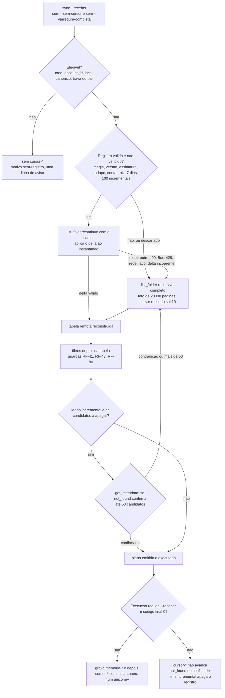
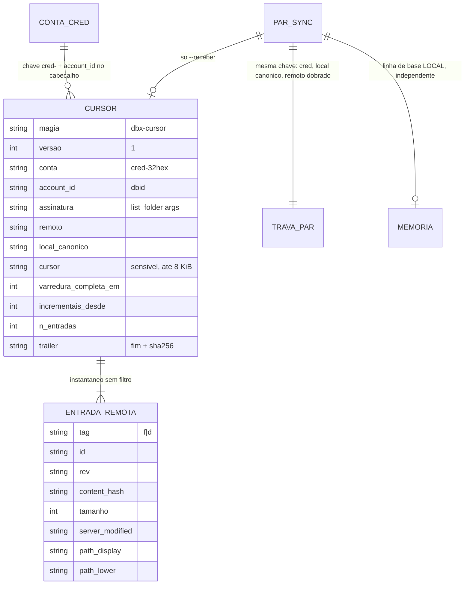
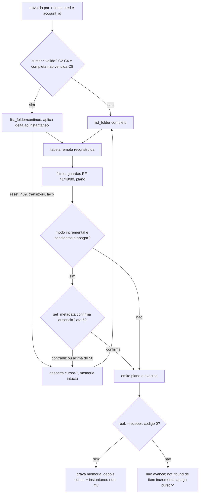

# Fase 7b do backlog (B7b): cursor de listagem no `sync --receber` (F-14)

## 1. Pedido e porte

| Campo | Valor |
|---|---|
| Pedido | Fase 7b do plano do backlog, depois do merge da PR #48 (fase 7a, F-03). F-14: detecção de mudanças por cursor (`list_folder/continue`) no sync remoto para local, com estado persistido entre execuções (namespace `cursor-*`). Requisitos RF-110 a RF-119, seção 5.16 do escopo v1.23. |
| Porte | **G**. Estado persistente entre execuções com dado remoto (cursor e instantâneo da listagem remota), reabre a `DP-09` e aciona o DBA. Classificado pelos gatilhos da regra 40. |
| Log de prompt | [docs/prompts/2026-10-21_0713_backlog-fase-7b-cursor.md](../prompts/2026-10-21_0713_backlog-fase-7b-cursor.md) |
| Memória de decisão | [.github/agents/memoria/entradas/2026-10-21-0713-cursor.md](../../.github/agents/memoria/entradas/2026-10-21-0713-cursor.md) |
| Branch / base | `feature/cursor-b7b` sobre `develop` @ `a6b5376` (merge da PR #48). Nenhum PR aberto na abertura. |
| Agents | Business Analyst (escopo v1.23, seção 5.16, RF-110 a RF-119; System Design v1.16; riscos v0.15, RSK-77 a RSK-84; candidatas v0.15); DBA (parecer de formato, chave, concorrência e limpeza, com condições C1 a C11, [anexo A](#anexo-a-parecer-do-dba-texto-integral)); Senior Developer (implementação sob `protocolo-tdd` e `protocolo-conformidade`, 2 ciclos); QA Expert (validação independente e adversarial, 2 ciclos, suíte final de 49 casos); Tech Lead (decisões DIV-204 a DIV-235, fechamento); Documentation Writer (este registro). |
| Data | 2026-10-21 (abertura, parecer do DBA, ciclos 1 e 2 de desenvolvimento e de QA, aprovação da suíte pelo solicitante). |

## 2. Causa ou decisão

### 2.1 Contexto

Até a 7a, o `sync --receber` enumerava a árvore remota inteira a cada execução: `list_folder` recursivo, páginas de 100 entradas, parse com `lib/json`. Essa enumeração é a parte cara do sync remoto para local. A F-14 propõe que o cursor de listagem do Dropbox (`list_folder/continue`) devolva só o delta desde a execução anterior.

O parecer do DBA mostrou que o cursor sozinho não basta ([anexo A, seção 0](#anexo-a-parecer-do-dba-texto-integral)). O `continue` devolve só o delta, e o plano do `sync` compara a tabela remota **inteira** com a travessia local inteira. Sem a tabela remota da execução anterior, um delta vazio não diz se um arquivo local editado à mão difere do remoto, nem quais arquivos locais sobram. O resultado seria um download omitido em silêncio, que é o dano mais difícil de ver.

Por isso o estado da 7b é **cursor + instantâneo remoto**, gravados num único arquivo. Na execução seguinte, `instantâneo ⊕ delta` reconstrói a tabela remota atual, e o restante do `sync` (filtros, guardas, plano, saída) segue o mesmo código da varredura completa.

### 2.2 Decisões do solicitante

Registradas no log de prompt (Prompt 1 e Prompt 2, [log](../prompts/2026-10-21_0713_backlog-fase-7b-cursor.md)):

- **Cursor (F-14):** "No sync remoto→local (Recomendado)". O estado só acelera; cursor inválido ou expirado volta à varredura completa.
- **Exclusão via cursor:** "Confirmar no servidor antes (Recomendado)". Sem confirmação na mesma execução, nada é apagado.
- **Suíte do QA:** aprovada em 2026-10-21 ("Aprovo"), 49 casos, sha256 `8c40c6f0f77ea0dd9e147e4ba6e21898366e7e131f5b51043e021ce05235e4b6`.

Princípios do Tech Lead, herdados da 7a e da fase 6: o estado nunca decide sozinho uma escrita destrutiva nem a integridade do resultado; a confirmação de exclusão é por identidade do servidor (`id`, `rev`), não por grafia do caminho; estado corrompido, de outra versão, de outra conta, de outra raiz ou de outro filtro é descartado com varredura completa; o cursor só é gravado depois de execução bem-sucedida; a infraestrutura da 7a é reusada (namespace, leitor limitado, gravação atômica, trava do par, 0600 e 0700, nenhum segredo no estado).

### 2.3 Decisão arquitetural (ADR resumido)

**Decisão.** Um registro `cursor-<resumo32>` por par (conta, raiz local canônica, raiz remota), em `$XDG_STATE_HOME/dbx` (0700). Arquivo único, formato NUL com magia `dbx-cursor` versão 1, contendo o cursor, a assinatura da listagem, o instantâneo remoto **sem filtro** (arquivos e pastas, com `id`, `rev`, `content_hash`, tamanho, `server_modified`, `path_lower` e `path_display`) e um rodapé com sha256. A gravação é atômica pela `_dbx_state_gravar_arquivo` existente. `DBX_STATE_VERSAO` não muda.

Chave: sha256 com separador NUL de `cursor`, `cred-`, raiz local canônica, raiz remota com caixa ASCII dobrada e assinatura da listagem; o `account_id` vai no cabeçalho e é reconferido contra o desta execução. Sem `cred-` ou sem `account_id`, não há cursor. Filtros ficam fora da chave, porque o servidor devolve o mesmo conjunto com ou sem eles e os filtros são aplicados depois da reconstrução.

Exclusão no modo incremental: todo candidato a apagar (`deleted` do delta **e** ausência no instantâneo) é confirmado por `get_metadata` na mesma execução, antes do plano. Só `path/not_found` confirma. Qualquer metadado presente é contradição: nunca apaga, descarta o registro e refaz a varredura completa na mesma execução. Acima de 50 confirmações, varredura completa.

Varredura completa obrigatória após 7 dias ou 100 incrementais (ou idade negativa além de 5 min).

**Alternativas consideradas e descartadas** (fonte: parecer do DBA, seções 0 a 3, e decisões do Tech Lead):

| Alternativa | Motivo do descarte |
|---|---|
| Só o cursor, sem instantâneo | Um delta vazio não reconstrói a tabela remota; sem ela, o `--receber` omitiria downloads em silêncio (DBA, seção 0). |
| Instantâneo filtrado, com a assinatura dos filtros na chave | Troca de filtro viraria varredura completa e haveria risco de aplicar o filtro duas vezes (DBA, seção 2). |
| Cursor no namespace `memoria-*` | Viola a separação linha de base local × estado remoto (RSK-32, RF-43). |
| Dois arquivos (cursor e instantâneo) | Exigiria protocolo de commit em shell; um arquivo e um `mv` garantem que cursor e instantâneo nunca discordam. |
| Trava por registro | Desnecessária: a chave do cursor é a do par, e a trava do par já é mantida pelo `sync` do início ao fim. |
| Acoplar a gravação de cursor e de `memoria-*` | Não é necessário: cada uma descreve um lado, e o plano recompara os dois inteiros (DIV-k). |
| Incrementar `DBX_STATE_VERSAO` | Descartaria toda `memoria-*` e desabilitaria a exclusão na primeira execução (RF-41(f), RSK-46). |

**Trade-offs aceitos:**

- Custo por execução incremental: leitura e sha256 do registro, páginas do delta e uma reescrita do registro, contra uma página por 100 entradas na completa. Carga estimada em ~250 B por entrada remota (100 mil entradas ≈ 25 MB), medição adiada para a F-34 (RSK-79).
- Confirmação de exclusão adiciona um `get_metadata` por raiz candidata, com teto de 50 (RSK-81).
- O instantâneo é dado novo no diretório de estado, com a mesma classe de privacidade de `memoria-*`, agora do lado remoto (RSK-80).
- Só a árvore remota deixa de ser varrida inteira; a travessia local continua completa, acelerada pela `memoria-*` como hoje (DIV-f).

### 2.4 Divergências decididas pelo Tech Lead

Texto integral na memória [2026-10-21-0713-cursor](../../.github/agents/memoria/entradas/2026-10-21-0713-cursor.md). Resumo:

- **Parecer do DBA:** aprovado com condições C1 a C11 ([anexo A, seção 10](#anexo-a-parecer-do-dba-texto-integral)). O parecer do SD declara a implementação de C1 a C11; a cobertura de cada condição por caso de teste está no [parecer TDD](2026-10-21-0713-parecer-tdd-cursor-b7b.md) e na suíte do QA.
- **Aceitas como recomendadas (BA):** DIV-204 A (desenho cursor + instantâneo), DIV-206 A (cursor ligado por padrão), DIV-207 B (opções `--sem-cursor`/`--no-cursor` e `--varredura-completa`/`--full-scan`), DIV-208 (varredura completa a cada 7 dias ou 100 incrementais), DIV-209 (até 50 confirmações), DIV-210 e DIV-211 (toda candidata confirmada por `get_metadata`; só `not_found` confirma), DIV-212, DIV-215, DIV-217, DIV-218 A (candidatas confirmadas também sem `--espelhar`), DIV-220.
- **DIV-205, alterada pelo Tech Lead:** só o `sync --receber` usa o cursor. O download de pasta fica fora; `--enviar` e `verificar` nunca usam o cursor.
- **DIV-213 A, aceita:** filtros fora da chave, retrato sem filtro. `dbx_sync_enumerar_remoto` passa a produzir a tabela completa e filtrar depois. Teste de equivalência com e sem filtro é obrigatório.
- **DIV-214 B:** a F-40 (`limit` no `continue`) é corrigida só no caminho do `sync`. O restante segue na F-40. Ver DIV-233.
- **DIV-216, aceita:** poda de 8 dias, teto de 100 registros e dimensionamento de ~250 B por entrada.
- **DIV-219:** contratos conferidos no Context7 antes da implementação (seção 2 do [parecer TDD](2026-10-21-0713-parecer-tdd-cursor-b7b.md)). O que não pôde ser confirmado segue a regra "em dúvida, varredura completa" e fica em RSK-78.
- **DIV-e, DIV-i e RNF-26:** emendas do System Design (v1.16). **DIV-g** (enumeração sem filtro) e **DIV-h** (guarda de cursor repetido e teto de páginas) entram na 7b.
- **Divergências do BA aceitas como implementadas (DIV-221 a DIV-234):**
  - Aceitas: DIV-221, 222, 223, 225, 227, 228, 229, 232 e 234.
  - **DIV-221:** a data remota só é lida quando algum filtro a exige, porque o teste aprovado QA-B4-E09 exige um único ponto de leitura. Incremental com filtro de data e retrato sem data cai para a varredura completa.
  - **DIV-222:** valores de `cursor_motivo` fora da RF-118(d): `descartado` e `sem-registro`.
  - **DIV-234:** a equivalência entre incremental e completa é de conjunto; a ordem das linhas pode variar.
- **DIV-224, aceita:** delta acima do teto de páginas cai para a varredura completa. Na varredura completa, cursor repetido ou mais de 20.000 páginas sai 10, como no `reter`. O BA alinha TC-CUV-08 e TC-CUF-06.
- **DIV-226, aceita:** no `sync`, divergência de hash é falha por item: sai 14, classe `integridade`. O BA corrige TC-CUS-03 (que esperava 11).
- **DIV-230:** o BA propaga a DIV-205 aos requisitos e casos de teste que ainda citam o download de pasta.
- **DIV-231:** dúvida sobre `include_deleted` no `continue` vai para RSK-78. O efeito é só manter arquivo local até a varredura periódica (direção segura).
- **DIV-233, aceita como mudança de comportamento:** `verificar` e `--enviar` passam a usar o `continue` sem `limit` e a guarda de laço, porque usam o mesmo enumerador. Entra na seção de mudanças da PR.
- **Ressalva de TDD do SD (R1):** parte de `lib/state` e da refatoração de `lib/sync` foi escrita antes dos casos que a cobrem. O vermelho contra a base foi comprovado depois, e nenhum caso verde na base cobre comportamento novo. Ressalva aceita e registrada no parecer TDD.
- **Lacunas TC-CUL-04 e 05 (sinal durante o `continue` e durante as confirmações):** cobertas pelo QA (grupo E da suíte). O desempenho de 100 mil a 1 milhão de entradas fica para a F-34 (RSK-72 análogo).

### 2.5 Achados do QA decididos pelo Tech Lead

- **Ciclo 1, reprovado.**
  - **QA-B7B-01 (P1), corrigido:** a raiz remota `/`, cujo caminho na API é `""`, nunca gravava registro. Agora a raiz vazia é chave válida (no contexto, na chave e no cabeçalho).
  - **QA-B7B-02 (P1), corrigido:** a entrada da própria pasta listada, que o `list_folder` recursivo devolve, reprovava a persistência. Agora é reconhecida estruturalmente (`path_lower` igual à raiz pedida e tag `folder`) e ignorada sem efeito. Qualquer outra entrada fora da raiz continua reprovando. Os dublês passaram a devolver essa entrada, como a API real faz.
  - **QA-B7B-03 (P3), corrigido:** no delta, `path_lower` passa pelo mesmo confinamento de `path_display` (RF-112(e), RF-115(h)).
  - **O1, corrigido:** o remédio do `diagnostico` deixa de dizer "substitui" para registro não regular.
  - **Lição:** os dublês precisam reproduzir o formato real da API (raiz `/` e entrada da própria pasta). A conferência de contrato no Context7 virou caso de teste (grupo H), não só nota.
- **O2, investigado, anterior à 7b, não corrigido (F-43, RSK-84).** Reproduzido na base `a6b5376`: com listagem de hash X e download de conteúdo de outro hash, sem cabeçalho `Dropbox-API-Result`, o `sync` aceita e grava o arquivo (`estado=0`). Causa: `dbx_cmd_receber_arquivo` confere só contra o cabeçalho e não recebe o `content_hash` da listagem. A 7b não tocou `lib/cmd.sh` nem `lib/http.sh`. Só se manifesta se o servidor omitir o cabeçalho, o que a API real não faz no `files/download`. **Decisão do Tech Lead:** backlog como F-43 (o `sync` passa o hash da listagem como valor esperado ao recebimento), risco registrado em RSK-84.
- **DIV-235, aceita:** comparação da entrada da raiz e confinamento de `path_lower` usam a caixa baixa do locale do processo, enquanto o servidor usa a do Unicode. Com `LC_ALL=C` e raiz com maiúscula fora do ASCII, o efeito é cair na varredura completa ou não gravar o retrato, nunca apagar. Registrada junto da RF-54(f).
- **Observação residual do QA, aceita (ciclo 2, O3):** o `path_lower` do delta não é conferido como minúsculo. O pior caso é uma chave a mais no mapa, o que impede uma exclusão e nunca a causa. A API não envia isso.

### 2.6 Decisão de rollout

Nenhum. Sem migração de dado: a 7b cria um namespace novo. O cursor fica ligado por padrão no `sync --receber`, com as opções de desligamento da seção 7.

## 3. Escopo técnico e arquivos modificados

Linhas inseridas e removidas por `git diff --numstat a6b5376` para os arquivos rastreados. Arquivos de teste novos, em linhas: `cursor_test.sh` 1398, `qa_cursor_b7b_test.sh` 1664, `cursor_estado_test.sh` 309, `sync_tabela_test.sh` 312 (total 3683), conferidos pelo Tech Lead antes do commit.

- **Código:** `lib/state.sh` +520/-5, `lib/sync.sh` +601/-73.
- **Comandos e CLI:** `commands/sync.sh` +296/-24, `commands/download.sh` +8/-0, `commands/diagnostico.sh` +29/-0, `bin/dbx` +17/-2, `completions/dbx.bash` +1/-1.
- **Documentação:** `README.md` +28/-0, `docs/arquitetura/system-design.md` +52/-4, `docs/testes/mapa-modulos.md` +6/-0.
- **Requisitos:** `escopo-requisitos-e-criterios-de-aceite.md` +88/-7, `funcionalidades-candidatas.md` +5/-4, `riscos-restricoes-e-licenciamento.md` +9/-1, `decisoes-pendentes.md` +8/-2.

| Arquivo | Alteração |
|---|---|
| `lib/state.sh` | Namespace `cursor-*`: contexto e chave SHA-256 com NUL (`dbx_state_cursor_contexto`); carga em fluxo com limites, rodapé conferido sobre o mesmo inode e descarte (`dbx_state_cursor_carregar`); gravação atômica com gancho de rodapé (`dbx_state_cursor_gravar`); remoção; vencimento por 7 dias, 100 incrementais e relógio (-5 min); poda (8 dias, teto 100, só `cursor-*`, nunca o corrente); listagem só do cabeçalho. `.cursor.*` entra na varredura de 24 h. `DBX_STATE_VERSAO` inalterada. |
| `lib/sync.sh` | Tabela remota sem filtro (DIV-g): listagem completa com `continue` só com cursor (DIV-214 B), guarda de cursor repetido e teto de 20.000 páginas (DIV-h); delta incremental com recuo para a completa em qualquer resposta inesperada; receita do serviço (`file`, `folder`, `deleted`); coerência do delta (`id`, `rev`, confinamento, `id` único); retrato com confinamento e `path_lower` repetido; filtros aplicados depois da tabela; confirmação de exclusões por `get_metadata` (só `not_found` confirma; agrupamento por raiz; teto de 50). `dbx_sync_enumerar_remoto` vira composição de listar e emitir; `verificar` e `--enviar` mantêm o resultado. |
| `commands/sync.sh` | Opções `--sem-cursor`/`--no-cursor` e `--varredura-completa`/`--full-scan` (saem 2 com `--enviar` ou se usadas juntas); elegibilidade do cursor (`cred-`, `account_id`, local canônico, trava do par); laço de até duas rodadas (incremental, confirmação, completa na mesma execução); confirmação antes do plano, também sem `--espelhar` e na simulação; campos `varredura`, `cursor_motivo`, `cursor_mudancas`, `cursor_confirmadas` só no `--receber` do próprio `sync`; gravação depois da `memoria-*`, só com código final 0; download `not_found` ou conflito de item incremental apaga o registro. |
| `commands/download.sh` | `DBX_CMD_SYNC_CHAMADOR=download` nas duas delegações: o `sync` interno do download de pasta nunca usa o cursor nem emite os campos (DIV-205). |
| `commands/diagnostico.sh` | Checagem `cursor` (DIV-220): uma linha por registro, só cabeçalho; `valido` e `vencido` como ok; `ilegivel` como aviso. Sem registros, nenhuma linha. Remédio corrigido (O1). |
| `bin/dbx`, `completions/dbx.bash` | Ajuda do `sync` com as opções nos dois nomes e as frases de RF-118(e); autocompletar só no `sync`. |
| `README.md` | Seção "Cursor de listagem do `sync --receber`" (estado, opções, como apagar). |
| `docs/arquitetura/system-design.md` | v1.16: registro de versão; linha de `lib/state` (DIV-e, DIV-i, fecha a DIV-a da 7a); seção "Cursor de listagem entre execuções" com Mermaid e contratos conferidos; RNF-26 item (8); dimensionamento. |
| `docs/requisitos/escopo-requisitos-e-criterios-de-aceite.md` | v1.23: seção 5.16 (RF-110 a RF-119), DIV-204 a DIV-235. |
| `docs/requisitos/funcionalidades-candidatas.md` | v0.15: F-43 (backlog, achado O2) e revisão da F-14. |
| `docs/requisitos/riscos-restricoes-e-licenciamento.md` | v0.15: RSK-77 a RSK-84. |
| `docs/requisitos/decisoes-pendentes.md` | v1.6: `DP-09` reaberta com o parecer do DBA. |
| `docs/testes/mapa-modulos.md` | Linhas de `lib/state` e `lib/sync` da 7b e regra de seleção do filtro `cursor`. |
| `tests/integracao/cursor_test.sh` | Novo. 48 casos (ciclo 2 do SD). |
| `tests/integracao/qa_cursor_b7b_test.sh` | Novo, suíte do QA. 49 casos, sha256 `8c40c6f0f77ea0dd9e147e4ba6e21898366e7e131f5b51043e021ce05235e4b6`. Aprovada pelo solicitante em 2026-10-21. |
| `tests/unit/cursor_estado_test.sh` | Novo. 13 casos. |
| `tests/unit/sync_tabela_test.sh` | Novo. 12 casos. |
| `.github/agents/memoria/entradas/2026-10-21-0713-cursor.md` | Novo (memória de decisão). |
| `docs/prompts/2026-10-21_0713_backlog-fase-7b-cursor.md` | Novo (log de prompt). |
| `docs/reviews/2026-10-21-0713-*.md` | Este registro e os pareceres TDD, de conformidade e de QA. |

Nenhum teste aprovado foi alterado nesta fase. Nenhum caso do QA foi removido. O sha256 conferido pelo SD no ciclo 2 (`f16a365b...b254`) é o da versão de 41 casos; a versão aprovada, de 49 casos, tem sha256 `8c40c6f0...e4b6` e é a que consta na seção 5.1.

### 3.1 Propagação documental

Aplicada na mesma rodada, por `documentation-sync`: escopo v1.23 (seção 5.16), System Design v1.16, candidatas v0.15 (F-43), riscos v0.15 (RSK-77 a RSK-84), decisões pendentes v1.6 (DP-09 reaberta), mapa de módulos, README, ajuda e completação do `sync`, `diagnostico` com a checagem `cursor`.

## 4. Diagrama (Mermaid)

Fluxo de decisão do `sync --receber`, por execução real ou simulada, como implementado. O diagrama detalhado do registro, da chave e da trava está no anexo A (DBA, seções 2 a 7).



## 5. Evidências de validação

### 5.1 Testes rodados

Contagens literais dos pareceres do Senior Developer ([TDD](2026-10-21-0713-parecer-tdd-cursor-b7b.md)) e do QA ([validação](2026-10-21-0713-validacao-qa-cursor-b7b.md)).

| Arquivo de teste | Item afetado que o justifica | Comando | Total | Aprovados | Falhos |
|---|---|---|---|---|---|
| `cursor_estado_test.sh` (ciclo 1) | `lib/state` (namespace, leitor, rodapé, poda, varredura) | `bash tests/run.sh cursor_estado` | 12 | 12 | 0 |
| `cursor_test.sh` (ciclo 1) | composição ponta a ponta por `bin/dbx` | `bash tests/run.sh cursor` (com os outros) | 45 | 45 | 0 |
| `sync_tabela_test.sh` (ciclo 1) | `lib/sync` (tabela, delta, confirmação) | `bash tests/run.sh sync_tabela` | 9 | 9 | 0 |
| `cursor_estado_test.sh` (ciclo 2) | correção QA-B7B-02 e 01 na unidade | `bash tests/run.sh cursor_estado` | 13 | 13 | 0 |
| `cursor_test.sh` (ciclo 2) | integração com dublê da própria pasta | `bash tests/run.sh cursor_test` | 48 | 48 | 0 |
| `sync_tabela_test.sh` (ciclo 2) | correção QA-B7B-02 e 03 na unidade | `bash tests/run.sh sync_tabela` | 12 | 12 | 0 |
| `qa_cursor_b7b_test.sh` (QA, ciclo 1) | suíte do QA (versão de 41 casos) | `bash tests/run.sh qa_cursor_b7b` | 41 | 38 | 3 (`z01`, `z02`, `z03`; o harness para em `z01`) |
| `qa_cursor_b7b_test.sh` (QA, ciclo 2) | suíte final, aprovada pelo solicitante | `bash tests/run.sh qa_cursor_b7b` | 49 | 49 | 0 |
| `cursor` (QA, ciclo 2) | regressão dos arquivos da fase | `bash tests/run.sh cursor` | 110 | 110 | 0 |
| `json` (QA, ciclo 2) | auditoria RNF-24 das suítes | `bash tests/run.sh json` | 62 | 62 | 0 |
| `harness` (QA, ciclo 2) | auditoria de helpers e funções | `bash tests/run.sh harness` | 22 | 22 | 0 |
| `composicao` (QA, ciclo 2) | auditoria de composição e documentação | `bash tests/run.sh composicao` | 28 | 28 | 0 |
| Seleção pelo mapa (dev, ciclo 2) | `cursor`, `json`, `harness`, `composicao`, `http`, `preflight`, `tmp_test`, `state`, `retomada`, `sync`, `verificar`, `diagnostico`, `filtros`, `comandos`, `trava`, `espaco`, `completar`, `cli`, `confinamento_remoto`, `banda`, `identidade_gnustat`, `recuperacao`, `reter`, `qa_` | `bash tests/run.sh <filtro>` | por filtro | todos aprovados; `cursor` 102, `sync` 103, `retomada` 132 (1 pulado, root), `qa_` 432 | 0 |
| `qa_cursor_b7b` (dev, ciclo 2, versão de 41 casos) | antes da inclusão do grupo H pelo QA | `bash tests/run.sh qa_cursor_b7b` | 41 | 41 | 0 |

Observação: a execução do dev no ciclo 2 foi feita contra a versão de 41 casos da suíte do QA (sha256 `f16a365b...b254`). O QA acrescentou o grupo H (8 casos) no ciclo 2 e a versão aprovada tem 49 casos, sha256 `8c40c6f0...e4b6`. A versão de 49 casos foi executada pelo QA: 49/49.

- **Red do ciclo 1 de desenvolvimento:** os arquivos novos foram copiados para a árvore da base `a6b5376` (`git archive`) e cada caso rodou isolado. Resultado: integração 43/45 vermelhos (os 2 verdes são guardas de regressão: `cul02` e `cur13`); unidade `cursor_estado` 12/12 vermelhos e `sync_tabela` 9/9 vermelhos.
- **Red do ciclo 2 de desenvolvimento:** casos novos conferidos contra o código do ciclo 1 antes da correção: `sync_tabela qa_b7b_02` e `qa_b7b_03`, `cursor_estado qa_b7b_01`, `cursor_test qa_b7b_01`, `qa_b7b_02` e `qa_b7b_o1`, e os casos `z01`, `z02` e `z03` da suíte do QA.
- **Mutantes do ciclo 1 de desenvolvimento:** 22 aplicados, 22 mortos. Cobrem RF-111, 112, 113, 114, 116, 117(a), DIV-205, C6, C10, DIV-214, DIV-h e C11 (lista no parecer TDD, seção 5).
- **Mutantes do ciclo 2 de desenvolvimento:** 10 aplicados, 10 mortos (confinamento e raiz própria, `-n` de volta, remédio antigo).
- **Mutantes do QA:** confirmação sempre aceita morta por a01, a03 e a05; presença com o mesmo `id` tratada como confirmada morta por a03; `limit` de volta no `continue` morto por g01. Ciclo 2 (3 mutantes): m4, m5 e m6 mortos.
- **Shellcheck:** limpo em `lib/`, `commands/`, `bin/`, `scripts/*.sh` e nos três arquivos de teste novos (dev); limpo na suíte do QA (QA ciclo 2).
- **Guarda de remoção de casos:** `bash scripts/verificar-remocao-de-casos.sh` com 1872 para 1872, nenhuma redução não declarada, nos dois ciclos.
- **Piramide e E2E:** a CLI é shell com dublê de `curl` na fronteira de rede. Sem E2E contra o serviço real (sem credencial de teste; mesmo critério das fases 3 a 7a). Formulários (regra 7): não aplicável.
- **Suíte completa local no push (regra 8):** comando oficial `sh scripts/suite-completa.sh`. **[PENDENTE: resultado da suíte completa, com a contagem de arquivos, aprovados, reprovados e pulados, e o commit em que foi executada.]**

### 5.2 Gates

| Gate | Skills aplicadas | Achados | Veredito |
|---|---|---|---|
| `protocolo-tdd` ([parecer](2026-10-21-0713-parecer-tdd-cursor-b7b.md)) | Regras 1 a 9; exceção de pirâmide do projeto shell | Ciclo 1: R1 (ordem do ciclo, aceita pelo TL), R2 (TC-CUL-04/05 sem caso próprio, coberto pelo QA), R3 (desempenho para a F-34). Ciclo 2: correções com vermelho antes e verde depois; sem achado novo registrado. | Ciclo 1 aprovado com ressalvas. Ciclo 2 aprovado pelo Tech Lead |
| `protocolo-conformidade` ([parecer](2026-10-21-0713-parecer-conformidade-cursor-b7b.md)) | `clean-architecture`, `shellcheck-configuration`, `security-best-practices`, `api-security-best-practices` | Camadas, guardas sem estado, reuso da 7a e sigilo (C10) conformes. Menor: acoplamento de leitura da constante de `lib/state` por `lib/sync`; variável `local` dinâmica em `download`; `commands/sync.sh` cresceu. Informativo: DIV-233. | Ciclo 1 aprovado com ressalvas. Ciclo 2 aprovado pelo Tech Lead |

### 5.3 QA

Detalhe em [validação do QA](2026-10-21-0713-validacao-qa-cursor-b7b.md).

- Ciclo 1: **reprovado**. QA-B7B-01 (P1, raiz `/` nunca gravava registro) e QA-B7B-02 (P1, entrada da própria pasta bloqueava a persistência), mais QA-B7B-03 (P3, `path_lower` sem confinamento). Nenhum P0 de dado violado: nenhum cenário produziu exclusão a partir do registro sem `not_found` na mesma execução.
- Ciclo 2: **aprovado**, 49/49. Os três achados e a O1 estão fechados. O reataque do grupo H (8 casos novos) não achou defeito.
- Suíte: 49 casos, sha256 `8c40c6f0f77ea0dd9e147e4ba6e21898366e7e131f5b51043e021ce05235e4b6`, aprovada pelo solicitante em 2026-10-21.
- Observações sem reprovação: O1 (corrigida), O2 (F-43, RSK-84), O3 (`path_lower` do delta sem conferência de minúscula, residual), O4 (teto de 20.000 páginas não exercitado por custo; laço coberto por cursor repetido, `has_more` sem cursor e cursor fora da regex), O5 (memória descartada com `--espelhar` sai 14, comportamento anterior, coerente com RF-111(g)).

## 6. Riscos, impacto e rollback

### 6.1 Riscos residuais

- **RSK-77 (delta que omite mudança):** um delta que não traz uma mudança mantém arquivo local extra ou omite transferência até a varredura periódica. Nunca apaga. Risco aceito, confirmado em comportamento pelo QA (observação O3 do ciclo 1).
- **RSK-78 (contratos não confirmados):** `include_deleted` no `continue` (DIV-231/DIV-l) e cursor da última página cobrindo mudanças feitas durante a varredura. O efeito seguro é manter arquivo local até a periódica. Conferir no primeiro uso real.
- **RSK-79 (custo e carga do registro):** ~250 B por entrada, regravado inteiro a cada sucesso. Teto de 1.000.000 entradas e 512 MiB; medição na F-34.
- **RSK-80 (dado sensível no estado):** o registro guarda nomes e hashes remotos e um cursor opaco. `0600` e `0700`, nada de segredo, cursor fora de toda saída e log, `unlink` apaga o diretório, poda de 8 dias. Cópia de backup do home leva o dado (documentar no README).
- **RSK-81 (custo das confirmações):** cada raiz candidata gasta um `get_metadata`. Teto de 50; sequencial.
- **RSK-82 (retrato adulterado levando a exclusão):** toda candidata, inclusive a ausência no retrato, é confirmada no servidor na mesma execução. Rodapé SHA-256. Só o próprio usuário forja, como RSK-76.
- **RSK-83 (divergência de equivalência):** erro na aplicação do delta ou no filtro pós-reconstrução produz plano diferente do da completa. Teste diferencial obrigatório e varredura periódica.
- **RSK-84 (O2, anterior à 7b):** o `sync` não passa o `content_hash` da listagem ao recebimento. Só aparece se o servidor omitir `Dropbox-API-Result`. Backlog F-43.
- **DIV-235 (caixa fora do ASCII sob `LC_ALL=C`):** efeito de custo ou de retrato não gravado, nunca de exclusão. Registrada junto da RF-54(f).
- **Desempenho em 100 mil a 1 milhão de entradas:** não medido (R3 do SD). F-34.
- **Ressalva de ordem do ciclo (R1, TDD):** aceita pelo Tech Lead.

### 6.2 Impacto

- **Contrato externo:** `list_folder` recursivo com `limit`; `list_folder/continue` sem `limit` nas rotas que usam o enumerador (`sync --receber`, DIV-214 B, e `verificar` e `sync --enviar`, DIV-233); `get_metadata` nas confirmações de exclusão. Nenhum endpoint novo.
- **Estado:** novo namespace `cursor-*` em `$XDG_STATE_HOME/dbx`, com temporário `.cursor.*`. `DBX_STATE_VERSAO` não muda. `memoria-*` intacta.
- **Códigos de saída:** 0 a 15, sem código novo. Varredura completa com cursor repetido ou mais de 20.000 páginas sai 10 (DIV-224). Divergência de hash no `sync` sai 14, classe `integridade` (DIV-226). `--sem-cursor` com `--enviar` e `--varredura-completa` com `--enviar` saem 2 (DIV-207 B).
- **OAuth:** nenhum escopo novo. Sem dependência nova.

### 6.3 Rollback

- `git revert` do commit da 7b em `develop` (ou do merge da PR, `git revert -m 1 <merge>`). Sem migração de dado nem de credencial.
- Após o revert, a versão anterior não lê nem grava `cursor-*`. Os registros existentes ficam no diretório de estado, ignorados pela versão anterior, até a próxima limpeza.
- O `unlink` da versão anterior (`_dbx_cmd_unlink_remover_estado`) apaga toda entrada do diretório de estado, exceto `trava-*`. Com isso, leva também os registros `cursor-*`.
- A versão anterior não tem o `sync` com cursor: volta a enumerar a árvore inteira a cada execução, como na 7a. O resultado do `sync` não muda.
- Mudanças de comportamento revertidas: cursor ligado por padrão, opções `--sem-cursor`, `--no-cursor`, `--varredura-completa` e `--full-scan`, campos de saída `varredura`, `cursor_motivo`, `cursor_mudancas` e `cursor_confirmadas`, checagem `cursor` do `diagnostico`, `continue` sem `limit` em `verificar` e `--enviar`.

### 6.4 Lições

- Cursor sem o estado remoto correspondente não reconstrói a árvore. O estado precisa ser o par (cursor, instantâneo) gravado num único arquivo (DBA, seção 0).
- O QA achou dois defeitos P1 que os 45 casos do desenvolvedor não pegaram: a raiz `/` e a entrada da própria pasta, que o duplo do desenvolvedor nunca devolvia. A regra é que o dublê reproduza o formato real da API, e que a conferência de contrato vire caso de teste (grupo H).
- Código escrito antes dos casos (R1) foi tratado com o vermelho comprovado depois, contra a base. Os mutantes do SD (22 no ciclo 1 e 10 no ciclo 2) foram todos mortos, e os do QA também.
- O achado O2 é anterior à 7b. Foi separado em F-43 e não entrou na fase, para não misturar a correção de um defeito antigo com a entrega do cursor.

## 7. Mudanças de comportamento

- **Cursor ligado por padrão** no `sync --receber`. Cursor inválido, expirado, de outra conta, de outra raiz, de outro formato ou acima dos tetos volta à varredura completa, sem falha.
- **Opções novas:** `--sem-cursor` e `--no-cursor` (não lê nem grava `cursor-*`); `--varredura-completa` e `--full-scan` (descarta o cursor e faz a varredura completa na execução). Saem 2 com `--enviar` e saem 2 se usadas juntas.
- **Saída do `sync --receber`:** campos `varredura`, `cursor_motivo`, `cursor_mudancas` e `cursor_confirmadas`, só no `--receber` do próprio `sync`. Nenhum campo novo no download de pasta.
- **Exclusões vindas do cursor:** candidatas são confirmadas por `get_metadata` na mesma execução, inclusive sem `--espelhar` e na simulação. Há chamadas extras de API (até 50 por execução incremental).
- **Varredura completa obrigatória** a cada 7 dias ou 100 incrementais. Relógio com idade negativa além de 5 min também força.
- **Varredura completa com defeito de servidor:** cursor repetido ou mais de 20.000 páginas saem 10 (DIV-224).
- **Divergência de hash no `sync`:** falha por item, classe `integridade`, saída 14 (DIV-226).
- **`verificar` e `--enviar`** passam a usar o `continue` sem `limit` e a guarda de laço (DIV-233).
- **Download de pasta:** nunca usa o cursor (DIV-205). Recusa `--sem-cursor` e `--varredura-completa` com 2, como a opção desconhecida.
- **`unlink`:** remove `cursor-*` junto do diretório de estado, com o mesmo tratamento de travas vivas.
- **`diagnostico`:** ganha a checagem `cursor` (uma linha por registro, só cabeçalho; ilegível é aviso). Nunca mostra o cursor.

## 8. Próximos passos

- **F-43** (backlog): o `sync` passa o `content_hash` da listagem ao recebimento como valor esperado (O2, RSK-84).
- **F-34:** medição de desempenho do registro e da tabela com 100 mil e 1 milhão de entradas (R3, RSK-79).
- **F-40:** `limit` no `continue` fora do `sync`, `verificar` e `--enviar` (DIV-214 B). `list` e `dbx_cmd_listar_nivel` seguem no backlog.
- **RSK-78:** conferir no primeiro uso real o `include_deleted` do `continue` e o comportamento da última página durante a varredura.
- **Endurecimento da leitura em FIFO** (OBS-3 da 7a, RSK-76): segue no backlog.
- **Documentar cópia de backup** do home com o dado de cursor no README (RSK-80).
- **Suíte completa e PR:** [PENDENTE: resultado de `sh scripts/suite-completa.sh`, sha do commit e número da PR.]
- **`documentation-sync` deste registro:** os documentos vivos afetados estão listados na seção 3.1; a conferência final fica com o Tech Lead antes do merge.

## 9. Diagrama de contexto (Mermaid, cursor e estado)

O diagrama de relacionamento entre a conta, o cursor, a trava do par, a `memoria-*` e o instantâneo remoto está no anexo A (DBA, seção 12, ao fim do parecer). Esta seção não reproduz o diagrama, para não duplicar a fonte.

## 10. Aceites

- **Solicitante, regra 12:** suíte do QA aprovada em 2026-10-21 ("Aprovo"), 49 casos, sha256 `8c40c6f0f77ea0dd9e147e4ba6e21898366e7e131f5b51043e021ce05235e4b6`. O Tech Lead conferiu antes as auditorias `json` e `harness`.
- **Tech Lead:** decisões DIV-204 a DIV-235 registradas na memória [2026-10-21-0713-cursor](../../.github/agents/memoria/entradas/2026-10-21-0713-cursor.md), incluindo O2 para F-43 e RSK-84. Aceite final depende da suíte completa no push e do commit. Gates dos ciclos 1 e 2 aprovados pelo Tech Lead em 2026-10-21.
- **QA Expert:** validação independente aprovada no ciclo 2 ([validação](2026-10-21-0713-validacao-qa-cursor-b7b.md)).
- **Senior Developer:** gates de TDD e de conformidade (ver [TDD](2026-10-21-0713-parecer-tdd-cursor-b7b.md) e [conformidade](2026-10-21-0713-parecer-conformidade-cursor-b7b.md)).
- **Merge:** fica com o solicitante.

## Anexo A. Parecer do DBA (texto integral)

Cópia integral de [b7b-dba.md](/tmp/claude-1000/-home-sales-dropbox-api/79c5663b-427b-43f7-afa1-0bdb22ddd6bf/scratchpad/b7b-dba.md), conforme a decisão do Tech Lead ("Texto integral copiado para o registro da fase"). As divergências do DBA estão resumidas em 2.4.

# Parecer do DBA — fase 7b, F-14 (cursor de listagem entre execuções no sync remoto→local), DP-09 reaberta

Data: 2026-10-21 · Branch: feature/cursor-b7b (a6b5376) · Modo: somente leitura
Base: memórias `2026-10-21-0713-cursor` e `2026-10-20-2315-retomada`; parecer da 7a (scratchpad/b7a-dba.md);
lib/state.sh (como mesclado), commands/sync.sh, lib/sync.sh (`dbx_sync_enumerar_remoto`), lib/http.sh
(`dbx_http_colecao`), lib/cmd.sh (`dbx_cmd_ciclo_iniciar`), lib/config.sh (`dbx_config_identidade`),
docs/arquitetura/system-design.md, docs/requisitos/riscos-restricoes-e-licenciamento.md (RSK-32, 46, 69..76),
RF-43.

**Veredito: aprovado com condições (C1 a C11).** A infraestrutura NUL da 7a serve, com dois acréscimos
obrigatórios: o registro guarda, além do cursor, um **instantâneo da listagem remota** (sem ele o cursor
não tem com o que ser aplicado), e o leitor precisa de uma variante **em fluxo** para um registro que
passa de 16 KiB.

---

## 0. O ponto que decide o desenho: o cursor sozinho não basta

- O `sync --receber` planeja com a tabela remota **inteira** (`mapa_remoto`: `content_hash`, tamanho,
  caminho) contra a travessia local inteira (commands/sync.sh:471-511). O `list_folder/continue` com um
  cursor antigo devolve **só o delta**.
- Sem a tabela remota da execução anterior, um delta vazio não diz se um arquivo local editado à mão
  difere do remoto (o `--receber` hoje o sobrescreveria), nem quais arquivos locais sobram (o `--espelhar`
  hoje os apaga). O resultado seria um download omitido em silêncio, que é o dano mais difícil de ver.
- **Portanto o estado da 7b é `cursor + instantâneo remoto`, consistentes entre si**: o instantâneo é a
  listagem remota completa no instante do cursor. Na execução seguinte, `instantâneo ⊕ delta` reconstrói
  a tabela remota atual, e o resto do `sync` (filtros, guardas, plano, saída) corre igual à varredura
  completa.
- **A travessia local continua completa** a cada execução, acelerada pela `memoria-*` como hoje. O
  cursor acelera só a enumeração remota (que é a parte cara: páginas de 100 com `lib/json`).
- **Consequência útil:** como o plano é sempre recalculado de "remoto atual completo × local atual
  completo", o cursor **nunca consome uma mudança**. Uma execução que falhou depois de aplicar o delta
  não perde nada se o par `(cursor, instantâneo)` gravado for consistente: o arquivo não baixado continua
  diferente na próxima comparação. A regra "só grava depois do sucesso" (TL) vira defesa em
  profundidade, não a única barreira.

## 1. Localização e formato

- **Localização:** o mesmo `$XDG_STATE_HOME/dbx` (0700), namespace `cursor-<resumo32>`, temporário
  `.cursor.*` incluído na varredura de 24 h de `_dbx_state_preparar_diretorio` (lib/state.sh:158-160).
- **Um arquivo só para cursor e instantâneo**, gravado por `_dbx_state_gravar_arquivo` (temporário no
  mesmo diretório + `mv -f`). Um único `mv` é o que garante que cursor e instantâneo nunca discordam.
  Dois arquivos exigiriam protocolo de commit em shell. Sem fsync (estado advisório); arquivo de 0 bytes
  ou lixo depois de queda é descartado.
- **Magia e versão do namespace:** `dbx-cursor`, `1`. `DBX_STATE_VERSAO` não muda (RSK-46).
- **Layout v1** (cada campo terminado em NUL):

```
cabeçalho (12 campos fixos)
 0 dbx-cursor
 1 1
 2 cred-<32hex>                 dbx_config_identidade (lib/config.sh:190)
 3 dbid:<...>                   account_id de get_current_account DESTA execução (já obtido pelo sync)
 4 <assinatura da listagem>     ver seção 2
 5 <remoto>                     raiz remota resolvida (_dbx_cmd_caminho_remoto), sem dobra
 6 <local canônico>             dbx_path_local_canonico da raiz local
 7 <cursor>                     ^[A-Za-z0-9_=+/.-]{1,8192}$ (seção 3)
 8 <varredura_completa_em>      epoch da última enumeração COMPLETA que originou a cadeia
 9 <incrementais_desde>         execuções incrementais desde a última completa
10 <gravado_em>                 epoch
11 <n_entradas>                 ^[0-9]{1,7}$
corpo (n_entradas × 2 campos)
  "tag\tid\trev\tcontent_hash\ttamanho\tserver_modified\tpath_display"   (path_display por último, pode ter TAB)
  "path_lower"
trailer
  fim
  <sha256 de todos os bytes anteriores ao campo "fim">
```

- Entradas: `tag` ∈ {`f`,`d`}; `id` `^id:[A-Za-z0-9_-]{1,64}$`; `rev` `^[0-9a-f]{9,64}$` (pasta: `-`);
  hash `^[0-9a-f]{64}$` (pasta: `-`); tamanho `^[0-9]{1,18}$`; `server_modified`
  `^[0-9]{4}-[0-9]{2}-[0-9]{2}T[0-9]{2}:[0-9]{2}:[0-9]{2}Z$` (pasta: `-`). Duas leituras `read -d ''`
  por entrada, não oito: é o que mantém a carga de 100 mil entradas em segundos.
- **Pastas entram no instantâneo** porque a varredura completa as usa: a pasta excluída por filtro conta
  1 em `filtrados` (lib/sync.sh:335-339, RF-80(i)), e a exclusão de pasta no delta remove descendentes.

## 2. Chave do registro

`resumo = sha256("cursor" NUL cred NUL local_canônico NUL remoto_dobrado_ASCII NUL assinatura NUL)[0:32]`

- **Conta.** Chave por `cred-` (sem rede, muda no relink, cobre `app_key`: outro app na mesma conta tem
  outra raiz, app folder × full Dropbox). O cabeçalho guarda também o `account_id`, reconferido contra o
  `get_current_account` que o `sync` já faz (commands/sync.sh:123-128). Qualquer um dos dois ausente: sem
  cursor, nem leitura nem gravação (mesma regra RF-52(a) da memória).
- **Raiz remota:** dobra só ASCII sob `C` (`_dbx_state_minusculas_ascii`), igual à trava. Dobra Unicode
  divergente só gera outra chave: varredura completa, nunca registro errado.
- **Raiz local canônica entra na chave.** O instantâneo é só remoto e poderia ser compartilhado, mas
  amarrar ao par dá: (a) a trava do par já existente cobre o registro (a chave da trava é exatamente
  `cred-`, local canônico, remoto dobrado — lib/cmd.sh:1065-1066, lib/state.sh:677-693); (b) ciclo de
  vida, `diagnostico` e descarte por par. O custo (duas raízes locais da mesma raiz remota listam duas
  vezes) é raro.
- **Assinatura da listagem:** constante única no código, por ex.
  `list_folder;recursive=1;include_deleted=0;include_mounted_folders=1;include_non_downloadable_files=1;limit=100`.
  Mudou o código, mudou a assinatura: descarta. O `limit` entra porque o cursor o carrega, mesmo sem
  mudar o conjunto.
- **Filtros NÃO entram na chave.** No `sync` os filtros são aplicados no cliente sobre a listagem
  recursiva (lib/sync.sh:335-361); o servidor devolve o mesmo conjunto com ou sem `--excluir`. Por isso o
  instantâneo é **sem filtro** e os filtros desta linha de comando são aplicados depois da reconstrução,
  pelo mesmo código da varredura completa. Mudar o filtro não invalida o cursor e não pode mudar o
  resultado. (Alternativa não recomendada: instantâneo filtrado com assinatura dos filtros na chave;
  troca de filtro viraria varredura completa e o risco de aplicar filtro duas vezes.)
- **Host não entra.** O conteúdo é estado remoto, válido em qualquer máquina; a cópia do diretório de
  estado entre máquinas ou a restauração de backup traz um par antigo, porém consistente, e o delta a
  partir dele continua correto.
- Reconferência byte a byte de 2..6 na carga; o resumo do nome só localiza.

## 3. O que guardar

| Dado | Guardar? | Motivo |
|---|---|---|
| cursor (último, da página com `has_more=false`) | sim | ponto de partida do `continue` |
| instantâneo remoto sem filtro (arquivos e pastas) | **sim, obrigatório** | seção 0 |
| `id`, `rev` por arquivo | sim | confirmação por identidade (C5) e detecção de contradição |
| `content_hash`, tamanho | sim | o plano compara por hash (RF-39) |
| `server_modified` | sim | filtro de data remota no `--receber` (`DBX_FILTRO_CAMPO_DATA_REMOTA`) |
| `path_lower` e `path_display` | sim | o delta de exclusão traz só caminho; `path_lower` aplica exclusão sem depender de localidade |
| varredura completa em / incrementais desde | sim | varredura completa periódica (C8) |
| token, segredo, conteúdo de arquivo | **nunca** | |

**Sensibilidade.** O cursor não é segredo (sem o token da mesma conta e do mesmo app não lista nada),
mas codifica namespace e ponto da conta: é identificador operacional sensível, como o `session_id`. Nunca
vai para stdout, stderr, `--json`, `diagnostico`, motivo de descarte nem mensagem de progresso. O
instantâneo tem a mesma classe de dado que `memoria-*` (caminhos e hashes, privacidade), agora do lado
**remoto**: é dado novo no diretório de estado (DIV-e).

**Tamanho do cursor.** Os cursores do Dropbox são opacos; no uso comum têm centenas de bytes a poucos KiB.
Limite de 8 KiB e regex fechada. Cursor acima do limite ou fora da regex: **não persiste** (a execução
segue normal e a próxima faz varredura completa), nunca falha.

**Relação com `memoria-*`.** Nenhuma escrita cruzada (RF-43, RSK-32):

- `memoria-*` = linha de base **local** (hash + identidade dos arquivos locais); `cursor-*` = estado
  **remoto**. Lados diferentes, ciclos diferentes.
- `reset` do servidor, cursor inválido ou `--varredura-completa` descartam só `cursor-*`; memória
  descartada (RF-41(f)) não toca `cursor-*`. A existência de `cursor-*` **não** responde a RF-48
  ("par já visto"): só `memoria-*` responde.
- **Não é preciso atomicidade conjunta cursor + memória**, e acoplar seria erro (DIV-k): nenhuma decisão
  depende de as duas terem sido gravadas no mesmo instante, porque cada uma descreve um lado e o plano
  recompara os dois inteiros. Ordem recomendada: memória e depois cursor; falha ao gravar o cursor
  preserva o registro anterior (consistente, apenas mais antigo).

## 4. Quando gravar e quando ler

- **Lê** uma vez, logo depois da trava do par e da identificação da conta, só no `sync --receber` real ou
  simulado. **Grava** uma vez, no fim, ainda sob a trava.
- **Grava só se** (TL): execução real (não `--dry-run`, RF-69(e)), sentido `--receber`, trava do par
  obtida, conta identificada (`cred-` e `account_id`), código final 0 (`falhas=0`, `parcial=nao`, sem
  recusa de origem vazia, sem memória descartada com exclusão desabilitada).
- `verificar` e `sync --enviar` **não leem nem gravam** `cursor-*` (o delta da próxima execução de
  `--receber` já mostra o que o `--enviar` mudou; não é preciso invalidar).
- **Sem trava** (diretório de estado sem escrita, DIV-48: "segue sem trava, com aviso"): sem cursor.
- **Download de item do plano incremental que falha com `not_found`/conflito de caminho:** apagar o
  registro (a próxima execução faz varredura completa). Sem isso, um instantâneo com entrada fantasma
  faria toda execução seguinte falhar no mesmo item até a varredura periódica.
- A varredura completa grava o cursor da **última página** dela; a incremental grava o cursor final do
  delta e o instantâneo com o delta aplicado.

## 5. Aplicação do delta (contrato para o Senior Developer)

Na ordem das entradas, página a página:
- `deleted` em P: remove P e todo descendente (`path_lower` igual a P ou começando com `P/`).
- `file` em P: substitui o que houver em P; se havia pasta, remove os descendentes.
- `folder` em P: se havia arquivo em P, remove; registra a pasta.
- Exclusão de caminho desconhecido é ignorada (o Dropbox pode emiti-la).
- Cada `path_display` do delta passa por `dbx_sync_relativo` (confinamento da fase 1b) como na varredura
  completa; entrada que falha descarta o modo incremental (seção 6).
- Guarda de laço (DIV-h): cursor repetido ou mais de N páginas no `continue` → abandona o incremental e
  faz a varredura completa na mesma execução.

## 6. Invalidação e descarte (nunca falha por causa do estado)

Descartar = apagar o registro (só arquivo regular, do usuário, não ligação simbólica) e fazer a
**varredura completa na mesma execução**, com no máximo um aviso de uma linha sem o cursor:

- magia, versão, assinatura desconhecida; contagem de campos; campo fora da regex; trailer ausente,
  contagem divergente ou sha256 divergente; acima dos tetos (C4);
- `cred-`, `account_id`, remoto ou local diferentes dos atuais;
- caminho do instantâneo que não passa no confinamento, `path_lower` duplicado;
- `continue` com 409 `reset` (Dropbox), qualquer outro 409 (`path/not_found` da raiz, cursor inválido),
  guarda de laço disparada;
- erro transitório no `continue` (5xx, rede depois das retentativas de `lib/http`): varredura completa na
  mesma execução; se ela também falhar, a execução falha **como hoje** (pela rede, não pelo estado);
- contradição na confirmação de exclusão (C5);
- varredura periódica vencida (C8);
- opção do usuário para forçar varredura completa (nome a definir pelo BA, ex. `--varredura-completa`).

`memoria-*` nunca é tocada por nenhum desses descartes (RF-43; teste que reprova se for).

## 7. Concorrência

- **Reusar a trava do par; sem trava por registro.** A chave do cursor é a do par (seção 2), e o `sync`
  já a detém do início ao fim (lib/cmd.sh:1066). Dois `sync` do mesmo par não correm; `verificar` e
  `--enviar` do mesmo par também esperam/recusam pela mesma trava e não tocam o cursor.
- Pares diferentes têm registros diferentes. A poda feita por outro par pode apagar o registro de um par
  em execução: é inofensivo, porque o registro é lido uma vez no início e regravado inteiro no fim.
- NFS entre hosts: melhor esforço (RSK-49); cada arquivo é consistente por `mv`.

## 8. Limpeza

- **`unlink`:** já apaga o diretório de estado respeitando travas vivas (commands/unlink.sh) — cobre
  `cursor-*`; nada fora do diretório de estado.
- **Poda**, na gravação de um `cursor-*`, uma vez por execução: `mtime` acima de 8 dias (um registro
  parado há mais de 7 dias exigiria varredura completa de qualquer jeito, então podá-lo não perde
  aceleração) e teto de **100** registros, removendo os mais antigos por `mtime`. Nunca casa
  `memoria-*`, `upload-*`, `retomada-*` nem `trava-*`; nunca o registro do par corrente.
- **`diagnostico`:** uma linha por `cursor-*` lendo **só o cabeçalho** (leitor limitado que para depois
  de 12 campos, sem exigir o arquivo inteiro abaixo de 16 KiB): remoto, local, entradas, idade, idade da
  última varredura completa, estado `valido|ilegivel|vencido`. Nunca o cursor.

## 9. Riscos de integridade e barreiras

**9.1 Cursor ou instantâneo velho, corrompido ou forjado causando EXCLUSÃO local.** No `--espelhar`, a
exclusão local nasce de "local existe, remoto não". No modo incremental, "remoto não" vem do estado de
duas formas: `deleted` no delta **ou ausência no instantâneo**. As duas são estado.

- **Barreira (C5):** todo candidato a exclusão do modo incremental é confirmado no servidor **na mesma
  execução, antes de o plano ser emitido** (RF-41(d)): `get_metadata` do caminho (o servidor resolve sem
  caixa, não por grafia local). `not_found` confirma; qualquer metadado presente é contradição → descarta
  o registro, refaz a enumeração completa e replaneja.
- Exclusões em massa: uma confirmação por raiz excluída do delta (pasta `deleted` confirmada cobre os
  descendentes locais dela); acima de **50** confirmações individuais, abandonar o incremental e fazer a
  varredura completa — a listagem completa da mesma execução é a confirmação que já vale hoje.
- As guardas existentes rodam sobre a tabela reconstruída sem mudança: RF-41(a)(b)(f), RF-48, RF-80(d)
  sem estado, `_dbx_cmd_sync_protegido` no ponto da escrita.
- Simulação faz as mesmas confirmações (são leitura) para que o `--dry-run` continue fiel.
- Se o `continue` não devolver exclusões com `include_deleted=false` (contrato a confirmar, DIV-l), o
  efeito é só manter arquivos locais extras até a varredura periódica: direção segura.

**9.2 Download omitido (resultado divergente sem sintoma).** Instantâneo que diz "remoto = H" quando o
remoto é H2, com local H: o plano omite.
- Barreiras: um arquivo só e um `mv` (cursor e instantâneo nunca discordam); trailer com contagem e
  sha256 (truncamento e bit trocado viram descarte); 0600/0700 (só o próprio usuário forja, como
  RSK-76/OBS-4); confinamento de cada caminho; descarte em qualquer 409.
- **Varredura completa periódica obrigatória (C8):** quando `varredura_completa_em` tiver mais de **7
  dias** ou `incrementais_desde` ≥ **100**; idade negativa além de 5 min também força. O relógio só
  decide fazer **mais** trabalho, nunca menos.
- Caixa de pasta renomeada só na caixa pode deixar `path_display` antigo nos filhos do instantâneo; o
  casamento sem caixa (RF-54) mantém o plano igual, e a varredura periódica corrige a grafia.

**9.3 Caminho do estado usado para ESCREVER fora da raiz.** O download do `sync` faz `mkdir -p` e grava
em `$raiz/$relativo` (commands/sync.sh:874-883). Caminho do instantâneo com `..` escaparia. Barreira (C4):
todo caminho carregado passa pela mesma validação de `dbx_sync_relativo` da listagem viva (RF-50 /
RSK-34: o estado não pode introduzir caminho que a resposta do servidor não introduziria).

**9.4 Custo de carga.** 100 mil entradas ≈ 25 MB, duas leituras por entrada, mais um sha256 do arquivo.
Ainda muito menor que 1.000 páginas com `lib/json`. Medir na F-34 (RSK-72 análogo).

## 10. Condições ao Senior Developer

- **C1 — Arquivo único e formato.** `cursor-<resumo32>`, NUL v1, magia `dbx-cursor` versão 1, cursor e
  instantâneo no mesmo arquivo gravado por `_dbx_state_gravar_arquivo`; `.cursor.*` na varredura de 24 h;
  `DBX_STATE_VERSAO` inalterada.
- **C2 — Chave e cabeçalho.** sha256 com separador NUL de `cursor`, `cred-`, local canônico, remoto
  dobrado ASCII e assinatura da listagem; reconferência byte a byte, mais `account_id` igual ao desta
  execução. Sem `cred-` ou sem `account_id`: sem cursor.
- **C3 — Instantâneo sem filtro.** Arquivos e pastas com `id`, `rev`, `content_hash`, tamanho,
  `server_modified`, `path_lower`, `path_display`; filtros aplicados depois da reconstrução, pelo mesmo
  código; paridade de saída (contagens `filtrados`, `REMOTOS_ANTES`, plano) entre incremental e completa
  coberta por teste.
- **C4 — Leitor em fluxo limitado.** Variante de `_dbx_state_ler_limitado`: só arquivo regular do usuário,
  um descritor, campo ≤ 8 KiB, cabeçalho de 12 campos, até 1.000.000 entradas e 512 MiB; trailer `fim` +
  sha256 conferido antes do uso; regex por campo; confinamento de cada caminho; `path_lower` duplicado
  descarta. Variante só-cabeçalho para o `diagnostico`.
- **C5 — Exclusão só com confirmação no servidor na mesma execução,** para todo candidato do modo
  incremental (delta `deleted` **e** ausência no instantâneo), antes do plano; contradição → descarte e
  varredura completa na mesma execução; acima de 50 confirmações → varredura completa; confirmação também
  na simulação.
- **C6 — Gravação.** Só `sync --receber` real, sob a trava do par, com conta identificada e código final
  0; depois da memória; cursor da última página; falha de gravação preserva o anterior; download com
  `not_found` de item do plano incremental apaga o registro.
- **C7 — Concorrência.** Trava do par, sem trava de registro; leitura uma vez no início, gravação uma vez
  no fim; sem trava (DIV-48) não há cursor; `verificar` e `--enviar` não tocam `cursor-*`.
- **C8 — Invalidação e varredura periódica.** Lista da seção 6; `reset`/409/erro transitório → completa na
  mesma execução, nunca falha por estado; completa obrigatória após 7 dias ou 100 incrementais (ou idade
  negativa > 5 min); opção de forçar completa.
- **C9 — RF-43/RSK-32.** Nenhum descarte de `cursor-*` toca `memoria-*` e vice-versa; existência de
  `cursor-*` não vale como "par visto" (RF-48). Testes que reprovam a conflação nos dois sentidos.
- **C10 — Sensibilidade.** Cursor fora de toda saída, log, progresso e motivo; `DBX_JSON_ESCAPADO`
  limpo como hoje; RNF-26 emendado.
- **C11 — Guardas de laço e limpeza.** Cursor repetido e teto de páginas no `continue` (abandono do
  incremental); poda em > 8 dias e teto de 100 por `mtime`, só `cursor-*`, nunca o registro corrente;
  `unlink` cobre pelo diretório.

**Testes mínimos para o QA:** registro de 0 bytes, truncado no corpo, trailer com sha errado, contagem
errada, campo de 8 KiB+1, cursor fora da regex, versão 2, magia errada, assinatura diferente;
`cred-`/`account_id`/remoto/local divergentes; caminho com `..` no instantâneo; `path_lower` duplicado;
`continue` com `reset`, com outro 409, com 5xx (completa na mesma execução); cursor repetido; instantâneo
forjado sem um arquivo que existe no remoto com `--espelhar --permitir-origem-vazia` (nada apagado,
confirmação contradiz, completa); delta `deleted` de arquivo que ainda existe (nada apagado); 51
candidatos (completa); troca de filtro entre execuções (mesmo plano que a completa); `--dry-run` não
grava; execução com falha não avança; download `not_found` apaga o registro; `reset` não toca
`memoria-*`; memória descartada não toca `cursor-*`; cursor ausente de stdout, stderr, `--json` e
`diagnostico`; poda acima de 100 e de 8 dias; FIFO no lugar de `cursor-*`.

## 11. Plano de dimensionamento e expansão (handoff ao Business Analyst, regra 26)

- **Namespaces ao fim da 7b:** `memoria-*`, `upload-*`, `trava-*`, `retomada-*`, `cursor-*`.
- **`cursor-*`:** um por (conta, raiz local, raiz remota) sincronizado no sentido `--receber`.
  Tamanho ≈ 1 KiB + ~250 B por entrada remota (arquivo ou pasta): 10 mil ≈ 2,5 MB; 100 mil ≈ 25 MB;
  teto 1.000.000 entradas / 512 MiB (acima: sem cursor, só varredura completa).
- **Crescimento:** acompanha o tamanho das árvores remotas sincronizadas, não as execuções (regravado
  inteiro a cada sucesso). Teto de 100 registros e poda de 8 dias limitam o total; caso realista: poucos
  registros de alguns MB.
- **Custo por execução incremental:** leitura e sha256 do registro + páginas do delta + uma reescrita
  do registro; contra 1 página por 100 entradas na completa.
- **Expansão:** se as árvores passarem de ~1 milhão de entradas ou a reescrita inteira pesar, reavaliar
  um formato com segmentos (base + diário de deltas com compactação) ou índice. Até lá, arquivo único é
  o que garante a atomicidade com um `mv`.
- **Fonte para o System Design:** este parecer — seção "Plano de dimensionamento e expansão do banco" e
  linha de `lib/state`.

## 12. Divergências registradas

- **DIV-e:** system-design.md:180 e RNF-26 descrevem "linha de base e cursor de enumeração" e o v0.8
  (riscado, SD:68) dizia que o cursor torna o sync correto. Na 7b o cursor é **só aceleração** e vem
  acompanhado de um **instantâneo remoto persistido** (ids, revs, hashes, caminhos remotos), dado novo no
  diretório de estado. SD e RNF-26 precisam nomear `cursor-*` com esse conteúdo (fecha a DIV-a da 7a).
- **DIV-f:** F-14 diz "sem varrer a árvore inteira"; só a árvore **remota** deixa de ser varrida. A
  travessia local (com `memoria-*`) continua completa. O ganho prometido precisa dizer isso.
- **DIV-g:** `dbx_sync_enumerar_remoto` aplica escopo e filtros de data/tamanho durante o parse
  (lib/sync.sh:335-361). Para o instantâneo sem filtro (C3) a enumeração precisa produzir a tabela
  completa e filtrar depois, com contagens idênticas às atuais.
- **DIV-h:** o laço do `sync` não tem guarda de cursor repetido nem teto de páginas (o `reter` tem,
  SD:416). Com cursor persistido a guarda passa a ser obrigatória (C11).
- **DIV-i:** `memoria-*` usa o `account_id` da rede (commands/sync.sh:123-128); `trava-*` e `retomada-*`
  usam `cred-`. O `cursor-*` usa `cred-` na chave e `account_id` no cabeçalho. Registrar no SD.
- **DIV-j:** RF-43 fala da "linha de base de sincronização" em abstrato; os testes da 7b precisam cobrir
  os dois sentidos da separação (`reset` → memória intacta; memória descartada → cursor intacto) e a não
  equivalência `cursor-*` ⇏ "par visto".
- **DIV-k:** a atomicidade "cursor + memória" do briefing não é necessária e o DBA recomenda não acoplar;
  a atomicidade exigida é cursor + instantâneo (um arquivo, um `mv`).
- **DIV-l:** o `sync` lista com `include_deleted` ausente (falso). Confirmar no contrato (`files.stone`)
  que o `list_folder/continue` devolve `DeletedMetadata` assim; se não, só se perdem exclusões até a
  varredura periódica (direção segura). Novo risco para o BA, no estilo do RSK-70.
- **DIV-m:** o princípio do TL fala da entrada `deleted` do cursor; o DBA estende a confirmação no
  servidor à **ausência no instantâneo**, que é a outra forma de o estado gerar exclusão (9.1).




