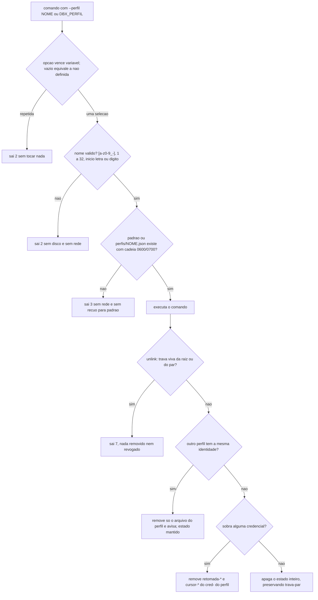

# Fase 8 do backlog (B8): perfis nomeados de credencial (F-18)

## 1. Pedido e porte

| Campo | Valor |
|---|---|
| Pedido | Fase 8 do plano do backlog (`2026-10-19-1023-plano-do-backlog`), depois do merge da PR #49 (fase 7b, F-14). F-18: perfis nomeados de credencial (`--perfil`, `DBX_PERFIL`, `dbx perfis`, `unlink --perfil`, `config --perfil`), RF-120 a RF-132. A fase reabre a `DP-05` ("uma conta só, sem noção de perfil"). |
| Porte | **G**. Altera o desenho fechado de `lib/config` (credencial e segredo), reabre a `DP-05`, mexe em estado persistente por identidade (`cred-`) e cria trava por raiz local. `scripts/porte.sh` não existe neste projeto; o porte segue a classificação do Prompt 1 do log. |
| Log de prompt | [docs/prompts/2026-10-21_1735_backlog-fase-8-perfis.md](../prompts/2026-10-21_1735_backlog-fase-8-perfis.md) (Prompts 1 a 6) |
| Memória de decisão | [.github/agents/memoria/entradas/2026-10-21-1735-perfis.md](../../.github/agents/memoria/entradas/2026-10-21-1735-perfis.md) |
| Memória do lint (fase paralela) | [.github/agents/memoria/entradas/2026-10-21-1845-lint-sequencial.md](../../.github/agents/memoria/entradas/2026-10-21-1845-lint-sequencial.md) |
| Branch / base | `feature/perfis-b8` sobre `develop` @ `dd129fb` (a 7b, PR #49). Checkpoint WIP `915cb52`. Merge da `develop` @ `ebb0d67` (PR #50, `scripts/lint.sh`) em `cee7b04`. Nenhum PR aberto na abertura. |
| Agents | Business Analyst (escopo, RF-120 a RF-132, divergências DIV-236 a DIV-255 propostas); DBA (parecer com condições C1 a C10, C7 substituída pela DIV-237; R1 a R3); Senior Developer (implementação sob `protocolo-tdd` e `protocolo-conformidade`, retomada em tarefas curtas); QA Expert (validação independente, 2 ciclos, suíte de 34 casos); Tech Lead (decisões, nota de conformidade, fechamento); Documentation Writer (este registro). |
| Pareceres | [Parecer TDD](2026-10-21-1735-parecer-tdd-perfis-b8.md) (aprovado); [parecer de conformidade](2026-10-21-1735-parecer-conformidade-perfis-b8.md) (aprovado com ressalvas, nota do Tech Lead); [validação do QA](2026-10-21-1735-validacao-qa-perfis-b8.md) (aprovado no ciclo 2). |
| Data | 2026-10-21 (abertura, parecer do DBA, quedas de sessão, checkpoint, correção do lint, ciclos 1 e 2 de desenvolvimento e de QA, aprovação da suíte pelo solicitante). |

## 2. Causa ou decisão

### 2.1 Contexto

Até a 7b, o Dropbox da máquina era usado por uma conta só. O `credencial.json` era a única credencial, e o estado (`memoria-*`, `retomada-*`, `cursor-*`, `trava-*`) era chaveado pela identidade dela. A F-18 pede perfis nomeados: mais de uma credencial, selecionada por opção ou variável de ambiente, com gestão pela CLI e sem vazamento de segredo.

O parecer do DBA mostrou que nem todo estado é separável por perfil. `retomada-*` e `cursor-*` trazem `cred-` no cabeçalho; a trava do par é chaveada por `cred-` mas não o guarda no conteúdo; `memoria-*` é chaveada por `account_id`; `upload-*` é global; e cada `config` gera um `cred-` novo. Com isso, o `unlink` de um perfil remove só o estado da sua identidade, e o apaga-tudo atual só acontece quando não sobra nenhuma credencial.

### 2.2 Decisões do solicitante

Registradas no log de prompt (Prompt 1, todas na opção recomendada, e Prompt 6):

- **Seleção:** `--perfil NOME` (alias `--profile`) em todos os comandos e `DBX_PERFIL` no ambiente. A opção vence a variável. A variável carrega só o nome, nunca segredo; a `DP-11` continua valendo.
- **Compatibilidade:** o `credencial.json` atual segue como perfil `padrao`, sem mudança para quem não usa perfil. Os demais ficam em `perfis/<nome>.json`, 0600, sob o mesmo diretório de configuração.
- **Gestão:** `dbx perfis` lista nomes e se a credencial está completa, sem segredo; `unlink --perfil NOME` remove; `config --perfil NOME` cria.
- **Nomes:** `[a-z0-9_-]`, de 1 a 32 caracteres, começando por letra ou dígito; fora disso, saída 2.
- **Suíte do QA:** aprovada pelo solicitante em 2026-10-21 ("Aprovo"), 34 casos, sha256 `9e6617c358b02608124dfd721e711226f5c5ca3e2b47b1da7ef44515b05932d7`, versão do ciclo 2 (Prompt 6).

Princípios do Tech Lead, da memória da fase:

- o nome do perfil é dado de caminho e é validado antes de qualquer acesso a disco;
- pedido explícito de perfil inexistente é erro de configuração, sem chamada de rede e sem recuo para o `padrao`;
- o estado nunca é apagado por inteiro enquanto sobrar credencial;
- a variável de ambiente nunca ecoa valor inválido na mensagem.

### 2.3 Decisão arquitetural (ADR resumido)

**Decisão.** Perfis são arquivos `perfis/<nome>.json` (0600) sob o diretório de configuração (0700). O perfil `padrao` é `credencial.json`, sem migração. Nome validado por uma única função (`dbx_config_perfil_validar`, alfabeto explícito, `LC_ALL=C`, sem tocar disco) antes de qualquer composição de caminho. Seleção: opção, depois variável, depois `padrao`; `DBX_PERFIL` vazio equivale a não definida (DIV-240). Trava de execução por raiz local, chave `dev:inode` obtida por `stat -L`, no mesmo mecanismo de aquisição atômica da trava do par (DIV-250). O `unlink` de um perfil remove só `retomada-*` e `cursor-*` cujo `cred-` no cabeçalho bate com o do perfil.

**Alternativas consideradas e descartadas** (fonte: memória da fase, parecer do DBA, log de prompt):

| Alternativa | Motivo do descarte |
|---|---|
| Perfil inexistente recuar para `padrao` | Viola o princípio de erro de configuração explícito; uma execução poderia usar a conta errada sem aviso. |
| `unlink` apagar todo o estado do diretório | Apagaria o estado de outro perfil. Só é feito quando não sobra credencial (DIV-238). |
| Dois perfis com mesma identidade revogam juntos | Revogar a credencial compartilhada derrubaria o outro perfil. Decidido: remove só o arquivo, avisa e mantém o estado (DIV-237 A). |
| Autocompletar chamando `dbx perfis` a cada TAB | Lê as credenciais a cada TAB. Descartada; só a opção é completada nesta fase (DIV-255 C). |
| Completar o valor de `--perfil` nesta fase | Adia para o backlog (F-45), para manter `TC-CPL-04` intacto: o script de completação não lê arquivo do `dbx`. |
| Corrigir de uma vez os pares já vistos (R2 do DBA) | Muda a semântica de `memoria-*` de pares existentes. Adiada para a F-44 (DIV-251, RSK-91). |

**Trade-offs aceitos:**

- Pares já vistos continuam vistos até a F-44; a correção dessa semântica fica fora da fase (RSK-91).
- Podas usam os tetos globais, não por perfil; impacto só em desempenho (R3 do DBA, RSK-92).
- A trava por raiz local é global, não por perfil: duas identidades sobre a mesma raiz física se excluem (DIV-250).
- Credencial ilegível, com outros perfis restantes, não remove estado e avisa; sem outros perfis, remoção total (DIV-253, deliberado).

### 2.4 Divergências decididas pelo Tech Lead

Texto integral na memória [2026-10-21-1735-perfis](../../.github/agents/memoria/entradas/2026-10-21-1735-perfis.md). Resumo:

- **Parecer do DBA:** aceito com condições C1 a C10; C7 substituída pela DIV-237.
- **DIV-236 A:** `unlink` de perfil remove só `retomada-*` e `cursor-*` com o `cred-` do perfil. Credencial ilegível não remove estado e avisa.
- **DIV-237 A:** identidade compartilhada não revoga. Remove só o arquivo, avisa nomeando o outro perfil e mantém o estado desse `cred-`.
- **DIV-238 (C5 do DBA):** estado só é apagado por inteiro quando não sobra nenhuma credencial. Vale para `padrao` e para `--perfil X`.
- **DIV-239 A:** `padrao` é nome válido e equivale a omitir o perfil. `perfis/padrao.json` é reservado.
- **DIV-240:** `DBX_PERFIL` vazio equivale a não definida.
- **DIV-241 C:** a opção vem antes do subcomando em todos os comandos, e depois dele só em `config` e `unlink`. Repetir a opção sai com 2.
- **DIV-242:** como o BA recomendou.
- **DIV-243 a DIV-248:** opção A em todas. A trava viva continua global e recusa o `unlink` com 7. O autocompletar lista só os nomes do diretório.
- **DIV-249:** o BA atualiza o System Design; o Senior Developer atualiza `lib/config.sh` e o preflight e reescreve as duas auditorias da DP-05 com mutação.
- **DIV-250 (R1 do DBA):** trava por raiz local (`dev|inode`) para o `sync --receber`, sem depender do perfil. Ocupada sai 7; respeita `--esperar`.
- **DIV-252 a DIV-254:** mkdir da raiz antes da trava; última credencial ilegível causa remoção total; `padrao` explícito conta como seleção explícita.
- **DIV-255 C:** o valor de `--perfil` não é completado; `TC-CPL-04` fica intacto. A completação do valor vai para a F-45.
- **DIV-251 (R2 do DBA):** fica para a F-44, com o risco RSK-91. Depois da correção, todos os pares voltam a "não visto".
- **R3 do DBA:** podas com tetos globais, aceito como RSK-92.
- **CNF-03 / QA-PF-01, corrigido por decisão do Tech Lead:** `dbx_config_carregar <arquivo> <nome>` revalida o nome antes do disco e confere a cadeia pelo caminho, não pelo rótulo. Ver seção 5.3.

### 2.5 Desvio de processo

- **Demanda do lint no meio da fase.** A PR #50 (`scripts/lint.sh`, memória `2026-10-21-1845-lint-sequencial`) foi feita durante a fase 8, por causa das quedas de sessão descritas na seção 2.6. A `develop` (`ebb0d67`) entrou na branch por merge (`cee7b04`) para que os gates usassem `sh scripts/lint.sh`.
- **Opção oferecida já aplicada.** No Prompt 5 o Tech Lead ofereceu ao solicitante a opção "cortar o source dos comandos (Recomendado)". Ao conferir, o carregamento de `commands/*.sh` no `bin/dbx` já tinha `source=/dev/null`, e a opção não mudava nada. O Tech Lead devia ter conferido antes de oferecer. A bissecção em cópia descartável apontou `lib/cli.sh` (ver seção 2.6). A correção foi delegada ao Senior Developer e registrada no Prompt 5.

### 2.6 Quedas de sessão e checkpoint

- Duas sessões caíram durante a fase, com o shellcheck em processo único (`external-sources=true`, um só processo sobre vários arquivos): consumo de 18 GB e 10 GB, em 2026-10-21 às 16:34 e 17:05. Causa corrigida na PR #50 (lint sequencial, um arquivo por vez, teto de 12 GB por processo).
- Na segunda queda, o Senior Developer parou no limite de 40 turnos sem handback. O trabalho estava intacto e sem commit: 18 arquivos alterados (+1329/−88) e 9 novos, com 241 casos da fase passando (Prompt 4).
- Decisão do solicitante: "Checkpoint, then resume (Recommended)". Commit WIP `915cb52` em `feature/perfis-b8`, local, sem push. A retomada seguiu em tarefas curtas.
- Causa do lint do `bin/dbx`: a diretiva `source=lib/json.sh` e `source=lib/config.sh` em `_dbx_cli_carregar_config` (`lib/cli.sh`) fazia o shellcheck reanalisar os arquivos. Antes da correção o `bin/dbx` estourava o teto (morto em duas rodadas com 14 GB). A correção usa `source=/dev/null` com comentário (ver CNF-02 descartado na seção 5.2).

## 3. Escopo técnico e arquivos modificados

Diff total da fase contra `dd129fb`: **35 arquivos, +4038/−90**. Esse total inclui o que veio da `develop` pelo merge `cee7b04` (`scripts/lint.sh`, `tests/...` do lint, `CLAUDE.md`, `README.md` e os docs da demanda do lint). O parecer de conformidade exclui esse conjunto e cobre 27 arquivos da própria fase.

- **Código de produção:** `lib/config.sh` (validação de nome, resolução de perfil, cadeia 0600/0700, listagem, `dbx_config_carregar`), `lib/cli.sh` (`--perfil`, `DBX_PERFIL`, `source=/dev/null`), `bin/dbx` (seleção antes do preflight, rede e disco), `lib/state.sh` (trava por raiz local `dev:inode`), `lib/cmd.sh` (`dbx_cmd_ciclo_trava_raiz`), `lib/preflight.sh`, `commands/perfis.sh` (novo), `commands/unlink.sh` (`--perfil`, remoção seletiva), `commands/config.sh` (`--perfil`), `commands/diagnostico.sh` (só as linhas que citam o perfil), `commands/sync.sh` (trava por raiz), `completions/dbx.bash` (completa só a opção).
- **Testes novos:** `tests/unit/perfis_cli_test.sh` (9 casos), `tests/unit/perfis_config_test.sh` (36 casos no ciclo 1; 38 no ciclo 2), `tests/unit/state_trava_raiz_test.sh` (9), `tests/integracao/perfis_test.sh` (40), `tests/integracao/perfis_trava_raiz_test.sh` (10), `tests/integracao/perfis_unlink_test.sh` (18 no ciclo 1; 19 com o caso `pfu08` do ciclo 2), `tests/integracao/qa_perfis_b8_test.sh` (suíte do QA, 34 casos, sha256 `9e6617c3...932d7`).
- **Requisitos e design:** `docs/requisitos/escopo-requisitos-e-criterios-de-aceite.md` (RF-120 a RF-132, DIV-236 a DIV-255), `docs/requisitos/decisoes-pendentes.md` (`DP-05` reaberta, `DP-11` mantida), `docs/requisitos/funcionalidades-candidatas.md` (F-44 e F-45), `docs/requisitos/riscos-restricoes-e-licenciamento.md` (RSK-91 e RSK-92), `docs/arquitetura/system-design.md` (DIV-249). Os cinco arquivos foram localizados por busca dos identificadores da fase; a lista exata de linhas alteradas por arquivo não foi conferida por `git diff --stat` nesta execução (ver seção 10).
- **Registro e log:** `docs/prompts/2026-10-21_1735_backlog-fase-8-perfis.md`, `.github/agents/memoria/entradas/2026-10-21-1735-perfis.md`, `docs/reviews/2026-10-21-1735-*.md` (este registro e os três pareceres).

## 4. Diagrama (Mermaid)

Fluxo de seleção de perfil e de remoção pelo `unlink`, como implementado. O detalhe da trava por raiz e das auditorias da DP-05 está nos pareceres.

## 5. Evidências de validação

### 5.1 Testes rodados

Contagens literais dos pareceres do Senior Developer ([TDD](2026-10-21-1735-parecer-tdd-perfis-b8.md)) e do QA ([validação](2026-10-21-1735-validacao-qa-perfis-b8.md)).

**Vermelho contra a base `dd129fb` (ciclo 1 do Senior Developer).** Os seis arquivos de teste novos foram copiados para um worktree descartável em `dd129fb`. O harness para no primeiro caso reprovado (Regra 9), portanto a prova é por arquivo.

| Arquivo | Casos | Resultado na base | Primeiro caso reprovado |
|---|---|---|---|
| `unit/perfis_cli_test.sh` | 9 | REPROVADO (1; 8 não executados) | `pfn09_variavel_invalida_so_e_validada_quando_usada` |
| `unit/perfis_config_test.sh` | 36 | REPROVADO (1; 1 aprovado antes; 34 não executados) | `pfc02_outro_nome_resolve_perfis_nome_json` |
| `unit/state_trava_raiz_test.sh` | 9 | REPROVADO (1; 8 não executados) | `pft01_segunda_aquisicao_da_mesma_raiz_recusa_com_conflito` |
| `integracao/perfis_test.sh` | 40 | REPROVADO (1; 39 não executados) | `pfa01_a_pfa03_ajuda_lista_perfis_a_opcao_e_a_variavel` |
| `integracao/perfis_trava_raiz_test.sh` | 10 | REPROVADO (1; 9 não executados) | `pfe06_cursor_de_outra_identidade_...` (`opcao global desconhecida: --perfil`) |
| `integracao/perfis_unlink_test.sh` | 18 | REPROVADO (1; 17 não executados) | `pfe01_leitores_expoem_cred_lendo_so_o_cabecalho` |

Resultado: 6 de 6 arquivos reprovam na base; 6 casos reprovados confirmados, 1 aprovado (guarda de regressão), 115 não executados por interrupção.

**Execuções verdes (contagens aprovados/reprovados/pulados):**

| Comando | Resultado |
|---|---|
| `bash tests/run.sh perfis_cli` | 9/0 (ciclo 1) |
| `bash tests/run.sh perfis_config` | 36/0 (ciclo 1); 38/0/0 (ciclo 2) |
| `bash tests/run.sh state_trava_raiz` | 9/0 |
| `bash tests/run.sh perfis` | 40/0 |
| `bash tests/run.sh perfis_unlink` | 19/0 (18 + 1 novo) (ciclo 1); 19/0/0 (ciclo 2) |
| `bash tests/run.sh cli` (`cli_test`, 2 arquivos) | 26/0 |
| `bash tests/run.sh config` | 79/0/0 (ciclo 2) |
| `bash tests/run.sh auth` | 42/0/0 (ciclo 2) |
| `bash tests/run.sh perfis_trava_raiz` | vermelho na base (1 reprovado, 9 não executados); verde: 10 aprovados, 0 reprovados, 0 pulados (Tech Lead, 2026-10-21) |
| `bash tests/run.sh qa_perfis_b8` (QA, ciclo 2) | 34/0/0, APROVADA |
| `bash tests/run.sh json` (QA, ciclo 2) | 62/0/0, APROVADA |
| `bash tests/run.sh harness` (QA, ciclo 2) | 22/0/0, APROVADA |

Pulados: 0 em todos os arquivos da fase. Observação: no ciclo 2 do Senior Developer, a execução de `qa_perfis_b8` registrou 30 aprovados e 1 reprovado (qpf31, esperado, antes da correção do CNF-03); o QA corrigiu a suíte e o resultado final é 34/0/0.

**Mutantes das guardas (ciclo 1 do Senior Developer).** Cada mutação foi aplicada em produção, só o arquivo de teste indicado foi executado e a mutação foi desfeita com `git checkout -- <arquivo>`.

| # | Guarda | Mutação | Resultado |
|---|---|---|---|
| 1 | Validação do nome antes de disco (`lib/config.sh:181`) | aceita qualquer nome | morto (`pfc_composicao_so_com_nome_validado`) |
| 2 | Perfil inexistente não recua ao `padrao` (`lib/config.sh:260`) | resolve sempre `padrao` | morto (2 de 2) |
| 3 | Permissão 0600 do perfil (`lib/config.sh:525`) | `chmod 644` | morto (2 de 2) |
| 4 | `perfis/padrao.json` reservado (`lib/config.sh:358`) | listagem não exclui | morto (2 de 2) |
| 5a | `unlink` só remove `retomada-*` do próprio `cred-` (`commands/unlink.sh:229`) | filtro removido | morto (`pfu01_pfe02_pfe04_...`) |
| 5b | Não revoga com identidade compartilhada (`commands/unlink.sh:425`) | `-eq 0` vira `-ge 0` | morto (`pfu08_identidade_compartilhada_...`) |
| 5c | Aviso "NAO sera revogado" (`commands/unlink.sh:370`) | `-gt 0` vira `-gt 99` | **sobreviveu** no ciclo 1; corrigido (ver abaixo) |
| 6 | Trava por raiz local recusa com 7 (`lib/state.sh:1116`) | chave com `$RANDOM` | morto (2 de 2) |
| 7a | `DBX_PERFIL` vazio equivale a não definida (`lib/config.sh:206`) | teste removido | morto só por `perfis_config_test` |
| 7b | Opção repetida sai com 2 (`lib/cli.sh:281`) | condição invertida | morto (3 de 3) |
| 8 | `dbx perfis` não imprime segredo (`commands/perfis.sh:51`) | campo `refresh` com o conteúdo | morto (`pfl06_nenhum_segredo_nem_identidade_em_nenhum_modo`) |

Mutantes: 10 mortos de 11 no ciclo 1. O sobrevivente 5c foi corrigido pelo caso `pfu08_aviso_de_credencial_compartilhada_sai_no_stderr_com_o_texto`, com vermelho comprovado com `-gt 99` (reprova em "aviso nomeia a origem"). Esse vermelho é a própria reaplicação do mutante depois do caso novo: com `-gt 99`, o `pfu08` reprova; desfeita a mutação, passa (11 de 11 mortos). O mutante 7a só é morto por `perfis_config_test`; a CLI e a integração não o distinguem (aceito, sem ação).

**Guarda de remoção de casos.** `bash scripts/verificar-remocao-de-casos.sh`: ciclo 1, "2118 -> 2119 caso(s); nenhuma redução não declarada"; ciclo 2, "2118 -> 2121".

**Lint.**

- Antes (lint da fase, `sh scripts/lint.sh` nos arquivos shell da fase, com `external-sources=true`): **208,94 s, exit 1, 10 achados** (`lib/cli.sh` 3, testes 7). `bin/dbx` foi morto pelo teto de memória.
- Medição prévia em cópia descartável (Tech Lead): `bin/dbx` 4747908 KB, 29,53 s, 0 achados; `lib/cli.sh` 31520 KB, 0,20 s, 0 achados.
- Depois da correção, nos 7 arquivos do ciclo 1 do Senior Developer: `sh scripts/lint.sh lib/cli.sh bin/dbx tests/unit/perfis_cli_test.sh ...`, 38,27 s, exit 0, 0 achados.
- Lint da fase inteira (20 arquivos shell): **`sh scripts/lint.sh`, exit 0, 0 achados, 71,22 s**.
- Lint de `tests/integracao/qa_perfis_b8_test.sh` (QA): exit 0.

**Suíte completa local (regra 8).** Comando oficial `sh scripts/suite-completa.sh`: **pendente**. O Tech Lead preenche depois da execução.

### 5.2 Gates

| Gate | Skills aplicadas | Achados | Veredito |
|---|---|---|---|
| `protocolo-tdd` ([parecer](2026-10-21-1735-parecer-tdd-perfis-b8.md)) | Regras 1 a 9 | Sem bloqueante nem maior. Menor: SC2034, SC2097/SC2098, SC2086 corrigidos ou justificados; achado 5c corrigido; achado 6 (mutante 7a só em `perfis_config_test`) aceito | **Aprovado** (ciclo 1 e ciclo 2) |
| `protocolo-conformidade` ([parecer](2026-10-21-1735-parecer-conformidade-perfis-b8.md)) | `clean-architecture`, `shellcheck-configuration`, `security-best-practices` | 0 bloqueante, 0 maior; CNF-01, CNF-02, CNF-03, CNF-04, CNF-05 (ver seção 5.4) | **Aprovado com ressalvas** |

### 5.3 QA

Detalhe em [validação do QA](2026-10-21-1735-validacao-qa-perfis-b8.md). O QA executou a suíte `qa_perfis_b8_test.sh` contra o `bin/dbx` real, com duplo de `curl` próprio e sem rede real.

- **Ciclo 1:** QA-PF-01 (= CNF-03), menor, confirmado: `dbx_config_carregar <arquivo> <nome>` não revalidava o nome; com rótulo `padrao` e arquivo de `perfis/`, a cadeia `dbx/` para `perfis/` não era conferida. Sem exploração pela CLI, porque só `perfis` e `unlink` chamam, com caminho de `caminho_de_perfil`.
- **Ciclo 2 (correção de QA-PF-01):** o ramo de 2 argumentos passou a validar o nome antes do disco e a conferir a cadeia pelo caminho. Os casos qpf31 e qpf33 foram invertidos para afirmar a recusa (nome `../x` sai `rc=2 motivo=perfil_invalido`; `dbx/` 777 com rótulo `padrao` sai `rc=3`). **QA-PF-01: corrigido e verificado.**
- **Veredito final (ciclo 2): Aprovado.** Sem achado bloqueante ou maior.
- **Cenários (34):** nomes hostis (17 nomes em `space`, `unlink`, `config`, `perfis` e opção global, sempre exit 2 sem rede e com disco intacto); symlink e permissão recusados (exit 3); seleção, `DBX_PERFIL` com segredo recusado sem eco, vazio como não definido, opção repetida exit 2; `unlink` seletivo e identidade compartilhada sem revogação; credencial ilegível sem remoção de estado; trava de raiz exit 7 sem escrever e sem identidade na mensagem; `perfis` sem segredo em nenhum modo.
- **Observação:** QA-PF-02 (informativo) está na seção 6.1.

### 5.4 Achados de conformidade e destino

| ID | Severidade | Situação | Destino |
|---|---|---|---|
| CNF-01 | Menor | `stat -L -c '%d:%i'` em `lib/state.sh` é só GNU; mesmo padrão do resto de `lib/state.sh` | Limite de plataforma registrado; sem correção nesta fase. Backlog (seção 8). |
| CNF-02 | Menor | Diretiva `source=/dev/null` em `_dbx_cli_carregar_config` | **Descartado pelo Tech Lead**: cada `.` tem a própria diretiva. O achado partiu de leitura parcial. |
| CNF-03 | Menor | Segundo argumento de `dbx_config_carregar` não revalidado | **Corrigido** no ciclo 2 (QA-PF-01, seção 5.3). O parecer de conformidade não tem ciclo 2; a correção foi verificada pelo QA. |
| CNF-04 | Menor | Falha de permissão ao obter a trava de raiz segue sem trava, com aviso (como a do par) | Aceito por simetria com a trava do par. Protege concorrência; a guarda destrutiva independe dela. Registrado aqui. |
| CNF-05 | Informativo | Credencial simbólica pendente não entra como `padrao` em `perfis_listar` | Sem efeito destrutivo; nenhuma ação. |

## 6. Riscos, impacto e rollback

### 6.1 Riscos residuais

- **RSK-91 (F-44, DIV-251, R2 do DBA):** pares já vistos não voltam a "não visto" depois da correção da semântica de `memoria-*`. Adiado para o backlog.
- **RSK-92 (R3 do DBA):** podas usam os tetos globais, não por perfil. Impacto só em desempenho. Aceito.
- **QA-PF-02 (informativo, DIV-253):** credencial ilegível é removida do disco com saída 14 e erro "removida sem que a revogação fosse emitida"; o estado é preservado. O token pode continuar válido na Dropbox. Comportamento declarado e coerente com DIV-253; registrado para ciência.
- **Compartilhamento de identidade (DIV-237):** dois perfis com a mesma identidade. O `unlink` não revoga; o usuário precisa saber disso. O aviso do caso 5c foi coberto só depois do ciclo 1.
- **Trava por raiz (RF-132):** raiz física compartilhada entre perfis sai 7 até a liberação. Respeita `--esperar`, sem dobrar o teto.
- **Limite de plataforma (CNF-01):** `stat -c` só GNU, como o resto de `lib/state.sh`.
- **Lint:** o shellcheck em processo único estourou memória em duas sessões. Mitigado pela PR #50 (lint sequencial); o teto é por processo.
- **Desempenho:** não medido; fora do escopo da fase.

### 6.2 Impacto

- **Contrato externo:** nenhum endpoint novo. Nenhuma chamada de rede nova; a seleção e a validação do nome acontecem antes da rede.
- **Estado:** `cred-` no cabeçalho de `retomada-*` e `cursor-*` passa a ser critério de remoção do `unlink` de perfil. Trava `trava-*` por raiz local (`dev:inode`), com o mesmo registro e a mesma aquisição atômica da trava do par.
- **Credenciais:** `perfis/<nome>.json` 0600 em `perfis/` 0700; `credencial.json` do `padrao` sem mudança.
- **Códigos de saída:** `2` para nome inválido, opção repetida ou uso inválido; `3` para perfil inexistente ou cadeia de permissão inválida; `7` para trava viva ou conflito de raiz; `14` para credencial ilegível removida (QA-PF-02).
- **Variável de ambiente:** `DBX_PERFIL` carrega só o nome; nunca segredo; valor inválido não é ecoado.
- **Autocompletar:** completa só a opção `--perfil`, não o valor (DIV-255 C).

### 6.3 Rollback

- `git revert` do merge da fase em `develop` (`git revert -m 1 <merge>`). Sem migração de dado.
- Após o revert, perfis em `perfis/` ficam sem leitura pela versão anterior. O `credencial.json` do `padrao` continua valendo, sem mudança.
- A versão anterior não conhece `--perfil` nem `DBX_PERFIL`; `dbx perfis` deixa de existir.
- A trava `trava-*` por raiz local é uma nova chave no mesmo diretório; a versão anterior a ignora.
- O `unlink` da versão anterior apaga o diretório de estado inteiro (exceto travas vivas), o que é o comportamento anterior.

## 7. Mudanças de comportamento

- **Opções novas:** `--perfil NOME` e `--profile NOME` em todos os comandos; `DBX_PERFIL` no ambiente. Opção vence variável; repetir a opção sai com 2.
- **Novos comandos:** `dbx perfis` (lista nomes e completude, sem segredo); `config --perfil NOME` (cria); `unlink --perfil NOME` (remove seletivamente).
- **`padrao`:** nome reservado que equivale a omitir o perfil; `perfis/padrao.json` é ignorado como entrada anômala.
- **Perfil inexistente:** saída 3 sem rede e sem recuo para `padrao`.
- **`unlink`:** remoção seletiva por `cred-` do cabeçalho; estado inteiro só quando não sobra credencial; identidade compartilhada não revoga; credencial ilegível não remove estado (exceto quando é a última).
- **Trava por raiz local:** `sync --receber` sai 7 se a raiz física já estiver ocupada, inclusive por outro perfil.
- **Autocompletar:** só a opção; o valor não é completado.

## 8. Próximos passos

- **F-44 (backlog, DIV-251, RSK-91):** corrigir a semântica de `memoria-*` e voltar pares já vistos a "não visto".
- **F-45 (backlog, DIV-255):** completar o valor de `--perfil` no autocompletar, sem ler arquivo do `dbx`.
- **RSK-92:** podas por perfil, se a medição mostrar necessidade.
- **CNF-01:** portabilidade de `stat` (ramo BSD) se a plataforma for ampliada.
- **CNF-04:** ver se a falha de trava de raiz deve virar erro, se a concorrência passar a ser risco real.
- **CNF-05:** nenhuma ação; registrado.
- **QA-PF-02 (sugestão deste registro, não decidida pelo Tech Lead):** avaliar se a mensagem de credencial ilegível removida deve orientar a revogação manual do token.
- **Suíte completa local e PR:** `sh scripts/suite-completa.sh` pendente; PR para `develop` pendente.

## 9. Diagrama de contexto (Mermaid)

Diagrama de relacionamento entre perfil, `cred-`, trava por raiz e estado por identidade está nos pareceres do DBA e no System Design (DIV-249). Esta seção não reproduz o diagrama, para não duplicar a fonte.

## 10. Aceites

- **Solicitante, regra 12:** suíte do QA aprovada em 2026-10-21 ("Aprovo"), 34 casos, sha256 `9e6617c358b02608124dfd721e711226f5c5ca3e2b47b1da7ef44515b05932d7`, versão do ciclo 2. O Tech Lead conferiu antes as auditorias `json` (62/0) e `harness` (22/0).
- **QA Expert:** validação independente aprovada no ciclo 2 ([validação](2026-10-21-1735-validacao-qa-perfis-b8.md)).
- **Senior Developer:** gates de TDD e de conformidade ([TDD](2026-10-21-1735-parecer-tdd-perfis-b8.md), [conformidade](2026-10-21-1735-parecer-conformidade-perfis-b8.md)).
- **Tech Lead:** decisões DIV-236 a DIV-255 registradas na memória [2026-10-21-1735-perfis](../../.github/agents/memoria/entradas/2026-10-21-1735-perfis.md). Aceite final depende da suíte completa (`pendente`), do commit (`pendente`) e da PR (`pendente`). Revisão consolidada e aprovação final: `pendente`, a cargo do Tech Lead.
- **Merge:** fica com o solicitante.
- **Commit:** `pendente`. Este registro não faz commit; o commit é feito pelo fluxo da fase.
