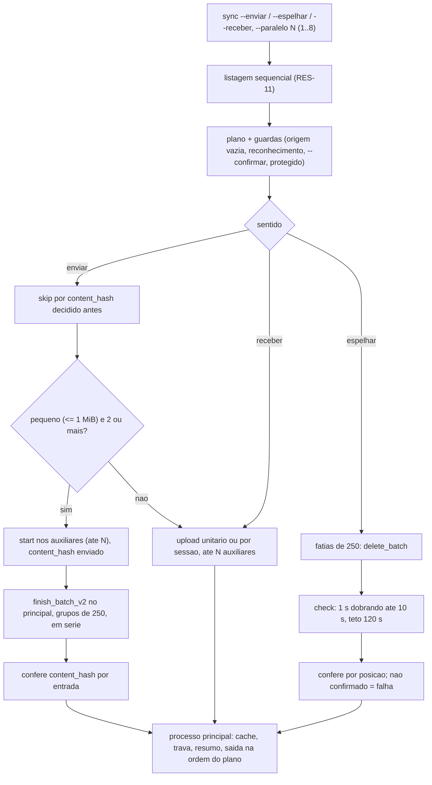

# Fase 9 do backlog (B9): desempenho, paralelismo e lote (F-09, F-08, F-34)

## 1. Pedido e porte

| Campo | Valor |
|---|---|
| Pedido | "analise e implemente a fase 9 do backlog" (Prompt 1 do log). F-09 (`--paralelo N`, `DBX_PARALELO`), F-08 (lote), F-34 (bancada de medição com medição antes e depois). RF-133 a RF-139, RNF-38 (e RNF-21 emendado). |
| Porte | **G**. Muda o modelo de execução (sequencial para concorrente), toca exclusão (destrutiva), integração externa (`delete_batch`, `check`, `finish_batch_v2`) e o System Design. `scripts/porte.sh` não existe; o porte segue o Prompt 1 do log. |
| Log de prompt | [docs/prompts/2026-10-21_2300_backlog-fase-9-desempenho.md](../prompts/2026-10-21_2300_backlog-fase-9-desempenho.md) (Prompts 1 a 4) |
| Memória de decisão | [.github/agents/memoria/entradas/2026-10-21-2300-desempenho.md](../../.github/agents/memoria/entradas/2026-10-21-2300-desempenho.md) |
| Requisitos | Seção 5.18 do [escopo](../requisitos/escopo-requisitos-e-criterios-de-aceite.md) (RF-133 a RF-139, RNF-38); DIV-256 a DIV-281 na seção 9 |
| Branch / base | `feature/desempenho-b9` sobre `develop` @ `334394e` (merge da PR #51, fase 8). Nenhum PR aberto na abertura. |
| Agents | Business Analyst (requisitos); Senior Developer (F-09, F-08, fechamento do código); QA Expert (duplos e validação independente); Tech Lead (decisões, bancada, correções); Documentation Writer (este registro). |
| Pareceres | [Validação do QA](2026-10-21-2300-validacao-qa-desempenho-b9.md) (aprovado com ressalvas). Parecer de TDD e parecer de conformidade: **pendentes** (ver seção 5.2); este registro não os inventa. |
| Data | 2026-10-21 e 2026-10-22 |

## 2. Causa ou decisão

### 2.1 Contexto

Até a fase 8, o `sync` transferia um arquivo por vez e apagava e enviava item a item. O F-34 exigia medição prévia antes de qualquer otimização (RNF-38(a)). A bancada mediu a base `334394e` na conta real: envio de 1052 arquivos em 1996.418 s com 1056 chamadas, e recebimento em cerca de 1330 s. A fase reduz o número de chamadas com lotes (F-08) e permite transferências concorrentes, limitadas a 8 e com padrão 1 (F-09), sem mudar resultado (P1) e sem afrouxar guarda destrutiva (P2).

### 2.2 Decisões do solicitante

Fonte: log de prompt e memória da fase.

- **Medição (F-34):** conta real, pasta dedicada e descartável. Cada execução contra a conta real exige o ok na hora (feito para a base, para o recebimento de diagnóstico e, depois, para a final).
- **Paralelismo:** só nas transferências do `sync`; listagem sempre sequencial (RES-11, RNF-21).
- **Lote:** exclusão em lote e envio em lote de pequenos. A opção "metadados em lote" foi **retirada** (a API não tem `get_metadata` em lote): vai ao backlog como F-46.
- **Volume:** misto padrão (1000 × 1–50 KB, 50 × 1–5 MB, 2 × 100 MB). A soma é cerca de 375 MB, não os "cerca de 500 MB" escritos na opção; valem as quantidades.
- **DIV-269 (2026-10-22):** "Reter item a item". O `reter` fica com `delete_v2` por item e RF-97 intacto; o lote de exclusão vale só para `sync --espelhar`. DIV-260 ficou sem efeito.
- **Medição final:** "N=1 e N=4", depois da aprovação do QA, mesmo volume e semente da base.
- **Suíte do QA:** "Aceito". **QA-B9-01:** "Corrigir nesta fase".
- **Recebimento de diagnóstico:** "Repetir só o recebimento", depois da falha `14` da primeira medição.

### 2.3 Decisões do Tech Lead (com a DIV)

| DIV | Decisão |
|---|---|
| DIV-256 | Limiar de "pequeno" para o lote de envio: 1 MiB, constante única em `lib/transfer`. |
| DIV-257 | Com N>1, saída na ordem do plano, com buffer por item. |
| DIV-258 | `429` não reduz N; vale o `Retry-After` por processo e o `429` é contado. |
| DIV-259 | Exclusão em fatias de 250 (a API não declara limite numérico; DIV-279). |
| DIV-261 | `--limite-banda` é o teto total, dividido por N. |
| DIV-262 | `check` com recuo de 1 s dobrando até 10 s, teto de 120 s por fatia; estouro falha a fatia inteira sem repetir a exclusão. |
| DIV-263 | Nenhum estado de lote entre execuções. |
| DIV-264 | `start`/`append` nos auxiliares; `finish_batch_v2` só no processo principal, em série. |
| DIV-265 | Bancada em `scripts/bancada.sh`; confirmação por `--confirmo-conta-real`, passada só após o ok do solicitante. |
| DIV-266 | Linha `paralelo` no `diagnostico` só com `DBX_PARALELO` definida. |
| DIV-267 | Piso da banda por transferência mantido, documentado no `help sync` e no README. |
| DIV-268 | Resumo de `429` no `--debug` só com N>1. |
| DIV-270 | `finish_batch_v2` em grupos de 250 (o parser JSON recusa corpo acima de 256 KiB). |
| DIV-271 | Cache do envio é o resumo local. |
| DIV-272 | Lote de envio só com 2 ou mais pequenos. |
| DIV-273 | Falha de chamada derruba a fatia de exclusão, sem retentativa por item. |
| DIV-274 | Linhas de falha do envio em lote na ordem do plano. |
| DIV-275 | Interrupção durante o `check`: a fatia pode estar apagada no servidor; sai `14`, sem repetir (itens na lixeira, RF-98). |
| DIV-276, DIV-277 | Trava do duplo de lote (`noclobber`); `start` com o mesmo N, `finish_batch_v2` só após todos os `start`, sem sobreposição. |
| DIV-278 | Bloqueante achado pelo Tech Lead: o lote passa a conferir `content_hash` de cada entrada e o `start` envia o hash local. |
| DIV-279 | Limites oficiais conferidos no Context7 (2026-10-22); fatias de 250 mantidas. |
| DIV-280 | `files/upload` unitário nunca conferiu `content_hash`: fora da fase, backlog F-47. |
| DIV-281 | O parser lê `entries[k].content_hash` plano ao lado de `.tag`; a medição final confirma. |

### 2.4 Escopo entregue

- **F-09:** `--paralelo N` (alias `--parallel`) e `DBX_PARALELO` no `sync`; padrão 1, máximo 8; N=1 sem processo auxiliar; só o processo principal grava estado.
- **F-08, apenas** a exclusão em lote no `sync --espelhar` e o envio em lote de pequenos no `sync --enviar`. Componente novo `lib/lote.sh`.
- **F-34:** `scripts/bancada.sh` com marcador, pasta dedicada, limpeza por `trap` e máscara dos logs (QA-B9-01 corrigido).

### 2.5 Fora do escopo

- Exclusão em lote no `reter`: fica item a item (DIV-269; RF-97 intacto).
- Metadados em lote: F-46, inviável na API atual.
- `files/upload` unitário conferir `content_hash`: F-47 (DIV-280).
- Paralelismo em `upload`/`download` avulsos e na listagem; `move/copy` em lote; ajuste dinâmico de N; retomada de lote entre execuções; bancada em CI.

## 3. Arquivos impactados

Conferido pelo Tech Lead com `git diff --stat` e `git status --short` em 2026-10-22: 25 arquivos rastreados alterados (1048 inserções, 90 remoções) e 11 novos.

- **Código novo:** `lib/lote.sh` (exclusão e envio em lote), `scripts/bancada.sh` (bancada de medição).
- **Código alterado:** `commands/sync.sh` (paralelismo, lote de exclusão e de envio, mensagem de interrupção), `lib/transfer.sh` (limiar de 1 MiB, `start` de pequeno com `content_hash`, conferência de resumo única), `lib/cli.sh` (validação de `--paralelo`), `lib/http.sh` (contador de `429`), `commands/upload.sh` (pasta ignora `DBX_PARALELO`), `commands/diagnostico.sh` (linha `paralelo`), `bin/dbx` (ajuda do `sync`), `completions/dbx.bash`, `README.md`.
- **Inalterado por decisão:** `commands/reter.sh`, `lib/retencao.sh` e os testes de retenção, iguais à `develop` (`DIV-269`).
- **Testes novos:** `tests/integracao/paralelo_test.sh`, `tests/integracao/lote_test.sh`, `tests/support/lote_duplo.sh`, `tests/integracao/qa_desempenho_b9_test.sh` (QA), `scripts/tests/bancada.bats`; `tests/unit/cli_test.sh` (+1 caso).
- **Testes adaptados, só no duplo de `curl`, sem afrouxar asserção:** `sync_test.sh`, `banda_test.sh`, `filtros_test.sh` (`div95` reforçado para o corpo do `delete_batch`), `cursor_test.sh` (auditoria de ordem cobre o novo ponto de exclusão), `comandos_test.sh`, `qa_cache_unico_p3`, `qa_docs_aliases_p4`, `qa_filtros_banda_b4`, `qa_integridade_p1` (UTC provado no commit do lote), `qa_robustez_rede_p2` (+2 casos). `qa_cursor_b7b` não foi tocado.
- **Requisitos e design:** seção 5.18 e `DIV-256` a `DIV-281` do escopo (v1.25), `funcionalidades-candidatas.md` (`F-46`, `F-47`), `decisoes-pendentes.md`, `riscos-restricoes-e-licenciamento.md`, `docs/arquitetura/system-design.md` (seção "Desempenho", v1.18).
- **Registro e trilha:** este arquivo, a [validação do QA](2026-10-21-2300-validacao-qa-desempenho-b9.md), os pareceres de conformidade e de TDD, o log de prompt e a memória `2026-10-21-2300-desempenho`.

## 4. Diagrama (Mermaid)

## 5. Evidências de validação

### 5.1 Testes rodados

Contagens literais do log e do relatório do QA (aprovados/reprovados/pulados quando informados).

| Comando | Resultado | Fonte |
|---|---|---|
| `bash tests/run.sh paralelo` | 14/0 | log, Prompts 2 e 4 |
| `bash tests/run.sh lote` | 31 aprovados, 0 reprovados, 0 pulados | QA e Prompt 4 |
| `bash tests/run.sh qa_desempenho_b9` | 15/0/0 (e 15/0 após a correção de QA-B9-01) | QA e Prompt 4 |
| `bash tests/run.sh qa_integridade_p1` | 27/0/0 | QA |
| `bash tests/run.sh qa_robustez_rede_p2` | 21/0/0 | QA |
| `bash tests/run.sh reter` | 84/0/0 | QA e Prompt 4 |
| `bash tests/run.sh json` | 62/0/0 | QA e Prompt 4 |
| `bash tests/run.sh harness` | 22/0/0 | QA e Prompt 4 |
| `sync_test` | 85 | Prompt 4 |
| `upload` / `retomada_upload` / `composicao` | 39 / 39 / 28 | Prompt 4 |
| `banda` / `filtros` / `cursor` / `trava` / `perfis` | 34 / 58 / 110 / 101 / 150 | Prompt 4 |
| `comandos` | 119/0 | Prompt 4 |
| `qa_cache_unico_p3` / `qa_docs_aliases_p4` | 33 / 16 | Prompt 4 |
| Bats da bancada | 11/11 | Prompt 4 (Tech Lead) |
| `bash scripts/verificar-remocao-de-casos.sh` | 2155 -> 2157 casos; nenhuma redução não declarada | QA |
| `sh scripts/lint.sh` | exit 0 nos 3 arquivos do QA; "lint limpo" após a máscara da bancada | QA e Prompt 4 |
| **Suíte completa local (`sh scripts/suite-completa.sh`)** | **(a medir)** | pendente |

O red do RF-137 foi registrado de forma literal pelo Senior Developer: lou01 "esperado 5, obtido 0". Sem o parecer de TDD, a prova de vermelho dos demais casos não está consolidada neste registro.

### 5.2 Gates

| Gate | Situação |
|---|---|
| `protocolo-tdd` | **Pendente.** Arquivo de parecer não encontrado em `docs/reviews/`; o registro aponta a lacuna e não a preenche. |
| `protocolo-conformidade` | **Pendente.** Idem. |

### 5.3 QA

Detalhe em [validação do QA](2026-10-21-2300-validacao-qa-desempenho-b9.md). Veredito: **aprovado com ressalvas**, sem achado bloqueante ou maior. Aceite da suíte pelo solicitante: "Aceito" (2026-10-22).

| ID | Severidade | Situação |
|---|---|---|
| QA-B9-01 | Menor | **Corrigido** pelo Tech Lead na fase: máscara dos logs da bancada ampliada (Basic em base64, `refresh_token`, `access_token`, `app_secret`, `app_key`, `client_secret`, `client_id`, `code`); `qdb15` invertido para `assert_nao_contem`; `qa_desempenho_b9` 15/0, bats 11/11. |
| QA-B9-02 | Informativo | A memória guarda hash local, não confirmação remota (DIV-271). Sem ação. |
| QA-B9-03 | Informativo | Falha de integridade no lote sai `14` com a classe `integridade` por item, não `11` (RF-29/35). Sem ação. |

### 5.4 Medição antes e depois

Bancada: `bin/dbx`, semente 42, 1052 arquivos, 369 MB em disco, N=1 na base.

| Etapa | Base `334394e` (N=1) | Final N=1 | Final N=4 |
|---|---|---|---|
| envio | 1996.418 s, 1056 chamadas, 0 `429`, status 0 | (a medir) | (a medir) |
| reenvio sem mudanças | 24.838 s, 14 chamadas, 0 `429`, status 0 | (a medir) | (a medir) |
| recebimento (diagnóstico) | 1327.982 s, 1052 arquivos, 0 falhas, status 0 | (a medir) | (a medir) |

A base de recebimento adotada é a do diagnóstico (1327.982 s). A primeira execução saiu `14` com 1344.439 s e 1066 chamadas, sem causa conhecida (ver seção 6.1). Pendente: o limite de RNF-38(b) ("N=1 não pior que `334394e` além da variação medida") é fixado com estas medições.

## 6. Riscos, impacto e rollback

### 6.1 Ressalvas e riscos residuais

- **Testes do F-09 escritos depois do código.** Desvio do red-green, declarado pelo Senior Developer no handback (Prompt 2). Os 14 casos de `paralelo_test` passam, mas não houve vermelho prévio.
- **Guarda `_dbx_cmd_sync_protegido` sem teste de caixa-preta capaz de matar a mutação.** O plano já descarta o item protegido, então a mutação não é detectada; a guarda por item antes da fatia fica como defesa em profundidade (Prompt 2). A guarda destrutiva continua sendo a do plano.
- **Falha transitória do primeiro recebimento da base.** Status `14` (`nao_concluida`) e saída apagada pelo `trap` da bancada; causa desconhecida. A repetição do recebimento deu status 0, 1052 arquivos, 0 falhas e árvore idêntica (`diff -rq`). A bancada passou a preservar a saída de cada etapa e a garantir a limpeza.
- **Suíte inteira parou uma vez em `retomada_download` caso `rmo01`.** Não reproduziu isolado (27/27) e coincidiu com a bancada consumindo memória em paralelo; a suíte completa será refeita antes do push (pendente).
- **Lacunas declaradas pelo QA:** `Retry-After`/`429` sob paralelismo, sinais (INT/TERM) com N>1 e a ordem de saída com falhas sob N=8 não foram exercitados pela suíte do QA.
- **DIV-275:** interrupção durante o `check` pode deixar a fatia (até 250 itens) apagada no servidor sem ser contada; sai `14`, itens na lixeira.
- **DIV-267:** com `--limite-banda` e N grande, a soma pode exceder o teto total por causa do piso por transferência.
- **DIV-277:** `start` e `finish_batch_v2` sem sobreposição; o ganho do lote é medido pela bancada.
- **DIV-280 / F-47:** o `files/upload` unitário não confere `content_hash`; o lote agora confere mais que o unitário pequeno.
- **RSK-94 e RSK-96:** citados nas DIV-258 e DIV-262/275 (`429` sob paralelismo; job de exclusão preso). Texto na seção de riscos dos requisitos, não conferido nesta execução.

### 6.2 Impacto

- **Contrato externo:** `files/delete_batch`, `delete_batch/check`, `upload_session/start` (com `content_hash`) e `finish_batch_v2`. Nenhuma outra rota nova.
- **Estado:** nenhum estado de lote ou de paralelismo persiste (DIV-263, RNF-38(c)); só o processo principal grava.
- **Códigos de saída:** nenhum novo (`0` a `15`); uso inválido de `--paralelo`/`DBX_PARALELO` sai `2` antes de rede e estado.
- **Comportamento padrão:** N=1 e sem a variável é igual ao anterior, salvo a troca interna por lote no `--espelhar` e no envio de pequenos (RF-139(a)).

### 6.3 Rollback

- `git revert -m 1 <merge>` da fase em `develop`. Sem migração de dado e sem estado persistente novo.
- Após o revert, `--paralelo` e `DBX_PARALELO` deixam de existir; `sync --espelhar` volta a `delete_v2` por item e o envio volta a upload unitário ou por sessão.
- Sessões de upload e jobs de exclusão em curso não deixam registro; o próximo `sync` reconcilia pelo `content_hash` e pela listagem.
- A bancada é um script à parte; removê-la não afeta o `dbx`.

## 7. Próximos passos

- Medição final N=1 e N=4 na conta real, com o ok do solicitante e a flag `--confirmo-conta-real` (seção 5.4); fixar o limite de RNF-38(b).
- Pareceres de TDD e de conformidade, em arquivos próprios.
- Suíte completa local (`sh scripts/suite-completa.sh`), commit e PR para `develop`.
- Backlog: F-46 (metadados em lote), F-47 (`content_hash` no `files/upload`), sobreposição de `start` e `finish_batch_v2` (DIV-277), decisão sobre reduzir N após `429` com base na bancada (DIV-258).

## 8. Aceites

- **Solicitante:** suíte do QA aceita em 2026-10-22 (sha256 `8591aa3f...5115`); `QA-B9-01` corrigir na fase; DIV-269.
- **QA Expert:** aprovado com ressalvas ([validação](2026-10-21-2300-validacao-qa-desempenho-b9.md)).
- **Tech Lead:** decisões DIV-256 a DIV-281 na memória da fase. Revisão consolidada e aprovação final: `pendente`, condicionadas à medição final, aos pareceres e à suíte completa.
- **Commit e PR:** `pendente`. Este registro não faz commit.
