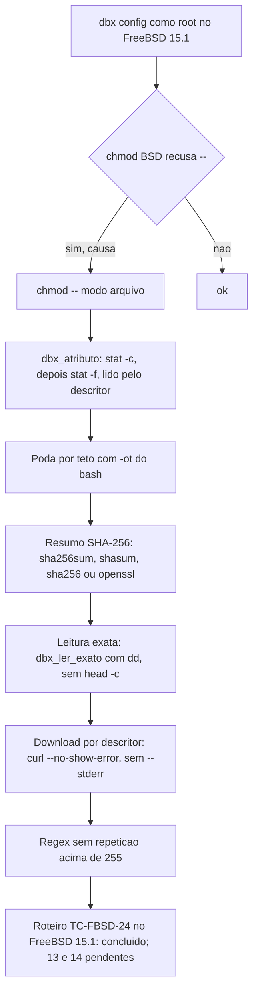

# Registro de entrega: suporte a FreeBSD (portabilidade por forma POSIX unica)

## Identificacao

| Campo | Valor |
|---|---|
| Demanda | `suporte-freebsd` (projeto `dropbox_sync`), porte **G** |
| Log de prompt | [docs/prompts/2026-10-24_1153_suporte-freebsd.md](../prompts/2026-10-24_1153_suporte-freebsd.md) (Prompts 1 a 17) |
| Especificacao | [escopo, secao 5.22](../requisitos/escopo-requisitos-e-criterios-de-aceite.md) (RF-166 a RF-173, RNF-39, TC-FBSD-01 a 28) |
| Inventario | [docs/requisitos/inventario-freebsd.md](../requisitos/inventario-freebsd.md) (itens I-01 a I-84) |
| Roteiro manual | [docs/testes/roteiro-freebsd.md](../testes/roteiro-freebsd.md) (TC-FBSD-24) |
| Branch | `feature/chmod-portavel-bsd` (base `master` @ `6df321e`, v2.0.0) |
| Issues vinculadas | Nenhuma informada |
| Agent | documentation-writer (registro); Tech Lead (implementacao, testes, conformidade) |
| Data | 2026-10-24 (abertura); atualizado em 2026-10-26 |

## Contexto e objetivo

O solicitante rodou `dbx --debug config` como root em FreeBSD e recebeu `chmod: --: No such file or directory` seguido de `erro: gravacao da credencial falhou`. Detalhes da abertura e das leituras do Tech Lead: [log de prompt](../prompts/2026-10-24_1153_suporte-freebsd.md).

**Causa raiz.** O `getopt` do `chmod` BSD nao permuta argumentos. Em `chmod 600 -- arq`, o `--` vem depois do primeiro operando e e tratado como nome de arquivo. O mesmo padrao aparecia em `lib/config.sh` (credencial), `lib/state.sh` (diretorio de estado), `lib/cmd.sh` (modo do arquivo baixado, com falha engolida).

**Decisao do solicitante** (2026-10-24): "Suportar FreeBSD", reabrindo a `DP-07` como "Linux e FreeBSD". Plataformas: FreeBSD 13 e 14 (UFS ou ZFS), `bash` 4.4+ por `pkg`, cURL.

**Objetivo.** `dbx config` e os demais comandos rodando no FreeBSD sem mudar o comportamento no Linux, com a mesma contagem de testes nos dois sistemas.

## Decisao

Norma da secao 5.22, sem ramificar por sistema:

1. **Forma POSIX unica** quando existe forma igual nos dois sistemas. Ex.: `chmod -- "$modo" "$arquivo"`.
2. **Deteccao por capacidade** somente quando nao ha forma unica: tenta-se a forma GNU e, se o utilitario a recusar, a BSD (`stat -c` e depois `stat -f`; `command -v` para o resumo SHA-256). Proibido decidir por `uname`, `$OSTYPE` ou `$MACHTYPE`, salvo no ponto unico `dbx_preflight_plataforma` (DIV-356), que nao foi criado.
3. **Ordem segura:** a forma GNU vem primeiro (`stat -f` no GNU significa "estado do sistema de arquivos" e sucede com saida errada).
4. **Falha nunca silenciosa** onde o resultado importa (estado, trava, tamanho gravado, carimbo).
5. **Sem dependencia nova:** o resumo SHA-256 aceita `sha256sum`, `shasum`, `sha256` e `openssl`, todos da base do FreeBSD (exceto `shasum`, do pacote Perl).

**Decisoes do solicitante sobre as divergencias** (recomendacao do BA entre parenteses):

| DIV | Tema | Decisao | Situacao atual |
|---|---|---|---|
| DIV-352 | `/dev/fd/<n>` so existe com `fdescfs` | Superada. Decisao "Conferir pelo descritor" (2026-10-24, Prompt 3): atributos lidos pelo proprio descritor; reabertura por caminho com conferencia do `dev:ino`; sem `fdescfs` | Validada no FreeBSD real (Prompts 3 e 17). Commit `b797ae8` |
| DIV-353 | `host_id` sem `/proc`; `kill -0` com EPERM | Degradar para `x` e documentar (A) | Vigente |
| DIV-354 | Backends do resumo e pre-requisito do instalador | Aceitar `sha256` e `openssl` (B) | Vigente |
| DIV-355 | Validacao sem FreeBSD no CI | Duplos mais roteiro manual do solicitante (A) | Vigente; VM no CI fica para depois (B) |
| DIV-356 | O que o teste de preflight passa a proibir | Liberar deteccao; complemento do Tech Lead: ponto unico `dbx_preflight_plataforma`, criado so quando necessario | Ponto unico **nao criado**: nenhum `uname` introduzido |
| DIV-357 | Mensagens e gerenciador de pacote | Mensagens por gerenciador (pkg ou apt) escolhidas por `command -v` (A) | Vigente |

**Trade-offs aceitos:**
- Deteccao de plataforma liberada (DIV-356) em vez de proibida; a regra de deteccao so por capacidade continua valendo.
- `shasum` depende do pacote Perl no FreeBSD; a lista aceita as quatro opcoes para nao exigir o pacote.
- O `chmod` com `--` antes do modo passa a valer nos dois sistemas, sem ramo de plataforma.
- `stat` lido pelo descritor e com `stat -f` sem operando no BSD; sem `fdescfs` a sonda do preflight nao e exigida (RF-171(a) e RF-172(a)).

**Arquitetura de leitura.** `lib/atributos.sh` concentra `dbx_atributo` (modo, dono, grupo, tamanho, mtime, `dev:inode`) e `dbx_ler_exato` (leitura exata de N bytes de descritor, RF-173). A forma do `stat` aprendida e memorizada; em subshell ela se perde e uma sonda a mais e feita (ressalva N3 da conformidade).

## Escopo tecnico e arquivos modificados

Commits da branch com `Prompt:` (lista de `git log --oneline 6cbb0c5..HEAD` e do reflog da branch; confirmar com `git log` antes do fechamento):

| Commit | Assunto | Tema |
|---|---|---|
| `82f1774` | docs(requisitos): reabre DP-07 para FreeBSD, inventario e secao 5.22 | Especificacao |
| `5085b5e` | docs(requisitos): DIV-352 a DIV-357 resolvidas pelo solicitante | Especificacao |
| `f52837d` | fix(portabilidade): chmod com `--` antes do modo (RF-166) | T1 |
| `21bd408` | fix(portabilidade): leitura de atributos por auxiliar unico (RF-167) | T2 |
| `15b24ac` | fix(portabilidade): resumo com sha256 da base e poda sem `find -printf` (RF-168, RF-169) | T3 |
| `ff2b851` | feat(portabilidade): fdescfs no preflight, instalador e diagnostico (RF-170 a RF-172) | T4 |
| `de4b66f` | fix(portabilidade): achados da conformidade no fdescfs, no modo BSD e na sonda do stat | Conformidade, ciclo 1 |
| `7f8e402` | fix(portabilidade): `%03Lp` no modo BSD e `-L` na sonda do fdescfs | Conformidade, ciclo 2 |
| `947fcf9` | test(qa): suite independente do suporte a FreeBSD e aceite pela regra 12 | QA |
| `907d442` | docs(portabilidade): registro, parecer de conformidade e evidencias | Documentacao |
| `2d7ca4a` | docs(requisitos): DIV-352 superada pela validacao no FreeBSD real | Especificacao (T5) |
| `b797ae8` | fix(portabilidade): conferir arquivos abertos pelo proprio descritor, sem `/dev/fd` (DIV-352) | T5 |
| `cae6e36` | test(qa): qa_b2_01 aceita as duas travas do sync vencedor (par e raiz) | QA (fase 2) |
| `6cbb0c5` | chore(instrucoes): versiona o bloco de roteamento do plugin ai-team no CLAUDE.md | Infra de instrucoes |
| `d18051d` a `17c433e` | docs(prompts): validacoes no FreeBSD do solicitante e leituras do Tech Lead | Log de prompt |
| `548b2f1` | docs(requisitos): RF-173 leitura exata de N bytes do descritor | Especificacao (RF-173) |
| `f614b02` | fix(portabilidade): leitura exata de N bytes do descritor, sem `head -c` (RF-173) | Defeito 2a |
| `5714175` | fix(http): download por descritor sem `--stderr`, que desviava o conteudo (RF-171) | Defeito 2b |
| `dd55b20` | fix(portabilidade): nenhuma repeticao de regex acima de 255 (RE_DUP_MAX do FreeBSD) | Defeito 2c |
| `f0870a4` | docs(prompts): upload de 388 MiB concluido e conferido no FreeBSD (HEAD no registro) | Log de prompt |

Commits de log de prompt (`docs(prompts)`) nao alteram codigo e estao registrados no proprio log.

**Arquivos principais** (lista consolidada): `lib/atributos.sh` (novo); `lib/config.sh`; `lib/state.sh`; `lib/cmd.sh`; `lib/hash.sh`; `lib/preflight.sh`; `lib/tmp.sh`; `lib/walk.sh`; `lib/progress.sh`; `lib/transfer.sh`; `lib/http.sh`; `commands/diagnostico.sh`; `install.sh`; `uninstall.sh`; `README.md`; `tests/support/` (duplos BSD); `tests/duplos/freebsd/bin/`; `tests/unit/preflight_test.sh`; `tests/integracao/qa_freebsd_b13_test.sh`, `qa_leitura_exata_b14_test.sh`, `qa_download_curl_real_b16_test.sh`, `qa_regex_portavel_b17_test.sh` (novos); `tests/unit/http_fd_curl_real_test.sh` (novo); `docs/testes/roteiro-freebsd.md`.

Total da branch sobre `origin/develop` (`git diff --stat origin/develop...HEAD`, antes do commit deste registro): 59 arquivos, +5238/-160.

## Evidencias de validacao

### Pareceres dos gates (referencias)

| Gate | Parecer | Situacao |
|---|---|---|
| `protocolo-conformidade` | [2026-10-24-1153-parecer-conformidade-suporte-freebsd.md](2026-10-24-1153-parecer-conformidade-suporte-freebsd.md) | Ciclo 1 e ciclo 2 aprovados com ressalvas (sem bloqueante). **Cobre ate `de4b66f`**. Commits posteriores (T5, RF-173, RF-171(a) emendado, RF-173(e)) **sem parecer de conformidade**: pendencia, ver abaixo. |
| `protocolo-tdd` | [2026-10-24-1153-evidencia-testes-suporte-freebsd.md](2026-10-24-1153-evidencia-testes-suporte-freebsd.md) | Red medido por tarefa ate o ciclo 2; suite verde em `f614b02`. Veredito: aprovado com ressalvas (FreeBSD real e suite do commit final pendentes). |
| Aceite do QA (regra 12) | [entrada de aceite](../../.github/agents/memoria/entradas/2026-10-24-1153-aceite-testes-qa-freebsd.md) | Aprovacoes e reaprovacoes por sha256 registradas (2026-10-24 a 2026-10-26). |

**Pendencia de conformidade (regra do protocolo):** nao ha parecer de `protocolo-conformidade` para os commits `2d7ca4a`, `b797ae8`, `cae6e36`, `f614b02`, `5714175`, `dd55b20` e para os artefatos de QA `qa_leitura_exata_b14`, `qa_download_curl_real_b16`, `qa_regex_portavel_b17`. Esta lacuna e registrada, nao preenchida por inferencia.

**Pendencia de red do protocolo-tdd:** a medicao de red por tarefa foi feita para T1 a T4 e para o ciclo 2. Para `f614b02` (RF-173), `5714175` (RF-171(a)) e `dd55b20` (RF-173(e)) a evidencia de red consta apenas de forma parcial no log de prompt (Prompt 6 cita red medido para o `head`); o red de `--stderr` e de `RE_DUP_MAX` nao esta em parecer de `protocolo-tdd` desta demanda.

### Testes executados

| Comando | Resultado | Situacao |
|---|---|---|
| `bash tests/run.sh` (suite de desenvolvimento), no commit `f614b02` | 96 arquivos; 2568 aprovados; 0 reprovados; 4 pulados; 2795 s | Ultima execucao registrada |
| `bash tests/run.sh` (ciclo 2 da conformidade, `7f8e402`) | 92 arquivos; 2535 aprovados; 0 reprovados; 4 pulados | Historico, anterior a T5 e RF-173 |
| `sh scripts/suite-completa.sh` (suite do commit final) | pendente: suite do commit final | Pendente; a rodar pelo Tech Lead apos este registro |

Execucoes das suites de QA (sha256 abreviado conforme a entrada de aceite; sha256 completo a conferir com `sha256sum` no arquivo):

| Suite | Casos | Situacao |
|---|---|---|
| `tests/integracao/qa_freebsd_b13_test.sh` | 10 | Reaprovado 2026-10-25, sha256 `20420830…711d006b` (antes, 5 casos, `fb7e9191…`, superado) |
| `tests/integracao/qa_trava_tmp_b2_test.sh` | - | Reaprovado 2026-10-25 com `qa_b2_01` corrigido para aceitar as duas travas (par e raiz); sha256 `2114eaa2…df6d3333` |
| `tests/integracao/qa_docs_aliases_p4_test.sh` | - | Reaprovado 2026-10-24, sha256 `17192612…708467` |
| `tests/integracao/qa_consulta_diagnostico_b1_test.sh` | - | Reaprovado 2026-10-26 (`dd` no PATH reduzido), sha256 `9a0dab8d…e661920a` |
| `tests/integracao/qa_debug_transferencias_b12_test.sh` | - | Reaprovado 2026-10-26 (`dd` no PATH reduzido), sha256 `fa2d971d…e2fca987` |
| `tests/integracao/qa_leitura_exata_b14_test.sh` | 10 | Aprovado 2026-10-26, sha256 `c7de4ca5…76c920b8` (RF-173, TC-FBSD-25 a 27) |
| `tests/integracao/qa_download_curl_real_b16_test.sh` | 7 | Aprovado 2026-10-26, curl real contra servidor HTTP local, sha256 `d0c1dd49…5af129` (RF-171(a)) |
| `tests/integracao/qa_regex_portavel_b17_test.sh` | 19 | Aprovado 2026-10-26, sha256 `1406718c…138a015d8` (RF-173(e), TC-FBSD-28) |

Nota: a contagem de casos do `qa_freebsd_b13_test.sh` (10) e a de `qa_trava_tmp_b2` nao constam da entrada de aceite; ficam em aberto ate conferencia com `bash tests/integracao/<arquivo>`.

### Validacao no FreeBSD real (TC-FBSD-24, roteiro do solicitante)

Sistema do solicitante: **FreeBSD 15.1-RELEASE-p3** (UFS). A secao 5.22 e o roteiro citam FreeBSD 13 e 14; **nao ha execucao registrada em 13 ou 14**. Resultados, com o log de prompt como fonte:

| Passo do roteiro | Resultado | Fonte |
|---|---|---|
| Passo 2: `dbx diagnostico` | Diagnostico le o modo 644 pelo `stat` do FreeBSD; resumo via `sha256sum` | Prompt 2 |
| Credencial com modo 600 (`config`) | `chmod -- 600` aplicado; `-rw-------` confirmado | Prompts 4 e 5 |
| Passo 5: `upload` de pasta e de arquivo grande | Defeito de leitura corrigido (ver defeito 2a); upload de 388 MiB concluido e conferido | Prompts 6, 7, 15 e 16 |
| Passo 5: `download` de pasta e `verificar` | `iguais: 4`, `diferentes: 0` | Prompts 9 e 10 |
| Passo 6: download retomavel | Retomada com `206`, `integridade: conferida` | Prompts 11 e 12 |
| Passo 6: upload retomavel | Retomada do bloco 5 sem nova sessao; defeito de regex corrigido | Prompts 8, 13 e 14 |
| Secao 7 (descritor, `%Mp%03Lp`, nanossegundos) | `stat -f %d|%i` no descritor = `/etc/passwd`; `%Mp|%Lp|%03Lp` com 4044 = `4|44|044`; `%.9Fm` com nanossegundos reais | Prompt 17 |

Achados do roteiro sem efeito de correcao: identidade BSD usa segundos com `.000000000`; nanossegundos reais estao disponiveis no UFS (melhoria registrada).

### Defeitos achados na validacao no FreeBSD real e corrigidos nesta demanda

**(a) Leitura alem de N bytes (`head -c`).**
- Causa: o `head -c` do FreeBSD le por stdio com leitura antecipada e deixa o deslocamento do descritor alem de N. Upload de 412689845 bytes leu 411060301; `content_hash` local errado acima de 4 MiB.
- Correcao: `dbx_ler_exato` com `dd` (RF-173(a) a (d)), commit `f614b02`.
- Teste/QA: `qa_leitura_exata_b14` (sha256 `c7de4ca5…76c920b8`); reaprovacoes de `qa_consulta_diagnostico_b1` e `qa_debug_transferencias_b12` (so `dd` acrescido ao PATH reduzido).
- Confirmacao no sistema do solicitante: `verificar` com 4 iguais (Prompt 10) e upload de 388 MiB conferido (Prompt 16).

**(b) `--stderr` do curl reabre o stderr e desvia o download por descritor.**
- Causa: em `lib/http.sh`, o destino `fd:` usava `--stderr <arquivo>`, que reabre o stderr do processo; o conteudo ia para o arquivo de mensagens e o `.part` ficava com 0 bytes. Defeito introduzido pela T5, em qualquer plataforma; a suite usava curl duble, que nao reproduzia.
- Correcao: `--no-show-error` no lugar de `--stderr` (RF-171(a) emendado), commit `5714175`.
- Teste/QA: `http_fd_curl_real` (curl real) e `qa_download_curl_real_b16` (sha256 `d0c1dd49…5af129`).
- Confirmacao no sistema do solicitante: download retomavel com `206` e integridade conferida (Prompt 12).

**(c) RE_DUP_MAX 255 do regcomp do FreeBSD.**
- Causa: `{1,256}` e `{1,8192}` sao regex invalidas no `[[ =~ ]]` do bash com a libc do FreeBSD. Efeito: registro de retomada do upload nunca gravado e cursor do `sync --receber` sempre descartado.
- Correcao: `+` com teste explicito de comprimento (RF-173(e)), commit `dd55b20`; auditoria `regex_portavel`.
- Teste/QA: `qa_regex_portavel_b17` (19 casos, sha256 `1406718c…138a015d8`).
- Confirmacao no sistema do solicitante: upload retomado do bloco 5 sem nova sessao (Prompt 14).

### Defeitos e correcoes da propria demanda antes da validacao real

Registrados no parecer de conformidade e na evidencia de testes: `read < <(stat)` sem status (corrigido por captura `$(stat)`); `uname` exigido pelo preflight com `PATH` reduzido (funcao removida); mensagem do diagnostico citando NFS (reescrita); `qa_b2_01` com defeito de teste (corrigido e reaprovado em 2026-10-25).

## Riscos, impacto e rollback

| Risco | Situacao | Tratamento |
|---|---|---|
| Comportamento no FreeBSD 13 e 14 diferente do validado no 15.1 | Aberto | Validar 13 e 14 no roteiro TC-FBSD-24 (solicitante) |
| Parecer de conformidade nao cobre os commits pos-`de4b66f` | Aberto | Rodar `protocolo-conformidade` sobre o diff ate o commit final |
| Red do `--stderr` e do `RE_DUP_MAX` sem parecer de `protocolo-tdd` | Aberto | Anexar evidencia de red ao parecer de testes |
| Suite do commit final | Pendente | Tech Lead roda `sh scripts/suite-completa.sh` |
| Instabilidade de `state_trava_test::leitor_concorrente_nunca_ve_trava_vazia_ou_parcial` (RSK-DSP-01, preexistente) | Aberto | Acompanhar na suite completa |
| Deteccao de plataforma liberada (DIV-356) pode crescer sem o ponto unico | Mitigado pela norma de capacidade | Criar `dbx_preflight_plataforma` somente quando necessario |
| `shasum` depende de pacote Perl no FreeBSD | Mitigado | Lista aceita `sha256sum`, `shasum`, `sha256`, `openssl` |
| Impacto no Linux | Mesma contagem de testes que antes nos duplos; defeito (b) afetava o Linux na T5 e foi corrigido | Suite de desenvolvimento verde em `f614b02` |

**Impacto.** Mudanca de comportamento em FreeBSD. No Linux, a mudanca e a forma de `chmod`, de `stat`, de leitura exata e do `curl` no modo `fd:`. Sem migracao de dado. O defeito (b) afetou o download por descritor em qualquer plataforma entre a T5 e `5714175`.

**Rollback.** Reverter o merge (`git revert -m 1 <sha-do-merge>`). Nenhuma migracao de dado. Reverter isoladamente `f614b02`, `5714175` ou `dd55b20` reintroduz os defeitos (a), (b) e (c) no FreeBSD.

## Achados fora do escopo FreeBSD

Valem no Linux; oferecidos ao solicitante como demandas separadas, **sem correcao nesta demanda**:

1. `sync` mostra "falha local" sem o motivo real (RF-59(c) so repassa o motivo na classe `integridade`).
2. `download` tenta `files/download` duas vezes (409) quando o `get_metadata` ja informou pasta (Prompt 9).
3. `upload` com modo `add` e arquivo diferente no destino falha so no `finish`, depois de enviar tudo; a pre-checagem RF-60 ja sabe (Prompt 15).
4. README sem a regra da `/` final do destino; a demanda `feature/upload-arquivo-para-pasta` (RF-174) trata o upload de arquivo para pasta (Prompts 6 e 7).

Observacao: a identidade BSD usa segundos com `.000000000`; nanossegundos reais estao disponiveis no UFS (melhoria registrada, sem efeito de correcao).

## Proximos passos

1. Rodar `sh scripts/suite-completa.sh` no commit final e registrar o resultado. **Pendente: suite do commit final.**
2. Executar o roteiro TC-FBSD-24 no FreeBSD 13 e 14 (solicitante) e anexar a saida; os passos 2 a 7 ja foram executados no 15.1.
3. Rodar `protocolo-conformidade` sobre os commits pos-`de4b66f` e anexar parecer proprio.
4. Anexar a evidencia de red de `f614b02`, `5714175` e `dd55b20` ao parecer de `protocolo-tdd`.
5. Atualizar a secao 5.22 do escopo: status "especificada" e DIV-352..357 "abertas" estao desatualizados (DIV-352 superada; decisoes do solicitante ja tomadas).
6. Abrir, a pedido do solicitante, as demandas separadas dos achados 1 a 4.
7. Investigar a causa de `qa_trava_tmp_b2::qa_b2_01` nao e mais necessaria como risco: o caso era defeito de teste, corrigido em `cae6e36`.
8. Aprovacao final do Tech Lead e revisao consolidada: **PENDENTES**.

## Diagrama (Mermaid)

## Aceites

- **QA (validacao independente):** suites `qa_*` listadas acima, aprovadas ou reaprovadas pelo solicitante por sha256 (entrada de aceite). Aceite do solicitante para a decisao: **"Suportar FreeBSD"** (2026-10-24). Aceite da validacao manual: **PARCIAL** (FreeBSD 15.1 concluido; 13 e 14 pendentes).
- **Tech Lead:** aprovacao final **PENDENTE**. Revisao consolidada: **PENDENTE**.
