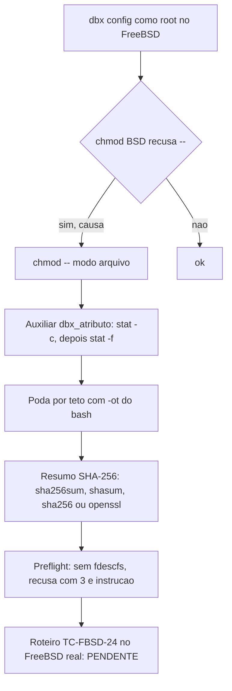

# Registro de entrega: suporte a FreeBSD (portabilidade por forma POSIX unica)

## Identificacao

| Campo | Valor |
|---|---|
| Demanda | `suporte-freebsd` (projeto `dropbox_sync`), porte **G** |
| Log de prompt | [docs/prompts/2026-10-24_1153_suporte-freebsd.md](../prompts/2026-10-24_1153_suporte-freebsd.md) |
| Especificacao | [escopo, secao 5.22 (v1.30)](../requisitos/escopo-requisitos-e-criterios-de-aceite.md) (RF-166 a RF-172, RNF-39, TC-FBSD-01 a 24, DIV-352 a DIV-357) |
| Inventario | [docs/requisitos/inventario-freebsd.md](../requisitos/inventario-freebsd.md) (itens I-01 a I-84) |
| Roteiro manual | [docs/testes/roteiro-freebsd.md](../testes/roteiro-freebsd.md) (TC-FBSD-24) |
| Branch | `feature/chmod-portavel-bsd` (base `master` @ `6df321e`, v2.0.0) |
| Issues vinculadas | Nenhuma informada |
| Agent | documentation-writer (registro); Tech Lead (implementacao, testes, conformidade) |
| Data | 2026-10-24 |

## Contexto e objetivo

O solicitante rodou `dbx --debug config` como root em FreeBSD 13/14 com UFS e recebeu `chmod: --: No such file or directory` seguido de `erro: gravacao da credencial falhou`.

**Causa raiz.** O `getopt` do `chmod` BSD nao permuta argumentos. Em `chmod 600 -- arq`, o `--` vem depois do primeiro operando e e tratado como nome de arquivo. O mesmo padrao aparecia em `lib/config.sh:525` (credencial), `lib/state.sh:153` (diretorio de estado), `lib/cmd.sh:663` e `:1049` (modo do arquivo baixado, com falha engolida por `|| :`).

**Escopo da causa.** O inventario identificou 84 itens de utilitarios externos; 24 falham no FreeBSD ou produzem resultado errado em silencio, e 15 deles nao tem recuo. Os usos GNU concentram-se em `stat -c`, `chmod`, `find -printf`, `sha256sum` e `/dev/fd`/`/proc`.

**Restricao anterior.** A `DP-07` fixava "So cURL, bash 4+, Linux", e `tests/unit/preflight_test.sh` proibia mencao a BSD.

**Decisao do solicitante** (AskUserQuestion, 2026-10-24): "Suportar FreeBSD". Reabre e resolve a `DP-07` como "Linux e FreeBSD". Plataformas: FreeBSD 13 e 14, UFS ou ZFS, `bash` 4.4+ por `pkg`, cURL.

**Objetivo.** Fazer `dbx config` e os demais comandos rodarem no FreeBSD sem mudar o comportamento no Linux, com a mesma contagem de testes nos dois sistemas.

## Decisao

Norma da secao 5.22, sem ramificar por sistema:

1. **Forma POSIX unica** quando existe forma igual nos dois sistemas. Ex.: `chmod -- "$modo" "$arquivo"`.
2. **Deteccao por capacidade** somente quando nao ha forma unica: tenta-se a forma GNU, e se o utilitario a recusar, a BSD (`stat -c` e depois `stat -f`; `command -v` para o resumo SHA-256). Proibido decidir por `uname`, `$OSTYPE` ou `$MACHTYPE`.
3. **Ordem segura:** a forma GNU vem primeiro, porque `stat -f` no GNU significa "estado do sistema de arquivos" e sucede com saida errada.
4. **Falha nunca silenciosa** onde o resultado importa (estado, trava, tamanho gravado, carimbo).
5. **Sem dependencia nova:** o resumo SHA-256 passa a aceitar `sha256sum`, `shasum`, `sha256` e `openssl`, todos da base do FreeBSD (exceto `shasum`, que vem do pacote Perl).

**Decisoes do solicitante sobre as divergencias** (recomendacao do BA entre parenteses):

| DIV | Tema | Decisao | Observacao |
|---|---|---|---|
| DIV-352 | `/dev/fd/<n>` so existe com `fdescfs` | Preflight recusa com instrucao (C) | Sem `fdescfs` usavel, sai com `3` e cita `mount -t fdescfs fdesc /dev/fd` |
| DIV-353 | `host_id` sem `/proc`; `kill -0` com EPERM | Degradar para `x` e documentar (A) | Sem `/proc`, `boot` e `ns` viram `x`; trava continua |
| DIV-354 | Backends do resumo e pre-requisito do instalador | Aceitar `sha256` e `openssl` (B) | Mesma lista em `lib/hash.sh`, `lib/preflight.sh` e `install.sh` |
| DIV-355 | Validacao sem FreeBSD no CI | Duplos na suite mais roteiro manual do solicitante (A) | Pipeline com VM no FreeBSD fica para depois (B) |
| DIV-356 | O que o teste de preflight passa a proibir | Liberar deteccao (contra a recomendacao A); complemento do Tech Lead: ponto unico `dbx_preflight_plataforma`, criado so quando necessario | O ponto unico **nao foi criado**: nenhum `uname` foi introduzido |
| DIV-357 | Mensagens e gerenciador de pacote | Mensagens por gerenciador (pkg ou apt) escolhidas por `command -v` (A) | Substitui a recomendacao de texto unico |

**Alternativas registradas na secao 9 do escopo** (nao reproduzidas aqui): as opcoes nao escolhidas de cada DIV acima.

**Trade-offs aceitos:**
- Deteccao de plataforma liberada (DIV-356) em vez de proibida. A regra de deteccao so por capacidade continua valendo; o ponto unico fica reservado para o caso em que nao houver forma unica.
- `shasum` depende do pacote Perl no FreeBSD; a lista aceita as quatro opcoes para nao exigir o pacote.
- O `chmod` com `--` antes do modo passa a valer nos dois sistemas. Nenhum ramo de plataforma e necessario para isso.

**Arquitetura de `stat`.** Um auxiliar unico (`lib/atributos.sh`, `dbx_atributo`) le modo, dono, grupo, tamanho, mtime e `dev:inode`. Tenta `stat -c` (GNU) e, se recusado, `stat -f` (BSD). Memoriza o formato aceito. A carga transitiva de `lib/atributos.sh` acontece via `lib/hash.sh`. Em subshell, o formato aprendido se perde e uma sonda a mais e feita.

## Escopo tecnico e arquivos modificados

Commits da branch (todos com `Prompt:`):

1. Especificacao e inventario (secao 5.22, `inventario-freebsd.md`).
2. Resolucao das DIVs.
3. **T1, chmod com `--` antes do modo** (RF-166): `lib/config.sh`, `lib/state.sh`, `lib/cmd.sh` (dois pontos). Duplo de `chmod` BSD em `tests/support/` e guarda de deteccao. Remocao do teste antigo que proibia mencao a bsd (`tests/unit/preflight_test.sh`, 1 caso).
4. **T2, leitura de atributos por auxiliar unico** (RF-167): `lib/atributos.sh` novo (`dbx_atributo`); cerca de 30 pontos migrados em `lib/` e `commands/`.
5. **T3, resumo SHA-256, poda e mktemp** (RF-168, RF-169): `lib/hash.sh`, `lib/preflight.sh`, `install.sh`, `README.md` (lista `sha256sum shasum sha256 openssl`); `lib/state.sh` (poda por teto com `-ot` do bash, sem `find -printf`); `lib/tmp.sh` (exige 6 `X` no modelo do `mktemp`).
6. **T4, preflight, instalador e diagnostico** (RF-170 a RF-172): `lib/preflight.sh` (`dbx_preflight_descritores`, sonda de `/dev/fd`); `install.sh` (`sugerir_instalacao`, mensagens por gerenciador); `commands/diagnostico.sh` (diz o backend do resumo e marca "nao verificado" para o tipo de sistema de arquivos); `README.md`.
7. **Conformidade, ciclo 2:** fdescfs verificado pelo `stat` externo com o mesmo `dev:ino`; modo BSD `%Mp%Lp` (menor: `%Mp%03Lp`); sonda unica da forma do `stat`; `BASH_VERSINFO[5]` na guarda; comentarios; roteiro.
8. **Suite do QA e aceite** (`tests/integracao/qa_freebsd_b13_test.sh`).

Arquivos principais (lista consolidada, a conferir com `git diff --stat master`): `lib/atributos.sh` (novo); `lib/config.sh`; `lib/state.sh`; `lib/cmd.sh`; `lib/hash.sh`; `lib/preflight.sh`; `lib/tmp.sh`; `lib/walk.sh`; `lib/progress.sh`; `lib/transfer.sh`; `commands/diagnostico.sh`; `install.sh`; `uninstall.sh`; `README.md`; `tests/support/` (duplos BSD); `tests/unit/preflight_test.sh`; `tests/integracao/qa_freebsd_b13_test.sh` (novo).

Lista exata pendente de conferencia: nao foi executado `git diff --stat` nesta redacao.

## Evidencias de validacao

### Pareceres dos gates (referencias)

| Gate | Parecer | Situacao |
|---|---|---|
| `protocolo-conformidade` | [2026-10-24-1153-parecer-conformidade-suporte-freebsd.md](2026-10-24-1153-parecer-conformidade-suporte-freebsd.md) | Ciclo 1 aprovado com ressalvas (1 importante: fdescfs so por `[[ -f ]]`; 7 menores). Ciclo 2 aprovado com ressalvas (N1 `%Lp` sem zeros, N2 `-L`), ambas corrigidas. Veredito final: Aprovado com ressalvas. |
| `protocolo-tdd` | [2026-10-24-1153-evidencia-testes-suporte-freebsd.md](2026-10-24-1153-evidencia-testes-suporte-freebsd.md) | Red medido por tarefa; suite verde apos o ciclo 2. Aprovado com ressalvas (FreeBSD real e suite oficial pendentes). |

### Testes executados

| Comando | Resultado |
|---|---|
| `bash tests/run.sh` (suite de desenvolvimento, apos as correcoes do ciclo 2) | 92 arquivos; 2535 aprovados; 0 reprovados; 4 pulados |
| `bash tests/integracao/qa_freebsd_b13_test.sh` (suite do QA) | `# resumo ok=5 nao_ok=0 pulados=0`; Aprovado. sha256 `fb7e91916d947264ebb2fe11712d042742e897a4e57928bc1c22554348ca7488` |
| `qa_docs_aliases_p4_test.sh` (reaprovado) | sha256 `17192612b94d60d51b855e482d9a499101de505d81b85f1ec89bb28346708467` |

Red medido pelo Tech Lead contra o commit anterior, em copia `git archive`:

| Defeito reproduzido | Resultado no commit anterior |
|---|---|
| Credencial nao gravava | status 3, `chmod: --` |
| Diretorio de estado | `return 1` |
| Modo do arquivo baixado | engolido |
| Identidade do arquivo | falhava (status 4) |
| Idade da retomada | caia para 0 |
| Recebimento | perdia o `0640` |
| Diagnostico | acusava estado de outro usuario de forma falsa |
| Poda | nunca removia nada (1005 retomadas em vez de 1000; 105 cursores em vez de 100) |
| Resumo | so com `sha256` falhava |
| mktemp | aceitava 3 `X` |
| Instalador | sugeria apt com pkg |
| Diagnostico | sem backend do resumo e sem "nao verificado" |
| Preflight | aprovava host sem fdescfs com bash que emula `/dev/fd` |
| Modo no BSD | 4600 lido como 600; 4044 como 444 |

Regressao (ja passavam antes): so `openssl`; `wc` com largura 8; `install --prefix` com duplos.

Defeitos achados pela suite durante a demanda e corrigidos:
- `read < <(stat)` no auxiliar nao espera o `stat` nem devolve status; o mutante rmd14 deixou de ter efeito. Correcao: captura por `$(stat)`.
- `uname` exigido pelo preflight quebrava testes com `PATH` reduzido. Correcao: funcao de plataforma removida.
- Mensagem do diagnostico citando NFS violava `trv35`. Correcao: mensagem reescrita.

### Lacunas e pendencias de validacao

- **Suite completa oficial** (`sh scripts/suite-completa.sh`, exigida para o push da PR): **PENDENTE**. Nao executada.
- **Validacao no FreeBSD real** (TC-FBSD-24, roteiro do solicitante): **PENDENTE**. Comportamento real de `fdescfs`, `%03Lp`, `%.9Fm` e do bash do `pkg` so sera confirmado pelo roteiro.
- Nanossegundos zerados no BSD: a confirmar no roteiro, secao 7.
- Carga transitiva de `lib/atributos.sh` via `lib/hash.sh`: observacao aceita.

## Riscos, impacto e rollback

| Risco | Situacao | Tratamento |
|---|---|---|
| Comportamento real do FreeBSD diferente do duplo | Aberto | Roteiro TC-FBSD-24 (pendente) |
| Instabilidade em testes de trava concorrente sob carga: `state_trava_test::leitor_concorrente...` (RSK-DSP-01, conhecido) | Aberto | Registrado |
| `qa_trava_tmp_b2::qa_b2_01` falhou 2 vezes na suite inteira e passou 4 vezes isolado e nas rodadas seguintes | Causa nao confirmada | Acompanhar na suite completa |
| Deteccao de plataforma liberada (DIV-356) pode crescer sem o ponto unico | Mitigado pela norma de capacidade | Criar `dbx_preflight_plataforma` somente quando necessario |
| Host sem `fdescfs` | Recusado pelo preflight com instrucao (DIV-352) | Sem efeito em host ja configurado |
| Impacto no Linux | Mesma contagem de testes que antes, nos duplos e no Linux | Suite de desenvolvimento verde |

**Impacto.** Mudanca de comportamento apenas em FreeBSD. No Linux, a mudanca e a forma de `chmod` e de `stat` (forma unica ou recuo por capacidade). Sem migracao de dado.

**Rollback.** Reverter o merge (`git revert -m 1 <sha-do-merge>`). Nenhuma migracao de dado.

## Proximos passos

1. Rodar a suite completa oficial (`sh scripts/suite-completa.sh`) antes do push da PR e registrar o resultado.
2. Executar o roteiro TC-FBSD-24 no FreeBSD 13 e 14 reais (solicitante) e anexar a saida dos passos 2 a 5, sem URL de autorizacao nem codigo do `dbx config`.
3. Confirmar as duas conferencias da secao 7 do roteiro (nanossegundos; `%03Lp` e `-L` no BSD real).
4. Localizar ou gerar os pareceres de `protocolo-tdd` e `protocolo-conformidade` desta demanda e linka-los na tabela de gates.
5. Investigar a causa de `qa_trava_tmp_b2::qa_b2_01` (instabilidade sob carga).
6. Commit deste registro: pendente. Este documento foi escrito sem commit, conforme a instrucao da delegacao.

## Diagrama (Mermaid)

## Aceites

- **QA (validacao independente):** suite `qa_freebsd_b13_test.sh` aprovada (5 casos); sha256 registrado acima. Aceite do solicitante: **"Suportar FreeBSD"** (decisao do escopo). Aceite da validacao manual no FreeBSD: **PENDENTE**.
- **Tech Lead:** aprovacao final **PENDENTE**. Revisao consolidada: **PENDENTE**.
