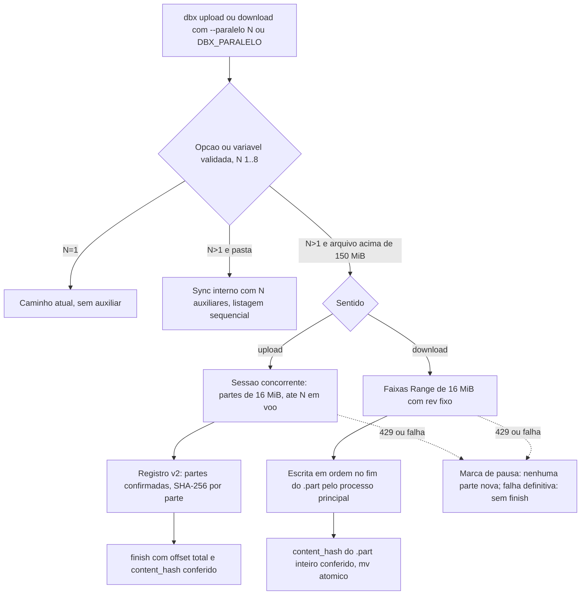

# Registro de entrega: paralelismo no upload e no download (pasta e arquivo grande)

## Identificacao

| Campo | Valor |
|---|---|
| Demanda | `paralelo-upload-download` (projeto `dropbox_sync`), porte **G** |
| Log de prompt | [docs/prompts/2026-10-26_1900_paralelo-upload-download.md](../prompts/2026-10-26_1900_paralelo-upload-download.md) (Prompt 1) |
| Especificacao | [escopo, secao 5.23](../requisitos/escopo-requisitos-e-criterios-de-aceite.md) (RF-175 a RF-185, TC-PUD-01 a 41, DIV-358 a DIV-376, RSK-98 a RSK-103) |
| Branch | `feature/paralelo-upload-download` (de `origin/develop` @ `6df321e`) |
| Issues vinculadas | Nenhuma informada |
| Agent | documentation-writer (registro e pareceres a partir dos fatos do Tech Lead); Tech Lead (implementacao, coordenacao do QA, conformidade) |
| Data | 2026-10-26 |

## Contexto e objetivo

O solicitante pediu que `dbx upload` e `dbx download` aceitem `--paralelo N` (alias `--parallel`), como o `sync` ja faz. Hoje a opcao so vale no `sync`: `RF-133(e)` recusa `2` nos demais comandos, e o upload e o download de pasta nunca usam paralelismo (decisao da fase 9).

**Escopo decidido pelo solicitante (2026-10-26):** "Pastas e arquivo grande" (contra a recomendacao "so pastas"). Pasta com arquivos simultaneos, pelo mecanismo do `sync`; arquivo grande em partes simultaneas (sessao concorrente no upload, faixas `Range` no download). `DBX_PARALELO` vale para upload e download; a opcao vence a variavel.

**Entregas.** Duas etapas na mesma demanda, com entregas separadas:

1. Pastas (`RF-175`, `RF-176`, `RF-185`), pelo mecanismo ja validado do `sync`.
2. Arquivo grande em partes simultaneas, depois da especificacao do BA: 2a upload (`RF-177` a `RF-183`, `RF-184`, `RF-181`), 2b download em faixas.

**Objetivo.** Mesmo conteudo, `content_hash`, cache e codigo de saida de `N=1` (`RF-134`, principio P1), com retomada e integridade preservadas (P2, P3).

## Decisao

**ADR resumido.** Paralelismo em um unico ponto (`dbx_cmd_paralelo`, validacao e precedencia de `RF-133`), reaproveitado por pasta (sync interno com `DBX_CMD_SYNC_CHAMADOR`) e por arquivo grande (`lib/transfer_paralelo.sh` para upload, `lib/download_paralelo.sh` para download). Auxiliares com o mecanismo existente do `sync`; so o processo principal grava registro, cache e `.part`.

**Decisoes do solicitante sobre as divergencias** (todas com "Aceito todas (Recomendado)", 2026-10-26, salvo onde indicado):

| DIV | Tema | Decisao | Situacao |
|---|---|---|---|
| DIV-358 | Limiar do arquivo em partes | A: 150 MiB, sem segundo limiar | Resolvida |
| DIV-359 | Tamanho da parte do upload | A: fixo 16 MiB (`N*P` = 128 MiB) | Resolvida |
| DIV-360 | `N=1` e tipo de sessao | A: `N=1` segue a sessao sequencial | Resolvida |
| DIV-361 | Servico recusa `concurrent` | B: fallback para sequencial com aviso de uma linha | Resolvida |
| DIV-362 | Limite de banda com partes | A: `--limite-banda` e o total, por `limite/partes em voo` | Resolvida |
| DIV-363 | `content_hash` local fora de ordem | A: resumo por parte, combinado na ordem dos deslocamentos | Resolvida |
| DIV-364 | Falha definitiva de uma parte | B: as em voo terminam, nenhuma parte nova, nenhum `finish`/`mv` | Resolvida |
| DIV-365 | `429` com varias partes em voo | A: pausa compartilhada. Ver nota de divergencia abaixo | Resolvida, com ressalva |
| DIV-366 | Formato do registro de retomada | A: versao `2` da magia, leitor aceita v1 | Resolvida (DBA acionado, regra 26, ver pendencias) |
| DIV-367 | Parte em voo na queda | A, condicionada ao teste de contrato (`RSK-98`) | Resolvida; condicao atendida (ver Evidencias) |
| DIV-368 | Registro v1 e `N>1` | A: retomada sequencial obedece o tipo gravado | Resolvida |
| DIV-369 | Escrita do download em partes | A, com refinamento do Tech Lead: escrita em ordem no fim do `.part` pelo descritor, no lugar de `dd seek=` | Resolvida, refinada |
| DIV-370 | Retomada do download fora de ordem | B: so o prefixo contiguo confirmado e retomado | Resolvida |
| DIV-371 | Tamanho da faixa do download | A: `Q` = 16 MiB | Resolvida |
| DIV-372 | `--dry-run` com `--paralelo` em pasta | A: aceita, valida N e ignora | Resolvida |
| DIV-373 | Orcamento de N entre pasta e arquivo grande | A: N e o total de processos; arquivo grande de pasta vai sequencial | Resolvida |
| DIV-374 | Entrada/saida padrao e a opcao | A: opcao com `-` e recusada com `2`; variavel ignorada com linha de `--debug` | Resolvida |
| DIV-375 | Progresso com partes | A: uma linha por arquivo | Resolvida |
| DIV-376 | Identidade do `.part` sem `/dev/fd` | B: descritor aberto no processo principal; gravacao so por ele | Resolvida |

**Alternativas descartadas e trade-offs.**

- Limiar proprio menor (DIV-358 B) ou partes para todo arquivo com `N>1` (DIV-360 B): descartados; mudariam a rota e a retomada de todo upload grande.
- Pre-alocacao do `.part` (DIV-369 C): descartada; quebra a invariante "tamanho do `.part` = progresso" (`RF-104(c)`).
- Retomada concorrente por arquivo por parte (DIV-366 C): descartada por poda mais complexa.
- Ajuste dinamico de `N` por `429` (`DIV-258`) e tamanho de parte configuravel (`DP-30`): fora desta fase.

**Nota de divergencia (DIV-365).** O texto da opcao A fala em "o `Retry-After` maior vale para todos os auxiliares". A implementacao nao propaga o maior `Retry-After` entre auxiliares em tempo real. O efeito pedido (nenhuma parte nova durante a pausa) foi mantido: o auxiliar que recebe `429` cria a marca `DBX_HTTP_MARCA_PAUSA` antes de esperar, e o coordenador nao despacha enquanto a marca existir (`lib/http.sh`, `lib/download_paralelo.sh`, `lib/transfer_paralelo.sh`). Esse mecanismo substituiu o esclarecimento anterior da DIV-365 (QA-B20-01). **A DIV-365 da especificacao ainda nao recebe a nota de refinamento** (pendencia).

**Cadeia de fatos do contrato (DIV-367, RSK-98).** Teste de contrato contra a conta real do solicitante, 2026-10-26: `upload_session/start` com `session_type: concurrent` 200; tres `append_v2` de 16 MiB simultaneos e fora de ordem todos 200; reenvio da parte ja aceita 200; `finish` 200; `size` e `content_hash` iguais ao local. Esta parte confirma a opcao A da DIV-367. O script de teste ficou no scratchpad da sessao e nao esta versionado; a evidencia e o log de prompt.

## Escopo tecnico e arquivos modificados

**Commits da branch** (`git reflog` do worktree; SHAs confirmados pelo reflog):

| Commit | Assunto | Etapa |
|---|---|---|
| `f708447` | feat(paralelo): upload e download aceitam --paralelo; pasta repassa N ao sync (RF-175, RF-176) | 1 |
| `71a61d2` | feat(paralelo): upload de arquivo grande em partes simultaneas (RF-177..183) | 2a |
| `7b29c68` | Merge origin/develop em `feature/paralelo-upload-download` | 2a (merge da develop, #62/#63) |
| `44d209e` | fix(paralelo): registro v2 so aceita intervalos canonicos; suite do QA da etapa 2a (RF-181) | 2a (QA-B19-01) |
| `a634232` | feat(paralelo): download de arquivo grande em faixas simultaneas; pausa de 429 compartilhada (RF-180..183) | 2b (inclui a correcao QA-B20-01, ver nota) |
| `c1af7e4` | Merge origin/develop em `feature/paralelo-upload-download` | 2b (merge da develop, #64) |

Nota: `a634232` reune a etapa 2b e a correcao da QA-B20-01 (ciclo 2), feitas antes do commit; o ciclo 1 do QA nao gerou commit proprio.

**Arquivos principais** (lista consolidada; total da branch sobre `origin/develop` antes do commit deste registro: ver `git diff --stat origin/develop...HEAD`):

- Codigo novo: `lib/transfer_paralelo.sh` (upload em partes), `lib/download_paralelo.sh` (download em faixas).
- Codigo alterado: `commands/upload.sh`, `commands/download.sh` (chamada ao sync interno com `DBX_CMD_SYNC_CHAMADOR`), `commands/sync.sh` (`_dbx_cmd_sync_paralelo_resolver`, ponto unico `dbx_cmd_paralelo`), `commands/diagnostico.sh` (aviso de `--paralelo`, linha 408, corrigido na etapa 1), `lib/state.sh` (registro v2, `_dbx_state_intervalos_validos`), `lib/http.sh` (`DBX_HTTP_MARCA_PAUSA`, `dbx_http_conteudo_receber_faixa`).
- Testes: `tests/integracao/qa_paralelo_pastas_b18_test.sh` (10 casos), `tests/integracao/qa_paralelo_upload_b19_test.sh` (35 casos), `tests/integracao/qa_paralelo_download_b20_test.sh` (27 casos); `tests/integracao/paralelo_test.sh`, `paralelo_upload_test.sh`, `paralelo_download_test.sh` (suites de desenvolvimento, contagens a confirmar com o runner).
- Especificacao: `docs/requisitos/escopo-requisitos-e-criterios-de-aceite.md` (secao 5.23, DIV-358 a DIV-376).
- Log de prompt: `docs/prompts/2026-10-26_1900_paralelo-upload-download.md`.

## Evidencias de validacao

### Pareceres dos gates (referencias)

| Gate | Parecer | Situacao |
|---|---|---|
| `protocolo-tdd` | [2026-10-26-1900-evidencia-testes-paralelo-upload-download.md](2026-10-26-1900-evidencia-testes-paralelo-upload-download.md) | Red medido por etapa; QA independente por etapa; suite do commit final pendente |
| `protocolo-conformidade` | [2026-10-26-1900-parecer-conformidade-paralelo-upload-download.md](2026-10-26-1900-parecer-conformidade-paralelo-upload-download.md) | Veredito: Aprovado, registrado pelo Tech Lead (ver ressalva no parecer) |
| Aceite do QA (regra 12) | Log de prompt, decisoes do solicitante (2026-10-26) | Aprovados `qa_paralelo_pastas_b18`, `qa_paralelo_upload_b19`, `qa_paralelo_download_b20` por sha256 |

### Testes executados

Este registro nao executou comandos (sem acesso a shell nesta rodada). As contagens abaixo sao transcritas da fonte.

| Suite | Casos | Situacao | sha256 (completo, fonte: log de prompt) |
|---|---|---|---|
| `tests/integracao/qa_paralelo_pastas_b18_test.sh` | 10 | Aprovada pelo solicitante; mutacoes M1/M2 pegas | `94f2b18c884f014b162632451ac28c2c1f0a2b372be37bcadf3d7e4e02071c44` |
| `tests/integracao/qa_paralelo_upload_b19_test.sh` | 35 | Reaprovada pelo solicitante em 2026-10-27 (ciclo 3: contagens pelo harness e 429 sincronizado com a primeira leva; 5 execucoes verdes); mutacoes de N+1 em voo e de parte em voo confirmada pegas | `e1dc693fe4e65bb82d5d278bbe64e51c12459b0726dfce32bdeb9e6ab7bd5526` |
| `tests/integracao/qa_paralelo_download_b20_test.sh` | 27 | Reaprovada pelo solicitante em 2026-10-27 (ciclo 3: 429 sincronizado com a primeira leva; 5 execucoes verdes; mutacao sem marca de pausa reprova); mutacoes de gravacao fora de ordem e de prefixo falso pegas | `86fc839a8d914d1c44b834f726e995fd63560ac79490dd116876c1d85d668d3e` |
| `sh scripts/suite-completa.sh` (commit final) | - | **Suite do commit final: duas execucoes reprovaram em `qa_retomada_b7a::qa_d16` (intermitente sob carga externa; passa isolado 6/6 e na sequencia curta); o solicitante decidiu ignorar a falha em 2026-10-27 (log de prompt).** Tech Lead completa apos este registro | - |

Ciclo do QA-B20-01: o ciclo 1 de `qa_paralelo_download_b20` teve 27 casos, 26 verdes (conforme log de prompt). O ciclo 2 foi aprovado pelo solicitante com os 27 casos.

### Teste de contrato real (RSK-98)

Executado em 2026-10-26 contra a conta do solicitante, com arquivo de 40 MiB em `/dbx-teste-contrato/`. Resultados e ausencia de segredos no log de prompt. Tamanho `41955385` igual ao local; `content_hash` igual; pasta de teste removida ao fim (200).

### Red antes do green

Medido pelo Tech Lead; detalhes no [parecer de evidencias](2026-10-26-1900-evidencia-testes-paralelo-upload-download.md). Resumo: `par20` a `par24` na etapa 1; caso de debug na etapa 2a; primeiro caso na etapa 2b.

## Riscos, impacto e rollback

| Risco | Situacao | Tratamento |
|---|---|---|
| Suite do commit final nao executada | Aberto | Tech Lead roda `sh scripts/suite-completa.sh` |
| Validacao no FreeBSD do solicitante (upload e download paralelos de arquivo grande) | Aberto | Pedido ao solicitante; `dd` e `wait` diferem entre sistemas (`RSK-103`) |
| FreeBSD 13 e 14 sem sistema real | Aberto | Validacao so em duplos; roteiro manual do solicitante |
| DIV-365 com texto da especificacao diferente da implementacao | Aberto | Nota de refinamento na DIV-365 (ver Decisao) |
| Registro v2 nao lido pelo binario v1 | Mitigado | Descarte com aviso e recomeco do zero (`RF-181(b)(g)`, `P2`) |
| Ocupacao temporaria `N*P` e `429` mais frequente (`RSK-100`) | Mitigado | Parte fixa 16 MiB; pausa compartilhada; medicao da bancada pendente |
| Idempotencia do reenvio de parte em voo (`RSK-99`) | Mitigado | Teste de contrato confirmou reenvio aceito (DIV-367 A) |
| Regressao do caminho sequencial (`RSK-102`) | Mitigado | `N=1` com suites `TC-RMU-`/`TC-RMD-` sem alteracao de saida |
| Instabilidade `state_trava_test::leitor_concorrente_nunca_ve_trava_vazia_ou_parcial` (RSK-DSP-01, preexistente) | Aberto | Acompanhar na suite completa |

**Impacto.** Novo comportamento apenas com `--paralelo`, `DBX_PARALELO` ou arquivo acima de 150 MiB com `N>1`. Sem `N>1` a saida, o cache e o registro v1 sao os de antes (`RF-185(a)`). Sem migracao de dado em disco.

**Rollback.** Antes do merge na develop, descartar a branch. Depois do merge, `git revert -m 1 <sha-do-merge>` (merge `c1af7e4` ou o merge da etapa); reverter isoladamente `a634232` remove o download paralelo mantendo o upload; reverter `71a61d2`/`44d209e` remove o upload paralelo; reverter `f708447` remove a pasta paralela. Registro v2 deixado em disco e descartado pela versao anterior (`RF-181(b)`), com recomeco do zero. Sessoes concorrentes abertas no servico nao sao encerradas pelo rollback do codigo; o comportamento de expiracao no servico nao foi verificado.

## Proximos passos

1. Rodar `sh scripts/suite-completa.sh` no commit final e registrar o resultado. **Feito: vermelha por intermitencia ignorada pelo solicitante.**
2. Validacao no FreeBSD do solicitante: upload e download paralelos de arquivo grande. **Pendente.**
3. Nota de refinamento na DIV-365 (`Retry-After` por auxiliar, pausa por marca) e atualizacao do status da secao 5.23 (hoje "especificada, aguardando as decisoes" e "nada implementado"; desatualizado). **Pendente; documentation-sync.**
4. DBA para o formato v2 do registro (DIV-366, regra 26), se ainda nao acionado. **Pendente de confirmacao.**
5. Revisao consolidada e aprovacao final do Tech Lead. **PENDENTES.**

## Diagrama (Mermaid)

## API, contratos e integracoes

- **Upload:** `upload_session/start` com `session_type: concurrent`; `append_v2` com `session_id`, `offset`, `close`; `finish` com `offset` total. Recusa do tipo cai na DIV-361 (B).
- **Download:** `files/download` com `Range: bytes=a-b` sobre `path` `rev:<rev>`; exige `206`, `Content-Range` exato e `rev` igual. Outra resposta: faixa nao gravada, recomeco sequencial (`RF-104(d)`).
- **Compatibilidade:** `DBX_STATE_VERSAO` nao muda; registro v1 lido como sequencial; v2 descartado por versao anterior.

## Aceites

- **QA (validacao independente):** `qa_paralelo_pastas_b18`, `qa_paralelo_upload_b19`, `qa_paralelo_download_b20`, aprovados pelo solicitante por sha256 (decisoes de 2026-10-26, no log de prompt).
- **Solicitante:** "Escopo: Pastas e arquivo grande"; "Aceito todas (Recomendado)" para DIV-358 a DIV-376; "Pode testar (Recomendado)" para o teste de contrato.
- **Tech Lead:** aprovacao final **PENDENTE**. Revisao consolidada: **PENDENTE**.
