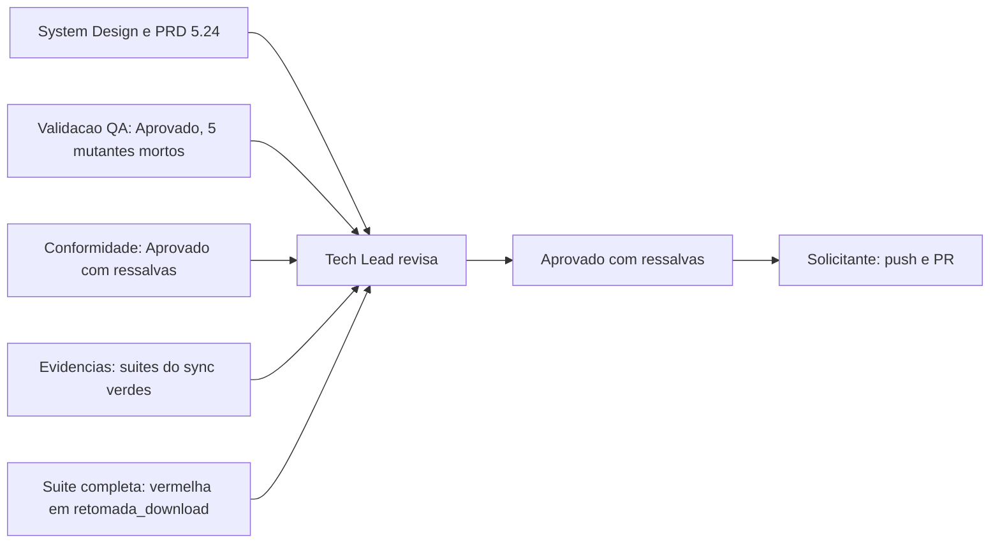

# Aprovacao final do Tech Lead - sync-em-blocos (F-101)

> Modelo: `.github/agents/templates/aprovacao-final-tech-lead-template.md`, porte G (todas as secoes). Documento redigido pelo documentation-writer em nome do Tech Lead, por referencia (regra 41). Fatos da entrega ficam no [registro de entrega](2026-10-31-1200-registro-sync-em-blocos.md) e nos pareceres linkados abaixo.

## Identificacao

- Projeto ou produto: dropbox_api (CLI `dbx`, Bash)
- Responsavel Tech Lead: Tech Lead (agent `tech-lead`)
- Data da aprovacao: 2026-10-31
- Escopo avaliado: `sync`, `upload` e `download` de pasta em ciclos de ate N arquivos cortados por diretorio (F-101, `RF-186` a `RF-197`, `TC-BLC-01..28`, `DIV-377` a `DIV-384`), branch `feature/sync-em-blocos` a partir de `origin/develop` @ 85885e3
- Uso do template padrao neste fechamento?: Sim
- Em caso de nao, justificativa explicita para excecao: Nao aplicavel
- Status final: Aprovado com ressalvas
- Porte da demanda: G (`sh scripts/porte.sh` mediu P na arvore sem diff; subida para G pelo Tech Lead, criterios no registro)
- Registro de entrega: [registro-sync-em-blocos](2026-10-31-1200-registro-sync-em-blocos.md)

## Artefatos obrigatorios revisados

- Revisao consolidada do Tech Lead: [revisao-consolidada-sync-em-blocos](2026-10-31-1200-revisao-consolidada-sync-em-blocos.md)
- Link ou referencia do arquivo concreto da revisao consolidada do Tech Lead: `docs/reviews/2026-10-31-1200-revisao-consolidada-sync-em-blocos.md`
- System Design revisado: [system-design-sync-em-blocos](2026-10-31-1200-system-design-sync-em-blocos.md) e a secao "Mudanca (sync-em-blocos, etapa 3b)" de `docs/arquitetura/system-design.md`
- Template padrao de System Design utilizado?: Nao
- Em caso de nao, justificativa explicita: a conferencia do System Design contra o template padrao nao foi executada nesta redacao. O parecer de conformidade registra "Coerente com System Design / ARD: Conforme" ([parecer de conformidade](2026-10-31-1200-parecer-conformidade-sync-em-blocos.md), secao "Consistencia com o projeto"). Pendencia registrada na revisao consolidada.
- PRD aplicavel?: Sim
- Referencia do PRD revisado: secao 5.24 de [escopo-requisitos-e-criterios-de-aceite.md](../requisitos/escopo-requisitos-e-criterios-de-aceite.md) (`F-101`, `RF-186` a `RF-197`), com `DIV-377` a `DIV-384` decididas
- ARD aplicavel?: Sim
- Referencia do ARD revisado: `docs/arquitetura/system-design.md` (secao "Mudanca (sync-em-blocos, etapa 3b)")
- Resumo das divergencias resolvidas entre PRD, ARD, implementacao e evidencias de validacao:
  - `RF-186(e)` prevalece sobre o briefing de implementacao (etapa 2, item 9): no `download` de arquivo unico `DBX_BLOCO` nao e lida; no `download` de pasta e validada antes de qualquer escrita ou estado. O teste da etapa 2 foi corrigido na etapa 3a.
  - `RF-187(c)` aplicado no `--receber` em fluxo: diretorio com mais de N arquivos forma ciclo sozinho (etapa 3d).
  - `RF-192(b)`: `get_latest_cursor` antes do ciclo 1 (`DIV-379`, opcao A); duble de `cursor_test.sh` ajustado sem alterar afirmacao.
  - Achados de conformidade 2 (poda por filtro unificada) e 4 (`DBX_SYNC_DIR_PARCIAL` removida) corrigidos, sem mudanca de comportamento.
  - Detalhe completo: [registro, secao Evidencias](2026-10-31-1200-registro-sync-em-blocos.md) e [parecer de evidencias](2026-10-31-1200-evidencia-testes-sync-em-blocos.md).
- Bloqueios remanescentes aceitos ou justificados:
  - Suite completa oficial (`sh scripts/suite-completa.sh`, commit `195af1e`) vermelha na familia do problema conhecido "retomada do download sob carga" (`tests/integracao/retomada_download_test.sh`, `rmd08`, `rmd07`). Aceito pela decisao do solicitante (ver Decisao final). Detalhe na [revisao consolidada](2026-10-31-1200-revisao-consolidada-sync-em-blocos.md), secao "Pendencias, bloqueios e riscos residuais".
  - Achados de conformidade 1 e 3 (refatoracao do laco de ciclos e da formacao do ciclo remoto): adiados com dono Tech Lead.
  - Achados 5, 6 e 7 do parecer de conformidade: abertos, sem correcao registrada.
  - Teste `hup_durante_a_listagem_remota_nao_deixa_area_do_sync` (`sync_test`): falhou uma vez sob carga, passou em 4 execucoes seguidas; sem mudanca de teste.
  - TC-BLC sem caso proprio do QA: 01, 03, 14, 19, 20, 23, 24, 28 (`TC-BLC-01` e `03` cobertos pelos testes do Senior Developer; o restante e candidato a ciclo de reforco).
- Validacao QA frontend aplicavel?: Nao
- Template QA frontend utilizado?: Nao
- Documento de validacao QA frontend referenciado no fechamento final: Nao aplicavel (entrega de CLI em Bash, sem frontend)
- Trecho, link ou evidencia reaproveitada da validacao QA frontend: Nao aplicavel
- Em caso de nao, justificativa explicita: a entrega nao tem interface de usuario grafica. A validacao do QA desta demanda (CLI) esta no [registro, secao "Validacao do QA"](2026-10-31-1200-registro-sync-em-blocos.md#validacao-do-qa-partes-1-e-2a) e na suite `tests/integracao/qa_sync_blocos_b21_test.sh`.
- Documento de Design System referenciado?: Nao
- Evidencias adicionais consultadas:
  - [Parecer de evidencias de testes](2026-10-31-1200-evidencia-testes-sync-em-blocos.md)
  - [Parecer de conformidade](2026-10-31-1200-parecer-conformidade-sync-em-blocos.md) (Aprovado com ressalvas; 0 bloqueantes, 3 maiores, 4 menores)
  - [Log de prompt](../prompts/2026-10-31_1200_sync-em-blocos.md), incluindo o paragrafo da suite completa
  - [Entrada de decisao](../../.github/agents/memoria/entradas/2026-10-31-1200-sync-em-blocos.md) e [entrada de aceite das suites qa_*](../../.github/agents/memoria/entradas/2026-10-31-1200-aceite-testes-qa-sync-em-blocos.md)

## Gates aplicados

| Gate | Aplicavel | Resultado | Evidencia | Observacoes |
|---|---|---|---|---|
| Business Analyst / System Design | Sim | Requisitos aprovados para implementacao; `DIV-377` a `DIV-384` decididas | [log de prompt](../prompts/2026-10-31_1200_sync-em-blocos.md), [system design](2026-10-31-1200-system-design-sync-em-blocos.md) | Template padrao de System Design nao conferido nesta redacao (ver Artefatos) |
| QA Expert / Validacao | Sim | Aprovado, sem defeito de codigo; 5 mutantes mortos | [registro, secao "Validacao do QA"](2026-10-31-1200-registro-sync-em-blocos.md#validacao-do-qa-partes-1-e-2a) | Suite `qa_sync_blocos_b21_test.sh` 25/0; ressalvas nao bloqueantes listadas no registro |
| UX Expert / Interface | Nao | Nao aplicavel | Entrega de CLI | Mudanca em ajuda, completion e README sem Design System |
| DBA / Persistencia | Nao | Nao aplicavel | Parecer de conformidade, "Modelo rico / invariantes / persistencia": nao aplicavel | Sem migracao; retrato e cursor mantem o formato de `lib/state` |

Gates adicionais que pesam na decisao (fora do modelo acima):

| Gate | Aplicavel | Resultado | Evidencia | Observacoes |
|---|---|---|---|---|
| Conformidade (`protocolo-conformidade`) | Sim | Aprovado com ressalvas | [parecer de conformidade](2026-10-31-1200-parecer-conformidade-sync-em-blocos.md) | 0 bloqueantes; maiores 1 e 3 adiados; achados 2 e 4 corrigidos |
| TDD / evidencias (`protocolo-tdd`) | Sim | Suites do sync verdes; suite completa vermelha na familia da retomada | [parecer de evidencias](2026-10-31-1200-evidencia-testes-sync-em-blocos.md) | Ver Criterios e Decisao |

## Criterios de aceite consolidados

| Criterio | Status | Evidencia | Observacoes |
|---|---|---|---|
| Revisao consolidada do Tech Lead registrada | Atendido | [revisao consolidada](2026-10-31-1200-revisao-consolidada-sync-em-blocos.md) | |
| Referencia concreta ao arquivo da revisao consolidada | Atendido | `docs/reviews/2026-10-31-1200-revisao-consolidada-sync-em-blocos.md` | |
| Requisitos claros e rastreaveis | Atendido | Secao 5.24 do escopo; matriz `RF-186..RF-197` na revisao consolidada | |
| PRD revisado quando aplicavel | Atendido | Secao 5.24 do escopo | |
| ARD revisado quando aplicavel | Atendido | `docs/arquitetura/system-design.md` | |
| Divergencias entre PRD, ARD, implementacao e evidencias tratadas | Atendido com ressalva | Resumo em "Artefatos obrigatorios revisados" | Decisoes de `DIV-377` a `DIV-384` aplicadas |
| System Design aderente ao template padrao | Nao verificado | Parecer de conformidade: "Coerente com System Design / ARD: Conforme" | Conferencia de template pendente |
| Vinculo entre System Design e Design System | Nao aplicavel | Entrega de CLI | |
| Validacao QA frontend registrada | Nao aplicavel | Entrega de CLI | Substituida pela validacao QA de CLI do registro |
| Referencia direta ao documento de validacao QA | Atendido | [registro, secao "Validacao do QA"](2026-10-31-1200-registro-sync-em-blocos.md#validacao-do-qa-partes-1-e-2a) | |
| Riscos residuais aceitaveis | Atendido com ressalva | Riscos listados na [revisao consolidada](2026-10-31-1200-revisao-consolidada-sync-em-blocos.md) | Suite completa vermelha aceita pelo solicitante |

## Riscos residuais e rollback

- Riscos residuais aceitos:
  - Suite completa oficial vermelha em `retomada_download_test.sh` (`rmd08`, `rmd07`), falha 3 de 3 dentro da suite e 0 de 6 isolada (arquivo isolado: 3 no ramo, 3 na base `85885e3`). A falha admite interferencia entre arquivos da mesma execucao. Dono: Tech Lead, demanda propria de investigacao.
  - Ramo que so existe no destino e lido inteiro no ciclo que o encontra, sem corte por N (decisao do Tech Lead; ciclo pode passar de N nesse caso).
  - Achados de conformidade 1 e 3 adiados (dono: Tech Lead; demanda de refatoracao antes da proxima alteracao no motor do `sync`).
  - Teste `hup_durante_a_listagem_remota_nao_deixa_area_do_sync` intermitente sob carga.
  - Uma chamada `get_latest_cursor` a mais por execucao em blocos.
  - Riscos formais `RSK-104` a `RSK-107` em [riscos-restricoes-e-licenciamento](../requisitos/riscos-restricoes-e-licenciamento.md).
- Riscos residuais nao aceitos: nenhum.
- Plano de rollback: reverter o merge do PR na `develop` (`git revert -m 1 <sha-do-merge>`). Sem migracao de estado: retrato e cursor mantem o formato de `lib/state`. Depois do revert, reexecutar `bash tests/run.sh` e confirmar a baseline anterior a demanda. Detalhe no [registro, secao "Plano de rollback"](2026-10-31-1200-registro-sync-em-blocos.md).
- Dependencias criticas para monitoramento: `list_folder` com `recursive:false` por diretorio (`429` em arvores com muitos diretorios pequenos, `RSK-105`); `get_latest_cursor` antes do ciclo 1; exclusao (`--espelhar`) so em diretorio observado por inteiro (`RSK-104`).

## Decisao final

- Decisao do Tech Lead: Aprovado com ressalvas. Merge liberado com a suite completa vermelha apenas na familia da retomada do download sob carga, pela decisao do solicitante. A execucao da suite foi repetida uma vez, conforme a decisao do solicitante, e falhou de novo somente em `rmd08`. A branch e enviada ao remoto e a PR e aberta pelo solicitante (o guarda de comandos nao permite abrir a PR com a suite vermelha).
- Condicoes para fechamento:
  - Push da branch e abertura da PR pelo solicitante.
  - Conferencia de `git status --short` e `git diff origin/develop --stat` contra a lista de arquivos do registro antes do commit (a lista do registro foi obtida dos pareceres, sem shell).
  - Commit do registro e dos arquivos da demanda com `Registro:` e `Prompt:` no corpo.
- Pendencias remanescentes:
  - Ressalva (a): refatoracao do laco de ciclos e da formacao do ciclo remoto para `lib/` (conformidade 1 e 3), sem mudanca de comportamento.
  - Ressalva (b): investigacao da falha de `retomada_download_test.sh` na suite completa (`rmd07`, `rmd08`), demanda propria.
  - Ressalva (c): TC-BLC sem caso proprio do QA (01, 03, 14, 19, 20, 23, 24, 28), candidato a ciclo de reforco.
  - Ressalva (d): teste `hup_durante_a_listagem_remota_nao_deixa_area_do_sync` intermitente.
  - Achados de conformidade 5, 6 e 7.
  - Red isolado nao obtido para RF-190, RF-194, RF-195 (QA e Tech Lead, ver registro).
  - Reaceite do solicitante das suites `qa_*` alteradas (aceite registrado em [entrada de aceite](../../.github/agents/memoria/entradas/2026-10-31-1200-aceite-testes-qa-sync-em-blocos.md)).
- Escalonamentos necessarios: falha de `retomada_download_test.sh` na suite completa, registrada como demanda propria de investigacao (dono: Tech Lead).
- Sintese final do impacto global da entrega: o `sync`, o `upload` e o `download` de pasta passam a processar em ciclos de ate N arquivos (padrao 50000, `--bloco`/`--batch`/`DBX_BLOCO`), cortados por diretorio, com listagem remota nao recursiva por diretorio do ciclo. A exclusao com `--espelhar` fica restrita a diretorio observado por inteiro nos dois lados. O cursor e o retrato so sao gravados em execucao integral. Compatibilidade preservada para arvores que cabem em um ciclo.
- Justificativa consolidada para eventual desvio do template padrao: a conferencia do System Design contra o template nao foi feita nesta redacao; ver Artefatos obrigatorios revisados.

