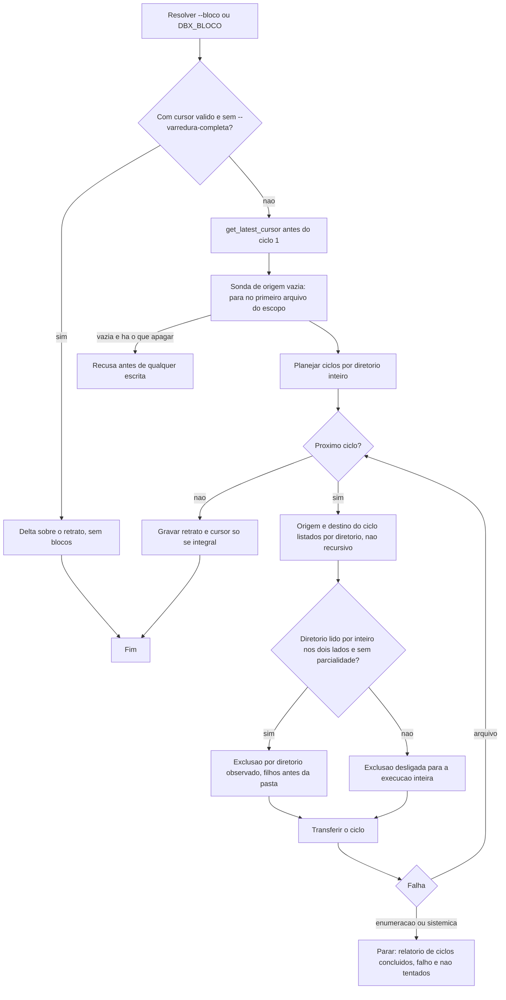

# Registro de entrega: sync, upload e download de pasta em blocos (F-101)

## Identificacao

- Porte: **G** (`sh scripts/porte.sh` mediu P na arvore sem diff; o Tech Lead subiu para G pelos criterios que o script nao mede: arquitetura do motor do `sync`, integracao externa (`list_folder` por diretorio), interacao com o cursor (F-14), guarda de exclusao (RF-41(a), RF-114) e retomada).
- Log de prompt: [docs/prompts/2026-10-31_1200_sync-em-blocos.md](../prompts/2026-10-31_1200_sync-em-blocos.md)
- Branch: `feature/sync-em-blocos`, a partir de `origin/develop` @ 85885e3. **Sem commit nesta data** (ver Proximos passos).
- Issues: nenhuma citada pelo solicitante.
- Agents: tech-lead (decisao e aceite), senior-developer (implementacao e gate de conformidade), qa-expert (validacao pendente), business-analyst (requisitos `RF-186` a `RF-197`, `DIV-377` a `DIV-384`), documentation-writer (este registro).
- Data: 2026-10-31.
- Worktree: `/home/sales/dropbox_api.worktrees/feature-sync-em-blocos`.

## Contexto e objetivo

O `sync` (e o `upload`/`download` de pasta, que o executam) enumerava a arvore local e remota inteira antes de planejar. O objetivo e processar em **ciclos** de ate N arquivos (padrao 50000, `--bloco N`/`--batch N`/`DBX_BLOCO`), formados por **diretorios inteiros** (o ciclo pode passar de N para fechar o diretorio corrente), consultando no remoto apenas os diretorios do ciclo.

Requisitos e pendencias: [secao 5.24 de `escopo-requisitos-e-criterios-de-aceite.md`](../requisitos/escopo-requisitos-e-criterios-de-aceite.md) (`F-101`, `RF-186` a `RF-197`, `TC-BLC-01..28`, `DIV-377` a `DIV-384`, todas decididas). Decisoes do solicitante e do Tech Lead: ver o [log de prompt](../prompts/2026-10-31_1200_sync-em-blocos.md) e a [entrada de memoria](../../.github/agents/memoria/entradas/2026-10-31-1200-sync-em-blocos.md).

## Decisao

Resumo (ADR resumido; a analise comparativa das tres abordagens fica no [system design da demanda](2026-10-31-1200-system-design-sync-em-blocos.md), secao "Analise comparativa de abordagens"):

- Leitura remota por diretorio (`list_folder` nao recursivo, cada diretorio uma vez, em fluxo) e planejamento por ciclo.
- Espelhamento so em diretorio lido por inteiro nos dois lados no ciclo; qualquer leitura parcial desliga a exclusao na execucao inteira.
- Sonda de origem vazia (DIV-378, opcao C) antes do ciclo 1; cursor pedido antes do ciclo 1 com retrato acumulado e gravado so ao fim integral (DIV-379, opcao A); falha de arquivo segue, falha de enumeracao ou sistemica para (DIV-380, opcao C).
- Cursor valido vence os blocos: o delta segue como hoje; os blocos valem para a varredura completa (primeira execucao, `--varredura-completa`, `--sem-cursor`, `--enviar` e `download` de pasta).
- `RF-186(e)` prevalece sobre o briefing de implementacao: no `download` de arquivo unico `DBX_BLOCO` nao e lida; no `download` de pasta ela e validada antes de qualquer escrita ou estado.
- Diretorio com mais de N arquivos forma ciclo sozinho tambem no `--receber` em fluxo (`RF-187(c)`).
- Ramo que so existe no destino e lido inteiro no ciclo que o encontra, sem corte por N (decisao do Tech Lead; ver riscos).

Trade-offs aceitos: o motor do `sync` passa a ter ciclos e uma chamada `get_latest_cursor` a mais por execucao em blocos; o executor `dbx_cmd_sync_executar` cresceu (ver ressalva de conformidade).

## Escopo tecnico e arquivos modificados

Lista obtida do parecer de conformidade (secao "Escopo verificado") e do parecer de evidencias. **Nao foi possivel executar `git status --short` nem `git diff origin/develop --stat` nesta execucao (sem shell); a lista deve ser conferida antes do commit.**

- **lib**: `lib/walk.sh` (enumeracao por diretorio, `_dbx_walk_podar_entrada`, `_dbx_walk_entrar_raiz`), `lib/sync.sh` (planejador `dbx_sync_blocos_planejar`, `list_folder` nao recursivo, `get_latest_cursor`), `lib/cli.sh` (validacao de `--bloco`/`DBX_BLOCO`), `lib/cmd.sh`.
- **commands**: `commands/sync.sh` (laco de ciclos, formacao de ciclo remoto, retrato e cursor, guarda de exclusao por diretorio), `commands/upload.sh`, `commands/download.sh`, `commands/diagnostico.sh` (parcial: `--bloco` e ajuda).
- **bin, completions, README**: `bin/dbx` (ajuda), `completions/dbx.bash`, `README.md`.
- **testes**: `tests/integracao/sync_blocos_test.sh`, `tests/integracao/bloco_cli_test.sh`, `tests/unit/sync_blocos_test.sh`, `tests/integracao/cursor_test.sh` (duble: `_servidor`, `cul11`, `qa_b7b_01/02` com `list_folder` nao recursivo e `get_latest_cursor`), `tests/integracao/qa_cursor_b7b_test.sh` (4 linhas de duble acrescentadas pelo developer; ver pendencias).
- **docs**: `docs/prompts/2026-10-31_1200_sync-em-blocos.md`, `docs/reviews/2026-10-31-1200-system-design-sync-em-blocos.md`, `docs/reviews/2026-10-31-1200-evidencia-testes-sync-em-blocos.md`, `docs/reviews/2026-10-31-1200-parecer-conformidade-sync-em-blocos.md`, `docs/requisitos/escopo-requisitos-e-criterios-de-aceite.md` (secao 5.24), `docs/requisitos/riscos-restricoes-e-licenciamento.md` (`RSK-104` a `RSK-107`), `docs/arquitetura/system-design.md` (secao "Mudanca (sync-em-blocos, etapa 3b)" e ajustes de coerencia no componente de enumeracao remota e no fluxo da varredura completa), este registro.

Mudancas tecnicas principais (detalhe nos pareceres): ver [system design da demanda](2026-10-31-1200-system-design-sync-em-blocos.md), secoes "Componentes e responsabilidades" e "Fluxo do ciclo".

## Evidencias de validacao

Evidencias por referencia: [parecer de evidencias de testes](2026-10-31-1200-evidencia-testes-sync-em-blocos.md) (etapas 1, 2, 3a, 3b, 3c, 3d e correcoes da conformidade).

Resumo do que o parecer registra como **executado** (contagens transcritas do parecer, nao recalculadas aqui):

- `bash tests/run.sh sync_`: 6 arquivos, 147 aprovados, 0 reprovados (etapa 3b; anterior a 3c e 3d).
- `sync_blocos`: 41/0 (3c), depois 42/0 (3d). `sync_test`: 93/0. `composicao`: 28/0 (3c). `filtro`: 92/0 e `walk`: 13/0 (correcoes da conformidade).
- Red comprovado: leitura dobrada anterior (`cul11`, teste de leitura unica); `blc_receber_diretorio_maior_que_n_forma_ciclo_sozinho` (`not ok 16`); RF-193 com `_dbx_cmd_sync_parada_sistemica` neutralizada (`trecho ausente: [ciclo_falho=1]`).

Validacao **nao executada** (declarado):

- `scripts/lint.sh` e shellcheck/shfmt: nao concluidos nesta entrega (parecer de conformidade e de evidencias).
- `cursor_test`, `download`, `paralelo` em regressao ampla: nao concluidos na etapa 3b; regressao ampla a cargo do Tech Lead.
- Red isolado para RF-190, RF-194, RF-195 e RF-193 nao obtido na etapa 3b; RF-193 fechado na 3c; os demais permanecem como pendencia (ver riscos).
- Validacao independente do QA (suite e inventario de testes): nao executada.
- Suite completa antes do push: nao executada.

Gate de conformidade: [parecer de conformidade](2026-10-31-1200-parecer-conformidade-sync-em-blocos.md). Veredito **Aprovado com ressalvas**, bloqueantes 0, maiores 3, menores 4. Correcoes aplicadas: achado 2 (poda por filtro unificada) e achado 4 (`DBX_SYNC_DIR_PARCIAL` removida). Achados 1 e 3 adiados com dono (Tech Lead). Achados 5, 6 e 7: sem correcao registrada na tabela de correcoes do parecer; ficam como pendencia.

## Riscos, impacto e rollback

### Riscos

Riscos formais novos, registrados em [riscos-restricoes-e-licenciamento.md](../requisitos/riscos-restricoes-e-licenciamento.md): `RSK-104` (exclusao por diretorio observado sem estar, `RF-190`), `RSK-105` (mais `list_folder` com `429`, `RF-187`), `RSK-106` (retrato/cursor de varredura parcial, `RF-192`), `RSK-107` (efeitos parciais apos falha de ciclo, `RF-193`).

Riscos residuais desta entrega (nao cobertos pelos `RSK` acima):

1. Ramo que so existe no destino e lido inteiro no ciclo que o encontra, sem corte por N. Risco aceito pelo Tech Lead para evitar plano duplicado entre ciclos. Pode haver ciclo maior que N nesse caso.
2. Teste `hup_durante_a_listagem_remota_nao_deixa_area_do_sync` (`sync_test`) falhou uma vez sob carga e passou em 4 execucoes seguidas. Intermitente; sem mudanca de teste; registrado na [entrada de memoria](../../.github/agents/memoria/entradas/2026-10-31-1200-sync-em-blocos.md).
3. Refatoracao adiada: achados maiores 1 e 3 do parecer de conformidade (laco de ciclos e formacao do ciclo remoto em `commands/sync.sh`, `dbx_cmd_sync_executar` com cerca de 1000 linhas). Dono: Tech Lead; demanda propria antes da proxima alteracao no motor do `sync`.
4. Red nao isolado de alguns testes da etapa 3b (RF-190, RF-194, RF-195): ver evidencias. Pendente ao QA.
5. Uma chamada a mais por execucao em blocos (`get_latest_cursor` antes do ciclo 1).
6. Achados 5 (dependencia `lib/walk` -> `DBX_CMD_MARCA_RECEBIMENTO`), 6 (motivo de parcialidade com quebra de linha) e 7 (recuo do laco) do parecer de conformidade: abertos.

### Impacto

- Contrato de CLI: nova opcao `--bloco N` (alias `--batch N`) e variavel `DBX_BLOCO`; faixa 1..1000000; ajuda, completions e README atualizados.
- Estado: sem migracao. O retrato e o cursor mantem o formato de `lib/state`. O cursor so e gravado ao fim integral.
- Remoto: `list_folder` nao recursivo por diretorio em varredura em blocos; `get_latest_cursor` antes do ciclo 1.
- Exclusao: so em diretorio observado por inteiro nos dois lados; guarda de origem vazia antes do ciclo 1.

### Plano de rollback

1. Reverter o merge do PR desta feature na `develop` (`git revert -m 1 <sha-do-merge>`).
2. Nao ha migracao de estado a desfazer: o retrato e o cursor mantem o formato de `lib/state`; execucoes anteriores ao revert continuam validas.
3. Reexecutar `bash tests/run.sh` na `develop` revertida e confirmar a baseline anterior a demanda.

## Proximos passos

1. QA: validacao independente (suite propria e inventario de testes), incluindo a conferencia dos red nao isolados (RF-190, RF-194, RF-195) e a medicao de `429` em arvore com muitos diretorios pequenos (RSK-105).
2. Reaceite do solicitante das suites `qa_*` alteradas, em especial `tests/integracao/qa_cursor_b7b_test.sh` (4 linhas de duble acrescentadas pelo developer). O QA decide sobre o restante dessas suites.
3. Suite completa (`bash tests/run.sh` e `scripts/lint.sh`) antes do push, incluindo `cursor_test`, `download` e `paralelo`, que nao foram concluidos.
4. Conferir `git status --short` e `git diff origin/develop --stat` contra a lista de arquivos deste registro.
5. Tech Lead: decidir sobre achados 5, 6 e 7; abrir a demanda de refatoracao dos achados 1 e 3.
6. Commit do registro e dos arquivos da demanda, com `Registro:` e `Prompt:` no corpo, somente apos a conferencia do item 4.

## Diagrama (Mermaid)

Ciclo de enviar e receber. Os nos "Origem" e "Destino" valem conforme o sentido (`--enviar` le a origem da travessia local; `--receber` e `download` de pasta leem a origem remota por diretorio). Detalhes em [system design, "Fluxo do ciclo"](2026-10-31-1200-system-design-sync-em-blocos.md).

## Aceites

- QA: pendente (validacao independente e reaceite das suites `qa_*` alteradas).
- Tech Lead: pendente (aprovacao final, decisao sobre achados 1, 3, 5, 6 e 7, e aceite do risco de ramo so no destino).
- Solicitante: pendente (reaceite das suites `qa_*` alteradas).

## Validacao do QA (partes 1 e 2a)

Veredito final: **Aprovado**, com ressalvas nao bloqueantes. Nenhum defeito de codigo encontrado; os 5 mutantes foram mortos.

- Suite `tests/integracao/qa_sync_blocos_b21_test.sh`: 25 aprovados, 0 reprovados (23 da parte 1 mais 2 casos novos da parte 2a). Cobre TC-BLC-02,04..09,10,11..13,15,16..18,21,22,25,26,27 e a exclusao nas duas direcoes. Fora da suite, com o motivo: TC-BLC-01,03,14,19,20,23,24,28 ficaram sem caso proprio por limite de chamadas do QA (nao por impossibilidade); TC-BLC-01/03 sao cobertos pelos testes do Senior Developer (`sync_blocos_test`, `bloco_cli_test`), o restante e candidato a ciclo de reforco.
- Casos novos (2a): (a) `qa_blc_arquivo_local_ilegivel_no_ciclo_desliga_a_exclusao_dali_em_diante`: arquivo local `chmod 000` em `d2` com `--espelhar --bloco 2`: sai diferente de 0 e nada e apagado de `d2` nem de `d3` (a raiz e `d1`, ciclos anteriores, podem ja ter apagado, RF-190(d)); (b) `qa_blc_filtro_sem_casamento_na_raiz_nao_recusa_por_origem_vazia`: `--receber --espelhar --incluir '*.log'` com nenhum `.log` na raiz, o unico em `s2/fundo`, e `sobra.log` a apagar: nao recusa por origem vazia com `--bloco 1` nem com `--bloco 1000000`, e os dois planos apagam `sobra.log`. Aprovou: sem defeito (acumulado e total_origem contam o escopo filtrado).
- Reparo das suites qa_ quebradas (so duble, sem afrouxar afirmacao): `qa_cursor_b7b` 49/0; `qa_regex_portavel_b17` 19/0. Causa: a coleta remota em fluxo (RF-189) lista um diretorio por vez e consulta `get_latest_cursor`; novo auxiliar `_q_filhos` e regras `recursive:false`/`get_latest_cursor` nos dubles.
- Auditorias: `json_test` 62/0, `composicao` 28/0, `auth_test` 42/0, todas APROVADA. `bash tests/run.sh qa_sync_blocos`: 25/0 APROVADA.
- Mutantes (revertidos, `sha256sum -c` OK; sha256 de `commands/sync.sh` 04a399624fa340b3eee48aa4679d1c1cae23e8961e3754812110eaa27d2707ec): (1) l.1108 `parcial='sim'`->`'nao'`: MATADO (cursor_so_e_gravado_ao_fim_integral); (2) l.1154 `parcial='sim'`->`'nao'`: MATADO (caso novo a: "ciclo da parcialidade nao apaga"); (3) l.1324 `recusa_origem_vazia='sim'`->`'nao'`: MATADO (origem_so_de_pastas_vazias...); (4) l.2347 `|| continue`->`&& continue` (checagem de pai observado antes de listar o ramo so do destino, `--enviar`): MATADO (enviar_apaga_no_remoto_so_o_observado_nos_dois_lados); (5) l.2168 e l.2283 `vazia_global='sim'`->`'nao'` (sonda de origem vazia): MATADO (origem_so_de_pastas_vazias... l. "sem nenhum arquivo na origem e algo a apagar").
- Observacoes nao bloqueantes: (a) `--json` emite um plano por ciclo mais o resumo agregado final; compativel com DIV-381, a confirmar. (b) `--receber --espelhar` nao remove a pasta local vazia (base). (c) RF-190(d): exclusao valida de ciclo anterior a parcialidade pode ja ter ocorrido (o caso novo a nao afirma o contrario). (d) O mutante 4 so exercita a direcao `--enviar`; a direcao `--receber` (pai observado) e coberta pelo caso `diretorio_so_no_destino_so_e_apagado_com_o_pai_observado` sem mutante proprio.
- Ressalvas: o red nao isolado de alguns testes da etapa 3b (ver parecer de evidencias) e a cobertura de TC-BLC listada acima como fora da suite.
- sha256: qa_sync_blocos_b21_test.sh f5e8fc366fda4d77c41db5e1541d40060a273ad1532397f11466209502bbd6f8 (antigo: inexistente); qa_cursor_b7b_test.sh antigo 8c40c6f0f77ea0dd9e147e4ba6e21898366e7e131f5b51043e021ce05235e4b6 novo 15045c18464902f61c70069c513a506cd3ac8f7fa2e3ed251a82e26af4ab5159; qa_regex_portavel_b17_test.sh antigo 1406718ce5010677ca044cfaaa5acb2b2c042078d6ba627da2fcd55138a015d8 novo 87de2391cc3bd773d8884e35510ea0ce0e0f67870b0abce7332b1ba5dc62bb9e.
