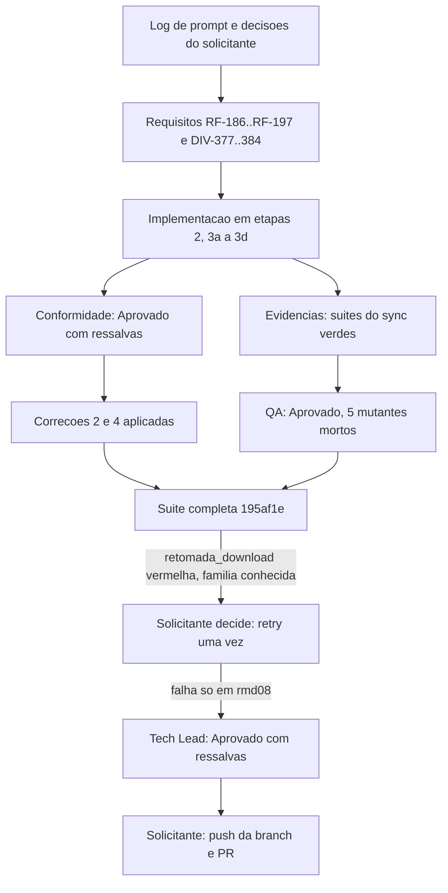

# Revisao consolidada do Tech Lead - sync-em-blocos (F-101)

> Modelo: `.github/agents/templates/revisao-consolidada-tech-lead-template.md`, porte G. Consolida por referencia (regra 41): cada linha aponta para o artefato de origem e nao reescreve o seu conteudo.

## Identificacao

- Projeto ou produto: dropbox_api (CLI `dbx`, Bash)
- Responsavel Tech Lead: Tech Lead (agent `tech-lead`)
- Data da revisao: 2026-10-31
- Escopo revisado: `sync`, `upload` e `download` de pasta em ciclos de ate N arquivos cortados por diretorio (F-101; `RF-186` a `RF-197`; `TC-BLC-01..28`; `DIV-377` a `DIV-384`); branch `feature/sync-em-blocos` a partir de `origin/develop` @ 85885e3
- Agents envolvidos: tech-lead, senior-developer, qa-expert, business-analyst, documentation-writer
- Status da revisao: Concluida com ressalvas
- Porte da demanda: G
- Registro de entrega: [registro-sync-em-blocos](2026-10-31-1200-registro-sync-em-blocos.md)
- Log de prompt: [log de prompt](../prompts/2026-10-31_1200_sync-em-blocos.md)

## Resumo executivo

- Objetivo da entrega: processar `sync`, `upload` e `download` de pasta em ciclos de ate 50000 arquivos (configuravel), cortados por diretorio inteiro, com coleta remota feita so nos diretorios do ciclo.
- Contexto consolidado: o executor enumerava a arvore local e remota inteira antes de planejar. A demanda muda o motor para ciclos, sem mudar o comportamento de arvores que cabem em um ciclo. As decisoes do solicitante estao no [log de prompt](../prompts/2026-10-31_1200_sync-em-blocos.md) e na [entrada de decisao](../../.github/agents/memoria/entradas/2026-10-31-1200-sync-em-blocos.md).
- Resultado executivo da revisao: aprovada com ressalvas. Os gates de codigo e QA estao verdes (conformidade sem bloqueantes; QA aprovado sem defeito de codigo; suites do sync verdes). A suite completa oficial ficou vermelha na familia do problema conhecido da retomada do download sob carga, em arquivo que a demanda nao altera. O solicitante decidiu aceitar a falha e levar a branch ao remoto, com a PR aberta por ele.
- Recomendacao do Tech Lead: aprovar com ressalvas. Abrir as demandas de refatoracao (conformidade 1 e 3) e de investigacao da retomada do download antes da proxima alteracao no motor do `sync`.

## PRD e ARD

- PRD aplicavel?: Sim
- Referencia do PRD: secao 5.24 de [escopo-requisitos-e-criterios-de-aceite.md](../requisitos/escopo-requisitos-e-criterios-de-aceite.md) (`F-101`, `RF-186` a `RF-197`, `TC-BLC-01..28`)
- ARD aplicavel?: Sim
- Referencia do ARD: `docs/arquitetura/system-design.md`, secao "Mudanca (sync-em-blocos, etapa 3b)"

| Artefato | Item revisado | Consistencia com entrega | Lacunas encontradas | Observacoes |
|---|---|---|---|---|
| PRD | Secao 5.24 (`RF-186..RF-197`) | Consistente com a implementacao, com `DIV-377..384` decididas | Matriz de testes de `RF-197(d)` (`docs/testes/mapa-modulos.md`, `docs/testes/inventario-de-testes.md`) nao confirmada nesta revisao | Ver pendencias |
| ARD | `docs/arquitetura/system-design.md` (mudanca sync-em-blocos) | Consistente com a implementacao, segundo o parecer de conformidade | Conferencia contra o template padrao de System Design nao executada | Ver pendencias |

## Divergencias entre PRD, ARD, implementacao e evidencias de validacao

| Divergencia | Origem | Impacto | Resolucao adotada | Status |
|---|---|---|---|---|
| Briefing (etapa 2, item 9) exigia recusar `DBX_BLOCO` invalida tambem no `download` de arquivo unico, contra `RF-186(e)` | Briefing de implementacao | `download` de arquivo unico quebraria por variavel que nao usa | Prevalece `RF-186(e)`: arquivo unico nao le a variavel; pasta valida antes de qualquer escrita ou estado. Teste corrigido na etapa 3a | Resolvida |
| Enumeracao remota previa lia a arvore inteira e cada ciclo a lia de novo (`RF-189`) | Implementacao da etapa 3b | Leitura dobrada, violacao de `RF-189(a)` | Coleta em fluxo; teste de leitura unica (`cul11` voltou a 1 e 1) | Resolvida |
| Ramo que so existe no destino e lido inteiro no ciclo que o encontra, sem corte por N | Decisao do Tech Lead, para evitar plano duplicado entre ciclos | Ciclo pode passar de N | Aceito como risco residual (ver Pendencias) | Aceita com ressalva |
| `RF-187(c)` no `--receber` em fluxo: diretorio com mais de N forma ciclo sozinho | Implementacao da etapa 3d | Sem ela, o diretorio entraria no ciclo corrente | Implementado; teste `blc_receber_diretorio_maior_que_n_forma_ciclo_sozinho` (red comprovado) | Resolvida |
| Parcialidade e `DBX_SYNC_DIR_PARCIAL` escrita e nunca lida (conformidade, achado 4) | Parecer de conformidade | Codigo morto com comentario enganoso | Variavel removida; sinal efetivo e o status de retorno da listagem | Resolvida |
| Poda por filtro replicada tres vezes (conformidade, achado 2) | Parecer de conformidade | Divergencia de filtro entre travessias | Extraido `_dbx_walk_podar_entrada`, sem mudanca de comportamento | Resolvida |
| Refatoracao do laco de ciclos e da formacao do ciclo remoto em `commands/sync.sh` (conformidade, achados 1 e 3) | Parecer de conformidade | Coesao e tamanho de `dbx_cmd_sync_executar` (~1000 linhas) | Adiado com dono Tech Lead, por risco de regressao depois de quatro rodadas de correcao | Aberta com dono |
| Achados 5 (dependencia `lib/walk` -> `DBX_CMD_MARCA_RECEBIMENTO`), 6 (quebra de linha em motivo de parcialidade) e 7 (recuo do laco) | Parecer de conformidade | Menores; sem efeito em seguranca nem em dado | Sem correcao registrada | Aberta |
| Suite completa vermelha em `tests/integracao/retomada_download_test.sh` (`rmd08`, `rmd07`, `rmd08`) | Suite oficial `sh scripts/suite-completa.sh` no commit `195af1e` | Falha 3 de 3 na suite, 0 de 6 isolada; admite interferencia entre arquivos da mesma execucao | Aceita pela decisao do solicitante; investigacao em demanda propria | Aberta com dono |

- Conclusao especifica sobre divergencias entre PRD e ARD: nenhuma divergencia aberta entre a secao 5.24 e o ARD. As decisoes de `DIV-377..384` estao aplicadas no ARD e na implementacao.
- Conclusao especifica sobre divergencias entre artefatos, implementacao e evidencias de validacao: as divergencias de codigo foram resolvidas. A unica divergencia aberta com impacto em aceite e a suite completa vermelha, tratada na secao de decisoes.

## Artefatos consolidados por agent

| Agent | Artefato (link) | Veredito ou resultado registrado la | Ressalva do Tech Lead |
|---|---|---|---|
| Senior Developer | [registro de entrega](2026-10-31-1200-registro-sync-em-blocos.md), [parecer de evidencias](2026-10-31-1200-evidencia-testes-sync-em-blocos.md), [parecer de conformidade](2026-10-31-1200-parecer-conformidade-sync-em-blocos.md) | Evidencias: suites do sync verdes (`sync_` 147/0 na etapa 3b; `sync_blocos` 42/0; `sync_test` 93/0; `filtro` 92/0; `walk` 13/0; `composicao` 28/0). Conformidade: Aprovado com ressalvas (0 bloqueantes, 3 maiores, 4 menores) | Achados 1 e 3 adiados; achados 5, 6, 7 abertos; lint e shellcheck nao concluidos |
| QA Expert | [registro, secao "Validacao do QA"](2026-10-31-1200-registro-sync-em-blocos.md#validacao-do-qa-partes-1-e-2a), suite `tests/integracao/qa_sync_blocos_b21_test.sh` | Aprovado; 25/0; 5 mutantes mortos; sem defeito de codigo | Ressalvas nao bloqueantes listadas no registro (observacoes a, b, c, d) |
| Business Analyst | [escopo, secao 5.24](../requisitos/escopo-requisitos-e-criterios-de-aceite.md), [system design](2026-10-31-1200-system-design-sync-em-blocos.md) | Requisitos `RF-186..RF-197` e `DIV-377..384` decididos | Matriz `RF-197(d)` a confirmar |
| UX Expert | Nao aplicavel: `Nao aplicavel: entrega de CLI, sem interface grafica` | Nao aplicavel | Nao aplicavel |
| DBA | Nao aplicavel: `Nao aplicavel: sem persistencia de banco; estado em lib/state sem migracao` | Nao aplicavel | Nao aplicavel |
| Documentation Writer | [registro de entrega](2026-10-31-1200-registro-sync-em-blocos.md), [aprovacao final](2026-10-31-1200-aprovacao-final-sync-em-blocos.md) | Artefatos de fechamento redigidos | Estado do registro: secoes de QA e de suite que dizem "pendente" precisam ser lidas com a data da aprovacao |

## Decisoes proprias do Tech Lead

| Decisao | Motivacao | Impacto | Status |
|---|---|---|---|
| `RF-186(e)` prevalece sobre o briefing de implementacao no arquivo unico | O requisito e a fonte; o briefing estava errado | `download` de arquivo unico nao le `DBX_BLOCO` | Aplicada |
| Ramo que so existe no destino e lido inteiro no ciclo que o encontra, sem corte por N | Evitar plano duplicado entre ciclos | Ciclo pode passar de N; risco aceito | Aplicada com ressalva |
| Adiar refatoracao dos achados 1 e 3 de conformidade | Refatorar o executor depois de quatro rodadas de correcao aumenta o risco de regressao; o achado e de coesao, nao de comportamento ou seguranca | Divida tecnica registrada; dono Tech Lead | Aplicada, demanda propria a abrir |
| Aceitar `sync_test` intermitente (`hup_durante_a_listagem_remota_nao_deixa_area_do_sync`) sem mudar o teste | Passou em 4 execucoes seguidas apos uma falha sob carga | Risco de teste intermitente registrado | Aplicada |
| Veredito Aprovado com ressalvas, com merge liberado pela decisao do solicitante sobre a suite vermelha na familia da retomada | Falha restrita a `retomada_download_test.sh`, familia do problema conhecido da v2.1.0, arquivo que a demanda nao altera; arquivo isolado 6 de 6 | Merge com suite completa nao verde; risco aceito pelo solicitante | Aplicada |

## Itens impactados e pontos validados (porte G)

Matriz de rastreabilidade por link. Os nomes de teste sao da suite do Senior Developer (`tests/integracao/sync_blocos_test.sh`, `tests/unit/sync_blocos_test.sh`, `tests/integracao/bloco_cli_test.sh`) e os `TC-BLC` sao os casos do QA (`tests/integracao/qa_sync_blocos_b21_test.sh`). Quando nao ha teste nomeado, a linha diz isso.

| Item | Tipo | Evidencia (link) | Risco | Mitigacao |
|---|---|---|---|---|
| RF-186 (`--bloco`, `--batch`, `DBX_BLOCO`; validacao, precedencia, `RF-186(e)`) | Requisito P0 | [bloco_cli_test.sh](../../tests/integracao/bloco_cli_test.sh); [unit RF-186](../../tests/unit/sync_blocos_test.sh); `blc_download_de_arquivo_ignora_a_variavel_invalida_e_o_de_pasta_recusa_2_sem_escrita` em [sync_blocos_test.sh](../../tests/integracao/sync_blocos_test.sh); QA `TC-BLC-02` na [suite do QA](../../tests/integracao/qa_sync_blocos_b21_test.sh) | Opcao com valor invalido em ambiente | Validacao antes de rede e de estado; teste de precedencia |
| RF-187 (unidade de corte, ciclo, excesso de um diretorio, cobertura exata) | Requisito P0 | Unit RF-187 (planejador puro) em [unit](../../tests/unit/sync_blocos_test.sh); `blc_enviar_forma_ciclos_por_diretorio_e_consulta_so_nao_recursivo`, `blc_uma_arvore_que_cabe_em_um_ciclo_nao_muda_o_resultado`, `blc_receber_diretorio_maior_que_n_forma_ciclo_sozinho` (RF-187(c), red comprovado) em [sync_blocos_test.sh](../../tests/integracao/sync_blocos_test.sh); QA `TC-BLC-04..07` | Ciclo maior que N no ramo so do destino (risco aceito) | Registrado como risco residual |
| RF-188 (origem define os diretorios; enumeracao por diretorio) | Requisito P0 | `blc_receber_lista_cada_diretorio_remoto_exatamente_uma_vez` (RF-188(b)) em [sync_blocos_test.sh](../../tests/integracao/sync_blocos_test.sh); parecer de evidencias, etapa 3b (`cul11` 1 e 1) | Enumeracao local incremental: cobertura de RF-188(a) e (c) so pelos testes de ciclo, sem teste nomeado especifico | Parecer de evidencias e QA |
| RF-189 (`list_folder` nao recursivo por diretorio; destino so nos diretorios do ciclo) | Requisito P0, integracao externa | `blc_receber_percorre_os_diretorios_remotos_nao_recursivamente` em [sync_blocos_test.sh](../../tests/integracao/sync_blocos_test.sh) (`"recursive":true` ausente); unit RF-189 em [unit](../../tests/unit/sync_blocos_test.sh); [cursor_test.sh](../../tests/integracao/cursor_test.sh) (raiz listada uma vez); QA `TC-BLC-08/09` | Mais chamadas e `429` em arvore com muitos diretorios pequenos (`RSK-105`) | Medicao de `429` pedida ao QA (proximo passo do registro) |
| RF-190 (exclusao por diretorio observado; parcialidade desliga a exclusao na execucao inteira) | Requisito P0, guarda de exclusao | `blc_espelhar_apaga_so_em_diretorio_lido_inteiro_e_o_so_do_destino_depois_do_pai`; `blc_travessia_parcial_desliga_a_exclusao_na_execucao_inteira`; `blc_receber_espelhar_apaga_ramo_local_que_so_existe_no_destino` (todos em [sync_blocos_test.sh](../../tests/integracao/sync_blocos_test.sh)); QA `TC-BLC-11`, `12`, `13` e casos de RF-190(a)..(d) em [qa_sync_blocos_b21](../../tests/integracao/qa_sync_blocos_b21_test.sh); mutantes 1 a 4 | Exclusao indevida (`RSK-104`) | Dois testes independentes (Senior Developer e QA). Red isolado nao obtido na etapa 3b: pendencia ao QA |
| RF-191 (guarda de origem vazia antes da exclusao) | Requisito P0, bloqueante | `blc_origem_vazia_com_algo_a_apagar_e_recusa_14_sem_escrita` em [sync_blocos_test.sh](../../tests/integracao/sync_blocos_test.sh); QA `TC-BLC-15` e casos de RF-191(a) em [qa_sync_blocos_b21](../../tests/integracao/qa_sync_blocos_b21_test.sh); mutantes 3 e 5 | Recusa indevida ou exclusao antes da decisao | Sonda antes do ciclo 1; `extras_arquivos` conta como algo a apagar |
| RF-192 (cursor e blocos; retrato so ao fim integral) | Requisito P0 | `blc_primeira_execucao_em_ciclos_grava_cursor_e_retrato_e_a_segunda_usa_o_delta`, `blc_retrato_dos_ciclos_e_o_da_varredura_recursiva_da_mesma_arvore`, `blc_dry_run_nao_grava_cursor_nem_retrato`, `blc_falha_no_ciclo_k_nao_grava`, `blc_leitura_parcial_nao_grava`, `blc_varredura_completa_forcada_roda_em_ciclos_e_regrava` (todos em [sync_blocos_test.sh](../../tests/integracao/sync_blocos_test.sh)); [cursor_test.sh](../../tests/integracao/cursor_test.sh) 48/0; [qa_cursor_b7b](../../tests/integracao/qa_cursor_b7b_test.sh) 49/0; QA `TC-BLC-16/17/18`; mutante 1 | Cursor gravado em execucao parcial | Gravacao so ao fim integral, sob trava |
| RF-193 (falha no ciclo k; efeitos dos ciclos anteriores; codigos existentes) | Requisito P0 | `blc_falha_de_arquivo_segue_e_falha_de_enumeracao_para`, `blc_falha_sistemica_de_transferencia_para_e_a_de_arquivo_segue` (em [sync_blocos_test.sh](../../tests/integracao/sync_blocos_test.sh)); QA `TC-BLC` de falha de arquivo ilegivel (RF-190(b)/RF-193); red com parada sistemica neutralizada (`trecho ausente: [ciclo_falho=1]`) | Efeitos parciais apos falha de ciclo (`RSK-107`) | Relatorio com ciclos concluidos, falho e nao tentados |
| RF-194 (progresso, resumo, `--json`, `--dry-run`) | Requisito P1 | `blc_debug_traz_a_linha_bloco_no_resumo`, `blc_dry_run_percorre_os_ciclos_sem_escrever` (em [sync_blocos_test.sh](../../tests/integracao/sync_blocos_test.sh)); QA `TC-BLC-21` e `TC-BLC-22`; `TC-BLC` de filtro (RF-191/RF-194) | `--json` com um plano por ciclo mais resumo agregado: compativel com `DIV-381`, a confirmar (observacao do QA) | Confirmar `DIV-381` |
| RF-195 (`--paralelo` e lote por ciclo) | Requisito P1 | `blc_paralelo_2_fecha_o_ciclo_antes_do_proximo_e_da_o_mesmo_resultado` (em [sync_blocos_test.sh](../../tests/integracao/sync_blocos_test.sh)) | Red isolado nao obtido na etapa 3b | Pendencia ao QA |
| RF-196 (colisao de caixa, filtros, poda por diretorio) | Requisito P0 | `blc_colisao_de_caixa_no_diretorio_do_ciclo_recusa_antes_de_escrever` (em [sync_blocos_test.sh](../../tests/integracao/sync_blocos_test.sh)); QA `TC-BLC-25`, `TC-BLC-26`, e caso `qa_blc_filtro_sem_casamento_na_raiz_nao_recusa_por_origem_vazia`; mutante 3 | Filtro aplicado so depois da tabela remota inteira (`DIV-g` no escopo) | Filtro antes do ciclo; poda por filtro unificada (conformidade 2) |
| RF-197 (compatibilidade, ajuda, completion, documentacao) | Requisito P1 | `blc_uma_arvore_que_cabe_em_um_ciclo_nao_muda_o_resultado`; reaprovacao de [qa_cursor_b7b](../../tests/integracao/qa_cursor_b7b_test.sh) e [qa_regex_portavel_b17](../../tests/integracao/qa_regex_portavel_b17_test.sh) (`qa_regex_portavel_b17` 19/0); ajuda em `bin/dbx`, [completions/dbx.bash](../../completions/dbx.bash), [README.md](../../README.md) | `RF-197(d)`: `docs/testes/mapa-modulos.md` e `docs/testes/inventario-de-testes.md` nao confirmados nesta revisao | Pendencia (ver tabela abaixo) |

Pontos validados sem item de requisito:

| Item | Tipo | Evidencia (link) | Risco | Mitigacao |
|---|---|---|---|---|
| Validacao de entrada e seguranca de exclusao | Seguranca | [parecer de conformidade, secao "Seguranca de exclusao"](2026-10-31-1200-parecer-conformidade-sync-em-blocos.md) | Nenhum achado de seguranca | Conforme |
| Cursor sem segredo; validacao por regex e teto | Seguranca | [parecer de conformidade, secao "Verificacao de seguranca acionada"](2026-10-31-1200-parecer-conformidade-sync-em-blocos.md) | Nenhum | Conforme |
| Teste de download de pasta corrigido (`RF-186(e)`) | Teste | `blc_download_de_pasta_usa_ciclos` em [sync_blocos_test.sh](../../tests/integracao/sync_blocos_test.sh) | Nenhum | Conforme |
| Dependencia `lib/walk` -> `DBX_CMD_MARCA_RECEBIMENTO` | Arquitetura | [parecer de conformidade, achado 5](2026-10-31-1200-parecer-conformidade-sync-em-blocos.md) | Acoplamento de camada | Aberto |

### Fluxo de decisao desta entrega

## Impacto global da entrega

- Impacto no negocio: upload, download de pasta e sync de arvores grandes passam a caber em execucoes por ciclo, com `--bloco` configuravel. Arvores pequenas nao mudam de resultado.
- Impacto tecnico: o motor do `sync` ganha ciclos, planejamento por ciclo e uma chamada `get_latest_cursor` a mais por execucao em blocos. `dbx_cmd_sync_executar` cresceu (divida de coesao registrada).
- Impacto operacional: mais chamadas `list_folder` por diretorio (`RSK-105`); execucao por ciclo pode parar no meio com efeitos dos ciclos anteriores preservados (`RF-193(b)`).
- Impacto em UX: contrato de CLI com `--bloco`, `--batch` e `DBX_BLOCO`; ajuda, completion e README atualizados; saida de progresso por ciclo.
- Impacto em dados: sem migracao. Retrato e cursor mantem o formato de `lib/state`; cursor so e gravado ao fim integral. A exclusao com `--espelhar` fica restrita a diretorio observado por inteiro nos dois lados.

## Encaminhamento para fechamento

- Pronto para aprovacao final?: Sim
- Dependencias para `templates/aprovacao-final-tech-lead-template.md`: [aprovacao final](2026-10-31-1200-aprovacao-final-sync-em-blocos.md) (escrita nesta data, com o veredito).
- Arquivo concreto desta revisao consolidada para referencia no fechamento final: `docs/reviews/2026-10-31-1200-revisao-consolidada-sync-em-blocos.md`
- Resumo das divergencias resolvidas que devem constar no fechamento final: `RF-186(e)` sobre o briefing; `RF-187(c)` no `--receber` em fluxo; poda por filtro unificada; `DBX_SYNC_DIR_PARCIAL` removida; coleta remota em fluxo (`RF-189`).
- Bloqueios remanescentes que precisam constar no fechamento final:
  - Suite completa vermelha em `retomada_download_test.sh` (`rmd08`, `rmd07`), aceita pelo solicitante.
  - Achados 1, 3, 5, 6 e 7 do parecer de conformidade.
  - TC-BLC sem caso proprio do QA: 01, 03, 14, 19, 20, 23, 24, 28.
  - Teste `hup_durante_a_listagem_remota_nao_deixa_area_do_sync` intermitente.
  - Red isolado nao obtido para RF-190, RF-194, RF-195.
  - Conferencia de `RF-197(d)` e do template de System Design.
- Observacoes finais do Tech Lead: o registro de entrega ainda traz texto de etapa anterior em algumas secoes (por exemplo, "Sem commit nesta data" e "Validacao do QA... pendente"). A leitura correta e a dos artefatos de fechamento e do log de prompt, que sao posteriores.

## Pendencias, bloqueios e riscos residuais

| Tipo | Descricao | Impacto | Owner | Proxima acao |
|---|---|---|---|---|
| Bloqueio aceito | Suite completa vermelha em `tests/integracao/retomada_download_test.sh` (`rmd08`, `rmd07`, `rmd08` na primeira rodada; `rmd08` na nova execucao). Falha 3 de 3 dentro da suite, 0 de 6 isolada (3 no ramo, 3 na base `85885e3`) | Admite interferencia entre arquivos da mesma execucao. Sem alteracao da retomada do download de arquivo unico | Tech Lead | Demanda propria de investigacao; a mesma familia esta nas notas da v2.1.0 |
| Pendencia | Ressalva (a): refatorar o laco de ciclos e a formacao do ciclo remoto para `lib/` (conformidade 1 e 3), sem mudanca de comportamento | Divida de coesao; risco de regressao no motor do `sync` | Tech Lead | Abrir demanda de refatoracao antes da proxima alteracao no motor |
| Pendencia | Ressalva (c): TC-BLC 01, 03, 14, 19, 20, 23, 24, 28 sem caso proprio do QA. `TC-BLC-01` e `03` cobertos pelos testes do Senior Developer | Cobertura de contrato menor que a especificada | QA | Ciclo de reforco com os casos restantes |
| Pendencia | Ressalva (d): teste `hup_durante_a_listagem_remota_nao_deixa_area_do_sync` intermitente sob carga | Falso vermelho ocasional | Tech Lead | Acompanhar nas proximas execucoes |
| Pendencia | Achados 5, 6 e 7 do parecer de conformidade | Acoplamento de camada, relato de motivo com quebra de linha, formatacao | Senior Developer | Decidir no Tech Lead; `shfmt` depois do achado 1 |
| Pendencia | Red isolado para RF-190, RF-194, RF-195 (e para `RF-193` apenas apos a etapa 3c) | Teste pode passar sem a implementacao | QA | Conferir na validacao independente |
| Pendencia | `scripts/lint.sh` e shellcheck/shfmt nao concluidos | Lint nao verificado | Senior Developer | Executar antes do push |
| Pendencia | Conferencia do System Design contra o template padrao; `RF-197(d)` (`docs/testes/mapa-modulos.md`, `docs/testes/inventario-de-testes.md`) | Documentacao de QA pode estar desatualizada | Business Analyst e documentation-writer | Verificar e atualizar, se necessario |
| Pendencia | Conferir `git status --short` e `git diff origin/develop --stat` contra a lista de arquivos do registro, antes do commit | Commit com arquivo fora da lista | Senior Developer | Conferir antes do commit |
| Risco aceito | Ramo que so existe no destino lido inteiro no ciclo que o encontra, sem corte por N | Ciclo pode passar de N | Tech Lead | Monitorar em arvores grandes |
| Risco aceito | Uma chamada `get_latest_cursor` a mais por execucao em blocos | Custo marginal de rede | Tech Lead | Nenhuma |
| Risco formal | `RSK-104` a `RSK-107` | Exclusao indevida, `429`, cursor parcial, efeitos apos falha de ciclo | Tech Lead | Medicao de `429` pelo QA (`RSK-105`) |

## Rollback

1. Reverter o merge do PR desta feature na `develop`: `git revert -m 1 <sha-do-merge>`.
2. Nao ha migracao de estado a desfazer; execucoes anteriores ao revert continuam validas.
3. Reexecutar `bash tests/run.sh` na `develop` revertida e confirmar a baseline anterior a demanda.

Detalhe no [registro, secao "Plano de rollback"](2026-10-31-1200-registro-sync-em-blocos.md).

## Links e aceites

- Registro de entrega: [registro-sync-em-blocos](2026-10-31-1200-registro-sync-em-blocos.md)
- Aprovacao final: [aprovacao-final-sync-em-blocos](2026-10-31-1200-aprovacao-final-sync-em-blocos.md)
- Aceite do solicitante das suites `qa_*`: [entrada de aceite](../../.github/agents/memoria/entradas/2026-10-31-1200-aceite-testes-qa-sync-em-blocos.md)
