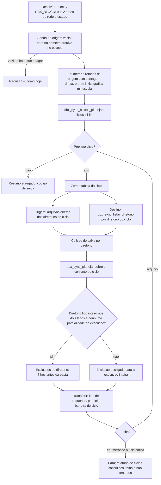

# System Design - Sync, upload e download de pasta em blocos (F-101)

## Identificacao

- Projeto: dbx (cliente de linha de comando Dropbox em shell)
- Demanda: `sync-em-blocos` (porte G), log `docs/prompts/2026-10-31_1200_sync-em-blocos.md`
- Requisitos: secao 5.24 de `docs/requisitos/escopo-requisitos-e-criterios-de-aceite.md` (RF-186 a RF-197, TC-BLC-01 a 28) e DIV-377 a DIV-384, todas decididas pelo solicitante (nao reabertas aqui)
- Data: 2026-10-31 | Status: Em validacao (guia as etapas 2 e 3)

## Objetivo do documento

- Problema: a varredura completa materializa a arvore inteira (local e remota) antes do primeiro envio ou recebimento; em arvores de milhoes de arquivos isso estoura memoria e tempo ate o primeiro efeito.
- Escopo: desenho da solucao e a base da etapa 1 (opcao, planejador de ciclos, listagem de um diretorio). Integracao no laco principal: etapas 2 e 3.
- Fora: retomada de ciclo entre execucoes (DIV-384 A), cursor com blocos (RF-192: delta segue como hoje).
- Restricao: o comportamento atual do sync nao muda na etapa 1; arvore com total <= N e um ciclo e identica a hoje (RF-197(a)).

## Analise comparativa de abordagens

Eixo 1: de onde vem a travessia que forma os ciclos.

| Abordagem | Vantagens | Desvantagens | Veredito |
|---|---|---|---|
| A1. Gerador de ciclos sobre a travessia local existente (`dbx_walk_local` inteira, depois fatiar) | Mudanca minima; ordem ja conhecida | Continua materializando a arvore antes do primeiro ciclo: nao resolve o problema (RF-188(a)) | Descartada |
| A2. Nova travessia por diretorio, incremental, em `lib/walk.sh`, que entrega a lista de diretorios com contagem de arquivos diretos e depois os arquivos de um grupo de diretorios | Atende RF-188(a)(c); reaproveita as guardas da descida (`cd` por nome relativo, parcialidade, filtro); ordem lexicografica minuscula (DIV-384) | Duas passadas locais por diretorio (contagem, depois arquivos); codigo novo no modulo mais sensivel a seguranca | **Escolhida** para o lado local |
| A3. Travessia unica que guarda tudo em arquivo temporario e le por ciclos | Uma passada | Mantem o custo de disco e o tempo ate o primeiro ciclo; a contagem exige leitura completa | Descartada |

Eixo 2: onde mora a listagem remota de um diretorio.

| Abordagem | Vantagens | Desvantagens | Veredito |
|---|---|---|---|
| B1. Modulo novo `lib/sync_blocos.sh` com laco proprio de paginas | Isolamento | Duplica o laco de paginas, o tratamento de `not_found` e as guardas (DIV-h, teto de paginas): duas copias divergem | Descartada |
| B2. Em `lib/sync.sh`, extraindo o laco de `dbx_sync_listar_completo` para `_dbx_sync_listar_paginas` parametrizado por caminho e recursividade | Uma so copia das guardas; alimenta a mesma tabela e o mesmo `_dbx_sync_entrada`; refatoracao coberta pelos testes de hoje | Toca funcao usada pelo caminho atual (mitigado: mesma assinatura, regressao verde) | **Escolhida** |
| B3. Reusar `list_folder` recursivo e filtrar por diretorio no cliente | Nenhum codigo novo | Viola RF-189(a) (nenhum recursivo na varredura completa) e nao reduz memoria | Descartada |

Eixo 3: forma do planejador de ciclos.

| Abordagem | Veredito |
|---|---|
| C1. Funcao pura sobre dois vetores (diretorios, contagens) devolvendo faixas `ini-fim` | **Escolhida**: testavel sem rede nem disco, usada igual por `--enviar` e `--receber` |
| C2. Planejador embutido no laco de travessia | Descartada: mistura regra de corte com E/S e impede teste unitario |
| C3. Ciclos por contagem global de arquivos (parte diretorio) | Descartada: viola RF-187(c) e a guarda por diretorio observado (RF-190) |

## Visao geral da solucao

Origem define os diretorios. O planejador (puro) agrupa diretorios em ciclos de ate N arquivos, cortando por diretorio: o que atinge ou cruza N entra inteiro e fecha o ciclo; diretorio com mais de N arquivos forma ciclo sozinho. Para cada ciclo: coleta da origem (local: arquivos diretos dos diretorios do ciclo; remota: `list_folder` nao recursivo por diretorio), coleta do destino somente nos diretorios do ciclo, plano e transferencia como hoje, exclusao so em diretorio lido por inteiro nos dois lados.

## Componentes e responsabilidades

Etapa 1 (entregue):

| Componente | Responsabilidade | Observacoes |
|---|---|---|
| `dbx_cli_validar_bloco` (`lib/cli.sh`) | Faixa 1..1000000, formato estrito, motivo nomeando opcao ou variavel | Padrao 50000 em `DBX_CLI_BLOCO_PADRAO` |
| `dbx_cmd_bloco` (`lib/cmd.sh`) | Precedencia: opcao vence, variavel nao lida; resultado em `DBX_CMD_BLOCO` e `DBX_CMD_BLOCO_ORIGEM` | Espelha `dbx_cmd_paralelo` |
| `_dbx_cmd_sync_bloco_resolver` (`commands/sync.sh`) | Com chamador (`upload`/`download`) a variavel e ignorada: o N chega como opcao (RF-175/176) | Resultado em `DBX_CMD_SYNC_BLOCO[_ORIGEM]` |
| `_dbx_cmd_download_bloco_pasta` (`commands/download.sh`) | Resolve a variavel so quando o alvo e pasta (o tipo so a rede revela) | `upload` resolve no ramo de diretorio |
| `dbx_sync_blocos_planejar` (`lib/sync.sh`) | Funcao pura: vetores por nome (diretorios, contagens) e N, resultado em `DBX_SYNC_BLOCOS_CICLOS` (`ini-fim`, fim exclusivo) | Contagem invalida ou vetores de tamanhos diferentes: uso invalido |
| `_dbx_sync_listar_paginas` e `dbx_sync_listar_diretorio` (`lib/sync.sh`) | Listagem de UM diretorio, `"recursive":false`, `continue` so com cursor, guardas de paginas; NAO zera a tabela; `DBX_SYNC_DIR_PARCIAL` | `not_found` = vazio legitimo |
| linha `bloco` em `diagnostico` | Valor efetivo e origem (RF-186(f)) | So com `DBX_BLOCO` definida, como `paralelo` |

Etapas 2 e 3 (a fazer, nomes fixados aqui):

| Componente | Etapa | Responsabilidade |
|---|---|---|
| `dbx_walk_diretorios <raiz> <arquivo_dirs>` (`lib/walk.sh`) | 2 | Enumera diretorios (nao excluidos, RF-80(b)) em ordem lexicografica minuscula, registros `\0`: `contagem\tcaminho_relativo`. Marca `DBX_WALK_PARCIAL` em qualquer erro de leitura |
| `dbx_walk_ciclo <raiz> <arquivo_dirs> <ini> <fim> <arquivo_registros>` (`lib/walk.sh`) | 2 | Registros de arquivos (mesmo formato de `dbx_walk_local`) so dos diretorios `ini..fim` |
| `dbx_sync_diretorios_remotos <raiz_api> <destino_vetores>` (`lib/sync.sh`) | 3 | Descida remota por `dbx_sync_listar_diretorio`, mesma ordem, produzindo diretorios e contagem diretos; nao grava na tabela do ciclo |
| `_dbx_cmd_sync_ciclo` (`commands/sync.sh`) | 2 e 3 | Um ciclo: zera a tabela, coleta origem e destino dos diretorios do ciclo, filtra, planeja, executa; barreira de `--paralelo` e de lote por ciclo (RF-195) |
| laco `_dbx_cmd_sync_ciclos` (`commands/sync.sh`) | 2 e 3 | Itera `DBX_SYNC_BLOCOS_CICLOS`, agrega contadores, trata falha por tipo, emite progresso `ciclo i` |

## Fluxo do ciclo

`--enviar`: diretorios e arquivos vem da travessia local (A2); o destino vem de `dbx_sync_listar_diretorio` nos diretorios do ciclo. `--receber` (varredura completa) e `download` de pasta: a origem remota vem de `dbx_sync_listar_diretorio` descendo de pasta em pasta (RF-188(b)); o destino local, da travessia local dos diretorios do ciclo. Com cursor valido o delta roda como hoje, sem blocos (RF-192).

## Como cada decisao entra nas etapas 2 e 3

- **Espelhamento por diretorio observado (RF-190), etapa 3.** Cada diretorio do ciclo carrega dois fatos da execucao, nunca de estado: `lido_origem` e `lido_destino`, ambos derivados de `DBX_WALK_PARCIAL` (local) e `DBX_SYNC_DIR_PARCIAL` (remoto) do diretorio. A lista de exclusoes do ciclo e filtrada por `dbx_sync_apagavel <dir>`: so os arquivos cujo diretorio esta nos dois conjuntos; diretorio so do destino exige o pai nos dois conjuntos e e apagado vazio, depois dos filhos. Qualquer `DBX_WALK_PARCIAL=sim` ou `DBX_SYNC_DIR_PARCIAL=sim` em qualquer ciclo liga `DBX_SYNC_EXCLUSAO_DESLIGADA` para o resto da execucao (os ciclos ja feitos mantem o que fizeram, RF-193(b)) e a saida difere de 0 com motivo e caminho. Itens filtrados nunca entram. Guarda destrutiva nunca le retrato, cursor ou memoria.
- **Sonda de origem vazia (DIV-378 C), etapa 2.** Antes do ciclo 1, `dbx_walk_primeiro_arquivo <raiz>` (local) ou a primeira pagina de `dbx_sync_listar_diretorio` descendo ate achar arquivo no escopo (remoto) responde "ha ao menos um arquivo". Vazia mais algo a apagar: recusa 14, `--permitir-origem-vazia` e `--dry-run` (`recusaria=origem vazia`) como hoje; reutiliza o bloco de `commands/sync.sh` ~1196-1233 trocando so a fonte da contagem. Nenhuma exclusao antes da sonda (RF-191(b)).
- **Cursor no inicio (DIV-379 A), etapa 3.** Sem mudanca no ramo delta. Na varredura completa em blocos, o retrato e o cursor so se gravam ao fim de execucao integral (RF-192(c)): o cursor e obtido no inicio da varredura e so persistido depois do ultimo ciclo verde; qualquer falha, simulacao ou parcialidade nao grava.
- **Falha por tipo (DIV-380 C), etapa 3.** Falha de arquivo: o ciclo termina, falhas agregadas, os ciclos seguintes rodam (RF-35). Falha definitiva de enumeracao remota, de resumo ou transferencia sistemica: o laco para e relata ciclos concluidos, falho e nao tentados. Codigos de saida existentes, nenhum novo.
- **Colisao por diretorio (DIV-383 A), etapa 2.** `dbx_sync_colisao_de_caixa` passa a rodar sobre os caminhos do ciclo, no inicio do ciclo e antes de qualquer escrita dele; colisao entre diretorios de ciclos diferentes e coberta pela chave sem caixa do pai.
- **Ordem (DIV-384 A).** Lexicografica por caminho em minusculas nos dois lados (`LC_ALL=C`), sem retomada de ciclo; a reexecucao e idempotente por `content_hash`.

## Seguranca e confinamento

Sem endpoint nem segredo novos. Dado de teste sintetico. O caminho remoto de cada diretorio passa pelo mesmo confinamento de `_dbx_sync_entrada` (`_dbx_sync_relativo_seguro`), e `list_folder` nao recursivo nao amplia o alcance. Nomes com TAB e quebra de linha: registros terminados em `\0` (como `lib/walk.sh`).

## Estrategia de testes

Unitarios em `tests/unit/sync_blocos_test.sh` (planejador, listagem por diretorio com dobros locais da camada de autenticacao) e integracao de CLI em `tests/integracao/bloco_cli_test.sh` (curl local que so registra chamada). Etapas 2 e 3: dobros de `curl` e arvores reais temporarias por TC-BLC-01 a 28, contra o mapa de modulos do QA.

## Riscos e pendencias

- `download` de arquivo unico com `DBX_BLOCO` invalida: a variavel so e lida depois que o alvo e conhecido pasta (para nao quebrar arquivo unico, RF-186(e)); no caminho com `get_metadata` isso ja e depois da rede, inevitavel porque o tipo so a rede revela.
- Duas passadas locais por diretorio (A2): custo aceito frente ao ganho de memoria; medir na etapa 2.
- `docs/arquitetura/system-design.md`, `docs/testes/mapa-modulos.md` e inventario: atualizar ao fim (RF-197(d), QA).

## Mudancas da etapa 2 no desenho
- Ramo so do destino: nao ha ciclos extras. O ramo e lido inteiro no ciclo que o encontra (`_dbx_cmd_sync_ramos_destino_remotos`; `dbx_walk_ciclo` com o conjunto de diretorios da origem), o que mantem o plano unico para arvore de um ciclo. `dbx_sync_diretorios_remotos` ganhou o parametro opcional de subdiretorio inicial.
- `sync --receber` com cursor gravavel segue sem ciclos ate a etapa 3. Ciclos: enviar, `--sem-cursor`, sem conta e `download` de pasta.
- Sonda de origem vazia = soma das contagens da enumeracao previa (so nomes e contagens em memoria).
