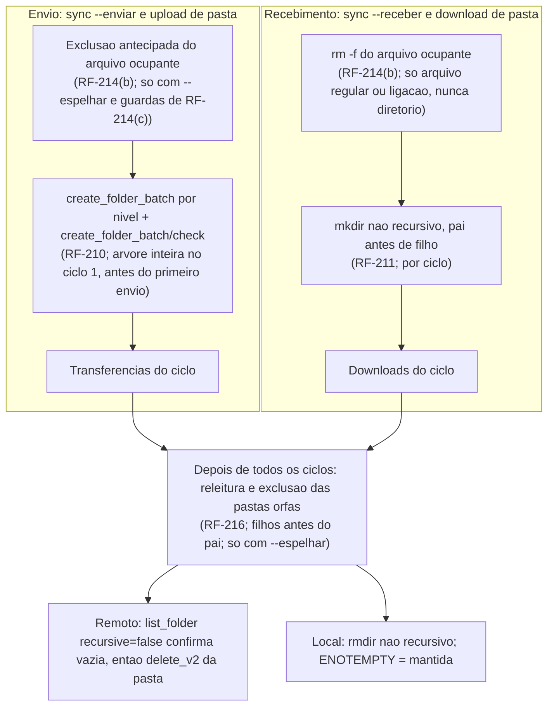

# Registro de entrega — estrutura de pastas antes da transferencia (F-103)

## Identificacao

- Demanda: estrutura-de-pastas-antes-da-transferencia (F-103) | Porte: G | Tipo: implementacao nova (sync, upload e download de pasta)
- Log de prompt: [docs/prompts/2026-11-07_0702_estrutura-de-pastas-antes-da-transferencia.md](../prompts/2026-11-07_0702_estrutura-de-pastas-antes-da-transferencia.md)
- Branch: `feature/estrutura-de-pastas-antes-da-transferencia` sobre `origin/develop` @ e3628a6; worktree `../dropbox_api.worktrees/feature-estrutura-de-pastas-antes-da-transferencia`
- Requisitos: `RF-209` a `RF-219` (secao 5.26 de [escopo-requisitos-e-criterios-de-aceite.md](../requisitos/escopo-requisitos-e-criterios-de-aceite.md)); casos `TC-ARV-01..32` (serie renumerada de `TC-EST-NN`, ver "Renumeracao da serie de criterios" no historico); decisoes `DIV-397` a `DIV-405`
- Arquitetura: [system-design.md, secao "Estrutura de pastas antes da transferencia" (v1.21)](../arquitetura/system-design.md)
- Pareceres: [parecer de evidencias TDD](2026-11-07-estrutura-de-pastas-parecer-tdd.md) e [parecer de conformidade](2026-11-07-estrutura-de-pastas-parecer-conformidade.md)
- Issues: nenhuma. PRs abertas na entrada: nenhuma.
- Data de inicio: 2026-11-07. Ultima atualizacao deste registro: 2026-11-08 (reorganizacao no formato de porte G, `documentation-writer`).

## Resumo da decisao

- Toda pasta da origem que passa no filtro de caminho e criada no destino antes das transferencias de arquivos (`RF-209`).
- Envio (`sync --enviar`, `upload` de pasta): a arvore remota inteira e criada antes do primeiro arquivo, por nivel de profundidade, com `create_folder_batch` e `create_folder_batch/check` (`RF-210`, decisao do Tech Lead). Roda uma vez, no ciclo 1, depois das recusas do plano.
- Recebimento (`sync --receber`, `download` de pasta): as pastas de cada ciclo sao criadas com `mkdir` nao recursivo antes das transferencias do ciclo (`RF-211`, decisao do solicitante). Com cursor valido, a fase roda uma vez para o delta (`RF-212`).
- Arquivo do destino que ocupa o caminho de uma pasta da origem: sem `--espelhar` vira falha de item; com `--espelhar` e apagado antes da criacao, sob as guardas de `RF-214(c)` (decisao do solicitante em `DIV-401`: "Apagar antes de criar").
- Exclusao de pasta orfa (`--espelhar`): uma unica vez, depois das exclusoes de arquivo de todos os ciclos, filhos antes do pai, so sobre o observado nesta execucao (`RF-216`). Nenhuma exclusao de pasta depende de `memoria-*`, retrato ou cursor (`P2`).
- Status: implementacao nas tarefas 1 a 6d; correcoes das tarefas 8a e 8b reportadas pelo Tech Lead. Validacao independente do QA: aprovado com ressalvas, sem achado bloqueante. Mapeamento de impacto completo apos as tarefas 8a e 8b: nao consta no registro (ver Pendencias).

## Escopo e arquivos

Lista extraida do registro original. Nao conferida por `git diff develop --stat`: o agent que reorganizou este registro nao dispunha de shell nesta execucao. Confirmar antes do commit.

- Codigo: `lib/lote.sh` (`dbx_lote_criar_pastas`, tarefa 1); `commands/sync.sh` (fase de criacao por ciclo, recebimento, exclusao de pasta orfa, simulacao, contadores e relatorio); `lib/sync.sh` (cabecalho "SO ARQUIVOS" reescrito, tarefa 6c); `scripts/lint.sh` (`LINT_MEMORIA_MB` de 12288 para 14336, tarefa 6d).
- Testes novos (6 arquivos, `tests/integracao/`): `estrutura_pastas_lote_test.sh`, `estrutura_pastas_envio_test.sh`, `estrutura_pastas_recebimento_test.sh`, `estrutura_pastas_cursor_test.sh`, `estrutura_pastas_paralelo_test.sh`, `estrutura_pastas_relatorio_test.sh`.
- Suites do QA alteradas so no duble ou em guarda estatica, com reaprovacao do solicitante (regra 12): `qa_paralelo_pastas_b18_test.sh`, `qa_cursor_b7b_test.sh`, `qa_sync_blocos_b21_test.sh`, `qa_desempenho_b9_test.sh` (sha256 no historico). A auditoria `lot11` do `lote_test` tambem foi alterada (excecao RF-136(f)); caminho a confirmar.
- Documentacao: `docs/requisitos/escopo-requisitos-e-criterios-de-aceite.md` (secao 5.26); `docs/arquitetura/system-design.md` (v1.21); `docs/testes/inventario-de-testes.md`; `docs/testes/mapa-modulos.md`; registros e pareceres em `docs/reviews/` (2026-11-07-estrutura-de-pastas-*).
- Fora deste worktree por restricao da delegacao: `CLAUDE.md`. O registro original afirma que o valor de `LINT_MEMORIA_MB` tambem foi alterado la; nao foi tocado nem verificado nesta execucao.

## Decisoes do solicitante (com data)

| Data | Decisao | Origem |
|---|---|---|
| 2026-11-07 | Toda pasta da origem que passa no filtro vai ao destino, inclusive as vazias; revoga o limite "so arquivos" do `sync` | Prompt 1, respostas do lote (regra 12) |
| 2026-11-07 | `sync --receber` e `download` de pasta: criar as pastas de cada ciclo antes das transferencias do ciclo | Prompt 1, respostas do lote |
| 2026-11-07 | Com `--espelhar`, apagar pastas do destino que nao existem mais na origem | Prompt 1, respostas do lote |
| 2026-11-07 | Linhas: `develop` e `support/bash-4.2`, uma PR por linha | Prompt 1, respostas do lote |
| 2026-11-07 | DIV-401: "Apagar antes de criar" (contra a recomendacao do BA, que propunha manter DIV-394) | Resposta DIV-401 |
| 2026-11-07 | Reaprovar as tres suites do QA alteradas no duble de `curl` (`create_folder_batch`) | Lote 3 |
| 2026-11-08 | "Excecao para delete_v2": exclusoes novas usam `delete_v2`, excecao ao RF-136; auditorias `lot11` e `qdb09` admitem `delete_v2` so nas duas funcoes nomeadas (RF-136(f)) | Lote 4 |
| 2026-11-08 | Reaprovar `qa_desempenho_b9_test.sh` com a auditoria restrita a RF-136(f) | Lote 5 |

Decisao do Tech Lead (2026-11-07, nao do solicitante): no envio, a arvore remota inteira e criada antes do primeiro arquivo; a exclusao de pasta orfa herda as guardas do espelhamento.

## Evidencias (por referencia)

- Evidencias de vermelho e verde por tarefa, contagens das suites e lacunas declaradas: [parecer de evidencias TDD](2026-11-07-estrutura-de-pastas-parecer-tdd.md).
- Conformidade (clean-architecture e padroes do repositorio), com achado menor aberto: [parecer de conformidade](2026-11-07-estrutura-de-pastas-parecer-conformidade.md).
- Validacao independente do QA (2026-11-08) e tratamento do Tech Lead: secoes "Validacao independente do QA" e "Tratamento da validacao do QA (Tech Lead)" do historico abaixo. Matriz TC-ARV-01..32 e achados M1, M2 e m1 a m6 estao la.
- Mapeamentos de impacto por rodada (arquivo isolado, como o runner): 123/123 (tarefa 3); 118 verdes de 123 (apos tarefas 4 e 5); 122 de 124 (apos 6a); 126/126 (apos 6d). Os numeros de cada rodada estao no historico.
- Filtro `estrutura_pastas` apos as tarefas 8a e 8b: 106/106 em duas rodadas seguidas, detector limpo (registro original).
- Lint: `lint` sai 0 na rodada da tarefa 6d; `commands/download.sh` teve interrupcao intermitente pelo teto de memoria, com rodadas isoladas em 0 (ver Pendencias).

## Aproximacoes aceitas e ressalvas

- RF-217(d): recusa por espaco que surja so em ciclo posterior nao retira os `criaria` ja anunciados (aceita, tarefa 6b).
- RF-212: o delta nao anuncia `criaria pasta` em simulacao (aceita, tarefa 6b).
- Simulacao no envio anuncia `criaria pasta` por ciclo, pela ausencia de registro `d` nas listagens ja lidas; superestima, sem escrita (aceita pelo Tech Lead, tarefa 6a).
- Contadores `pastas_*` sempre emitidos, inclusive zero, em simulacao (aceita, tarefa 6a).
- `session_id` conferido so no envio em `--debug` (RF-215(d)); `mkdir -p` do pai de arquivo sem linha de debug, por nao ser criacao de pasta do ciclo (tarefa 6d).
- RF-215(b) ("nenhum auxiliar cria nem apaga pasta") sem caso proprio (tarefa 6d).
- Reclassificado como defeito, nao como aproximacao: ocupante no delta tratado como falha de item, sem exclusao antecipada. Contraria a DIV-401 (apagar antes de criar em todos os processos). Delegado a tarefa 8a; correcao reportada, sem detalhe de caso no registro original.
- Achados do QA (validacao independente, 2026-11-08): M1 (TC-ARV-19 e TC-ARV-28 sem caso) e M2 (`tc_arv_15` nao discrimina) tratados nas tarefas 8a e 8b; m1 (colisao de ID) resolvida pela renumeracao para `TC-ARV`, sem mudanca nos `TC-EST-01..04` do RNF-25; m2 (cobertura por proxy de TC-ARV-18, 20, 23, 27) e m3 (auditorias estaticas em caso de produto) aceitos como ressalva; m5 encerrado (sha256 das quatro suites `qa_*` editadas igual ao reaprovado); m4 reclassificado acima; m6 (mapa de contencao entre casos do SD e do QA) nao feito.

## Riscos, impacto e rollback

- **Rollback:** reverter a PR (`git revert` do commit ou merge na linha afetada). Nao ha migracao de estado: nenhum artefato persistente novo, e a exclusao nao depende de `lib/state`, memoria ou cursor.
- **Ressalva de rollback:** reverter o codigo nao desfaz o que a execucao ja fez na Dropbox. Pastas criadas permanecem; arquivos apagados por `--espelhar` (ocupantes e pastas orfas) foram para a lixeira por `delete_v2` e dependem do historico da lixeira para restauracao.
- **Impacto:** `sync`, `upload` e `download` de pasta; chamadas novas `create_folder_batch`, `create_folder_batch/check` e `delete_v2` (este ultimo so nas duas funcoes nomeadas, RF-136(f)); contadores e campos novos em resumo e `--json` (RF-218). Arquivo unico e demais comandos nao mudam (RF-209(d)).
- **Risco destrutivo:** a exclusao de pasta so ocorre com `--espelhar`, `--confirmar`, origem nao vazia, leitura completa nos dois lados e pasta vazia pela releitura desta execucao (RF-216). Cobertura por caso das guardas TC-ARV-28 (pagina que falha numa subarvore do destino) e TC-ARV-19 (ENOSPC/EROFS no ciclo 2) estava ausente no QA; o registro original afirma tratamento na tarefa 8b, sem detalhe.

## Pendencias

1. **Linha `support/bash-4.2`:** a decisao do solicitante e uma PR por linha (`develop` e `support/bash-4.2`). Nao ha, no registro, PR aberta, branch nem evidencia de execucao na linha legada (`RF-219(b)`). Pendente.
2. **Divida tecnica:** recuo duplicado do `check` entre `_dbx_lote_excluir_fatia` e `_dbx_lote_pastas_fatia` (`lib/lote.sh`). Achado menor do parecer de conformidade; refactor em tarefa propria, sem alterar a exclusao nesta entrega.
3. **Tarefas 8a e 8b:** o registro original traz so o resultado agregado (filtro 106/106). Nao descreve os casos novos de TC-ARV-19 e TC-ARV-28, o reforco de `tc_arv_15` (M2) nem a correcao do ocupante no delta (m4). Reconferir antes do fechamento.
4. **Mapeamento de impacto completo apos 8a e 8b:** nao consta. O ultimo mapeamento completo (126/126) e anterior a elas.
5. **Lint final:** `commands/download.sh` interrompido de forma intermitente pelo teto de 12288 MB; o solicitante subiu o teto para 14336. Rodar o lint completo antes do commit.
6. **`CLAUDE.md`:** o valor de `LINT_MEMORIA_MB` deveria constar la tambem (registro original). Nao verificado nesta execucao.
7. **Gate de conformidade das tarefas 2 a 8b:** o registro traz parecer de conformidade apenas para a tarefa 1. O parecer atual cobre so essa tarefa.
8. **Aceite final do Tech Lead:** nao consta no registro. Aceite do QA: aprovado com ressalvas (2026-11-08).
9. **Diagrama de sistema:** o diagrama de [system-design.md](../arquitetura/system-design.md) nao tem o no de exclusao antecipada do arquivo ocupante (`RF-214(b)`). Atualizar via `documentation-sync`; o diagrama abaixo ja o inclui.
10. **Commit e registro de alteracoes externas:** nao executados nesta execucao (sem shell; ver hand-back).
11. **Historico de execucao, regra de porte G:** a copia em `docs/historico/` nao foi criada, porque a regra exigida nao foi localizada: `AGENTS.md` nao existe na raiz do worktree e a busca por `historico` nos `.md` nao achou regra de porte G (so usos documentais em registros antigos). Template `registro-de-entrega-completo` tambem nao existe em `.github/agents/templates/` (so o `registro-de-entrega-curto-template.md`). Seguiram-se as regras de porte G da skill `review-documentation`.

### Divergencias entre registro e requisitos

- **Ocupante no delta (RF-212 x RF-214(b) e DIV-401):** o registro original tratou como aproximacao; o Tech Lead reclassificou como defeito. A secao 5.26 nao traz regra para o delta ocupado; a decisao DIV-401 vale para todos os processos. Tratar como divergencia a registrar no BA, alem da correcao.
- **Simulacao no envio (RF-217(a), "na ordem da execucao real"):** o plano anuncia `criaria pasta` por ciclo, sem a ordem exata da execucao real. Aceito pelo Tech Lead, mas a formulacao do requisito nao o cobre.
- **TC-ARV-15 (RF-212(c)):** o caso nao discrimina (M2). Fica em aberto ate a tarefa 8a ser conferida.
- **TC-ARV-32 (`RF-219(a)/(b)`):** "a suite passa nas duas linhas" nao verificavel neste worktree (so `develop`).
- **TC-ARV-04:** o registro original ainda cita `TC-EST-04`; o caso novo nao tem caso proprio (QA, m1). A renumeracao vale para a serie nova; o `TC-EST-04` do RNF-25 segue como esta.

## Diagrama (Mermaid)

Ordem de um ciclo, com os dois ramos e a fase final comum. Nomes conferidos com a secao "Estrutura de pastas antes da transferencia" do system-design (`create_folder_batch` por nivel + `check`, `mkdir` nao recursivo, `rmdir`, `list_folder` + `delete_v2`), exceto o no de arquivo ocupante, que falta no system-design (pendencia 9).

## Aceites

- QA Expert (2026-11-08): aprovado com ressalvas, sem bloqueante (historico, "Validacao independente do QA").
- Tech Lead: aprovacao final nao consta no registro original. Pendente.
- Solicitante: decisoes e reaprovacoes na tabela de decisoes acima.

## Historico da execucao

Texto original do registro, preservado integralmente (numeros, sha256, comandos e contagens). Os titulos de nivel 2 abaixo sao os do registro original. Os termos `TC-EST-NN` nestas secoes equivalem a `TC-ARV-NN` (ver "Renumeracao da serie de criterios").

### Registro original

- Demanda: estrutura-de-pastas-antes-da-transferencia | Porte: G
- Log de prompt: [docs/prompts/2026-11-07_0702_estrutura-de-pastas-antes-da-transferencia.md](../prompts/2026-11-07_0702_estrutura-de-pastas-antes-da-transferencia.md)
- Branch: `feature/estrutura-de-pastas-antes-da-transferencia` sobre `origin/develop` @ e3628a6
- Requisitos: RF-210, RF-213, TC-EST-06 a TC-EST-09, DIV-398 (secao 5.26)

## Tarefa 1 — lib/lote

- Escopo: `lib/lote.sh` (nova `dbx_lote_criar_pastas`, contrato no cabecalho) e `tests/integracao/estrutura_pastas_lote_test.sh` (novo, 9 casos; seam = funcao publica com lib/auth + lib/http reais e duplo de `curl`).
- **protocolo-tdd:** red antes da implementacao: `bash tests/run.sh estrutura_pastas_lote_test.sh` -> 1 reprovado (`dbx_lote_criar_pastas: command not found`, status 127), 8 nao executados (parada no primeiro erro). Green: o mesmo comando -> `casos aprovados: 9, reprovados: 0, pulados: 0, APROVADA`. Regressao: `bash tests/run.sh lote_test.sh` (o filtro casa tambem o arquivo novo) -> 9/9 + 32 casos de `lote_test.sh`, codigo de saida 0. Checklist protocolo-tdd aplicado; nao aplicavel: banco (adaptador sem persistencia), E2E (sem interface), container (projeto CLI, execucao pelo runner oficial). Regra 6: nao aplicavel (nenhum endpoint exposto, autenticacao ou entrada de usuario nova; o token do teste e sintetico). Veredito: Aprovado.
- **protocolo-conformidade:** Checklist clean-architecture + padroes do repositorio (shell/bash 4.4+) aplicado integralmente sobre o diff. Adaptador na camada de adaptadores, dependendo so de lib/auth, lib/http e lib/json (sem dependencia nova); reaproveita `_dbx_lote_ler_marca`, `_dbx_lote_resumo_http`, `_dbx_lote_dormir` e as constantes de recuo/teto da DIV-262; constante unica de fatia; sem estado entre execucoes; motivo so com texto do dbx e o caminho (corpo bruto nunca entra). `shellcheck -x lib/lote.sh tests/integracao/estrutura_pastas_lote_test.sh` limpo. Achados: nenhum bloqueante nem maior. Menor: o recuo do `check` esta duplicado entre `_dbx_lote_excluir_fatia` e `_dbx_lote_pastas_fatia` (refactor possivel numa tarefa propria, sem alterar a exclusao nesta). Veredito: Aprovado.

## Reaprovacao de suites do QA (regra 12) — 2026-11-07

Motivo: a criacao da arvore remota (F-103) passou a chamar `files/create_folder_batch`; os dubles de curl destas suites nao respondiam o endpoint. Alteracao so no duble (+34 linhas, 0 removidas), nenhum assert ou caso alterado; `verificar-remocao-de-casos.sh` 2948 → 2948; auditorias json (66/66), harness (23/23) e composicao (28/28) verdes. Reaprovadas pelo solicitante em lote.

| Suite | sha256 antes | sha256 depois | Resultado |
|---|---|---|---|
| tests/integracao/qa_paralelo_pastas_b18_test.sh | 94f2b18c884f014b162632451ac28c2c1f0a2b372be37bcadf3d7e4e02071c44 | 29f9b2c9cf3cc5dd6784be0abcb555c57afa0b9ad9dfc2a6535e2119d6304834 | 10/10 |
| tests/integracao/qa_cursor_b7b_test.sh | 15045c18464902f61c70069c513a506cd3ac8f7fa2e3ed251a82e26af4ab5159 | 21988dac2613d8265176f9fe5a848b17227b8f9cdf335d11e46fbae3d8a26fc0 | 49/49 |
| tests/integracao/qa_sync_blocos_b21_test.sh | f5e8fc366fda4d77c41db5e1541d40060a273ad1532397f11466209502bbd6f8 | b5629912637e96058a545ac9b9ff3c45c4e7fb35b024bbc0046301dc94c6f541 | 25/25 |

Lint: `qa_cursor_b7b` (SC2034, linha 255) e `qa_sync_blocos_b21` (SC1105, SC2211, SC2288, SC2086, SC2210, SC2034, linhas 28 e 42) tem achados **pre-existentes**, reproduzidos na `develop` (e3628a6) com os mesmos codigos; fora do escopo desta demanda.

## Correcao da Tarefa 2 — RF-210(g) (2026-11-07)

Achado pelo mapeamento de impacto (`qa_cache_unico_p3`, variante `so_diretorios`): a criacao de pastas rodava antes das recusas do plano (origem vazia, espaco). Corrigido em `commands/sync.sh`: criacao unica, no primeiro ciclo apos as recusas, antes da primeira transferencia. TDD: `estrutura_pastas_envio_test` red 6/7 (TC-EST-05b, duble registrou `/r/a`, `/r/c`, `/r/a/b`) → green 9/9; `paralelo_test` red par05 → 25/25 (duble passou a carregar `lote_duplo.sh`); `qa_cache_unico_p3` 33/33; auditorias json, http, preflight e composicao verdes; lint dos arquivos alterados limpo.

## Tarefa 3 — recebimento (`sync --receber`, `download` de pasta) — 2026-11-07

- `commands/sync.sh`: `_dbx_cmd_sync_pastas_receber_criar` cria, por ciclo, as pastas de `dirs_v[ci_ini..ci_fim)` com `mkdir` nao recursivo, pai antes de filho, depois das recusas do plano e fora da simulacao (RF-211, RF-210(g)). Pasta existente = sucesso; caminho ocupado por arquivo ou ligacao (nao seguida) = falha de item `arquivo no lugar da pasta` (RF-214(a)); ENOSPC/EROFS/quota = falha sistemica (RF-213(b)). `_dbx_cmd_sync_pastas_falhas_aplicar` generalizada aos dois sentidos; `_dbx_cmd_sync_pasta_falha_contar` faz a pasta que falha contar ela mesma como falha de item (RF-213(a)), nos dois sentidos.
- `download` de pasta chega ao mesmo executor (raiz, filtro e fallback sem filtro); coberto.
- Fora do escopo desta tarefa: delta com cursor valido (`modo_ciclos=nao`) mantem o `mkdir -p` por arquivo — RF-212, Tarefa 6.
- TDD: `estrutura_pastas_recebimento_test` red 0/1 (`motivo da pasta`) → green 6/6 → 8/8 com os ajustes; caso da pasta vazia que falha no envio red → green (10/10). **Lacunas declaradas:** o red do mesmo caso no recebimento foi visto so no agregado (`ok=3 nao_ok=1`), sem execucao isolada; o caso `download_de_pasta_sem_filtro_cria_subpasta_vazia` e de caracterizacao (o comportamento ja vinha da Tarefa 3, sem red contra o codigo).
- Suites: lote 9/9, envio 10/10, recebimento 8/8, sync_blocos 19/19, paralelo_download 12/12, retomada_download 32/32, qa_sync_blocos_b21 25/25, qa_download_curl_real_b16 7/7, qa_paralelo_download_b20 27/27, debug_sync 8/8; lint dos alterados limpo. Mapeamento de impacto completo (cada arquivo isolado, como o runner): 123/123 arquivos verdes, 3299 s.

## Tarefa 4 — arquivo no lugar de pasta (RF-214) — 2026-11-07

- `commands/sync.sh`: `_dbx_cmd_sync_exclusao_antecipada_permitida` (mesmos predicados da exclusao comum: `espelhar`, `exclusao_desabilitada`, `recusa_origem_vazia`, `_dbx_cmd_sync_protegido`; ausente = nao liberada), `_dbx_cmd_sync_ocupante_remoto_ler` (list_folder do pai, todas as paginas, so `file` com `rev`), `_dbx_cmd_sync_ocupante_remoto_apagar` (`delete_v2` + `parent_rev`), `_dbx_cmd_sync_pastas_ocupantes_apagar` (reenvio da pasta e descendentes), `_dbx_cmd_sync_pasta_local_ocupada_remover` (`rm -f`, so arquivo regular/ligacao, diretorio nunca), `_dbx_cmd_sync_apagar_retirar`; DIV-400 em `_dbx_cmd_sync_pastas_falhas_aplicar`.
- Revisao do Tech Lead sobre o codigo das guardas (1)-(7): conforme; a contagem de falha da pasta ocorre depois da tentativa de exclusao (sem dupla contagem). Decisoes registradas em RF-214(c) (notas) e na memoria: ligacao local no caminho da pasta = falha de item (travessia parcial); (4) avaliada no ciclo 1 no envio.
- TDD: reds observados — DIV-400 (delete_batch presente), TC-EST-17 envio e TC-EST-17c recebimento (com predicado neutralizado numa copia temporaria, restaurada). **Lacuna declarada:** demais casos novos sem red isolado; os de "nada e apagado" valem como regressao.
- Verificacao do Tech Lead: envio 17/17, recebimento 13/13, lote 9/9, qa_cache_unico_p3 33/33, qa_sync_blocos_b21 25/25, qa_exclusao_sem_localidade_b42 6/6, sync_blocos 42/42, paralelo 25/25, composicao 28/28, json 66/66; lint limpo.
- Pendente para a Tarefa 6: o motivo `arquivo no lugar da pasta` sai hoje so em aviso (stderr); RF-214(e) (relatorio/simulacao) entra com RF-217/RF-218.

## Tarefa 5 — pastas orfas no `--espelhar` (RF-216) — 2026-11-07

- `commands/sync.sh`: funcoes `_dbx_cmd_sync_pastas_orfas_{registrar,remotas,locais,remota_vazia,apagar_remota,apagar_local,apagar}`; coleta por ciclo (envio: registros `d` da tabela do ciclo fora de `chaves_dirs`, so diretorios listados por inteiro; recebimento: subdiretorios da travessia local fora de `chaves_dirs` mais os de baixo por `find -P -type d`); bloqueio `pastas_bloqueio` por ciclo; exclusao unica apos todos os ciclos, profundidade decrescente.
- Revisao do Tech Lead: remoto relê a pasta (todas as paginas; erro ou entrada = mantida) e so entao `delete_v2` da propria pasta; local `rmdir` nao recursivo com recusa de ligacao em qualquer componente; nenhum uso de memoria, retrato ou cursor (auditoria estatica em teste). Decisoes em RF-216 (notas) e na memoria.
- Mudanca observavel: origem vazia com so pasta orfa no destino, com `--espelhar`, agora e recusada (14).
- Fora: delta com cursor valido nao coleta pastas (nenhuma apagada; coerente com RF-212(c)).
- TDD: red observado isolado em 7/10 (recebimento) e 7/11 (envio); os demais so exigem nao agir e ja passavam (regressao). Tres asserts do proprio teste corrigidos (contagem de `list_folder`), codigo inalterado nesses casos.
- Suites (relato do SD): estrutura_pastas 60/60, sync_blocos 42/42, qa_sync_blocos_b21 25/25, qa_exclusao_sem_localidade_b42 6/6, qa_cache_unico_p3 33/33; lint limpo. Mapeamento de impacto completo apos Tarefas 4 e 5: em execucao.
- Auditoria `composicao_test` (mapeamento apos T4/T5) reprovou 3 contagens diretas (`grep -c`) em `estrutura_pastas_envio_test.sh`; trocadas pelo auxiliar `_harness_contar` pelo Tech Lead. composicao 28/28, envio 28/28, lint limpo.

## Correcoes apos o mapeamento de T4/T5 e excecao RF-136(f) — 2026-11-08

Mapeamento de impacto (123 arquivos isolados, 4110 s): 118 verdes, 5 reprovados.
- `composicao_test`: contagens diretas no teste de envio — corrigido (ver acima).
- `sync_test` (55) e `qa_integridade_p1` (15): regressao da Tarefa 5. Causa (SD, refutando a hipotese de caixa do Tech Lead): listagem com item sob `Docs/` sem a entrada `folder` deixava `chaves_dirs` so com a raiz, a pasta local `docs` virava orfa e a recusa de origem vazia (que passou a contar pastas) disparava; mensagem dizia "apagaria 0". Correcao: `_dbx_cmd_sync_pastas_cobertas_pela_origem` (pasta com item da origem sob ela nunca e orfa; mesma chave minuscula) e contagem das pastas na mensagem. TDD: `rf216_pasta_local_com_caixa_diferente_do_remoto_nao_e_orfa` red -> green; segundo caso nasceu verde (guarda). Verificacao do Tech Lead: sync_test 106/106, qa_integridade_p1 27/27, recebimento 25/25.
- `lote_test` (lot11) e `qa_desempenho_b9` (qdb09): conflito RF-136 x RF-214/216. Decisao do solicitante: excecao RF-136(f). As duas auditorias passam a admitir `delete_v2` so nas duas funcoes nomeadas, exigem que existam e reprovam qualquer outro uso (prova de mordida contra copia mutante, scripts no scratchpad). Verificacao do Tech Lead: lote 41/41 (2 arquivos), qa_desempenho_b9 15/15, composicao 28/28, lint limpo.

| Suite do QA | sha256 antes | sha256 depois | Reaprovacao |
|---|---|---|---|
| tests/integracao/qa_desempenho_b9_test.sh | 2630f5364fd3da79f3f6a36ca67b61722b9f010e50a86f6d7603e312bef90c47 | 9ebfe1c95fa9e9e0087c80d482225cc2585344325544874d8e3530b49bfe5144 | solicitante, 2026-11-08 |

## Tarefa 6a — simulacao, contadores e relatorio (RF-217, RF-218, RF-214(e)) — 2026-11-08

- `commands/sync.sh`: `_dbx_cmd_sync_pastas_plano_simular`, `_dbx_cmd_sync_pastas_campos`; contadores `pastas_criadas`, `pastas_falhou`, `pastas_apagadas`, `pastas_mantidas`; linha `apagado=<rel> (arquivo no lugar da pasta)` (+ `apagado_caminho`/`apagado_motivo` no `--json`); simulacao com `criaria=pasta <rel>`, `apagaria=<rel> (arquivo no lugar da pasta)` no plano do ciclo e `apagaria=pasta <rel>` no render final. Campos novos depois de `falhas` e dos pares por item, antes de `ciclos`/`bloco` (posicao logo apos `falhas` quebrava o contrato "cada falha e um par logo depois da contagem" de `sync_test`).
- Suite nova `estrutura_pastas_relatorio_test.sh` (8 casos) e +5 casos no recebimento. TDD: red observado por requisito (RF-214(e), RF-217, RF-218, RF-219(a)); green `estrutura_pastas` 75/75.
- SD parou no teto sem lint/registro: Tech Lead rodou lint (0) e `--registrar` dos 3 arquivos (detector acusou os 3 como nao registrados; origem conhecida — alteracoes do proprio SD).
- Aproximacoes aceitas pelo Tech Lead: contadores sempre emitidos (inclusive 0) em simulacao; `criaria pasta` no envio em simulacao por ciclo, pela ausencia de registro `d` nas listagens ja lidas (superestima, sem escrita).
- **Devolvidas para a 6b:** RF-217(c) — pasta orfa so anunciada como `apagaria` se ficaria vazia pelas exclusoes planejadas sobre o observado; RF-217(d) — com recusa (espaco) nenhum plano de pastas e anunciado.
- Mapeamento de impacto completo apos 6a: em execucao.

### Mapeamento pos-6a

Mapeamento por arquivo isolado (3807 s): 122 OK de 124, com 2 reprovacoes em suites do QA de mesma causa.

- `qa_pasta_ocupada` caso 2: no `--dry-run`, o plano perdeu `apagar=sub`.
- `qa_cursor_b7b` caso a06: o plano da varredura por ciclos perdeu `apagar=a.txt` (`a_apagar` 2, contra 3 no incremental).

Causa: `_dbx_cmd_sync_pastas_plano_simular` retira o ocupante de `DBX_SYNC_APAGAR` antes do cabecalho do plano. A execucao real so o retira no ciclo. Isso fere a RF-217(a), que pede a ordem da execucao real. As suites do QA estao corretas e nao foram alteradas. A correcao foi devolvida ao SD como item 0 da Tarefa 6b.

### Tarefa 6b (parcial) e 6c

Itens da 6b, conferidos pelo TL. O SD parou no limite de turnos.

- Item 0 (ocupante no plano da simulacao): pronto.
- RF-217(c): pronto.
- RF-217(d): pronto.

Aproximacoes registradas:

- RF-217(d): uma recusa por espaco que surja so num ciclo posterior nao retira os `criaria` ja anunciados.
- RF-212: o delta nao anuncia `criaria pasta` em simulacao.
- RF-212: no delta, uma pasta ocupada por arquivo e falha de item, sem a exclusao antecipada da RF-214.

Tarefa 6c, conferida pelo TL:

- RF-212 fechado em `estrutura_pastas_cursor_test.sh`, com 3/3 casos aprovados.
- Vermelho comprovado nos casos 13 e 14. O caso 15 e negativo e fica verde sem o codigo novo.
- O cabecalho "SO ARQUIVOS" de `lib/sync.sh` foi reescrito.
- Verificacao do TL:
  - chamada restaurada (`true ||` = 0);
  - filtro `estrutura_pastas` com 5 arquivos e 84/84 casos aprovados;
  - detector limpo.

Observacao do lint: `commands/download.sh`, que esta fora do diff, e interrompido de forma intermitente pelo teto de 12288 MB. As rodadas isoladas dao 0. Reconferir antes do commit.

Pendente: RF-215, delegado como Tarefa 6d.

### Tarefa 6d (RF-215) e teto do lint

Tarefa 6d, conferida pelo TL: `estrutura_pastas_paralelo_test.sh` foi criado com 7 casos.

| Item | Casos | Codigo novo |
|---|---|---|
| Barreira com `--paralelo` | 2 (envio e recebimento) | Nao; ja passava |
| `--debug`: create_folder_batch/check e delete_v2 sem segredo | 2 | Nao; ja passava |
| `--debug` de mkdir/rmdir | 1 | `dbx_debug_linha pasta operacao=mkdir\|rmdir resultado=... caminho=...` nos dois mkdir do ciclo (ciclos e delta) e no rmdir de orfa; vermelho observado |
| `--paralelo` 1 e 8 dao a mesma arvore | 2 (envio e recebimento) | Nao; ja passava |

Verificacao do TL: o filtro `estrutura_pastas` roda 6 arquivos com 91/91 casos aprovados, e o detector fica limpo.

Aproximacoes:

- RF-215(b) ("nenhum auxiliar cria nem apaga pasta") nao tem caso proprio.
- RF-215(d): o `session_id` foi conferido so no envio.
- O `mkdir -p` do pai de arquivo nao gera linha de debug, porque nao e criacao de pasta do ciclo.

Teto do lint. A intermitencia anotada na 6c vem do diff, nao do ambiente:

- O `shellcheck` de `commands/download.sh` segue `commands/sync.sh`, que passou de 2504 para 3359 linhas. O pico subiu de 11,4 GB (develop) para 12,8 GB (`/usr/bin/time`), contra o teto de 12288 MB.
- O `commands/upload.sh` tambem segue o sync.sh e mede 9,7 GB.
- Com `source=/dev/null` o pico cairia para 1,0 e 2,3 GB, ao custo de 3 avisos info e da perda da analise cruzada.
- O solicitante escolheu subir o teto: `LINT_MEMORIA_MB` passou a 14336 em `scripts/lint.sh`, com o mesmo valor no CLAUDE.md.
- `verificar-instrucoes-do-projeto.sh` nao acusa drift. As rodadas seguidas do lint deram 0.

### Mapeamento pos-6d

Cada arquivo de teste rodou isolado, por 3674 s, e os 126 arquivos passaram (126/126 OK). O resultado inclui as suites do QA `qa_pasta_ocupada` e `qa_cursor_b7b`, sem alteracao nelas.

## Validacao independente do QA

QA Expert, 2026-11-08, porte G. Leitura feita a partir da secao 5.26 dos requisitos, do diff e dos seis arquivos `estrutura_pastas_*_test.sh` (99 casos); o registro acima foi lido por ultimo. Reexecutados por este QA: `estrutura_pastas_cursor` (3/3) e `estrutura_pastas_envio` (28/28). Os demais arquivos valem pela rodada isolada do Tech Lead (126/126). Suite completa nao rodada (regra 8 de `protocolo-tdd`).

### 1. Matriz TC-EST-01..32

Arquivos abreviados: LOT = `estrutura_pastas_lote`, ENV = `_envio`, REC = `_recebimento`, CUR = `_cursor`, PAR = `_paralelo`, REL = `_relatorio`.

| TC | Casos que cobrem | Cobertura |
|---|---|---|
| 01 | ENV `tc_est_01_pasta_vazia_e_pasta_com_arquivo_sao_criadas_e_o_arquivo_enviado` | coberto |
| 02 | ENV `tc_est_02_pasta_podada_por_excluir_nao_e_criada` (nao ha prova de "nem listada" alem da poda) | coberto |
| 03 | ENV `tc_est_03_pasta_com_arquivos_todos_filtrados_por_tamanho_e_criada_vazia` | coberto |
| 04 | nenhum. O unico `TC-EST-04` do repositorio e o de `tests/integracao/sync_test.sh:1436` (RNF-25, diretorio de estado alheio): colisao de ID | **sem cobertura** |
| 05 | ENV `tc_est_05_com_tres_ciclos_toda_criacao_precede_o_primeiro_envio`; `upload_de_pasta_cria_a_arvore_antes_do_primeiro_envio` | coberto |
| 05b | ENV `tc_est_05b_origem_so_com_pastas_vazias_e_recusada_sem_criar_pasta`; REL `rf217d_recusa_por_espaco_nao_anuncia_nenhuma_pasta` (so simulacao para a recusa por espaco) | parcial (recusa por espaco real sem caso) |
| 06 | LOT `tc_est_06_nivel_seguinte_so_depois_do_check_complete_do_anterior` | coberto |
| 07 | LOT `tc_est_07_pasta_existente_conta_como_sucesso_e_nao_como_criada` | coberto |
| 08 | LOT `tc_est_08_09_fatias_conservadoras_posicao_e_autorename_false` | coberto |
| 09 | LOT `tc_est_08_09_...` (autorename false no corpo de cada chamada do lote; o `delete_v2` e `create_folder` fora do lote nao entram) | coberto |
| 10 | REC `tc_est_10_pastas_de_cada_ciclo_existem_antes_do_primeiro_download_do_ciclo` | coberto |
| 11 | REC `tc_est_11_...`; `download_de_pasta_sem_filtro_cria_subpasta_vazia` | coberto |
| 12 | REC `tc_est_12_ligacao_simbolica_no_lugar_da_pasta_falha_sem_seguir_e_o_resto_segue` | coberto |
| 13 | CUR `tc_est_13_entrada_folder_do_delta_cria_a_pasta_local_sem_list_folder_por_diretorio` | coberto |
| 14 | CUR `tc_est_14_pasta_do_retrato_ausente_localmente_e_recriada` | coberto |
| 15 | CUR `tc_est_15_deleted_de_pasta_no_delta_nao_autoriza_exclusao_de_pasta` | parcial (achado M2) |
| 16 | ENV `tc_est_16_arquivo_no_lugar_da_pasta_falha_os_arquivos_sob_ela_e_envia_o_resto`; `div_400_item_de_exclusao_sob_pasta_que_falhou_nao_e_apagado` | coberto |
| 17 | ENV `tc_est_17_espelhar_apaga_o_arquivo_antes_de_criar_a_pasta_e_envia_na_mesma_execucao`; `tc_est_17_sem_espelhar_...` | coberto |
| 17b | ENV `tc_est_17b_destino_filtrado...`, `_rev_divergente...`, `_item_listado_como_pasta...`, `_origem_vazia_e_leitura_parcial...` | coberto |
| 17c | REC `tc_est_17c_*` (5 casos) | coberto |
| 18 | ENV `falha_sistemica_na_criacao_para_antes_de_qualquer_envio`; LOT `sem_espaco_na_entrada...`, `429/5xx/rede_repetido_no_lancamento...`. Sem caso de `429` esgotado ponta a ponta com "zero envios" | parcial (indireto, por camada) |
| 19 | nenhum caso de `ENOSPC`/`EROFS` no `mkdir` do ciclo 2 (o ramo existe em `commands/sync.sh:2729-2733`) | **sem cobertura** |
| 20 | PAR `tc_est_20_envio_...`, `tc_est_20_recebimento_...` (barreira). A metade "nenhum auxiliar cria/apaga pasta" nao tem caso (o registro admite, RF-215(b)) | parcial |
| 21 | PAR `tc_est_21_*` (3 casos: criacao, `delete_v2`, `mkdir`/`rmdir`) | coberto |
| 22 | ENV `rf216_pasta_remota_orfa_com_arquivo_orfao_arquivo_em_lote_depois_pasta_por_delete_v2`, `rf216_pasta_remota_orfa_vazia_vai_para_delete_v2_apos_releitura`; REC `rf216_pasta_orfa_com_arquivo_orfao_arquivo_sai_e_depois_a_pasta`, `rf216_pastas_aninhadas_filho_antes_do_pai` | coberto |
| 23 | REC `rf216_pasta_orfa_com_item_filtrado_fica_mantida` (ENOTEMPTY por item filtrado, nao por arquivo criado depois da leitura) | parcial (indireto: a corrida da leitura ao `rmdir` nao e simulada) |
| 24 | ENV `rf216_releitura_com_entrada_nova_mantem_a_pasta_sem_delete_v2`; `rf216_a_decisao_remota_nao_apaga_em_lote_nem_permanentemente` (a mutacao para `delete_batch`) | coberto |
| 25 | ENV `rf216_pasta_remota_com_item_filtrado_nunca_e_apagada`, `rf216_pasta_remota_excluida_por_filtro_nunca_e_apagada`; REC `rf216_pasta_orfa_com_item_filtrado...`, `rf216_subpasta_com_filtrado...` | coberto |
| 26 | ENV `rf216_origem_vazia_recusa_antes_de_apagar_pasta_remota`; REC `rf216_origem_vazia_recusa_antes_de_apagar_pasta` (com e sem `--confirmar` nao verificado nos nomes) | coberto |
| 27 | ENV `rf216_leitura_parcial_desliga_a_exclusao_de_pasta`; REC `rf216_ligacao_simbolica_no_lugar_de_pasta_orfa...` (parcial por ligacao). Falta o recorte "ciclo 3 de 5" | parcial |
| 28 | nenhum caso com pagina de listagem que falha numa subarvore so do destino (`grep` por `pagina`/falha de pagina nos seis arquivos: vazio) | **sem cobertura** |
| 29 | REC `rf216_a_decisao_nao_le_memoria_retrato_nem_cursor` (estatico); REC `rf216_pasta_orfa_vazia_e_apagada_e_a_raiz_fica` (raiz). Raiz remota orfa nao tem caso | parcial |
| 30 | REL `tc_est_30_*` (2), `rf214e_simulacao_...`, `rf217c_*`; REC `tc_est_30_*` (2) | coberto |
| 31 | REL `tc_est_31_*` (3); REC `tc_est_31_recebimento_conta_so_a_pasta_criada_e_pasta_nao_e_arquivo`; CUR 13 (`pastas_criadas=2`) | coberto |
| 32 | REL `tc_est_32_arvore_sem_pasta_nova_traz_os_antigos_iguais_e_os_novos_zerados`. "Passa nas duas linhas": nao verificavel neste worktree (so `develop`) | parcial |

Totais (35 linhas: 32 ids mais 05b, 17b e 17c): sem cobertura = 3 (04, 19, 28); parcial = 8 (05b, 15, 18, 20, 23, 27, 29, 32); coberto = 24. Cobertura so indireta (por camada ou proxy): 18, 23, 27.

### 2. Amostragem de 3 casos de risco

1. **Exclusao de pasta orfa** (`ENV rf216_releitura_com_entrada_nova_mantem_a_pasta_sem_delete_v2`, `rf216_a_decisao_remota_nao_apaga_em_lote_nem_permanentemente`; codigo `commands/sync.sh:3192-3250`). O assert prova o RF: afirma zero `delete_v2` da pasta e que a pasta fica `mantida` com a entrada nova, e o segundo caso prova o endpoint (nao `delete_batch`, nao permanente). O codigo corresponde: `_dbx_cmd_sync_pastas_orfas_remota_vazia` pagina ate o fim e devolve 1 em duvida. Conclusao: prova o RF.
2. **Arquivo no lugar de pasta** (`ENV tc_est_17_espelhar_apaga_o_arquivo_antes_de_criar_a_pasta_e_envia_na_mesma_execucao`, `commands/sync.sh:2500-2527`). Prova a ordem pela sequencia literal `create_folder_batch list_folder delete_v2 create_folder_batch`, o `parent_rev` igual ao lido, ausencia de `delete_batch`, o envio do arquivo sob a pasta e `apagados=1`. Os casos `17b` cobrem rev divergente, filtrado, pasta e origem vazia. Conclusao: prova o RF.
3. **Delta do cursor** (`CUR tc_est_15_deleted_de_pasta_no_delta_nao_autoriza_exclusao_de_pasta`). **Nao prova o RF-212(c).** Ver M2.

### 3. Guardas destrutivas

Toda exclusao de pasta passa por `_dbx_cmd_sync_pastas_orfas_apagar` (`commands/sync.sh:3277`):

- `delete_v2` de pasta remota: `commands/sync.sh:3243`, dentro de `_dbx_cmd_sync_pastas_orfas_apagar_remota` (3233), precedido da releitura desta execucao em `_dbx_cmd_sync_pastas_orfas_remota_vazia` (3192). Candidatas: `_dbx_cmd_sync_pastas_orfas_remotas` (3076) le so `DBX_SYNC_TAB`/`chaves_dirs`, a tabela do ciclo.
- `rmdir` local: `commands/sync.sh:3263`, em `_dbx_cmd_sync_pastas_orfas_apagar_local` (3253), nao recursivo, sem seguir ligacao (3258). Candidatas locais: `find -P` do disco agora (3172-3190).
- Nenhum dos dois caminhos (3064-3345) le `memoria-*`, retrato ou cursor (grep: so em comentario, linha 3095). O outro `delete_v2` (2525, arquivo ocupante) exige `tag=file` lido no pai nesta execucao e `parent_rev`. Gate de execucao: `$pastas_bloqueio`, `$ciclo_falho`, `$parcial`, `$pastas_recusa` e `--espelhar` (3278-3282). A guarda estatica `lot11` restringe `delete_v2` a duas funcoes.

Confirmado: nenhuma exclusao de pasta depende de memoria, retrato ou cursor.

### 4. Achados

| Id | Sev. | Achado | Local |
|---|---|---|---|
| B1 | **bloqueante** | nenhum | |
| M1 | maior | `TC-EST-28` (RF-216(h)/`DIV-403`, subarvore so do destino com pagina que falha) sem caso: e a guarda destrutiva mais fina contra apagar com leitura incompleta; o codigo de 3192-3228 trata (`return 1`), mas nada o prova. `TC-EST-19` (ENOSPC/EROFS no ciclo 2) tambem sem caso. Exige caso novo (regra 14 do AGENTS.md: ausencia de teste em criterio acordado) | `commands/sync.sh:2729`, `3216-3222` |
| M2 | maior | `tc_est_15` nao discrimina: o registro admite que "fica verde sem o codigo novo"; alem disso a pasta `a` local tem `a1.txt` da primeira execucao, entao `rmdir` nao recursivo falharia de qualquer modo, e o assert `pasta apagada` ausente nao distingue "nao tentou" de "tentou e ENOTEMPTY". O RF-212(c) pedia retrato forjado como "vazio" e pasta local vazia; nem um nem outro existe no caso. Correcao: apagar `a1.txt` local e/ou forjar o retrato e afirmar `pasta apagada` ausente e `pasta` ainda existente | `tests/integracao/estrutura_pastas_cursor_test.sh:180-191` |
| m1 | menor | Colisao de ID: `TC-EST-04` ja existe (RNF-25, `tests/integracao/sync_test.sh:1436`, mapa-modulos linha de `lib/state`). A secao 5.26 reusa `TC-EST-01..04` do `lib/state`; renumerar (por exemplo `TC-EST-F103-nn`) ou documentar o conflito. O novo `TC-EST-04` (upload/download de arquivo unico sem `mkdir`/criacao) fica sem caso | docs/requisitos, secao 5.26 |
| m2 | menor | `TC-EST-20` segunda metade (RF-215(b), auxiliar nao cria nem apaga pasta) sem caso, admitido no registro; `TC-EST-23` por corrida (arquivo criado depois da leitura) e `TC-EST-27` ("ciclo 3 de 5") e `TC-EST-18` ponta a ponta (429 esgotado) so por proxy | PAR, REC, ENV |
| m3 | menor | Nomes que prometem mais do que exercitam: `rf216_a_decisao_nao_le_memoria_retrato_nem_cursor` e uma auditoria estatica em caso de produto (governanca, `tdd-test-design`); a prova funcional esta em CUR 15, que e fraco (M2). Casos de `lot11` e a guarda `delete_v2` por funcao em `qa_desempenho` sao estruturais de codigo | REC, `lote_test` |
| m4 | menor | Aproximacoes aceitas pelo Tech Lead e conferidas: RF-217(d) recusa tardia nao retira `criaria` ja anunciados; delta nao anuncia `criaria pasta` em simulacao; ocupante no delta e falha de item sem exclusao antecipada; `session_id` so no envio; `mkdir -p` do pai sem `--debug`. Nenhuma toca guarda destrutiva; aceitas como ressalva, mas o RF-212 (delta ocupado) diverge de `RF-214(b)` e deve entrar na lista de divergencias do BA | registro 6b e 6d |
| m5 | menor | Alteracoes de teste fora do dominio: `qa_cursor_b7b`, `qa_desempenho_b9`, `qa_paralelo_pastas_b18`, `qa_sync_blocos_b21` (suites do QA, ja aceitas) foram editadas (duble de `create_folder_batch`, guarda `delete_v2`). Sao ajustes de duble e de guarda estatica; sha256 muda, exigem novo aceite do solicitante (regra 12) | tests/integracao |
| m6 | menor | A auditoria de duplicidade/contencao entre casos do Senior Developer e do QA (mapa de contencao) nao foi feita por este QA por falta de suite `qa-*` propria nesta demanda: os arquivos `estrutura_pastas_*` sao de autoria do Senior Developer. Nenhum caso do QA existente e contido pelos novos | |

### 5. Inventario e mapa de modulos

- `docs/testes/inventario-de-testes.md`: 6 arquivos novos (Resumo e secoes, 99 casos) e `F-103` nas regras de origem dos 6 alterados. As descricoes dos casos novos foram derivadas do nome do caso, e devem ser lapidadas pelo Tech Lead se quiser texto livre; autoria registrada como Senior Developer.
- `sh scripts/inventario-de-testes.sh --check` olha so arquivos versionados (`git ls-files`); com os 6 novos ainda nao versionados ele ignora os arquivos. Conferido com indice temporario (`GIT_INDEX_FILE` no scratchpad, `git add -N`, sem tocar o indice real): `arquivos: 126 | casos: 3047 | divergencias: 0`. Refazer o `--check` apos `git add`.
- `docs/testes/mapa-modulos.md`: secao nova *Testes da F-103*, e acrescimos nas linhas de `lib/lote.sh` e `commands/sync.sh`.

### 6. Veredito

**Aprovado com ressalvas.** Sem achado bloqueante: a guarda destrutiva depende so do observado na execucao, as sequencias de ordem (pai antes de filho, criacao antes do primeiro envio, apagar antes de criar com `parent_rev`) estao provadas por assert de ordem e nao so por ausencia de erro, e 126/126 estao verdes no isolado. Ressalvas a tratar antes da PR: M1 (casos `TC-EST-28` e `TC-EST-19`) e M2 (reforcar `tc_est_15`), com dono Senior Developer; m1 a m6 como recomendacoes. Cobertura: 3 TC sem cobertura (04, 19, 28), 8 parciais. Aceite do solicitante sobre os arquivos `qa_*` alterados pendente (m5).

### Tratamento da validacao do QA (Tech Lead)

- **Veredito do QA:** aprovado com ressalvas, sem bloqueante.
- **m5:** encerrado. O sha256 atual das quatro suites `qa_*` editadas e igual ao reaprovado pelo solicitante: b18 `29f9b2c9…`, b7b `21988dac…`, b21 `b5629912…` e b9 `9ebfe1c9…`.
- **m4:** reclassificado como defeito. A aproximacao aceita na 6b (ocupante no delta vira falha de item, sem exclusao antecipada) contraria a decisao do solicitante na DIV-401, que manda apagar antes de criar em todos os processos. Por isso a correcao nao foi registrada como divergencia: foi delegada (Tarefa 8a).
- **M2** (`tc_est_15` nao discrimina): Tarefa 8a.
- **M1** (TC-EST-19 e TC-EST-28 sem teste) e o TC-EST-04 da 5.26 sem caso: Tarefa 8b, so testes.
- **m1:** a colisao de ID e maior do que o achado. Os TC-EST-01..04 do RNF-25 (`lib/state`, linha 1513 da matriz, `tests/unit/state_test.sh`, `sync_test.sh:1436`, `system-design.md:917`) ja existiam, e a secao 5.26 reusou os quatro. O TL vai renumerar a serie nova depois das Tarefas 8a e 8b. Os IDs antigos ficam como estao.
- **m2 e m3:** aceitos como ressalva.
  - m2: cobertura por proxy dos TC-EST-18, 20, 23 e 27.
  - m3: auditorias estaticas guardadas em caso de produto.
- **Lint em segundo plano disparado pelo QA:** nao altera arquivos e foi ignorado.

### Renumeracao da serie de criterios (m1)

A serie de criterios da secao 5.26 passa de `TC-EST-NN` a `TC-ARV-NN`, com o mesmo numero e os mesmos sufixos 05b/17b/17c. Os nomes de caso `tc_est_NN` passam a `tc_arv_NN`.

- Onde mudou: linhas 19, 1322-1393 e 1599 dos requisitos, a RSK de riscos, a F-103, a entrada de memoria da demanda, os 6 arquivos `estrutura_pastas_*` e o inventario.
- Onde nao mudou: os `TC-EST-01..04` do RNF-25 (linhas 61, 428, 505, 1513, 1686 e 1705, `tests/unit/state_test.sh`, `sync_test.sh:1436`, `system-design.md:917`).
- Nas secoes anteriores deste registro, `TC-EST-NN` da 5.26 equivale a `TC-ARV-NN`.
- Depois das Tarefas 8a e 8b: o filtro `estrutura_pastas` passou em duas rodadas seguidas, 106/106 em cada, e o detector ficou limpo.

### Gate de conformidade sobre o diff completo e decisao do TL

Revisor sem participacao na implementacao. Parecer em `docs/reviews/2026-11-07-estrutura-de-pastas-parecer-conformidade.md`.

- **Veredito do revisor:** aprovado com ressalvas. Sem bloqueante e com 3 achados maiores.
- **Leitura estrita do TL: achado 1 sobe a bloqueante.**
  - No delta, a remocao do arquivo local que ocupa o lugar de uma pasta pode partir so do retrato gravado, que e memoria.
  - Isso fere a regra "guarda destrutiva so sobre o observado nesta execucao", que ja gerou 4 brechas.
  - Correcao delegada como Tarefa 9: a remocao so ocorre com a pasta observada nesta execucao (entrada do delta ou leitura confirmatoria). Fora disso, falha de item com o arquivo intacto.
- **Achado 2** (duplicacao entre `_pastas_receber_criar` e `_pastas_delta_criar`): corrigido na Tarefa 9, com uma funcao comum.
- **Achado 3** (laco de paginacao duplicado entre `_ocupante_remoto_ler` e `_orfas_remota_vazia`): registrado como divida, ao lado do recuo duplicado do `check`. A extracao reabriria duas guardas de `delete_v2` ja provadas.
- **Menores baratos** (cabecalho `create_folder_batch`, prefixo de `_PASTA_MOTIVO`, comentarios "Executor:"): Tarefa 9.
- **Menores que ficam como ressalva:**
  - a janela entre a releitura e o `delete_v2` da orfa, risco residual da API: o `delete_v2` de pasta nao aceita `parent_rev`;
  - a guarda de ancestrais simbolicos no `rm` e no `mkdir` locais, sem furo observado.
- **Para a PR da linha support/bash-4.2:**
  - `local -n` em `commands/sync.sh:3156` (novo neste diff);
  - expansoes de arranjo possivelmente vazio sem `${v[@]+...}` em `lib/lote.sh:639/648` e em `commands/sync.sh:2419` e 2538-2580.
- **Mapeamento pos-8:** interrompido com 54 arquivos OK e nenhuma falha, porque ficou obsoleto com a Tarefa 9. Sera refeito.

### Tarefa 9 (bloqueante de conformidade), conferida pelo TL

**Guarda nova.** `_dbx_cmd_sync_pasta_remota_observada` so autoriza remover o arquivo local que ocupa a pasta quando um `get_metadata` desta execucao devolve `.tag == folder`. Retrato, cursor e tabela nao contam como observacao.

- A opcao (a), marcar as pastas vindas do delta, foi descartada: a tabela nao distingue delta de retrato, e a marca exigiria mudar `lib/sync.sh`.
- Custo: uma chamada de rede, so quando ha ocupante com `--espelhar` e com as guardas liberadas.

**Funcao comum.** `_dbx_cmd_sync_pasta_local_criar <rel> <sim|confirmar>`: os ciclos chamam com `sim`, porque a travessia e desta execucao; o delta chama com `confirmar`.

- O TL conferiu que o predicado `_exclusao_antecipada_permitida` continua dentro de `_dbx_cmd_sync_pasta_local_ocupada_remover`, nos dois caminhos.

**Casos novos.**

- `rf_214_delta_pasta_so_do_retrato_nao_confirmada_nao_apaga_o_arquivo_local`: vermelho com o comportamento antigo forcado.
- `rf_214_delta_pasta_so_do_retrato_confirmada_por_get_metadata_apaga_o_arquivo_local`.

**Menores corrigidos.**

- `lib/sync.sh:29` passou a dizer `create_folder_batch`.
- `_PASTA_MOTIVO` foi renomeado para `_DBX_CMD_SYNC_PASTA_MOTIVO`.
- Os comentarios "Executor:" foram completados.

**Verificacao do TL.**

- Detector limpo.
- `inventario --check`: 126 arquivos, 3056 casos, 0 divergencias.
- Lint completo: 0, com o teto de 14336 MB.

O mapeamento completo pos-9 esta em curso.

### Mapeamento pos-9 (final)

Cada arquivo de teste rodou isolado, por 3983 s: **126/126 OK**.
