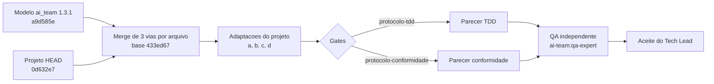

# Aplicar o protocolo atual (plugin ai-team 1.3.1)

## Identificacao

| Campo | Valor |
|---|---|
| Pedido | "apply current protocol in this project" (sincronizacao do modelo ai-team 1.0.9 para 1.3.1) |
| Porte | G - regra transversal do pacote (AGENTS.md de 51 para 53 regras, templates, scripts do protocolo, guardas de comando e autorizacao de sessao); `sh scripts/porte.sh` mede G (protocolo comum, templates, scripts do protocolo, `*guard*`; 6166 linhas) |
| Log de prompt | `docs/prompts/2026-11-11_1413_protocolo-atual-1-3-1.md` |
| Branch / base | `chore/protocolo-atual-1-3-1` sobre `origin/develop` @ `0d632e7` |
| Issues vinculadas | Nenhuma |
| Agents | Tech Lead (sincronizacao, adaptacoes do projeto, testes do Tech Lead); `ai-team:qa-expert` (validacao independente); `ai-team:documentation-writer` (este registro e os pareceres) |
| Data | 2026-11-11 |

## Contexto e objetivo

Sincronizar as copias locais do protocolo com o modelo `git@github.com:salesadriano/ai_team.git`, de `433ed675` (plugin 1.0.9) para `a9d585e` (plugin 1.3.1), sem perder as adaptacoes do projeto. A memoria de adocao do modelo passa a ser `2026-11-11-1413-adocao-modelo`, que substitui `2026-10-18-1715-adocao-modelo`.

Nao ha alteracao de codigo de produto. A entrega altera protocolo, templates, scripts do protocolo e documentacao de governanca.

## Decisao

Tres abordagens foram avaliadas.

| # | Abordagem | Trade-off | Situacao |
|---|---|---|---|
| 1 | Copia cega do modelo (`AGENTS.md`, templates, scripts e testes) | Rapida, mas apagaria as adaptacoes locais (poda de skills, `suite-completa.sh`, precedencia de funcao shell no inventario) e trairia `SKILLS_SYNC.md` | Descartada |
| 2 | Merge de 3 vias por arquivo, base `433ed67`, lado do modelo `a9d585e`, lado do projeto `HEAD`, preservando as adaptacoes | Mais trabalhoso; exige conferencia arquivo a arquivo e testes de regressao das adaptacoes | **Escolhida** |
| 3 | Atualizar so o `AGENTS.md` e manter os scripts atuais | Barata, mas deixaria guarda de comandos, resumo de estado e verificador defasados (versoes do modelo de 2026-10-18 e 2026-10-19) | Descartada |

Racional da escolha: a abordagem 2 e a unica que atualiza o protocolo inteiro e preserva as tres adaptacoes do projeto. A regra 39 (poda de skills) foi preservada, e `SKILL_HIERARCHY.md` e `SKILLS_SYNC.md` do projeto foram mantidos.

### Mudancas do protocolo

- `AGENTS.md`: de 51 para 53 regras. Regra 52 (ambiente de validacao humana) nao aplicavel: a CLI nao tem servico, declarado no `CLAUDE.md`. Regra 53 (Release Note) aplicavel, com registro em `docs/releases/<versao>.md`. Mudancas nas regras 45, 48 (reversao x autorizacao de sessao), 49, na tabela por porte e na tabela de stack.
- Caminhos `../skills/` convertidos para `ai-team:<skill>`, porque as skills vem do plugin.
- Templates: `README`, `inventario-de-testes` (coluna Condicao de execucao, camada meta), `registro-de-entrega-curto-template` (Regras 1 a 9 e 11; Contencao), `briefing` atualizados. Novo `release-note-template.md`. `casos-de-teste-e2e` nao trazido (projeto sem interface).
- Scripts trazidos ou atualizados: `guarda-de-comandos.sh` e `.awk` (leitura por palavra), `autorizacao-de-sessao.sh`, `resumo-de-estado.sh`, `verificar-instrucoes-do-projeto.sh` (aviso acima de 200 linhas), `auditar-casos.sh` (novo), `caminhos-confirmados.txt` (novo), `guarda-de-comandos.txt`, `inventario-de-testes.sh`.
- Bats: 21 atualizados e 15 novos. Nao trazidos: `qa-guarda-linha-so-com-espacos.bats` e `qa-guarda-por-palavra.bats` (leem commits do repositorio do pacote) e 2 casos de configuracao de `autorizacao-de-sessao.bats` (leem settings de exemplo e `hooks.json` do pacote).
- `.claude/settings.json`: bloco `permissions` completo do modelo (allow para git rotineiro, `gh pr create/edit/merge`, `gh run rerun`; deny para push com force). Decisao do solicitante: "Bloco completo do modelo".
- Skills do projeto: `SKILL.md` de `bats-testing-patterns`, `shellcheck-configuration`, `testing-strategy` e `use-case-specification` atualizados; `LICENSE` e `NOTICE` trazidos.
- `CLAUDE.md`: 53 regras, linhas das regras 52 e 53, linha de Hooks (agora do plugin), comando da auditoria.

### Adaptacoes do projeto preservadas

| Adaptacao | Descricao |
|---|---|
| (a) `inventario-de-testes.sh` | Nome da funcao shell no inicio da linha vale antes das strings. O modelo usa a precedencia inversa; issue `ai_team#60` fechada com outra precedencia. O caso do modelo `qa-inventario-funcao-shell.bats` ("aspas prevalecem") foi invertido para o comportamento do projeto. |
| (b) `auditar-casos.sh` (adaptador shell) | `_harness_falhar` reconhecido como assercao direta, com fronteira de palavra; remocao de braco de `case` e de prefixo `VAR=valor` antes de reconhecer a assercao. Bats do Tech Lead `auditar-casos-harness-do-projeto.bats` (7 casos; red contra o script do modelo: 4 `not ok`; green: 7 `ok`). |
| (c) `suite-completa-wrapper.bats` | Mantem o comentario do projeto. |
| (d) `auditar-casos.txt` | Escopo do projeto: `*.bats` como `bats` e `tests/*_test.sh` como `shell`. |

### Casos inertes da auditoria (decisao do solicitante: "Corrigir neste PR")

- Auditoria inicial: 37 bloqueantes.
- 36 falsos positivos do adaptador shell, resolvidos pela adaptacao (b).
- 1 achado real: `teste_qa_download_hash_divergente_registra_e_mantem_codigo` em `tests/integracao/qa_debug_transferencias_b12_test.sh`, que continha apenas `pular`. Caso removido; a verificacao equivalente esta coberta por `teste_tc_dbg_15_hash_divergente_aparece_antes_do_erro_11` (`tests/integracao/retomada_download_test.sh:817`). Declarado no commit: `Remocao-de-casos: tests/integracao/qa_debug_transferencias_b12_test.sh 1`.
- Resultado final: bloqueantes 0, maiores 0, avisos 12.

## Arquivos

Listagem por grupo, conforme o escopo acima. A lista consolidada de caminhos do commit final e produzida pelo Tech Lead a partir de `git status` antes do push.

- Protocolo: `.github/agents/AGENTS.md`, `.github/agents/templates/` (README, inventario, registro curto, briefing, `release-note-template.md`).
- Skills do projeto: `SKILL.md` de `bats-testing-patterns`, `shellcheck-configuration`, `testing-strategy`, `use-case-specification`; `LICENSE`, `NOTICE`; `SKILL_HIERARCHY.md` e `SKILLS_SYNC.md` mantidos.
- Scripts: `scripts/guarda-de-comandos.sh`, `scripts/guarda-de-comandos.awk`, `scripts/autorizacao-de-sessao.sh`, `scripts/resumo-de-estado.sh`, `scripts/verificar-instrucoes-do-projeto.sh`, `scripts/auditar-casos.sh` (novo), `scripts/caminhos-confirmados.txt` (novo), `scripts/guarda-de-comandos.txt`, `scripts/inventario-de-testes.sh`, `scripts/auditar-casos.txt`.
- Testes: 21 Bats atualizados e 15 novos em `scripts/tests/`, incluindo `qa-inventario-funcao-shell.bats` (invertido), `scripts/tests/qa-auditar-casos-harness-do-projeto.bats` (11 casos, do QA) e `auditar-casos-harness-do-projeto.bats` (7 casos, do Tech Lead).
- Testes de produto: `tests/integracao/qa_debug_transferencias_b12_test.sh` (caso inerte removido).
- Configuracao: `.claude/settings.json` (bloco `permissions`), `CLAUDE.md`.
- Documentacao: este registro, os dois pareceres, o log de prompt, a entrada de aceite na memoria.

Codigo de produto: nao alterado, exceto a remocao do caso inerte acima.

## Evidencias

Comandos e resultados executados nesta entrega.

| Verificacao | Comando | Resultado |
|---|---|---|
| Bats de scripts/tests e skills | Bats sobre `scripts/tests/` | 705/705 ok |
| Bats da auditoria (4 arquivos) | Bats sobre os arquivos da auditoria | 66/66 ok |
| Inventario de testes | `sh scripts/inventario-de-testes.sh --check` | 126 arquivos, 3055 casos, 0 divergencias |
| Indice de memoria | `sh scripts/memoria-index.sh --check` | 58 validas. Aviso conhecido: `2026-10-07-1256-stack` com agentes: todos |
| Lint e shellcheck | `scripts/lint.sh` e `shellcheck` | Limpos |
| Caso removido | `bash tests/run.sh qa_debug_transferencias_b12_test.sh` | APROVADA |
| Retomada de download | `tests/integracao/retomada_download_test.sh` (QA) | 32/32 |
| Alteracoes externas | `sh scripts/alteracoes-externas.sh --detectar` | 0 |
| Auditoria de casos | `sh scripts/auditar-casos.sh` | Bloqueantes 0, maiores 0, avisos 12 |

Suite completa local: `sh scripts/suite-completa.sh` (`bash tests/run.sh`) sobre `d734f3b`, arvore limpa: 126 arquivos, 3040 aprovados, 0 reprovados, 3 pulados, APROVADA, 3525 s, registrada em 2026-11-11T20:45:52Z (`--conferir` = 0).

## Gates

| Gate | Parecer | Veredito |
|---|---|---|
| `protocolo-tdd` | [parecer-tdd-protocolo-atual-1-3-1](2026-11-11-1413-parecer-tdd-protocolo-atual-1-3-1.md) | Aprovado |
| `protocolo-conformidade` | [parecer-conformidade-protocolo-atual-1-3-1](2026-11-11-1413-parecer-conformidade-protocolo-atual-1-3-1.md) | Aprovado |

## Diagrama (Mermaid)

## QA

- Validacao independente por `ai-team:qa-expert`: **Aprovado com ressalvas**.
- O QA escreveu `scripts/tests/qa-auditar-casos-harness-do-projeto.bats` (11 casos) tentando calar o caso inerte. Achado: `_harness_falhar_x` e `afirmarX` eram aceitos por falta de fronteira de palavra em `scripts/auditar-casos.sh:338`. Corrigido pelo Tech Lead; 11/11 verdes.
- Ressalva aceita: `VAR=$(cmd arg)` antes de assercao ainda gera falso positivo. O lado do erro e seguro (acusa a mais, nao deixa passar).
- O inventario cobre somente `tests/*_test.sh`; nao ha bloco de `.bats` no inventario.
- Sha256 dos testes aceitos:
  - `tests/integracao/qa_debug_transferencias_b12_test.sh`: `3edd64eb7e81b0ca49490de2031c9ff77b5a2afe1cfc37a826440efc9a458ec6`
  - `scripts/tests/qa-auditar-casos-harness-do-projeto.bats`: `c80c6c069331b3c784d9530bac764b180f739e6013f5fcc7efe9b80453a040f8`

## Riscos e rollback

| Risco | Mitigacao |
|---|---|
| Adaptacoes locais divergem do pacote (adaptacoes a e b) | Proposta ao pacote ai_team; a proxima sincronizacao precisa preserva-las |
| Permissoes liberam `gh pr merge` sem prompt | Decisao do solicitante ("Bloco completo do modelo"); deny para push com force mantido |
| Remocao do caso inerte pode esconder uma lacuna | Cobertura equivalente em `teste_tc_dbg_15_hash_divergente_aparece_antes_do_erro_11` (`tests/integracao/retomada_download_test.sh:817`) |

Rollback: `git revert` do commit da demanda.

## Aceites

- Solicitante: escopo "Bloco completo do modelo", casos inertes "Corrigir neste PR" (entrada `2026-11-11-1413-aceite-testes-qa-protocolo-1-3-1` e log de prompt).
- QA: **Aprovado com ressalvas** (secao QA).
- Tech Lead: **Aprovado, 2026-11-11**.

## Pendencias

- Propor ao pacote ai_team as adaptacoes (b) do `auditar-casos.sh`.
- Aviso de `memoria-index.sh --check` para `2026-10-07-1256-stack` (agentes: todos) fica para tratamento proprio.
- Suite completa local: verde (secao Evidencias). PR #109 para `develop`, mesclada em 2026-11-11 (`6a62cfc`); worktree removido por `limpar-worktrees.sh --executar`. Envio da branch e abertura da PR feitos pelo solicitante: o guarda do plugin avalia o checkout principal (`develop`) e nao o worktree.
